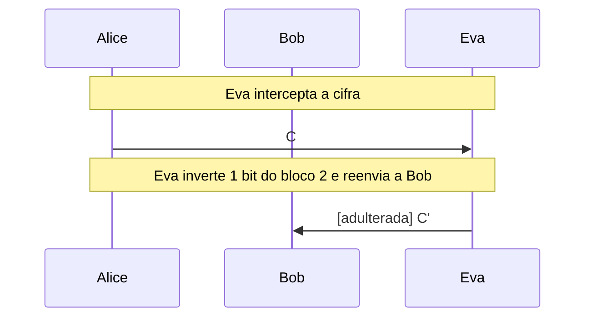
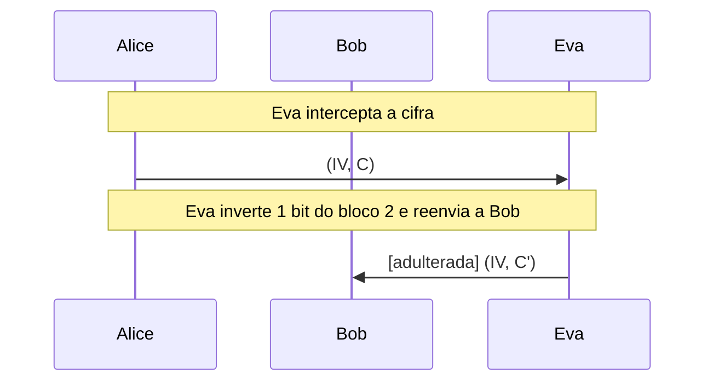
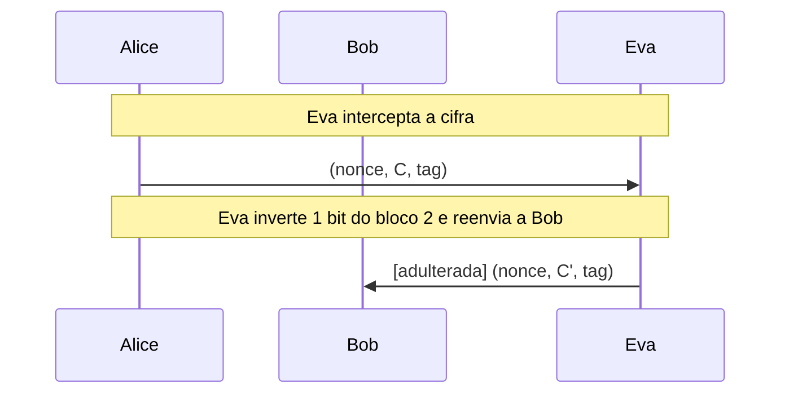

# AES e modos de operação

As rodadas do AES operação por operação e a comparação de ECB, CBC, CTR e GCM diante de Eva, que observa e altera a cifra.

- **Categoria:** Criptografia Simétrica
- **Abrir o laboratório:** <https://peotta.github.io/CryptoNet/#/lab/aes>
- **Motor:** didático (ECB, CBC e CTR) e real (GCM, pela Web Crypto)
- **Código-fonte:** `src/labs/aes/` (interface e fluxos) e `src/crypto/aes.ts` (operações)
- **Padrões e referências:** FIPS 197 (AES); NIST SP 800-38A (ECB, CBC e CTR) e SP 800-38D (GCM).

## 1. Objetivos de aprendizagem

- Descrever a estrutura do AES: bloco de 128 bits, chaves de 128, 192 e 256 bits, e as operações SubBytes, ShiftRows, MixColumns e AddRoundKey.
- Explicar confusão e difusão e identificar qual operação do AES contribui para cada propriedade.
- Diferenciar cifra de bloco de modo de operação, e justificar por que o modo importa tanto quanto o algoritmo.
- Observar o vazamento de padrões do ECB e a ausência dele em CBC, CTR e GCM.
- Mostrar o que um atacante (Eva) consegue fazer ao alterar bits da cifra em cada modo, sem conhecer a chave.
- Reconhecer o AES-GCM como criptografia autenticada (AEAD) e o papel do nonce.

## 2. Fundamentação

O AES opera em blocos de 16 bytes e repete rodadas de SubBytes, ShiftRows, MixColumns e AddRoundKey (10 rodadas com chave de 128 bits). O modo de operação define como os blocos se combinam: o ECB vaza padrões (blocos iguais geram cifras iguais), o CBC e o CTR os ocultam, mas só o GCM, um modo autenticado, detecta a adulteração por Eva.

## 3. Participantes

Alice e Bob são os participantes legítimos; Eva é a atacante (observadora passiva ou, quando há adulteração, ativa). As tabelas abaixo listam o que cada um mantém em cada cenário.

| Participante | Papel | Dados que pode guardar (tipo) |
| --- | --- | --- |
| Alice | Remetente | Chave K (segredo); Mensagem m (texto claro); IV ou nonce (parâmetro público); Cifra C (texto cifrado) |
| Bob | Destinatário | Chave K (segredo); Cifra recebida (texto cifrado); Resultado da decifragem (texto claro) |
| Eva | Atacante (observa e, se puder, altera o canal) | Cifra observada ou capturada (texto cifrado); Padrões nos blocos cifrados (parâmetro público); Cifra alterada C' (enviada a Bob) (texto cifrado); Chave K: desconhecida para Eva (segredo) |

## 4. Como ler os diagramas

Cada figura é um diagrama de sequência gerado a partir da mesma definição de protocolo que anima o laboratório: as colunas são os participantes, o tempo corre de cima para baixo e cada faixa horizontal é o início de uma etapa. Os valores numéricos e as chaves não aparecem aqui (são aleatórios ou dependem das entradas); eles são mostrados nas fórmulas do próprio laboratório.

- Seta cheia: mensagem enviada pelo canal, com o rótulo do que trafega.
- `[adulterada]` no início do rótulo: a mensagem foi alterada em trânsito por Eva.
- Faixa com texto: título da etapa que começa naquele ponto.

**Lista de figuras**

- [Figura 5.1.1](#511-ecb-com-eva-alterando-um-bloco): ECB com Eva alterando um bloco
- [Figura 5.1.2](#512-cbc-com-eva-alterando-um-bloco): CBC com Eva alterando um bloco
- [Figura 5.1.3](#513-ctr-com-eva-alterando-um-bloco): CTR com Eva alterando um bloco
- [Figura 5.1.4](#514-gcm-com-eva-alterando-um-bloco): GCM com Eva alterando um bloco

## 5. Cenários

### 5.1 Modos de operação

#### 5.1.1 ECB com Eva alterando um bloco

**Entradas usadas:** modo ECB, chave de 128 bits aleatória.

*Figura 5.1.1 (sequência).* ECB com Eva alterando um bloco: 2 mensagens (1 adulterada), entre Alice, Bob e Eva.

| Etapa | Título | Operação |
| --- | --- | --- |
| 1 | Alice e Bob compartilham a chave K | Nenhum cálculo: K já é conhecida por Alice e por Bob e nunca trafega. |
| 2 | Alice escreve a mensagem | Divisão da mensagem em blocos de 16 bytes. |
| 3 | Alice cifra com AES-128 no modo ECB | Cifragem AES-128-ECB. |
| 4 | Eva intercepta a cifra | Interceptação da cifra. |
| 5 | Eva inverte 1 bit do bloco 2 e reenvia a Bob | Inversão de 1 bit no bloco cifrado 2 e reenvio. |
| 6 | Bob recebe a cifra | Recepção da mensagem cifrada. |
| 7 | Bob decifra com a chave K | Decifragem AES-128-ECB. |
| 8 | A mensagem chega alterada, sem que Bob perceba | Comparação entre a mensagem enviada e a recuperada. |

**Veredito do cenário:** O bloco 2 foi decifrado como lixo e os demais permanecem íntegros. Bob não tem como perceber a adulteração: o ECB não autentica.

#### 5.1.2 CBC com Eva alterando um bloco

**Entradas usadas:** modo CBC, chave de 128 bits aleatória.

*Figura 5.1.2 (sequência).* CBC com Eva alterando um bloco: 2 mensagens (1 adulterada), entre Alice, Bob e Eva.

| Etapa | Título | Operação |
| --- | --- | --- |
| 1 | Alice e Bob compartilham a chave K | Nenhum cálculo: K já é conhecida por Alice e por Bob e nunca trafega. |
| 2 | Alice escreve a mensagem | Divisão da mensagem em blocos de 16 bytes. |
| 3 | Alice gera um IV aleatório | Sorteio do IV com gerador criptograficamente seguro. |
| 4 | Alice cifra com AES-128 no modo CBC | Cifragem AES-128-CBC. |
| 5 | Eva intercepta a cifra | Interceptação da cifra. |
| 6 | Eva inverte 1 bit do bloco 2 e reenvia a Bob | Inversão de 1 bit no bloco cifrado 2 e reenvio. |
| 7 | Bob recebe a cifra | Recepção da mensagem cifrada. |
| 8 | Bob decifra com a chave K | Decifragem AES-128-CBC. |
| 9 | A mensagem chega alterada, sem que Bob perceba | Comparação entre a mensagem enviada e a recuperada. |

**Veredito do cenário:** O bloco 2 virou lixo e o MESMO bit foi invertido no bloco 3: Eva controla a alteração do bloco seguinte (manipulação de bits). Bob não percebe, pois o CBC não autentica.

#### 5.1.3 CTR com Eva alterando um bloco

**Entradas usadas:** modo CTR, chave de 128 bits aleatória.

*Figura 5.1.3 (sequência).* CTR com Eva alterando um bloco: 2 mensagens (1 adulterada), entre Alice, Bob e Eva.

| Etapa | Título | Operação |
| --- | --- | --- |
| 1 | Alice e Bob compartilham a chave K | Nenhum cálculo: K já é conhecida por Alice e por Bob e nunca trafega. |
| 2 | Alice escreve a mensagem | Divisão da mensagem em blocos de 16 bytes. |
| 3 | Alice gera um nonce aleatório | Sorteio do nonce com gerador criptograficamente seguro. |
| 4 | Alice cifra com AES-128 no modo CTR | Cifragem AES-128-CTR. |
| 5 | Eva intercepta a cifra | Interceptação da cifra. |
| 6 | Eva inverte 1 bit do bloco 2 e reenvia a Bob | Inversão de 1 bit no bloco cifrado 2 e reenvio. |
| 7 | Bob recebe a cifra | Recepção da mensagem cifrada. |
| 8 | Bob decifra com a chave K | Decifragem AES-128-CTR. |
| 9 | A mensagem chega alterada, sem que Bob perceba | Comparação entre a mensagem enviada e a recuperada. |

**Veredito do cenário:** Exatamente o bit invertido por Eva mudou no texto claro: o CTR é maleável, e Eva altera a mensagem de forma controlada sem conhecer a chave. Bob não percebe.

#### 5.1.4 GCM com Eva alterando um bloco

**Entradas usadas:** modo GCM, chave de 128 bits aleatória.

*Figura 5.1.4 (sequência).* GCM com Eva alterando um bloco: 2 mensagens (1 adulterada), entre Alice, Bob e Eva.

| Etapa | Título | Operação |
| --- | --- | --- |
| 1 | Alice e Bob compartilham a chave K | Nenhum cálculo: K já é conhecida por Alice e por Bob e nunca trafega. |
| 2 | Alice escreve a mensagem | Divisão da mensagem em blocos de 16 bytes. |
| 3 | Alice gera um nonce aleatório | Sorteio do nonce com gerador criptograficamente seguro. |
| 4 | Alice cifra com AES-128 no modo GCM | Cifragem AES-128-GCM. |
| 5 | Eva intercepta a cifra | Interceptação da cifra. |
| 6 | Eva inverte 1 bit do bloco 2 e reenvia a Bob | Inversão de 1 bit no bloco cifrado 2 e reenvio. |
| 7 | Bob recebe a cifra | Recepção da mensagem cifrada. |
| 8 | Bob verifica a etiqueta e decifra | Verificação da etiqueta e decifragem AES-GCM. |
| 9 | A mensagem é rejeitada | Comparação entre a mensagem enviada e a recuperada. |

**Veredito do cenário:** Etiqueta de autenticação inválida: Bob rejeita a mensagem inteira. O GCM detecta qualquer adulteração da cifra.

## 6. Perguntas de fixação

1. Por que o AES, sozinho, não define como cifrar uma mensagem maior que 16 bytes?

   **Resposta.** O AES é uma cifra de bloco: transforma um bloco de 128 bits em outro, sob uma chave. Para mensagens maiores é preciso um modo de operação (ECB, CBC, CTR, GCM...) que defina como os blocos são encadeados, e essa escolha determina propriedades como vazamento de padrões e proteção de integridade.

2. Por que o ECB é considerado inseguro mesmo com o AES-256?

   **Resposta.** Porque cifra cada bloco de forma independente e determinística: blocos iguais geram cifras iguais. Quem observa a cifra vê a estrutura do texto claro (como o contorno de uma imagem), sem precisar da chave. A fraqueza está no modo, não no AES.

3. Eva inverte um bit do bloco 2 da cifra em CBC. O que acontece com os blocos 2 e 3 de texto claro?

   **Resposta.** O bloco 2 é decifrado como um valor aleatório (corrompido), e o mesmo bit é invertido no bloco 3, porque o texto claro do bloco 3 é o XOR da saída do AES com o bloco cifrado 2. Eva controla a alteração do bloco 3, e Bob não percebe, pois o CBC não autentica.

4. Por que reutilizar o nonce no CTR ou no GCM com a mesma chave é uma falha grave?

   **Resposta.** O fluxo de chaves seria idêntico nas duas mensagens: o XOR das duas cifras é igual ao XOR dos dois textos claros, o que permite análises e, com texto conhecido, a recuperação de uma das mensagens. No GCM, a repetição do nonce também compromete a chave de autenticação (GHASH).

5. O que o GCM oferece além da confidencialidade, e como Bob percebe uma adulteração?

   **Resposta.** Integridade e autenticidade (criptografia autenticada com dados associados, AEAD). A cifra vem acompanhada de uma etiqueta de 128 bits calculada com a chave; Bob a recalcula e, se não conferir, a operação falha e nenhuma mensagem é entregue. Eva não consegue produzir uma etiqueta válida sem a chave.

6. O IV do CBC precisa ser secreto? E precisa ser imprevisível?

   **Resposta.** Não precisa ser secreto (trafega junto com a cifra), mas deve ser imprevisível e aleatório a cada mensagem. IVs previsíveis permitem ataques, como o BEAST contra o TLS 1.0. Já o nonce de CTR e GCM precisa apenas ser único para cada chave.

## 7. Limitações e cuidados

- A implementação didática (ECB, CBC e CTR) não é resistente a ataques de canal lateral nem deve ser usada em produção.
- Não há preenchimento: a mensagem é completada com espaços até múltiplo de 16 bytes.
- Uso exclusivamente didático: os laboratórios não devem proteger dados reais.

---

*CryptoNet é um projeto mantido pelo Prof. Dr. Laerte Peotta de Melo, com apoio de IA generativa no processo de desenvolvimento, com sua estrita supervisão, revisão técnica e responsabilidade. Uso exclusivo para fins de ensino e pesquisa. Universidade de Brasília (UnB) - Departamento de Engenharia Elétrica. Código aberto (licença MIT).*
