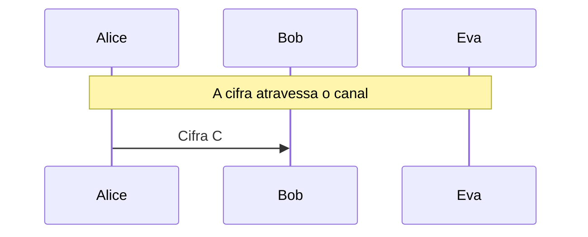
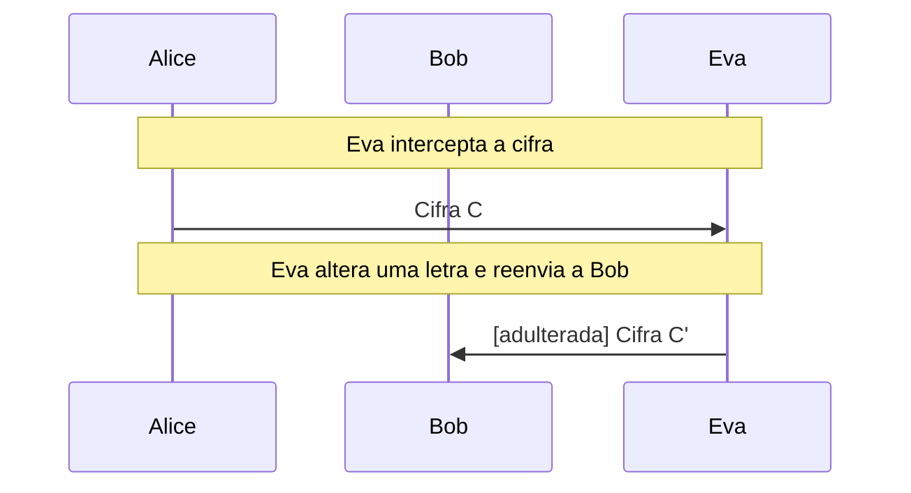

# Cifras de César e afim

Disco de cifra, aritmética modular e a criptoanálise de Eva por força bruta e frequência das letras.

- **Categoria:** Criptografia Clássica
- **Abrir o laboratório:** <https://peotta.github.io/CryptoNet/#/lab/cesar-afim>
- **Motor:** didático (aritmética modular)
- **Código-fonte:** `src/labs/classica/` (interface e fluxos) e `src/crypto/classical.ts` (operações)
- **Padrões e referências:** Livro de referência: Stallings, *Cryptography and Network Security*, cap. 3 (cifras clássicas).

## 1. Objetivos de aprendizagem

- Cifrar e decifrar com a cifra de César e com a cifra afim, e escrever as fórmulas em aritmética modular (módulo 26).
- Explicar por que a cifra afim exige mdc(a, 26) = 1 e calcular o inverso multiplicativo de a.
- Calcular o tamanho do espaço de chaves de cada cifra (26 e 312) e relacioná-lo à força bruta.
- Usar a análise de frequência das letras e a estatística χ² para quebrar uma cifra de substituição.
- Reconhecer o princípio de Kerckhoffs e por que as cifras clássicas não oferecem integridade nem segurança.

## 2. Fundamentação

As cifras de César e afim substituem cada letra por outra por meio de uma função módulo 26 (C = a·P + b mod 26; no César, a = 1). O espaço de chaves é minúsculo (26 chaves no César, 312 no afim), e a distribuição das letras do português continua visível no texto cifrado. Eva quebra a cifra por força bruta e confirma a chave pela frequência das letras (teste χ²).

## 3. Participantes

Alice e Bob são os participantes legítimos; Eva é a atacante (observadora passiva ou, quando há adulteração, ativa). As tabelas abaixo listam o que cada um mantém em cada cenário.

| Participante | Papel | Dados que pode guardar (tipo) |
| --- | --- | --- |
| Alice | Remetente | Chave K (segredo); Mensagem m (texto claro); Cifra C (texto cifrado) |
| Bob | Destinatário | Chave K (segredo); Cifra recebida (texto cifrado); Mensagem recuperada (texto claro) |
| Eva | Criptoanalista (observa e, se puder, altera o canal) | Cifra observada ou capturada (texto cifrado); Chave deduzida por Eva (segredo); Texto claro deduzido por Eva (texto claro); Cifra alterada C' (enviada a Bob) (texto cifrado) |

## 4. Como ler os diagramas

Cada figura é um diagrama de sequência gerado a partir da mesma definição de protocolo que anima o laboratório: as colunas são os participantes, o tempo corre de cima para baixo e cada faixa horizontal é o início de uma etapa. Os valores numéricos e as chaves não aparecem aqui (são aleatórios ou dependem das entradas); eles são mostrados nas fórmulas do próprio laboratório.

- Seta cheia: mensagem enviada pelo canal, com o rótulo do que trafega.
- `[adulterada]` no início do rótulo: a mensagem foi alterada em trânsito por Eva.
- Faixa com texto: título da etapa que começa naquele ponto.

**Lista de figuras**

- [Figura 5.1.1](#511-césar-sem-adulteração): César sem adulteração
- [Figura 5.1.2](#512-afim-com-eva-alterando-o-texto-cifrado): Afim com Eva alterando o texto cifrado

## 5. Cenários

### 5.1 Alice, Bob e Eva

#### 5.1.1 César sem adulteração

**Entradas usadas:** cifra César, deslocamento 3.

*Figura 5.1.1 (sequência).* César sem adulteração: 1 mensagem, entre Alice, Bob e Eva.

| Etapa | Título | Operação |
| --- | --- | --- |
| 1 | Alice e Bob combinam a chave | Nenhum cálculo: a chave já é conhecida por Alice e por Bob. |
| 2 | Alice escreve a mensagem | Normalização e codificação das letras como números de 0 a 25. |
| 3 | Alice cifra com a cifra César | Cifragem César de 388 letras. |
| 4 | A cifra atravessa o canal | Transmissão da cifra pelo canal público. |
| 5 | Eva tenta todas as 26 chaves (força bruta) | Decifragem com as 26 chaves e escolha do menor χ². |
| 6 | Bob recebe a cifra | Recepção da mensagem cifrada. |
| 7 | Bob decifra com a chave K | Decifragem César. |
| 8 | A cifra foi quebrada por Eva | Avaliação do resultado. |

**Veredito do cenário:** Eva deduziu a chave (k = 3) apenas com o texto cifrado e a frequência das letras, e leu a mensagem. A cifra não oferece segurança.

#### 5.1.2 Afim com Eva alterando o texto cifrado

**Entradas usadas:** cifra afim, a = 5 e b = 8; Eva troca uma letra.

*Figura 5.1.2 (sequência).* Afim com Eva alterando o texto cifrado: 2 mensagens (1 adulterada), entre Alice, Bob e Eva.

| Etapa | Título | Operação |
| --- | --- | --- |
| 1 | Alice e Bob combinam a chave | Nenhum cálculo: a chave já é conhecida por Alice e por Bob. |
| 2 | Alice escreve a mensagem | Normalização e codificação das letras como números de 0 a 25. |
| 3 | Alice cifra com a cifra afim | Cifragem afim de 388 letras. |
| 4 | Eva intercepta a cifra | Interceptação da cifra. |
| 5 | Eva tenta todas as 312 chaves (força bruta) | Decifragem com as 312 chaves e escolha do menor χ². |
| 6 | Eva altera uma letra e reenvia a Bob | Alteração da letra 195 e reenvio. |
| 7 | Bob recebe a cifra | Recepção da mensagem cifrada. |
| 8 | Bob decifra com a chave K | Decifragem afim. |
| 9 | A cifra foi quebrada por Eva | Avaliação do resultado. |

**Veredito do cenário:** Eva deduziu a chave (a = 5, b = 8) apenas com o texto cifrado e a frequência das letras, e leu a mensagem. Além disso, Bob decifrou a mensagem alterada sem perceber: a cifra não tem integridade. A cifra não oferece segurança.

## 6. Perguntas de fixação

1. Cifre "ATAQUE" com a cifra de César e k = 3. Qual é a decifragem de "DWDTXH"?

   **Resposta.** A → D, T → W, A → D, Q → T, U → X e E → H, logo "ATAQUE" vira "DWDTXH". Decifrar é deslocar 3 posições para trás, o que devolve "ATAQUE".

2. Por que a cifra afim C = (a·P + b) mod 26 não aceita a = 2 nem a = 13?

   **Resposta.** Porque mdc(a, 26) precisa ser 1 para que a multiplicação tenha inverso módulo 26. Com a = 2, duas letras diferentes (por exemplo, A e N) viram a mesma letra cifrada, e a decifragem passa a ser ambígua. Há 12 valores válidos de a (1, 3, 5, 7, 9, 11, 15, 17, 19, 21, 23 e 25).

3. Quantas chaves tem a cifra afim? É seguro?

   **Resposta.** 12 valores de a e 26 de b: 312 chaves. Não é seguro: Eva testa as 312 em milissegundos e escolhe a que dá o texto mais parecido com português. Com duas letras claras conhecidas, ela resolve um sistema de duas equações e descobre a e b.

4. Por que a análise de frequência funciona contra o César e a cifra afim?

   **Resposta.** Porque cada letra do texto claro sempre vira a mesma letra cifrada: a cifra apenas permuta as letras. As frequências do português (A, E e O muito comuns; K, W e Y raras) sobrevivem, só trocadas de posição. O histograma da cifra é o do português reordenado.

5. Eva altera uma letra da cifra. Bob percebe?

   **Resposta.** Não. Cifras clássicas não têm nenhum mecanismo de integridade: Bob decifra a letra alterada e obtém outra letra no texto claro, sem nenhum aviso. Isso reaparece nos modos CBC e CTR do AES, e só o GCM, com a etiqueta de autenticação, detecta a alteração.

6. O que diz o princípio de Kerckhoffs, e como ele se aplica a estas cifras?

   **Resposta.** A segurança de um sistema deve depender somente do sigilo da chave, e não do sigilo do algoritmo. Eva conhece o algoritmo (César ou afim), e o que protege a mensagem seria apenas a chave, mas o espaço de chaves é tão pequeno que a proteção desaparece.

## 7. Limitações e cuidados

- Cifras históricas: não oferecem segurança alguma.
- O alfabeto é o de 26 letras sem acentos; o texto é normalizado (maiúsculas, sem acentos nem pontuação).
- Uso exclusivamente didático: os laboratórios não devem proteger dados reais.

---

*CryptoNet é um projeto mantido pelo Prof. Dr. Laerte Peotta de Melo, com apoio de IA generativa no processo de desenvolvimento, com sua estrita supervisão, revisão técnica e responsabilidade. Uso exclusivo para fins de ensino e pesquisa. Universidade de Brasília (UnB) - Departamento de Engenharia Elétrica. Código aberto (licença MIT).*
