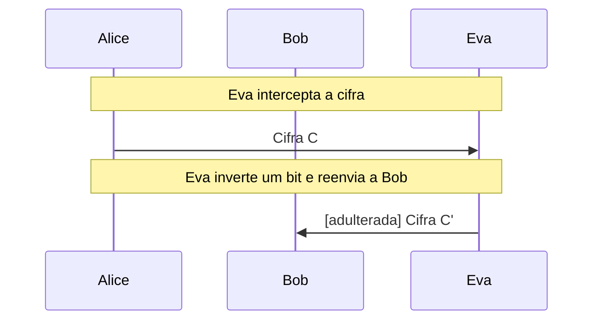
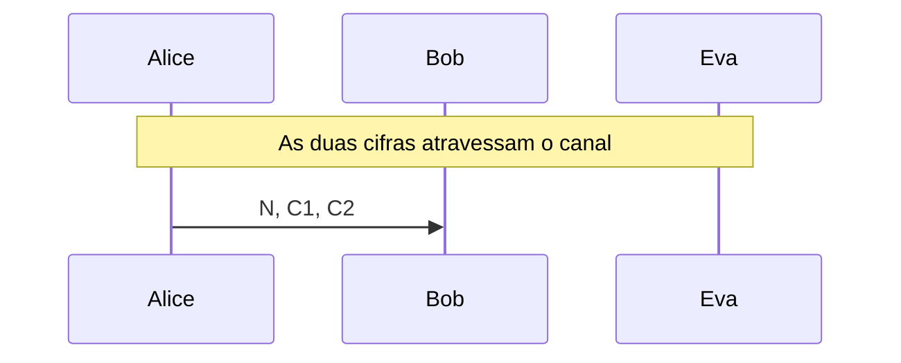

# ChaCha20

Cifra de fluxo ARX ([RFC 8439](https://www.rfc-editor.org/rfc/rfc8439)): quarter round e bloco operação por operação, nonce reutilizado e maleabilidade diante de Eva.

- **Categoria:** Criptografia Simétrica
- **Abrir o laboratório:** <https://peotta.github.io/CryptoNet/#/lab/chacha20>
- **Motor:** didático (ChaCha20 sem Poly1305)
- **Código-fonte:** `src/labs/chacha20/` (interface e fluxos) e `src/crypto/chacha20.ts` (operações)
- **Padrões e referências:** [RFC 8439](https://www.rfc-editor.org/rfc/rfc8439) (ChaCha20 e Poly1305 para protocolos IETF); O ChaCha20 não é um algoritmo aprovado pelo NIST (não consta em nenhuma FIPS nem SP): a referência normativa é a [RFC 8439](https://www.rfc-editor.org/rfc/rfc8439).

## 1. Objetivos de aprendizagem

- Descrever uma cifra de fluxo: um fluxo de chaves pseudoaleatório gerado de uma chave curta e combinado com a mensagem por XOR.
- Executar o quarter round (12 operações ARX) e a função de bloco do ChaCha20 (20 rodadas e soma final), conferidos com a [RFC 8439](https://www.rfc-editor.org/rfc/rfc8439).
- Explicar a função da chave de 256 bits, do nonce de 96 bits e do contador de 32 bits.
- Mostrar por que reutilizar o par (chave, nonce) é catastrófico: C1 ⊕ C2 = m1 ⊕ m2, e o arrasto de texto provável de Eva.
- Demonstrar a maleabilidade: sem autenticação, Eva altera bits da mensagem sem conhecer a chave.
- Comparar com o one-time pad (fluxo realmente aleatório) e com o AES-CTR, e situar o ChaCha20-Poly1305 no TLS 1.3.

## 2. Fundamentação

O ChaCha20 é uma cifra de fluxo ARX (soma módulo 2³², rotação e XOR): o bloco de 64 bytes é calculado em 20 rodadas sobre um estado com constantes, chave de 256 bits, contador e nonce de 96 bits, e o fluxo de chaves é combinado com a mensagem por XOR. Repetir o par (chave, nonce) permite a Eva obter m1 ⊕ m2, e sem autenticação ela inverte bits do claro sem conhecer a chave.

## 3. Participantes

Alice e Bob são os participantes legítimos; Eva é a atacante (observadora passiva ou, quando há adulteração, ativa). As tabelas abaixo listam o que cada um mantém em cada cenário.

| Participante | Papel | Dados que pode guardar (tipo) |
| --- | --- | --- |
| Alice | Remetente | Chave K (256 bits) (segredo); Nonce N (96 bits) (parâmetro público); Mensagem m (texto claro); Fluxo de chaves (segredo); Cifra C (texto cifrado) |
| Bob | Destinatário | Chave K (256 bits) (segredo); Nonce N (96 bits) (parâmetro público); Cifra recebida (texto cifrado); Fluxo de chaves (segredo); Mensagem recuperada (texto claro) |
| Eva | Atacante (observa e, se puder, altera o canal) | Cifra observada ou capturada (texto cifrado); C1 ⊕ C2 (= m1 ⊕ m2) (parâmetro público); Trecho deduzido por Eva (texto claro); Cifra alterada C' (enviada a Bob) (texto cifrado) |

## 4. Como ler os diagramas

Cada figura é um diagrama de sequência gerado a partir da mesma definição de protocolo que anima o laboratório: as colunas são os participantes, o tempo corre de cima para baixo e cada faixa horizontal é o início de uma etapa. Os valores numéricos e as chaves não aparecem aqui (são aleatórios ou dependem das entradas); eles são mostrados nas fórmulas do próprio laboratório.

- Seta cheia: mensagem enviada pelo canal, com o rótulo do que trafega.
- `[adulterada]` no início do rótulo: a mensagem foi alterada em trânsito por Eva.
- Faixa com texto: título da etapa que começa naquele ponto.

**Lista de figuras**

- [Figura 5.1.1](#511-eva-observa-e-altera-um-byte): Eva observa e altera um byte
- [Figura 5.2.1](#521-arrasto-de-texto-provável): Arrasto de texto provável

## 5. Cenários

### 5.1 Uso correto

#### 5.1.1 Eva observa e altera um byte

**Entradas usadas:** chave e nonce aleatórios.

*Figura 5.1.1 (sequência).* Eva observa e altera um byte: 2 mensagens (1 adulterada), entre Alice, Bob e Eva.

| Etapa | Título | Operação |
| --- | --- | --- |
| 1 | Alice e Bob compartilham a chave | Nenhum cálculo: a chave já é conhecida por Alice e por Bob. |
| 2 | Alice escolhe um nonce novo | Escolha de um nonce de 96 bits. |
| 3 | Alice escreve a mensagem | Codificação UTF-8 da mensagem. |
| 4 | Alice gera o fluxo de chaves | Geração de 25 bytes de fluxo de chaves. |
| 5 | Alice faz o XOR da mensagem com o fluxo | XOR byte a byte: C = m ⊕ KS. |
| 6 | Eva intercepta a cifra | Interceptação da cifra. |
| 7 | Eva inverte um bit e reenvia a Bob | XOR de 0x01 no byte 10 da cifra. |
| 8 | Bob recebe a cifra e o nonce | Recepção da cifra e do nonce. |
| 9 | Bob gera o mesmo fluxo de chaves | Geração do fluxo de chaves. |
| 10 | Bob faz o XOR da cifra com o fluxo | XOR byte a byte: m = C ⊕ KS. |
| 11 | Bob aceita uma mensagem alterada | Avaliação do resultado. |

**Veredito do cenário:** Eva inverteu um bit do byte 10 da cifra, sem conhecer a chave, e Bob decifrou a mensagem com exatamente esse bit invertido (1 byte alterado), sem perceber. O ChaCha20 sozinho não autentica: é preciso um código de autenticação (Poly1305, no ChaCha20-Poly1305).

### 5.2 Nonce reutilizado

#### 5.2.1 Arrasto de texto provável

**Entradas usadas:** mesma chave e mesmo nonce, texto provável AMANHECER.

*Figura 5.2.1 (sequência).* Arrasto de texto provável: 1 mensagem, entre Alice, Bob e Eva.

| Etapa | Título | Operação |
| --- | --- | --- |
| 1 | Alice e Bob compartilham a chave | Nenhum cálculo: a chave já é conhecida por Alice e por Bob. |
| 2 | Alice usa o mesmo nonce nas duas mensagens (erro) | Reutilização do nonce. |
| 3 | Alice cifra a mensagem 1 | XOR da mensagem 1 com o fluxo de chaves. |
| 4 | Alice cifra a mensagem 2 com o mesmo fluxo | XOR da mensagem 2 com o mesmo fluxo de chaves. |
| 5 | As duas cifras atravessam o canal | Transmissão das duas cifras. |
| 6 | Eva faz o XOR das duas cifras | XOR de C1 com C2 (o fluxo de chaves cancela). |
| 7 | Eva arrasta um texto provável | XOR do texto provável com X em cada posição (arrasto). |
| 8 | Bob decifra normalmente | Decifragem das duas mensagens. |
| 9 | A reutilização do nonce destruiu o sigilo | Avaliação do resultado. |

**Veredito do cenário:** O texto provável "AMANHECER" aparece na mensagem 1 a partir do byte 19, e o mesmo trecho da mensagem 2 sai legível: "ESTA AO A". Eva obteve ainda 9 bytes do fluxo de chaves (C ⊕ texto provável), com os quais pode estender o ataque. Nenhuma chave foi descoberta, mas a reutilização do nonce destruiu o sigilo.

## 6. Perguntas de fixação

1. O que significa ARX e por que o ChaCha20 usa apenas essas operações?

   **Resposta.** ARX são as iniciais de Add (soma módulo 2³²), Rotate (rotação de bits) e XOR. Juntas são não lineares o bastante para misturar bem os bits e rodam em tempo constante em qualquer processador, sem tabelas de consulta. Por isso o ChaCha20 é rápido em software e resiste a ataques de tempo de acesso ao cache, ao contrário de implementações do AES baseadas em S-boxes sem instruções dedicadas.

2. Como o ChaCha20 transforma uma chave de 32 bytes em um fluxo de chaves longo?

   **Resposta.** Para cada contador i, monta-se um estado de 16 palavras (4 constantes, 8 da chave, o contador e 3 do nonce), aplica-se a função de bloco (20 rodadas) e soma-se o resultado ao estado inicial, obtendo 64 bytes. Com i = 1, 2, 3, ... os blocos são concatenados. A mensagem é combinada com esse fluxo por XOR, e a decifragem é a mesma operação.

3. Por que o nonce não pode se repetir com a mesma chave?

   **Resposta.** Porque o fluxo de chaves depende só de (chave, nonce, contador). Com o nonce repetido, duas mensagens usam o mesmo fluxo: C1 ⊕ C2 = (m1 ⊕ KS) ⊕ (m2 ⊕ KS) = m1 ⊕ m2. A chave se cancela, e Eva, com um trecho provável de uma das mensagens, lê o trecho correspondente da outra e recupera parte do fluxo de chaves. É o mesmo problema do one-time pad reutilizado.

4. O ChaCha20 sozinho protege a integridade da mensagem?

   **Resposta.** Não. Como C = m ⊕ KS, inverter um bit da cifra inverte exatamente o mesmo bit do texto claro, sem que Eva conheça a chave, e Bob não percebe. Por isso o ChaCha20 é combinado com o Poly1305 (código de autenticação) no ChaCha20-Poly1305 ([RFC 8439](https://www.rfc-editor.org/rfc/rfc8439)), um AEAD usado no TLS 1.3 e no WireGuard.

5. Qual a diferença entre o one-time pad e o ChaCha20?

   **Resposta.** No one-time pad a chave é aleatória, tão longa quanto a mensagem e de uso único: o sigilo é perfeito (Shannon). No ChaCha20 o fluxo é pseudoaleatório, gerado de uma chave de 256 bits: a segurança é computacional, e depende de ninguém conseguir distinguir o fluxo de uma sequência aleatória em tempo viável. Em troca, a chave é curta e reutilizável (com nonces diferentes).

6. Quantas mensagens de 64 bytes cabem em um mesmo nonce e quanto tempo dura uma chave?

   **Resposta.** O contador tem 32 bits, então um par (chave, nonce) cifra até 2³² blocos de 64 bytes, cerca de 256 GiB. Com nonces de 96 bits e escolhidos sem repetição (um contador de mensagens, por exemplo), a mesma chave pode proteger muito tráfego. Se os nonces forem sorteados ao acaso, a probabilidade de colisão limita a quantidade de mensagens por chave (paradoxo do aniversário), motivo para existir a variante XChaCha20 com nonce de 192 bits.

## 7. Limitações e cuidados

- O laboratório usa só o ChaCha20, sem o Poly1305: por isso a cifra não autentica (o ChaCha20-Poly1305 é o AEAD usado no TLS 1.3).
- A mensagem é limitada a 120 bytes.
- Uso exclusivamente didático: os laboratórios não devem proteger dados reais.

---

*CryptoNet é um projeto mantido pelo Prof. Dr. Laerte Peotta de Melo, com apoio de IA generativa no processo de desenvolvimento, com sua estrita supervisão, revisão técnica e responsabilidade. Uso exclusivo para fins de ensino e pesquisa. Universidade de Brasília (UnB) - Departamento de Engenharia Elétrica. Código aberto (licença MIT).*
