# DAP: autorização visual de transações

Segundo fator fora de banda por QR code: chave em duas metades, desafio com AES-256-CBC e HMAC-SHA-256, tela confiável do celular (WYSIWYS) e os ataques de Eva ao computador não confiável.

- **Categoria:** DAP: Autorização de Transações
- **Abrir o laboratório:** <https://peotta.github.io/CryptoNet/#/lab/dap>
- **Motor:** real (Web Crypto: HMAC-SHA-512, HMAC-SHA-256, SHA-256 e AES-256-CBC), com QR code desenhado na tela
- **Código-fonte:** `src/labs/dap/` (interface e fluxos) e `src/crypto/dap.ts` (operações)
- **Padrões e referências:** Melo, L. P. de. *DAP (Dynamic Authorization Protocol): Secure Approach Out-of-Band for E-Bank with a Two-Factor Visual Authentication*. Tese de doutorado, Universidade de Brasília, 2012; Melo, L. P. de et al. *A Secure Approach Out-of-Band for e-Bank with Visual Two-Factor Authorization Protocol*. Cryptography, v. 8, n. 4, art. 51, 2024. DOI 10.3390/cryptography8040051; draft-melo-dap-visual-oob-auth-00 (Internet-Draft, trabalho em andamento, sem número de RFC); [RFC 2104](https://www.rfc-editor.org/rfc/rfc2104) (HMAC); [RFC 6234](https://www.rfc-editor.org/rfc/rfc6234) (SHA-2); [RFC 4648](https://www.rfc-editor.org/rfc/rfc4648) (Base64); [FIPS 197](https://csrc.nist.gov/pubs/fips/197/final) (AES); [SP 800-38A](https://csrc.nist.gov/pubs/sp/800/38/a/final) (modo CBC); ISO/IEC 18004 (QR code).

## 1. Objetivos de aprendizagem

- Explicar por que um computador não confiável (UC) não pode ser o único canal de autorização de uma transação, e como o DAP usa um canal óptico fora de banda com o celular (MD).
- Acompanhar o provisionamento da chave k por duas metades, k = k1 ⊕ k2, em dois canais separados, e a ativação com o código de transação 000.
- Montar e verificar o desafio trans_data | r' | y: cifragem do código r com AES-256-CBC e autenticação do conjunto com HMAC-SHA-256.
- Aplicar o princípio "o que você vê é o que você assina" (WYSIWYS): a tela do MD mostra os dados autenticados, e o usuário confere.
- Reconhecer como o DAP reage a Eva: alteração do QR, pedido trocado por malware, chute do código, repetição do código e metade da chave trocada.
- Identificar os limites do protocolo: a independência das metades da chave, o relógio do MD e o usuário que confirma uma transação fraudulenta.

## 2. Fundamentação

O **DAP** (*Dynamic Authorization Protocol*) é um protocolo de **autorização de transações fora de banda**, proposto na **tese de doutorado do Prof. Dr. Laerte Peotta de Melo** ([ORCID](https://orcid.org/0000-0002-2075-6601); Universidade de Brasília, 2012) e desenvolvido posteriormente em artigo científico e em um *Internet-Draft* do IETF. Destina-se a servir de **segundo fator de autenticação e autorização em transações financeiras realizadas em computadores não confiáveis**, como as do Internet banking: transferências, pagamento de boletos, alterações cadastrais ou qualquer transação que se queira proteger.

**Pesquisadores colaboradores.** Participaram da pesquisa que originou o protocolo, como colaboradores, [**Dino Macedo Amaral**](https://orcid.org/0000-0002-8023-1057), [**João José Costa Gondim**](https://orcid.org/0000-0002-5873-7502), [**Robson de Oliveira Albuquerque**](https://orcid.org/0000-0002-6717-3374) e [**Fábio Lúcio Lopes de Mendonça**](https://orcid.org/0000-0001-7100-7304).

**O problema tratado.** São a **captura e o uso de credenciais** (*login*, senha e impressão digital do aparelho), por *phishing* ou por programa malicioso, inclusive o que atua no navegador (*Man-in-the-Browser*) e, depois do *login*, substitui a conta ou o valor e exibe ao usuário uma tela falsa. Senhas, códigos enviados por mensagem (SMS) e senhas de uso único (HOTP e TOTP) não dependem do conteúdo da transação e, por isso, permanecem válidos para a transação adulterada.

**O código de seis dígitos.** Ele não é um HOTP nem um TOTP: não deriva de contador nem de relógio, e sim de um **valor aleatório sorteado pelo e-Bank para cada transação** e protegido junto com os dados dela. Cada código **vale somente para aquela transação** e **não pode ser aproveitado para outra**, nem mesmo para outra de mesmo destinatário e valor. Ele só é revelado no celular do usuário depois que este confere, em uma tela independente do computador, o destinatário e o valor. Dessa forma, **o usuário autoriza o que vê** (*What You See Is What You Sign*, WYSIWYS), e **um atacante não é capaz de alterar a mensagem que está sendo autorizada**: os dados da transação são protegidos por uma **etiqueta HMAC**, e qualquer alteração faz o celular rejeitar o desafio antes de exibir a transação ou de revelar o código.

**Autenticação e autorização.** O **DAP** autentica o desafio, pois somente quem possui a chave produz uma etiqueta HMAC válida, e autoriza cada operação por meio de um código associado a ela. Consequentemente, ainda que as credenciais do usuário (*login*, senha e impressão digital do aparelho) sejam capturadas por *phishing* ou por programa malicioso, o atacante **não consegue autorizar uma transação**: sem a **chave k**, que permanece no celular, ele não forja um desafio aceito pelo aparelho nem decifra o código. Essa garantia vale no **modelo de adversário** do *draft*, que supõe o celular fora do controle do atacante.

**Resistência à engenharia social.** O protocolo aumenta essa resistência porque o **usuário não tem acesso à chave**. Armazenada de forma segura no celular de confiança e **não exportável**, ela não pode ser copiada, visualizada nem incluída em cópias de segurança, e o próprio usuário nunca a conhece. Assim, diferentemente de uma senha, que pode ser revelada por engano, a chave não pode ser entregue ao atacante. Resta ao adversário tentar convencer o usuário a confirmar uma transação fraudulenta ou a informar o código exibido no celular, risco que a conferência na tela do aparelho reduz, mas não elimina.

**Funcionamento em cada transação.** O e-Bank gera o desafio `trans_data | r' | y`, com o código r cifrado em **AES-256-CBC** e a etiqueta **HMAC-SHA-256**, e o apresenta como **QR Code** no computador não confiável (UC). O celular de confiança (MD), que dispensa conexão de rede, lê o QR, verifica a etiqueta, exibe a transação em tela própria e, somente após a confirmação do usuário, revela o código, que o e-Bank confere em até **120 s** e **3 tentativas**. A proteção apoia-se ainda em HMAC-SHA-512, que deriva uma das metades da chave no módulo de segurança de hardware (HSM) do e-Bank, e na divisão da chave em duas metades pela operação ⊕ (OU exclusivo).

**Provisionamento da chave.** A chave k, de 512 bits, chega ao MD em **duas metades por canais separados** (**k = k1 ⊕ k2**) e é ativada com o código 000. Alice é a usuária com o MD, Bob é o e-Bank com o HSM e Eva é o UC, que controla o canal da Internet.

**Partes do laboratório.** A Parte A cobre o provisionamento da chave, inclusive a troca de k1 por Eva e a observação do ATM; a Parte B cobre a ativação do dispositivo, que confirma que as duas pontas têm a mesma chave; a Parte C cobre a transação e os ataques de Eva: alteração do QR, pedido trocado por malware (MITB), chute do código e repetição do código.

**Artigos originais.**

- Melo, L. P. de. *DAP (Dynamic Authorization Protocol): Uma Abordagem Segura Out-of-Band para E-Bank com um Segundo Fator de Autenticação Visual*. Tese (Doutorado em Engenharia Elétrica), Universidade de Brasília, 2012. [Acessar a tese (PDF, repositório da UnB)](https://repositorioantigo.bce.unb.br/bitstream/10482/12963/1/2012_LaertePeottadeMelo.pdf).
- Melo, L. P. de; Amaral, D. M.; Albuquerque, R. de O.; Gondim, J. J. C.; Mendonça, F. L. L. de. *A Secure Approach Out-of-Band for e-Bank with Visual Two-Factor Authorization Protocol*. Cryptography, v. 8, n. 4, art. 51, 2024. [Acessar o artigo (acesso aberto, MDPI)](https://www.mdpi.com/2410-387X/8/4/51); [DOI 10.3390/cryptography8040051](https://doi.org/10.3390/cryptography8040051).

### 2.1 Diagramas de sequência do protocolo (Internet-Draft)

Os diagramas abaixo reproduzem todas as interações do protocolo descritas no *Internet-Draft* `draft-melo-dap-visual-oob-auth-00`, com os atores do próprio draft (e não com Alice, Bob e Eva, usados nos cenários da seção 5). Seta cheia é mensagem por rede; seta tracejada com a palavra "óptico" é a câmera do MD lendo um QR code, canal que não usa rede. A notação é k = k1 ⊕ k2 (512 bits), k'1 (32 octetos, chave do HMAC-SHA-256) e k'2 (32 octetos, chave do AES-256-CBC); r é o código autorizador de seis dígitos, r' é IV + C, y é a etiqueta HMAC e trans_data são os dados da transação em claro.

| Ator | Significado |
| --- | --- |
| Cliente | Usuário humano |
| MD | *Trusted Mobile Device*: celular de confiança com o aplicativo da instituição (função DAP) |
| UC | *Untrusted Computer*: computador do cliente, tratado como não confiável |
| ATM | Caixa eletrônico da instituição (tela com QR e leitor de smartcard) |
| e-Bank | Servidor da instituição |
| HSM | Módulo de segurança de hardware do e-Bank (guarda a chave-mestra MK e só calcula k2; o restante, inclusive k = k1 ⊕ k2, é feito pelo e-Bank) |

#### 2.1.1 Provisionamento e ativação da chave (Seção 5 do draft)

Cenário em que o Cliente cadastra o celular. Na fase 1 (canal Internet), o e-Bank sorteia k1 e o apresenta como QR no UC, e o MD o lê pela câmera. Na fase 2 (canal ATM), o Cliente se identifica com smartcard e PIN, o e-Bank pede ao HSM a metade k2 (calculada sob demanda) e o ATM a exibe como QR, também lido pelo MD, que calcula k = k1 ⊕ k2 e apaga as metades da memória. Na fase 3, o e-Bank cria o desafio de ativação (código 000), o MD o verifica e mostra r_hat, o Cliente o digita no ATM e o e-Bank habilita o MD. A chave k nunca trafega inteira por nenhum canal.

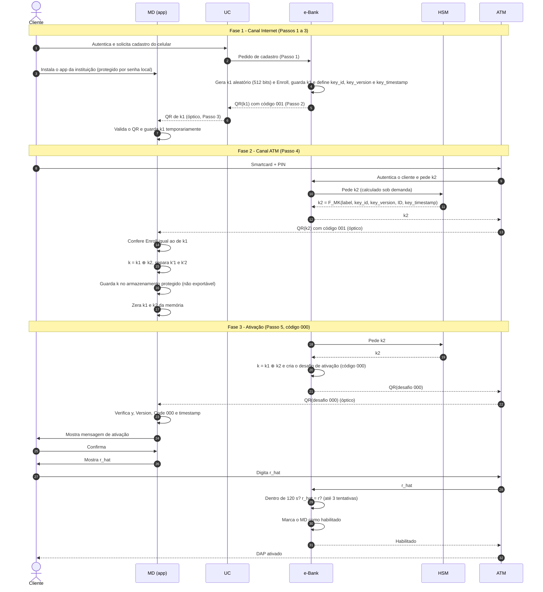

*Figura 2.1.1 (sequência).* Provisionamento e ativação da chave.

#### 2.1.2 Formato e validação dos QR de troca de chaves (código 001, Seção 5.2)

Cenário em que o MD valida os QR de k1 (vindo do e-Bank pelo UC) e de k2 (vindo do ATM). Os QR não levam a etiqueta y, porque o MD ainda não tem chave: o MD confere apenas a estrutura (seis campos, Version, Code 001, 64 octetos e o campo Check). As duas metades podem ser lidas em qualquer ordem, devem ter o mesmo Enroll e são descartadas se a segunda não chegar no prazo definido pela instituição. Uma metade adulterada só é detectada na ativação.

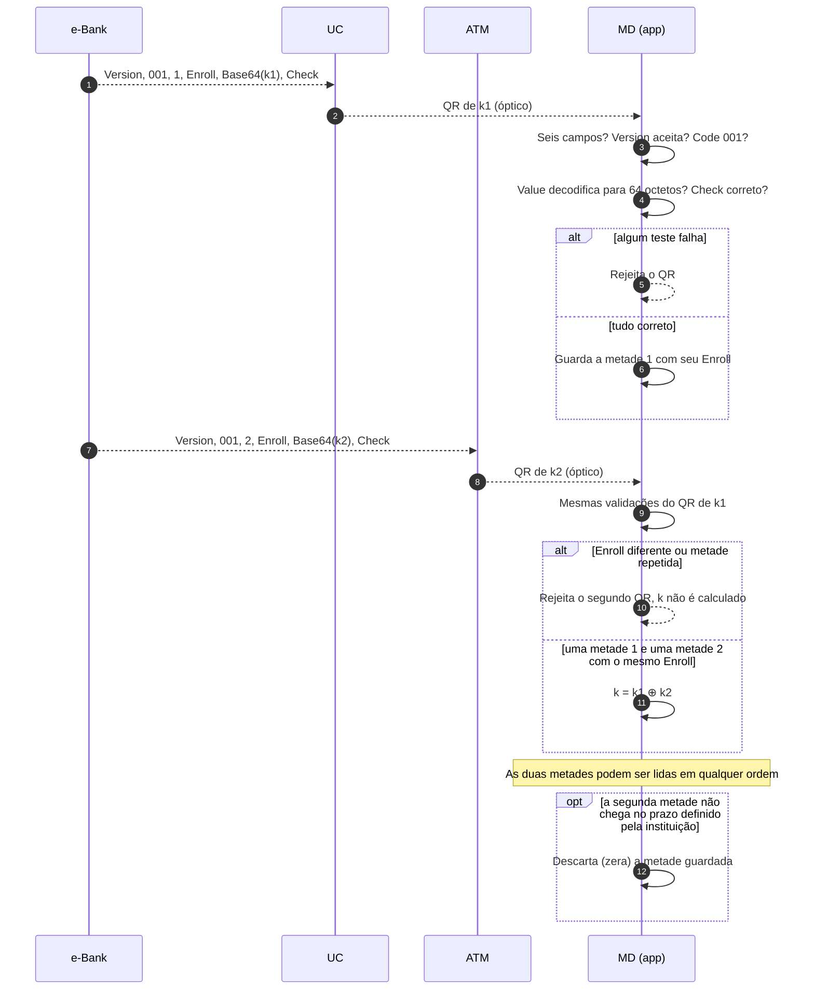

*Figura 2.1.2 (sequência).* Formato e validação dos QR de troca de chaves.

#### 2.1.3 Autorização de transação (Seção 6 do draft)

Fluxo normal, do login ao recibo. O Cliente se autentica no UC e solicita a transação; o e-Bank gera o Nonce, o código r e o desafio (r' = IV + C, etiqueta y), obtendo k2 do HSM, e o exibe como QR. O MD lê o QR, recalcula a etiqueta, valida Version, Code, template e timestamp e mostra a transação em tela própria (WYSIWYS). Após a confirmação do Cliente, o MD decifra r e mostra r_hat; o Cliente o digita no UC, e o e-Bank o confere em até 120 s, executa a transação e invalida r.

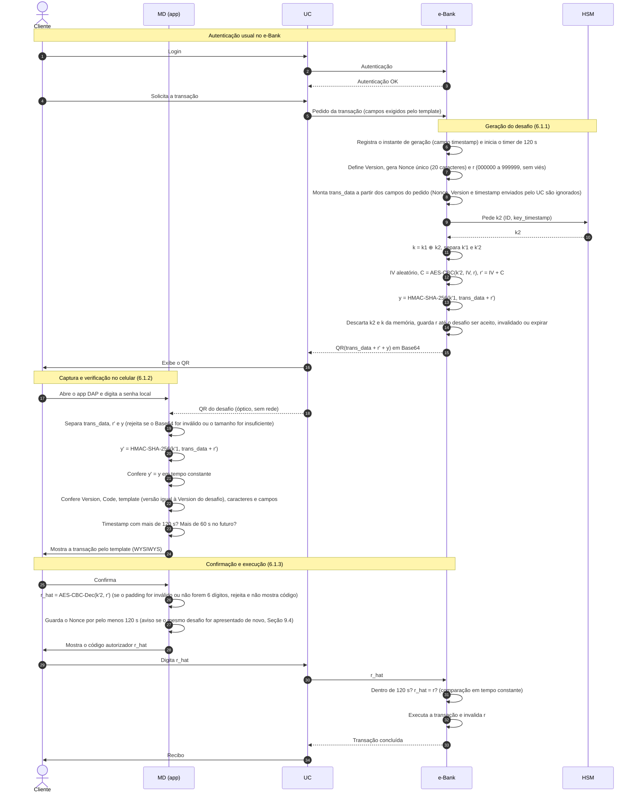

*Figura 2.1.3 (sequência).* Autorização de transação.

#### 2.1.4 Cancelamento pelo usuário (divergência nos dados mostrados)

Cenário do ataque MITB. O malware no UC troca a conta e o valor do pedido antes de enviá-lo ao e-Bank, e a tela do UC continua mostrando os dados originais. O desafio é autêntico, pois veio do e-Bank, de modo que a etiqueta HMAC confere, mas o MD exibe a conta B e o valor Y reais. O Cliente percebe a divergência e cancela; o MD descarta o desafio sem mostrar r_hat, e o e-Bank cancela a transação quando o timer de 120 s expira. O MD não fala com o e-Bank.

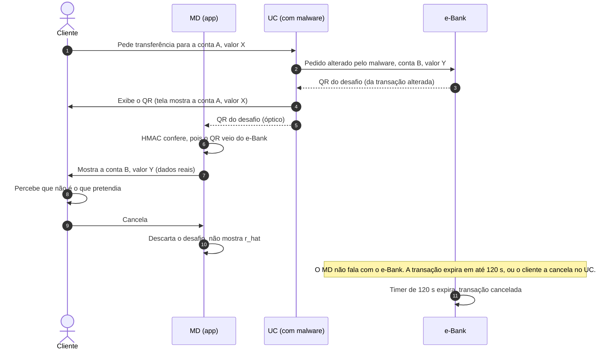

*Figura 2.1.4 (sequência).* Cancelamento pelo usuário.

#### 2.1.5 Rejeições no MD (QR adulterado, vencido ou inválido)

Cenário em que o UC, tratado como adversário, apresenta ao MD um QR alterado, antigo ou repetido. O MD rejeita, nesta ordem: Base64 inválido ou tamanho insuficiente; etiqueta y' diferente de y (encerra sem decifrar r'); Version, Code, template ou campos inválidos; timestamp com mais de 120 s (desafio expirado) ou mais de 60 s à frente do relógio (verificar data e hora do aparelho). Se o mesmo Nonce já teve o código exibido há menos de 120 s, o MD avisa o Cliente antes de pedir Confirm ou Cancel.

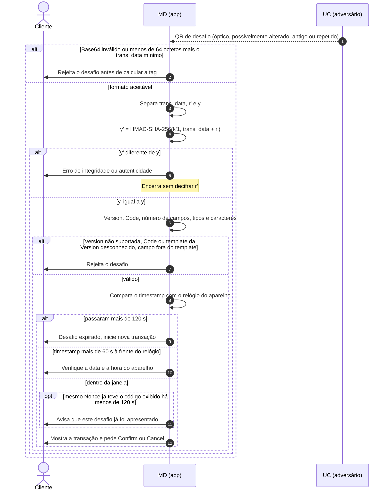

*Figura 2.1.5 (sequência).* Rejeições no MD.

#### 2.1.6 Validação do código no e-Bank (tentativas, expiração e erro)

Cenário em que o Cliente digita o código no UC e o e-Bank o valida. A cada tentativa, o e-Bank verifica primeiro o timer de 120 s (expirado cancela a transação), depois compara r_hat com r (igual executa a transação e invalida r) e, se diferente, conta uma falha e responde "código incorreto". Após a terceira falha, o e-Bank invalida o desafio, cancela a transação e registra o evento; a política da instituição pode acionar alerta ou nova autenticação.

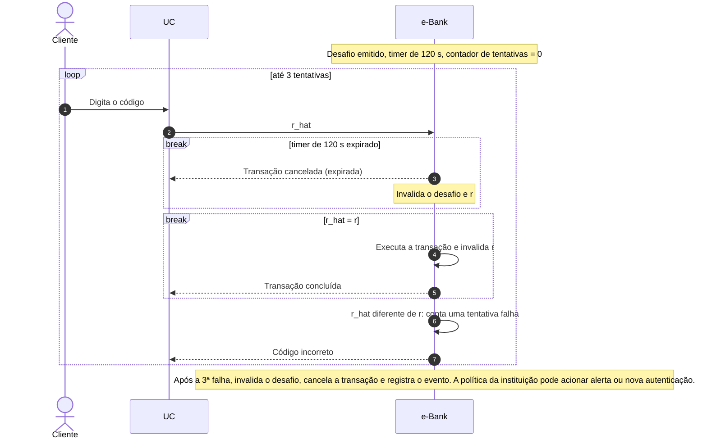

*Figura 2.1.6 (sequência).* Validação do código no e-Bank.

#### 2.1.7 Perda do celular, revogação e novo cadastro (Seção 7 do draft)

Cenário em que o Cliente perde ou troca o celular. Não existe canal alternativo de autorização: a recuperação é feita somente no ATM ou na agência, com smartcard e PIN. O e-Bank apaga k1 (tornando k irrecuperável no servidor), deixa de gerar desafios, rejeita códigos de desafios pendentes, registra a revogação e avisa o Cliente por canal cadastrado. O novo cadastro repete o provisionamento e a ativação (diagrama 2.1.1) com novo k1, novo key_timestamp e key_version incrementada; a chave k não é exportável nem copiada para outro aparelho.

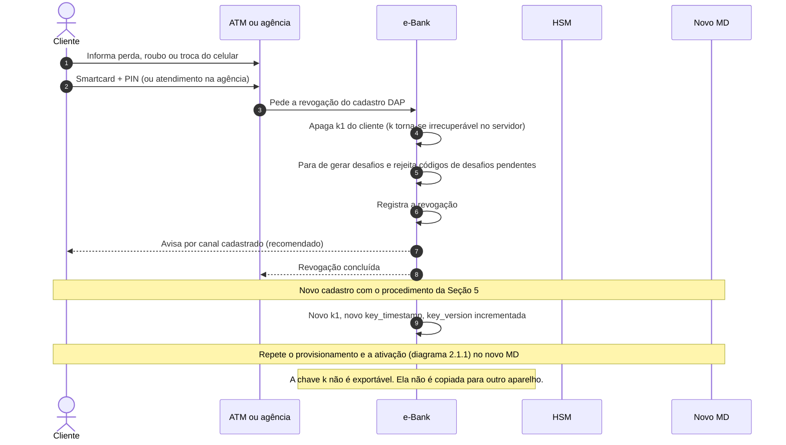

*Figura 2.1.7 (sequência).* Perda do celular, revogação e novo cadastro.

#### 2.1.8 Rotação ou comprometimento da chave-mestra MK (gestão da MK no HSM)

Cenário de gestão da chave-mestra no HSM. Na rotação planejada, o e-Bank cria no HSM uma nova MK com novo key_id e os novos cadastros passam a usá-lo, enquanto a MK antiga permanece no HSM enquanto houver cliente que a use. Se a MK for suspeita de comprometimento, o e-Bank revoga todos os cadastros que usam o key_id e convoca os Clientes afetados a refazer o cadastro e a ativação (diagrama 2.1.1).

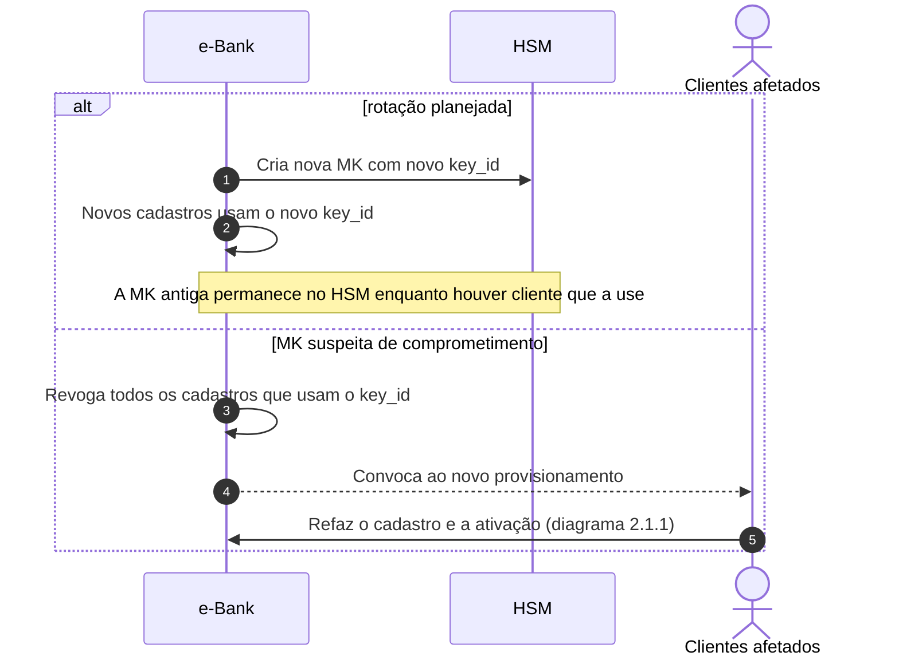

*Figura 2.1.8 (sequência).* Rotação ou comprometimento da chave-mestra MK.

> **Aviso:** a partir deste ponto são apresentados os cenários para simulação em laboratório, com Alice, Bob e Eva como participantes.

## 3. Participantes

Alice e Bob são os participantes legítimos; Eva é a atacante (observadora passiva ou, quando há adulteração, ativa). As tabelas abaixo listam o que cada um mantém em cada cenário.

| Participante | Papel | Dados que pode guardar (tipo) |
| --- | --- | --- |
| Alice | Usuária com o celular de confiança (MD) | Metade k_1 (temporária) (segredo); Metade k_2 (temporária) (segredo); Chave k (armazenamento protegido) (segredo); Etiqueta y' recalculada (assinatura ou etiqueta); Tela do MD (WYSIWYS) (texto claro); Código r_hat (segredo) |
| Bob | e-Bank com o HSM | Metade k_1 (guardada) (segredo); Metade k_2 (recalculada no HSM) (segredo); Chave k (só dentro do HSM) (segredo); trans_data (texto claro); Código r (segredo); r' = IV \| C (texto cifrado); Etiqueta y (assinatura ou etiqueta); Situação da transação (parâmetro público) |
| Eva | Computador não confiável (UC) controlado pela atacante | Metade k_1 vista na tela do UC (segredo); Metade k_1 trocada por Eva (segredo); Metade k_2 (só se Eva viu o ATM) (segredo); Chave k calculada por Eva (segredo); Pedido alterado enviado ao e-Bank (texto claro); Desafio que passa pelo UC (texto cifrado); Desafio adulterado enviado ao MD (texto cifrado); Código digitado, visto no UC (segredo); Chute de código (segredo); Chave k: desconhecida para Eva (segredo) |

## 4. Como ler os diagramas

Cada figura é um diagrama de sequência gerado a partir da mesma definição de protocolo que anima o laboratório: as colunas são os participantes, o tempo corre de cima para baixo e cada faixa horizontal é o início de uma etapa. Os valores numéricos e as chaves não aparecem aqui (são aleatórios ou dependem das entradas); eles são mostrados nas fórmulas do próprio laboratório.

- Seta cheia: mensagem enviada pelo canal, com o rótulo do que trafega.
- Número no início do rótulo: ordem da interação no diagrama, de cima para baixo.
- Botão Ampliar diagrama (no site): abre o diagrama em tela cheia, com zoom.
- `[adulterada]` no início do rótulo: a mensagem foi alterada em trânsito por Eva.
- Faixa com texto: título da etapa que começa naquele ponto.

**Lista de figuras**

- [Figura 5.1.1](#511-provisionamento-normal): Provisionamento normal
- [Figura 5.1.2](#512-eva-troca-a-metade-k1-no-uc): Eva troca a metade k1 no UC
- [Figura 5.1.3](#513-eva-vê-a-metade-k2-na-tela-do-atm): Eva vê a metade k2 na tela do ATM
- [Figura 5.2.1](#521-chave-correta): Chave correta
- [Figura 5.2.2](#522-chave-divergente-eva-trocou-k1-no-provisionamento): Chave divergente: Eva trocou k1 no provisionamento
- [Figura 5.2.3](#523-eva-conhece-a-chave-k): Eva conhece a chave k
- [Figura 5.3.1](#531-transação-normal): Transação normal
- [Figura 5.3.2](#532-eva-altera-os-dados-dentro-do-qr): Eva altera os dados dentro do QR
- [Figura 5.3.3](#533-eva-troca-o-pedido-no-navegador-mitb-e-alice-cancela): Eva troca o pedido no navegador (MITB) e Alice cancela
- [Figura 5.3.4](#534-eva-chuta-o-código): Eva chuta o código
- [Figura 5.3.5](#535-eva-repete-o-código-capturado): Eva repete o código capturado

## 5. Cenários

### 5.1 Provisionamento da chave

#### 5.1.1 Provisionamento normal

**Entradas usadas:** valores fixos.

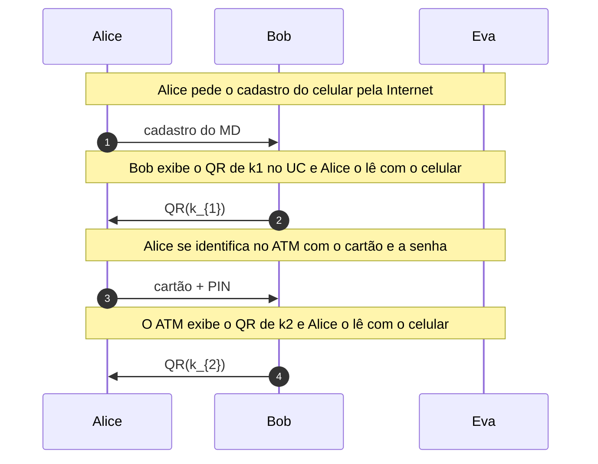

*Figura 5.1.1 (sequência).* Provisionamento normal: 4 mensagens, entre Alice, Bob e Eva.

| Etapa | Título | Operação |
| --- | --- | --- |
| 1 | Alice pede o cadastro do celular pela Internet | Pedido de cadastro (Passo 1). |
| 2 | Bob sorteia a metade k1 de 512 bits e a guarda | k1 ← {0,1}^512. |
| 3 | O HSM calcula a metade k2 com a chave-mestra MK | k2 = HMAC-SHA-512(MK, label \| key_id \| version \| len(ID) \| ID \| key_timestamp). |
| 4 | Bob exibe o QR de k1 no UC e Alice o lê com o celular | Canal da Internet (UC) mais leitura óptica. |
| 5 | O MD valida o QR da primeira metade | Seis campos, Version, Code = 001, \|Value\| = 64 octetos, Check correto. |
| 6 | Alice se identifica no ATM com o cartão e a senha | Autenticação no ATM (Passo 4). |
| 7 | O ATM exibe o QR de k2 e Alice o lê com o celular | Canal do ATM mais leitura óptica. |
| 8 | O MD valida o QR da segunda metade e o Enroll | Share 1 + Share 2 e o mesmo Enroll. |
| 9 | O MD calcula a chave k = k1 ⊕ k2 | k = k1 ⊕ k2. |
| 10 | O MD separa k'1 e k'2 e apaga k1 e k2 da memória | k'_1 = k[0..31]; k'_2 = k[32..63]. |

**Veredito do cenário:** Chave provisionada: o MD guarda k e apagou k1 e k2. Eva viu só k1, que sozinha nada revela sobre k. Falta a ativação, que confirma que o e-Bank e o MD têm a mesma chave.

#### 5.1.2 Eva troca a metade k1 no UC

**Entradas usadas:** valores fixos.

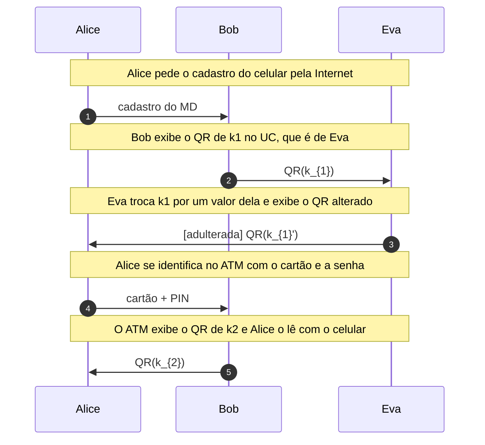

*Figura 5.1.2 (sequência).* Eva troca a metade k1 no UC: 5 mensagens (1 adulterada), entre Alice, Bob e Eva.

| Etapa | Título | Operação |
| --- | --- | --- |
| 1 | Alice pede o cadastro do celular pela Internet | Pedido de cadastro (Passo 1). |
| 2 | Bob sorteia a metade k1 de 512 bits e a guarda | k1 ← {0,1}^512. |
| 3 | O HSM calcula a metade k2 com a chave-mestra MK | k2 = HMAC-SHA-512(MK, label \| key_id \| version \| len(ID) \| ID \| key_timestamp). |
| 4 | Bob exibe o QR de k1 no UC, que é de Eva | Canal da Internet (UC). |
| 5 | Eva troca k1 por um valor dela e exibe o QR alterado | k1' no lugar de k1. |
| 6 | O MD valida o QR da primeira metade | Seis campos, Version, Code = 001, \|Value\| = 64 octetos, Check correto. |
| 7 | Alice se identifica no ATM com o cartão e a senha | Autenticação no ATM (Passo 4). |
| 8 | O ATM exibe o QR de k2 e Alice o lê com o celular | Canal do ATM mais leitura óptica. |
| 9 | O MD valida o QR da segunda metade e o Enroll | Share 1 + Share 2 e o mesmo Enroll. |
| 10 | O MD calcula a chave k = k1 ⊕ k2 | k = k1 ⊕ k2. |
| 11 | O MD separa k'1 e k'2 e apaga k1 e k2 da memória | k'_1 = k[0..31]; k'_2 = k[32..63]. |

**Veredito do cenário:** O MD aceitou o QR trocado e calculou uma chave diferente da do e-Bank, sem perceber (o Check não protege contra adversário). A troca só será descoberta na ativação.

#### 5.1.3 Eva vê a metade k2 na tela do ATM

**Entradas usadas:** valores fixos.

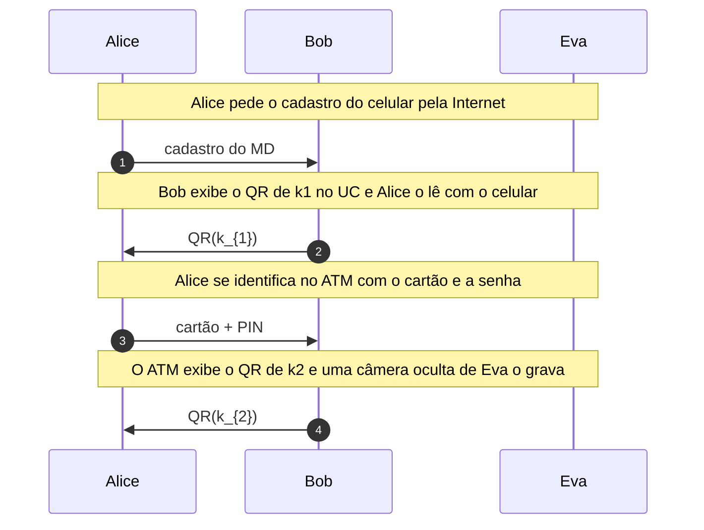

*Figura 5.1.3 (sequência).* Eva vê a metade k2 na tela do ATM: 4 mensagens, entre Alice, Bob e Eva.

| Etapa | Título | Operação |
| --- | --- | --- |
| 1 | Alice pede o cadastro do celular pela Internet | Pedido de cadastro (Passo 1). |
| 2 | Bob sorteia a metade k1 de 512 bits e a guarda | k1 ← {0,1}^512. |
| 3 | O HSM calcula a metade k2 com a chave-mestra MK | k2 = HMAC-SHA-512(MK, label \| key_id \| version \| len(ID) \| ID \| key_timestamp). |
| 4 | Bob exibe o QR de k1 no UC e Alice o lê com o celular | Canal da Internet (UC) mais leitura óptica. |
| 5 | O MD valida o QR da primeira metade | Seis campos, Version, Code = 001, \|Value\| = 64 octetos, Check correto. |
| 6 | Alice se identifica no ATM com o cartão e a senha | Autenticação no ATM (Passo 4). |
| 7 | O ATM exibe o QR de k2 e uma câmera oculta de Eva o grava | Canal do ATM mais leitura óptica. |
| 8 | O MD valida o QR da segunda metade e o Enroll | Share 1 + Share 2 e o mesmo Enroll. |
| 9 | Eva combina as duas metades que viu e obtém a chave k | k = k1 ⊕ k2 (Eva). |
| 10 | O MD calcula a chave k = k1 ⊕ k2 | k = k1 ⊕ k2. |
| 11 | O MD separa k'1 e k'2 e apaga k1 e k2 da memória | k'_1 = k[0..31]; k'_2 = k[32..63]. |

**Veredito do cenário:** Eva viu as duas metades e conhece k: a hipótese de independência das metades foi violada e o segundo fator está comprometido. A ativação não percebe isso.

### 5.2 Ativação do dispositivo

#### 5.2.1 Chave correta

**Entradas usadas:** QR lido em 12 s e código digitado em 30 s.

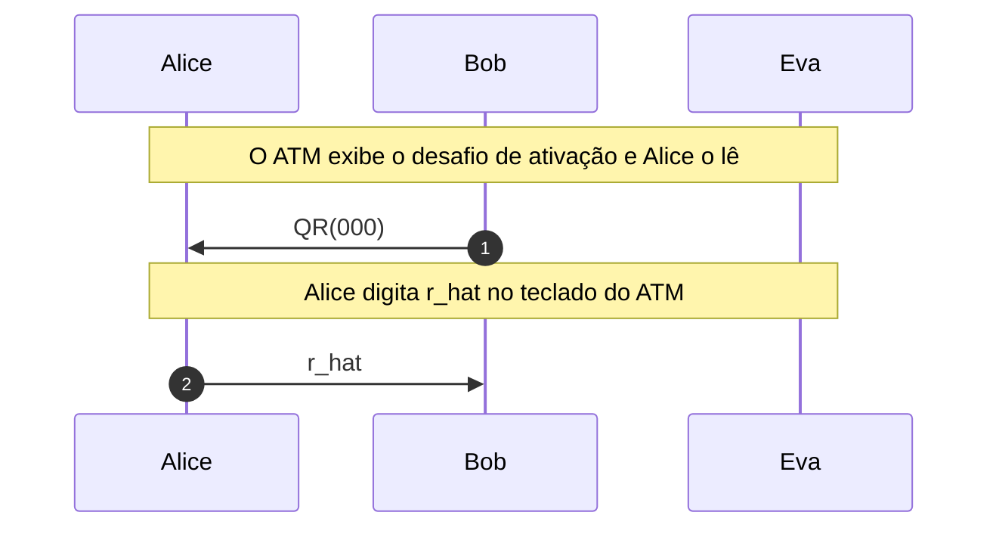

*Figura 5.2.1 (sequência).* Chave correta: 2 mensagens, entre Alice, Bob e Eva.

| Etapa | Título | Operação |
| --- | --- | --- |
| 1 | Ponto de partida: o MD já calculou a chave k | Estado ao fim do provisionamento da chave. |
| 2 | O e-Bank combina k1 e k2 no HSM para a ativação | k = k1 ⊕ k2 (no HSM). |
| 3 | Bob monta trans_data e inicia o relógio de 120 s | trans_data = Nonce ; Version ; Code ; Field_1 ; … ; Field_n (ASCII imprimível). |
| 4 | Bob sorteia o código autorizador r | r = amostragem com rejeição em [0, 10^6). |
| 5 | Bob cifra r com o AES-256-CBC: r' = IV \| C | C = CBC-Enc(k'_2, IV, r); r' = IV \| C. |
| 6 | Bob calcula a etiqueta y sobre trans_data \| r' | y = HMAC-SHA-256(k'_1, trans_data \| r'). |
| 7 | Bob codifica o desafio em Base64 para o QR | desafio = Base64(trans_data \| r' \| y). |
| 8 | O ATM exibe o desafio de ativação e Alice o lê | Canal do ATM mais leitura óptica. |
| 9 | O MD recalcula a etiqueta y' e compara com y | y' = HMAC-SHA-256(k'_1, trans_data \| r'); aceita só se y' = y. |
| 10 | O MD valida Version, Code, campos e carimbo | Version suportada? Code conhecido? Campos conforme o modelo? −60 s ≤ idade ≤ 120 s? |
| 11 | O MD mostra a transação pelo modelo (WYSIWYS) | Aplicação da máscara do modelo 000 (Ativação do DAP). |
| 12 | Alice confirma e o MD decifra r' para mostrar r_hat | r_hat = CBC-Dec(k'_2, IV, C). |
| 13 | Alice digita r_hat no teclado do ATM | Entrada de r_hat no ATM. |
| 14 | O e-Bank confere o prazo e compara r_hat com r | Dentro de 120 s? r_hat = r? |

**Veredito do cenário:** Ativação concluída: o e-Bank e o MD têm a mesma chave k, e o MD passa a ser um autorizador válido. Eva viu só k1.

#### 5.2.2 Chave divergente: Eva trocou k1 no provisionamento

**Entradas usadas:** QR lido em 12 s.

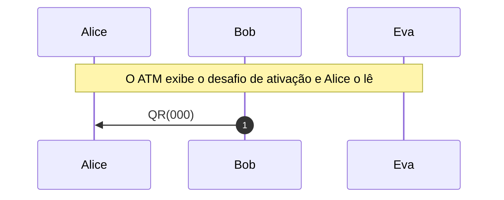

*Figura 5.2.2 (sequência).* Chave divergente: Eva trocou k1 no provisionamento: 1 mensagem, entre Alice, Bob e Eva.

| Etapa | Título | Operação |
| --- | --- | --- |
| 1 | Ponto de partida: o MD já calculou a chave k | Estado ao fim do provisionamento da chave. |
| 2 | O e-Bank combina k1 e k2 no HSM para a ativação | k = k1 ⊕ k2 (no HSM). |
| 3 | Bob monta trans_data e inicia o relógio de 120 s | trans_data = Nonce ; Version ; Code ; Field_1 ; … ; Field_n (ASCII imprimível). |
| 4 | Bob sorteia o código autorizador r | r = amostragem com rejeição em [0, 10^6). |
| 5 | Bob cifra r com o AES-256-CBC: r' = IV \| C | C = CBC-Enc(k'_2, IV, r); r' = IV \| C. |
| 6 | Bob calcula a etiqueta y sobre trans_data \| r' | y = HMAC-SHA-256(k'_1, trans_data \| r'). |
| 7 | Bob codifica o desafio em Base64 para o QR | desafio = Base64(trans_data \| r' \| y). |
| 8 | O ATM exibe o desafio de ativação e Alice o lê | Canal do ATM mais leitura óptica. |
| 9 | O MD recalcula a etiqueta y' e compara com y | y' = HMAC-SHA-256(k'_1, trans_data \| r'); aceita só se y' = y. |

**Veredito do cenário:** Ativação falhou: Eva trocou k1, então o MD e o e-Bank têm chaves diferentes e a etiqueta y não confere. O e-Bank não habilita o MD e o usuário refaz o cadastro. O Check do QR não detecta a troca.

#### 5.2.3 Eva conhece a chave k

**Entradas usadas:** QR lido em 12 s e código digitado em 30 s.

*Figura 5.2.3 (sequência).* Eva conhece a chave k: 2 mensagens, entre Alice, Bob e Eva.

| Etapa | Título | Operação |
| --- | --- | --- |
| 1 | Ponto de partida: o MD já calculou a chave k | Estado ao fim do provisionamento da chave. |
| 2 | O e-Bank combina k1 e k2 no HSM para a ativação | k = k1 ⊕ k2 (no HSM). |
| 3 | Bob monta trans_data e inicia o relógio de 120 s | trans_data = Nonce ; Version ; Code ; Field_1 ; … ; Field_n (ASCII imprimível). |
| 4 | Bob sorteia o código autorizador r | r = amostragem com rejeição em [0, 10^6). |
| 5 | Bob cifra r com o AES-256-CBC: r' = IV \| C | C = CBC-Enc(k'_2, IV, r); r' = IV \| C. |
| 6 | Bob calcula a etiqueta y sobre trans_data \| r' | y = HMAC-SHA-256(k'_1, trans_data \| r'). |
| 7 | Bob codifica o desafio em Base64 para o QR | desafio = Base64(trans_data \| r' \| y). |
| 8 | O ATM exibe o desafio de ativação e Alice o lê | Canal do ATM mais leitura óptica. |
| 9 | O MD recalcula a etiqueta y' e compara com y | y' = HMAC-SHA-256(k'_1, trans_data \| r'); aceita só se y' = y. |
| 10 | O MD valida Version, Code, campos e carimbo | Version suportada? Code conhecido? Campos conforme o modelo? −60 s ≤ idade ≤ 120 s? |
| 11 | O MD mostra a transação pelo modelo (WYSIWYS) | Aplicação da máscara do modelo 000 (Ativação do DAP). |
| 12 | Alice confirma e o MD decifra r' para mostrar r_hat | r_hat = CBC-Dec(k'_2, IV, C). |
| 13 | Alice digita r_hat no teclado do ATM | Entrada de r_hat no ATM. |
| 14 | O e-Bank confere o prazo e compara r_hat com r | Dentro de 120 s? r_hat = r? |

**Veredito do cenário:** Ativação concluída, mas Eva viu as duas metades e conhece k: a hipótese de independência das metades foi violada e o segundo fator está comprometido. O banco deveria invalidar a chave e refazer o cadastro.

### 5.3 Autorização de transação

#### 5.3.1 Transação normal

**Entradas usadas:** transferência de R$ 1.500,00 para MARIA SILVA.

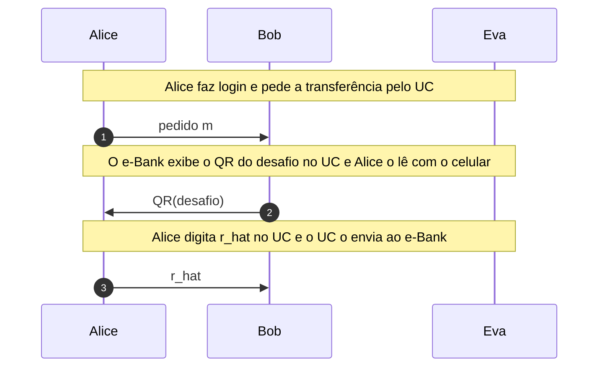

*Figura 5.3.1 (sequência).* Transação normal: 3 mensagens, entre Alice, Bob e Eva.

| Etapa | Título | Operação |
| --- | --- | --- |
| 1 | Ponto de partida: o MD de Alice já foi ativado | Estado inicial do cadastro. |
| 2 | Alice faz login e pede a transferência pelo UC | Pedido m (login e transação). |
| 3 | O HSM recompõe a chave k do usuário | k = k1 ⊕ HMAC-SHA-512(MK, x). |
| 4 | Bob monta trans_data e inicia o relógio de 120 s | trans_data = Nonce ; Version ; Code ; Field_1 ; … ; Field_n (ASCII imprimível). |
| 5 | Bob sorteia o código autorizador r | r = amostragem com rejeição em [0, 10^6). |
| 6 | Bob cifra r com o AES-256-CBC: r' = IV \| C | C = CBC-Enc(k'_2, IV, r); r' = IV \| C. |
| 7 | Bob calcula a etiqueta y sobre trans_data \| r' | y = HMAC-SHA-256(k'_1, trans_data \| r'). |
| 8 | Bob codifica o desafio em Base64 para o QR | desafio = Base64(trans_data \| r' \| y). |
| 9 | O e-Bank exibe o QR do desafio no UC e Alice o lê com o celular | Canal da Internet (UC) mais leitura óptica. |
| 10 | O MD recalcula a etiqueta y' e compara com y | y' = HMAC-SHA-256(k'_1, trans_data \| r'); aceita só se y' = y. |
| 11 | O MD valida Version, Code, campos e carimbo | Version suportada? Code conhecido? Campos conforme o modelo? −60 s ≤ idade ≤ 120 s? |
| 12 | O MD mostra a transação pelo modelo (WYSIWYS) | Aplicação da máscara do modelo 818 (Transferência entre contas correntes). |
| 13 | Alice confirma e o MD decifra r' para mostrar r_hat | r_hat = CBC-Dec(k'_2, IV, C). |
| 14 | Alice digita r_hat no UC e o UC o envia ao e-Bank | Entrada de r_hat no UC. |
| 15 | O e-Bank confere o prazo e compara r_hat com r | Dentro de 120 s? r_hat = r? |

**Veredito do cenário:** Transação autorizada: o MD autenticou o desafio, Alice conferiu os dados na tela confiável e o e-Bank validou o código dentro do prazo.

#### 5.3.2 Eva altera os dados dentro do QR

**Entradas usadas:** mesmos dados.

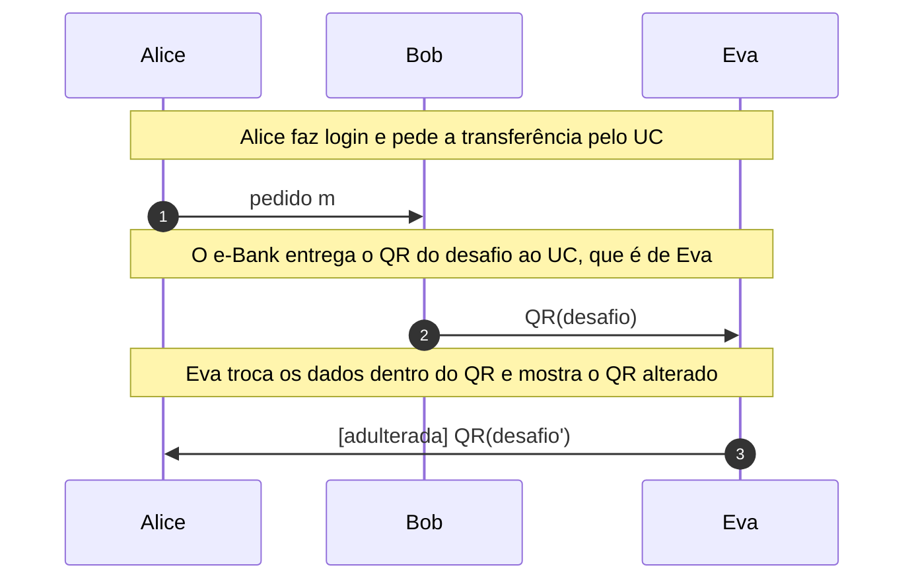

*Figura 5.3.2 (sequência).* Eva altera os dados dentro do QR: 3 mensagens (1 adulterada), entre Alice, Bob e Eva.

| Etapa | Título | Operação |
| --- | --- | --- |
| 1 | Ponto de partida: o MD de Alice já foi ativado | Estado inicial do cadastro. |
| 2 | Alice faz login e pede a transferência pelo UC | Pedido m (login e transação). |
| 3 | O HSM recompõe a chave k do usuário | k = k1 ⊕ HMAC-SHA-512(MK, x). |
| 4 | Bob monta trans_data e inicia o relógio de 120 s | trans_data = Nonce ; Version ; Code ; Field_1 ; … ; Field_n (ASCII imprimível). |
| 5 | Bob sorteia o código autorizador r | r = amostragem com rejeição em [0, 10^6). |
| 6 | Bob cifra r com o AES-256-CBC: r' = IV \| C | C = CBC-Enc(k'_2, IV, r); r' = IV \| C. |
| 7 | Bob calcula a etiqueta y sobre trans_data \| r' | y = HMAC-SHA-256(k'_1, trans_data \| r'). |
| 8 | Bob codifica o desafio em Base64 para o QR | desafio = Base64(trans_data \| r' \| y). |
| 9 | O e-Bank entrega o QR do desafio ao UC, que é de Eva | Canal da Internet (UC). |
| 10 | Eva troca os dados dentro do QR e mostra o QR alterado | Substituição de trans_data por trans_data' (a etiqueta y fica a antiga). |
| 11 | O MD recalcula a etiqueta y' e compara com y | y' = HMAC-SHA-256(k'_1, trans_data \| r'); aceita só se y' = y. |

**Veredito do cenário:** Erro de integridade ou autenticidade: o MD descartou o desafio sem decifrar r'. O código nunca foi revelado.

#### 5.3.3 Eva troca o pedido no navegador (MITB) e Alice cancela

**Entradas usadas:** mesmos dados.

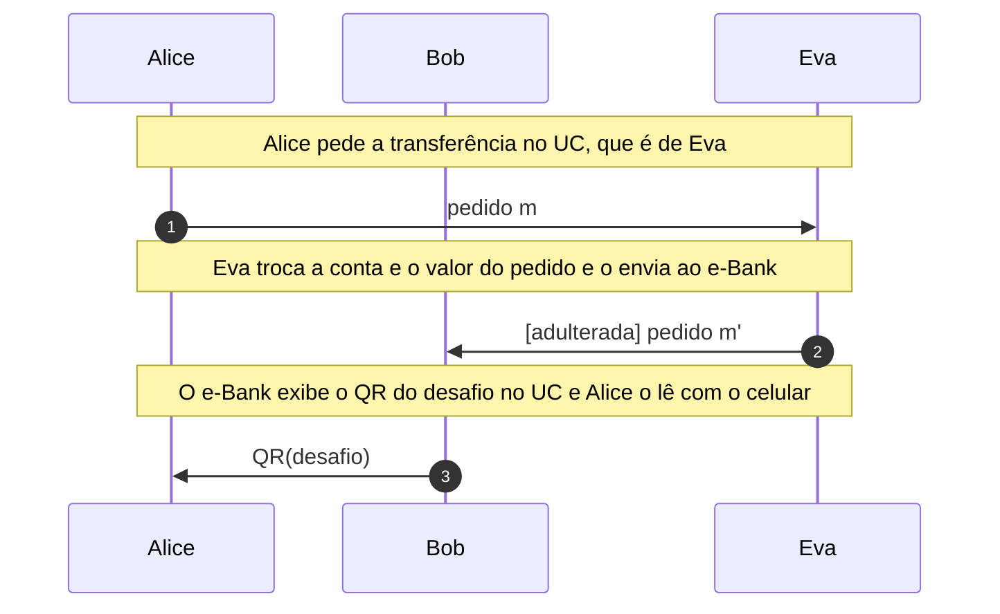

*Figura 5.3.3 (sequência).* Eva troca o pedido no navegador (MITB) e Alice cancela: 3 mensagens (1 adulterada), entre Alice, Bob e Eva.

| Etapa | Título | Operação |
| --- | --- | --- |
| 1 | Ponto de partida: o MD de Alice já foi ativado | Estado inicial do cadastro. |
| 2 | Alice pede a transferência no UC, que é de Eva | Pedido m de Alice. |
| 3 | Eva troca a conta e o valor do pedido e o envia ao e-Bank | Reenvio de m' ao e-Bank. |
| 4 | O HSM recompõe a chave k do usuário | k = k1 ⊕ HMAC-SHA-512(MK, x). |
| 5 | Bob monta trans_data e inicia o relógio de 120 s | trans_data = Nonce ; Version ; Code ; Field_1 ; … ; Field_n (ASCII imprimível). |
| 6 | Bob sorteia o código autorizador r | r = amostragem com rejeição em [0, 10^6). |
| 7 | Bob cifra r com o AES-256-CBC: r' = IV \| C | C = CBC-Enc(k'_2, IV, r); r' = IV \| C. |
| 8 | Bob calcula a etiqueta y sobre trans_data \| r' | y = HMAC-SHA-256(k'_1, trans_data \| r'). |
| 9 | Bob codifica o desafio em Base64 para o QR | desafio = Base64(trans_data \| r' \| y). |
| 10 | O e-Bank exibe o QR do desafio no UC e Alice o lê com o celular | Canal da Internet (UC) mais leitura óptica. |
| 11 | O MD recalcula a etiqueta y' e compara com y | y' = HMAC-SHA-256(k'_1, trans_data \| r'); aceita só se y' = y. |
| 12 | O MD valida Version, Code, campos e carimbo | Version suportada? Code conhecido? Campos conforme o modelo? −60 s ≤ idade ≤ 120 s? |
| 13 | O MD mostra a transação pelo modelo (WYSIWYS) | Aplicação da máscara do modelo 818 (Transferência entre contas correntes). |
| 14 | Alice vê a conta de Eva na tela do MD e cancela | Cancelamento no MD. |
| 15 | O prazo de 120 s vence e o e-Bank cancela a transação | Timeout do desafio. |

**Veredito do cenário:** Ataque barrado: a tela confiável do MD revelou a conta de Eva e Alice cancelou. Sem o código r_hat, o e-Bank não executa a transação.

#### 5.3.4 Eva chuta o código

**Entradas usadas:** três tentativas.

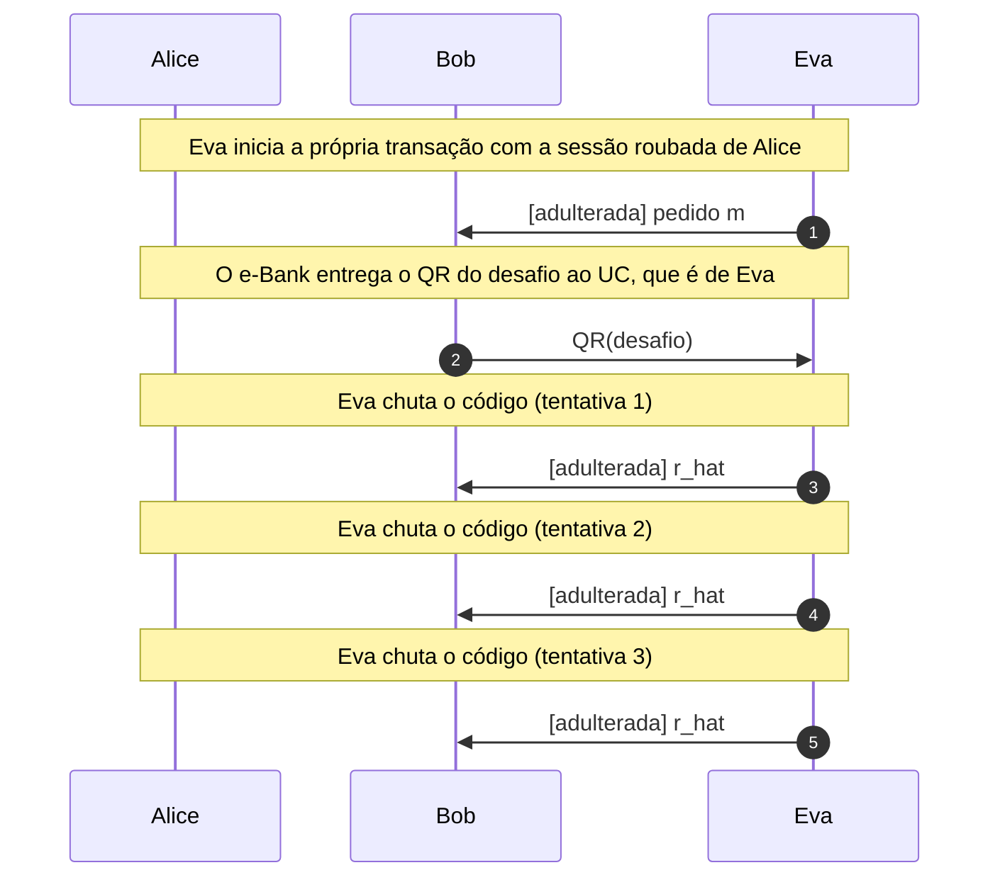

*Figura 5.3.4 (sequência).* Eva chuta o código: 5 mensagens (4 adulteradas), entre Alice, Bob e Eva.

| Etapa | Título | Operação |
| --- | --- | --- |
| 1 | Ponto de partida: o MD de Alice já foi ativado | Estado inicial do cadastro. |
| 2 | Eva inicia a própria transação com a sessão roubada de Alice | Pedido iniciado por Eva. |
| 3 | O HSM recompõe a chave k do usuário | k = k1 ⊕ HMAC-SHA-512(MK, x). |
| 4 | Bob monta trans_data e inicia o relógio de 120 s | trans_data = Nonce ; Version ; Code ; Field_1 ; … ; Field_n (ASCII imprimível). |
| 5 | Bob sorteia o código autorizador r | r = amostragem com rejeição em [0, 10^6). |
| 6 | Bob cifra r com o AES-256-CBC: r' = IV \| C | C = CBC-Enc(k'_2, IV, r); r' = IV \| C. |
| 7 | Bob calcula a etiqueta y sobre trans_data \| r' | y = HMAC-SHA-256(k'_1, trans_data \| r'). |
| 8 | Bob codifica o desafio em Base64 para o QR | desafio = Base64(trans_data \| r' \| y). |
| 9 | O e-Bank entrega o QR do desafio ao UC, que é de Eva | Canal da Internet (UC). |
| 10 | Eva chuta o código (tentativa 1) | Envio do chute 1. |
| 11 | O e-Bank recusa o chute 1 | r_hat = r? (até 3 tentativas) |
| 12 | Eva chuta o código (tentativa 2) | Envio do chute 2. |
| 13 | O e-Bank recusa o chute 2 | r_hat = r? (até 3 tentativas) |
| 14 | Eva chuta o código (tentativa 3) | Envio do chute 3. |
| 15 | Na terceira falha o e-Bank cancela a transação | r_hat = r? (até 3 tentativas) |

**Veredito do cenário:** Ataque barrado: depois de 3 chutes errados o e-Bank cancelou a transação. A chance de Eva acertar em 3 tentativas é de 3 × 10^-6.

#### 5.3.5 Eva repete o código capturado

**Entradas usadas:** segunda transação de Eva.

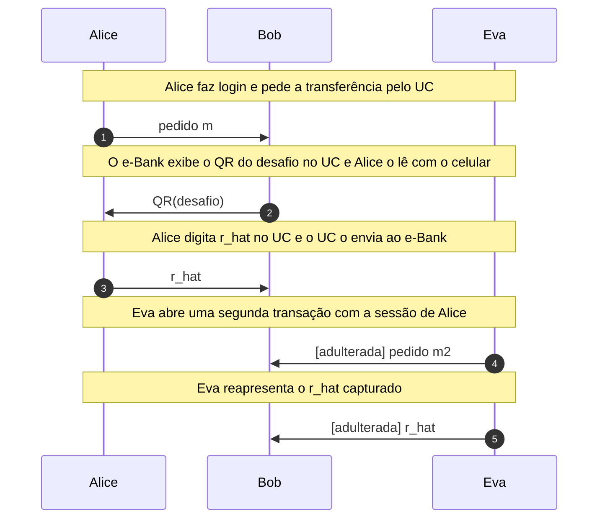

*Figura 5.3.5 (sequência).* Eva repete o código capturado: 5 mensagens (2 adulteradas), entre Alice, Bob e Eva.

| Etapa | Título | Operação |
| --- | --- | --- |
| 1 | Ponto de partida: o MD de Alice já foi ativado | Estado inicial do cadastro. |
| 2 | Alice faz login e pede a transferência pelo UC | Pedido m (login e transação). |
| 3 | O HSM recompõe a chave k do usuário | k = k1 ⊕ HMAC-SHA-512(MK, x). |
| 4 | Bob monta trans_data e inicia o relógio de 120 s | trans_data = Nonce ; Version ; Code ; Field_1 ; … ; Field_n (ASCII imprimível). |
| 5 | Bob sorteia o código autorizador r | r = amostragem com rejeição em [0, 10^6). |
| 6 | Bob cifra r com o AES-256-CBC: r' = IV \| C | C = CBC-Enc(k'_2, IV, r); r' = IV \| C. |
| 7 | Bob calcula a etiqueta y sobre trans_data \| r' | y = HMAC-SHA-256(k'_1, trans_data \| r'). |
| 8 | Bob codifica o desafio em Base64 para o QR | desafio = Base64(trans_data \| r' \| y). |
| 9 | O e-Bank exibe o QR do desafio no UC e Alice o lê com o celular | Canal da Internet (UC) mais leitura óptica. |
| 10 | O MD recalcula a etiqueta y' e compara com y | y' = HMAC-SHA-256(k'_1, trans_data \| r'); aceita só se y' = y. |
| 11 | O MD valida Version, Code, campos e carimbo | Version suportada? Code conhecido? Campos conforme o modelo? −60 s ≤ idade ≤ 120 s? |
| 12 | O MD mostra a transação pelo modelo (WYSIWYS) | Aplicação da máscara do modelo 818 (Transferência entre contas correntes). |
| 13 | Alice confirma e o MD decifra r' para mostrar r_hat | r_hat = CBC-Dec(k'_2, IV, C). |
| 14 | Alice digita r_hat no UC e o UC o envia ao e-Bank | Entrada de r_hat no UC. |
| 15 | O e-Bank confere o prazo e compara r_hat com r | Dentro de 120 s? r_hat = r? |
| 16 | Eva abre uma segunda transação com a sessão de Alice | Novo pedido m2 de Eva. |
| 17 | O e-Bank gera um desafio novo, com outro r | Nonce2 e r2 sorteados. |
| 18 | Eva reapresenta o r_hat capturado | Reapresentação de r_hat. |
| 19 | O e-Bank rejeita o código repetido | r_hat = r2? |

**Veredito do cenário:** A transação de Alice foi executada, mas o código capturado por Eva não autoriza outra transação: r é de uso único e cada desafio tem o seu.

## 6. Perguntas de fixação

1. Por que a chave k é entregue em duas metades por canais diferentes, e o que acontece se Eva vê as duas?

   **Resposta.** k1 é uniforme em {0,1}^512 e k2 sai de uma função pseudoaleatória com a chave-mestra MK, de modo que cada metade isolada não diz nada sobre k = k1 ⊕ k2 (argumento do one-time pad). O UC mostra k1 e o ATM mostra k2: Eva, que controla o UC, vê só k1. Se ela também enxergar o ATM no momento em que k2 é exibido (por exemplo, com uma câmera oculta), calcula k e o segundo fator deixa de existir. Por isso o ATM exibe k2 uma única vez, por pouco tempo, e o banco deve refazer o cadastro se suspeitar de observação.

2. O QR de troca de chaves (código 001) tem um campo Check. Ele impede que Eva troque k1 por outra metade?

   **Resposta.** Não. O Check são os 4 primeiros octetos do SHA-256 do próprio texto e qualquer pessoa pode recalculá-lo, então só detecta erro de leitura. Se Eva trocar k1, o MD aceita o QR e calcula uma chave diferente da do e-Bank. A troca é descoberta na ativação: o desafio de código 000 é autenticado com a chave do e-Bank, o MD recalcula y com outra chave e o resultado não confere. Por isso o e-Bank só habilita o MD depois de uma ativação bem-sucedida.

3. Por que o MD recalcula y antes de decifrar r' e interrompe tudo se a etiqueta não confere?

   **Resposta.** A etiqueta cobre trans_data e r' (cifrar e depois autenticar). Assim, nenhum byte alterado em trânsito chega à decifragem, o que evita ataques de oráculo de preenchimento, e nenhum dado financeiro adulterado chega à tela do MD. Como Eva não conhece k'1, não consegue recalcular y para o conteúdo que alterou. A comparação é em tempo constante para não vazar, pelo tempo, quantos octetos coincidem.

4. Eva repassa o QR autêntico de uma transação fraudulenta (ataque MITB). O HMAC não detecta nada. Onde o ataque é barrado?

   **Resposta.** Na tela do MD. O desafio é autêntico, pois veio do e-Bank, mas traz a conta e o valor de Eva. O MD mostra esses dados autenticados e Alice, ao compará-los com o que pretendia, cancela. Sem o r_hat, que só aparece depois da confirmação, o e-Bank não executa a transação e a cancela em até 120 s. A proteção, porém, depende do usuário: se ele confirmar sem ler, o DAP autoriza a fraude, risco residual que o draft reconhece e que pede avisos claros na interface do MD.

5. O código r tem só seis dígitos. Por que Eva não consegue quebrá-lo por força bruta?

   **Resposta.** Porque a adivinhação precisa passar pelo e-Bank, que aceita no máximo 3 tentativas por desafio dentro de 120 s e depois cancela a transação: a chance de sucesso é de 3 em 10^6 (3 × 10^-6). Offline, Eva também não tem como testar candidatos, já que r' é a cifra de r com k'2, que ela desconhece, e qualquer chave produz algum texto. O limite por usuário de desafios falhos e o monitoramento complementam a defesa.

6. O que o prazo de 120 s e o carimbo de geração acrescentam à proteção contra repetição?

   **Resposta.** O carimbo está dentro de trans_data e, portanto, coberto pelo HMAC: Eva não pode rejuvenescer um QR antigo. O MD descarta desafios com mais de 120 s e tolera até 60 s de adiantamento por causa dos relógios de celulares. Essa verificação é complementar, porque o relógio do MD não é confiável e não conta o tempo de leitura da tela e de digitação. A autoridade do prazo é o e-Bank, que cancela por conta própria depois de 120 s e invalida o código na primeira execução.

## 7. Limitações e cuidados

- O laboratório segue um Internet-Draft (trabalho em andamento) e não uma RFC: o texto pode mudar até a publicação. A verificação formal citada no draft não cobre os elementos mais recentes (modelos, carimbo, Nonce e arquivo de modelos assinado).
- O arquivo de modelos assinado em CMS ([RFC 5652](https://www.rfc-editor.org/rfc/rfc5652)) não é implementado: os modelos 000 e 818 são fixos no código. O e-Bank, o HSM e o ATM são simulados no navegador, sem rede.
- O QR code é desenhado na tela, e a leitura por câmera não é simulada. O UC honesto e o UC de Eva são representados por Eva, que sempre controla o canal da Internet.
- Os valores aleatórios vêm da Web Crypto, e a implementação não tem proteção contra ataques de canal lateral nem armazenamento protegido de verdade: não a use para proteger dados reais.
- Uso exclusivamente didático: os laboratórios não devem proteger dados reais.

## 8. Glossário

Significado e finalidade das siglas usadas neste documento.

| Sigla | Significado | Para que serve |
| --- | --- | --- |
| **AES** | Advanced Encryption Standard, padrão de criptografia avançado | cifra de bloco de 128 bits com chaves de 128, 192 ou 256 bits, padronizada no [FIPS 197](https://csrc.nist.gov/pubs/fips/197/final) |
| **ASCII** | American Standard Code for Information Interchange | código que associa números aos caracteres básicos de texto |
| **ATM** | Automated Teller Machine, caixa eletrônico | terminal bancário usado como canal de autenticação no DAP |
| **CBC** | Cipher Block Chaining, encadeamento de blocos cifrados | modo em que cada bloco é combinado por XOR com o bloco cifrado anterior antes de cifrar; exige vetor de inicialização imprevisível |
| **CMS** | Cryptographic Message Syntax | formato padronizado para mensagens assinadas e cifradas ([RFC 5652](https://www.rfc-editor.org/rfc/rfc5652)) |
| **DAP** | Dynamic Authorization Protocol, protocolo de autorização dinâmica | protocolo de autorização de transações com canal óptico fora de banda entre o computador e o celular |
| **DOI** | Digital Object Identifier, identificador de objeto digital | identificador permanente de uma publicação, que leva ao artigo pelo endereço doi.org |
| **FIPS** | Federal Information Processing Standards, padrões federais de processamento de informação | padrões do NIST de uso obrigatório nos órgãos americanos, como o [FIPS 197](https://csrc.nist.gov/pubs/fips/197/final) (AES) e o [FIPS 203](https://csrc.nist.gov/pubs/fips/203/final) (ML-KEM) |
| **HMAC** | Keyed-Hash Message Authentication Code, código de autenticação de mensagem com chave | autentica uma mensagem com uma chave secreta e uma função de hash ([RFC 2104](https://www.rfc-editor.org/rfc/rfc2104)) |
| **HOTP** | HMAC-based One-Time Password, senha de uso único baseada em HMAC | código de uso único derivado de um segredo e de um contador de eventos ([RFC 4226](https://www.rfc-editor.org/rfc/rfc4226)) |
| **HSM** | Hardware Security Module, módulo de segurança em hardware | dispositivo que guarda chaves e executa operações criptográficas sem expô-las |
| **ID** | Identifier, identificador | valor que nomeia uma chave, um usuário ou uma sessão |
| **IETF** | Internet Engineering Task Force | organização aberta que desenvolve e publica os padrões da Internet, as RFCs |
| **ISO/IEC** | International Organization for Standardization / International Electrotechnical Commission | organizações internacionais que publicam normas técnicas conjuntas, inclusive de segurança da informação |
| **IV** | Initialization Vector, vetor de inicialização | valor que torna distintas duas cifragens com a mesma chave; em geral público, mas único ou imprevisível conforme o modo |
| **MD** | Mobile Device, dispositivo móvel | o celular do usuário, que exibe os dados da transação e confirma a autorização |
| **MITB** | Man-in-the-Browser, homem no navegador | ataque em que um código malicioso no navegador altera o que o usuário vê e envia |
| **MK** | Master Key, chave-mestra | chave guardada no HSM do banco, da qual derivam as chaves de cada usuário |
| **PDF** | Portable Document Format, formato de documento portátil | formato de arquivo das cópias dos artigos citados |
| **PIN** | Personal Identification Number, número de identificação pessoal | senha numérica curta que, com o cartão, autentica o usuário |
| **QR** | Quick Response, resposta rápida | código de barras bidimensional; entrega o segredo do TOTP ao aplicativo autenticador, e no DAP leva a chave pelo canal óptico |
| **RFC** | Request for Comments, pedido de comentários | documento numerado do IETF que define ou descreve um protocolo da Internet; cada documento do projeto cita as RFCs com link para o RFC Editor |
| **SHA-2** | Secure Hash Algorithm 2 | família de hashes (SHA-224 a SHA-512) padronizada no [FIPS 180-4](https://csrc.nist.gov/pubs/fips/180-4/upd1/final) |
| **SHA-256** | Secure Hash Algorithm, saída de 256 bits | hash da família SHA-2 de uso mais comum |
| **SMS** | Short Message Service, serviço de mensagens curtas | mensagem de texto de celular, às vezes usada para entregar um código de uso único |
| **SP** | Special Publication, publicação especial | série de recomendações do NIST, como a [SP 800-38A](https://csrc.nist.gov/pubs/sp/800/38/a/final) (modos de operação) e a [SP 800-38D](https://csrc.nist.gov/pubs/sp/800/38/d/final) (modo GCM) |
| **TOTP** | Time-based One-Time Password, senha de uso único baseada em tempo | código que muda a cada 30 segundos, derivado de um segredo e do relógio ([RFC 6238](https://www.rfc-editor.org/rfc/rfc6238)), usado como segundo fator |
| **UC** | Untrusted Computer, computador não confiável | o computador do usuário, que pode estar comprometido e por isso não é o único canal de autorização |
| **WYSIWYS** | What You See Is What You Sign, o que você vê é o que você assina | princípio de que a tela confiável mostra os dados exatos que serão autenticados |

---

*CryptoNet é um projeto mantido pelo Prof. Dr. Laerte Peotta de Melo, com apoio de IA generativa no processo de desenvolvimento, com sua estrita supervisão, revisão técnica e responsabilidade. Uso exclusivo para fins de ensino e pesquisa. Universidade de Brasília (UnB) - Departamento de Engenharia Elétrica. Código aberto (licença MIT).*
