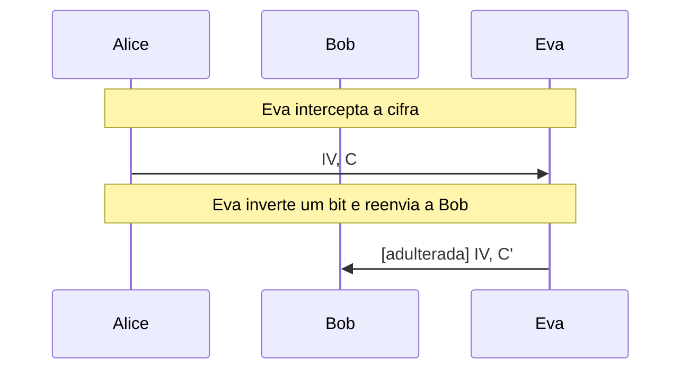
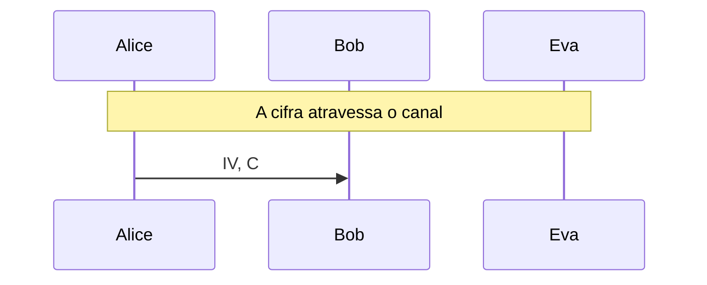

# DES e Triple DES

A rede de Feistel de 16 rodadas operação por operação, a busca exaustiva de Eva contra a chave de 56 bits e o Triple DES, com Alice e Bob.

- **Categoria:** Criptografia Simétrica
- **Abrir o laboratório:** <https://peotta.github.io/CryptoNet/#/lab/des>
- **Motor:** didático (DES e Triple DES sobre bits, com rastro; conferido com o OpenSSL)
- **Código-fonte:** `src/labs/des/` (interface e fluxos) e `src/crypto/des.ts` (operações)
- **Padrões e referências:** [FIPS 46-3](https://csrc.nist.gov/pubs/fips/46-3/final) (Data Encryption Standard), retirada pelo NIST em 19 de maio de 2005; [SP 800-67 Rev. 2](https://csrc.nist.gov/pubs/sp/800/67/r2/final) (Triple DES), retirada pelo NIST em 1º de janeiro de 2024; [FIPS 197](https://csrc.nist.gov/pubs/fips/197/final) (AES), o padrão vigente de cifra de bloco.

## 1. Objetivos de aprendizagem

- Descrever o DES como uma rede de Feistel de 16 rodadas sobre blocos de 64 bits e chave de 56 bits úteis.
- Acompanhar a geração das 16 subchaves de 48 bits (PC-1, giros de C e D e PC-2) e a função f (expansão E, XOR com a subchave, caixas S e permutação P), conferidas com o exemplo clássico.
- Explicar por que decifrar é cifrar com as subchaves em ordem inversa e qual é o papel das permutações inicial e final.
- Mostrar por que 56 bits não bastam: a busca exaustiva de Eva com texto claro conhecido, em escala didática, e a projeção para a chave inteira.
- Entender o Triple DES (cifrar, decifrar, cifrar), a segurança efetiva de 112 bits e o limite do bloco de 64 bits (Sweet32).
- Verificar o efeito avalanche, a propriedade do complemento e as chaves fracas, e situar o DES entre a [FIPS 46-3](https://csrc.nist.gov/pubs/fips/46-3/final) (retirada) e o AES.

## 2. Fundamentação

O DES cifra blocos de 64 bits com uma chave de 56 bits úteis, em 16 rodadas de uma rede de Feistel: a função f expande a metade direita para 48 bits, soma (XOR) a subchave, passa por oito caixas S e por uma permutação. Decifrar é cifrar com as subchaves em ordem inversa. A chave pequena permite a busca exaustiva (o EFF DES Cracker a fez em 56 horas, em 1998), e o Triple DES, que aplica cifrar, decifrar e cifrar, mantém o limite do bloco de 64 bits (ataque Sweet32). O padrão vigente é o AES.

## 3. Participantes

Alice e Bob são os participantes legítimos; Eva é a atacante (observadora passiva ou, quando há adulteração, ativa). As tabelas abaixo listam o que cada um mantém em cada cenário.

| Participante | Papel | Dados que pode guardar (tipo) |
| --- | --- | --- |
| Alice | Remetente | Chave K (56 bits úteis) (segredo); Vetor de inicialização IV (64 bits) (parâmetro público); Mensagem m (texto claro); Cifra C (blocos de 64 bits) (texto cifrado); Chave K1 (segredo); Chave K2 (segredo); Chave K3 (segredo) |
| Bob | Destinatário | Chave K (56 bits úteis) (segredo); Vetor de inicialização IV (parâmetro público); Cifra recebida (texto cifrado); Mensagem recuperada (texto claro); Chave K1 (segredo); Chave K2 (segredo); Chave K3 (segredo) |
| Eva | Atacante (observa e, se puder, altera o canal) | Cifra e IV observados (texto cifrado); Cifra alterada C' (enviada a Bob) (texto cifrado); Primeiro bloco do claro (conhecido) (texto claro); Entrada da cifra: P1 ⊕ IV (parâmetro público); Chave encontrada (segredo); Mensagem lida por Eva (texto claro) |

## 4. Como ler os diagramas

Cada figura é um diagrama de sequência gerado a partir da mesma definição de protocolo que anima o laboratório: as colunas são os participantes, o tempo corre de cima para baixo e cada faixa horizontal é o início de uma etapa. Os valores numéricos e as chaves não aparecem aqui (são aleatórios ou dependem das entradas); eles são mostrados nas fórmulas do próprio laboratório.

- Seta cheia: mensagem enviada pelo canal, com o rótulo do que trafega.
- `[adulterada]` no início do rótulo: a mensagem foi alterada em trânsito por Eva.
- Faixa com texto: título da etapa que começa naquele ponto.

**Lista de figuras**

- [Figura 5.1.1](#511-eva-inverte-um-bit-do-bloco-cifrado-2): Eva inverte um bit do bloco cifrado 2
- [Figura 5.2.1](#521-eva-testa-todas-as-chaves-12-bits-desconhecidos): Eva testa todas as chaves (12 bits desconhecidos)
- [Figura 5.3.1](#531-cifrar-decifrar-cifrar-com-três-chaves): Cifrar, decifrar, cifrar com três chaves

## 5. Cenários

### 5.1 DES em CBC

#### 5.1.1 Eva inverte um bit do bloco cifrado 2

**Entradas usadas:** chave e IV fixos, mensagem de 37 bytes.

*Figura 5.1.1 (sequência).* Eva inverte um bit do bloco cifrado 2: 2 mensagens (1 adulterada), entre Alice, Bob e Eva.

| Etapa | Título | Operação |
| --- | --- | --- |
| 1 | Alice e Bob compartilham a chave | Nenhum cálculo: a chave já é conhecida por Alice e por Bob. |
| 2 | Alice escolhe um IV novo | Escolha de um IV de 64 bits. |
| 3 | Alice escreve a mensagem e a completa | Codificação UTF-8 e preenchimento PKCS#7. |
| 4 | Alice cifra bloco a bloco em CBC | 5 cifragens DES de 16 rodadas, encadeadas. |
| 5 | Eva intercepta a cifra | Interceptação do IV e da cifra. |
| 6 | Eva inverte um bit e reenvia a Bob | XOR de 0x01 no primeiro byte do bloco cifrado 2. |
| 7 | Bob recebe o IV e a cifra | Recepção do IV e da cifra. |
| 8 | Bob decifra bloco a bloco | 5 decifragens DES e XOR com o bloco cifrado anterior. |
| 9 | Bob aceita uma mensagem alterada | Avaliação do resultado. |

**Veredito do cenário:** Eva inverteu um bit do bloco cifrado 2, sem conhecer a chave. No CBC, Bob recebeu o bloco 2 destruído (36 de 64 bits diferentes, resultado imprevisível) e o bloco 3 com 1 bit invertido, exatamente na mesma posição do bit que Eva alterou. Ela corrompe um bloco para mudar de forma dirigida o seguinte. O DES-CBC não autentica: é preciso um código de autenticação (HMAC ou um modo AEAD).

### 5.2 Busca exaustiva

#### 5.2.1 Eva testa todas as chaves (12 bits desconhecidos)

**Entradas usadas:** chave com 12 bits desconhecidos, primeiro bloco do claro conhecido.

*Figura 5.2.1 (sequência).* Eva testa todas as chaves (12 bits desconhecidos): 1 mensagem, entre Alice, Bob e Eva.

| Etapa | Título | Operação |
| --- | --- | --- |
| 1 | Alice e Bob compartilham uma chave de poucos bits | Nenhum cálculo: a chave já é conhecida por Alice e por Bob. |
| 2 | Alice cifra a mensagem em CBC | Cifragem DES-CBC. |
| 3 | A cifra atravessa o canal | Transmissão do IV e da cifra. |
| 4 | Bob recebe e decifra | Decifragem DES-CBC. |
| 5 | Eva usa o cabeçalho que conhece | Texto claro conhecido: primeiros 8 bytes. |
| 6 | Eva calcula a entrada do DES no primeiro bloco | XOR de P(1) com o IV. |
| 7 | Eva testa as 4.096 chaves possíveis | Até 4.096 cifragens DES de um bloco. |
| 8 | Eva decifra a mensagem inteira | Decifragem DES-CBC com a chave encontrada. |
| 9 | O DES não resiste à busca exaustiva | Avaliação do resultado. |

**Veredito do cenário:** Eva encontrou a chave testando 1.235 de 4.096 candidatas em menos de 1 segundo e leu a mensagem inteira. Aqui só 12 bits eram desconhecidos. Na chave inteira de 56 bits o espaço é 17.592.186.044.416 vezes maior: neste navegador, a busca média levaria cerca de 8.604 anos, e a máquina da EFF com a rede distributed.net (1999) acabaria em 41,7 horas em média. Hoje, com circuitos dedicados ou em nuvem, é uma questão de horas ou dias. Por isso o DES foi aposentado.

### 5.3 Triple DES

#### 5.3.1 Cifrar, decifrar, cifrar com três chaves

**Entradas usadas:** três chaves independentes e IV fixos.

*Figura 5.3.1 (sequência).* Cifrar, decifrar, cifrar com três chaves: 1 mensagem, entre Alice, Bob e Eva.

| Etapa | Título | Operação |
| --- | --- | --- |
| 1 | Alice e Bob compartilham as chaves | Nenhum cálculo: as chaves já são conhecidas por Alice e por Bob. |
| 2 | Alice escolhe um IV novo | Escolha de um IV de 64 bits. |
| 3 | Alice combina o primeiro bloco com o IV | XOR de P(1) com o IV. |
| 4 | Primeiro estágio: cifrar com K1 | E(K1, X). |
| 5 | Segundo estágio: decifrar com K2 | D(K2, A). |
| 6 | Terceiro estágio: cifrar com K3 | E(K3, B). |
| 7 | A cifra atravessa o canal | Transmissão do IV e da cifra. |
| 8 | Eva avalia o custo de atacar | Estimativa de custo (sem cálculo). |
| 9 | Bob decifra na ordem inversa | Decifragem Triple DES em CBC. |
| 10 | Comunicação protegida, mas legada | Avaliação do resultado. |

**Veredito do cenário:** Bob recuperou a mensagem. O Triple DES triplica o trabalho por bloco e leva a chave a 168 bits armazenados, com segurança efetiva de 112 bits: o ataque do encontro no meio (meet-in-the-middle) reduz o custo de 2^168 para cerca de 2^112. Mesmo assim o bloco continua de 64 bits: depois de cerca de 2^32 blocos com a mesma chave, o paradoxo do aniversário permite recuperar texto claro (ataque Sweet32). Por isso o 3DES foi retirado pelo NIST em 2024.

## 6. Perguntas de fixação

1. O que é uma rede de Feistel e por que o DES decifra com o mesmo circuito de cifragem?

   **Resposta.** Em cada rodada o bloco é dividido em L e R, e o novo estado é L(i) = R(i-1) e R(i) = L(i-1) ⊕ f(R(i-1), K(i)). A função f não precisa ser inversível, porque a inversão da rodada é feita pelo XOR: L(i-1) = R(i) ⊕ f(L(i), K(i)). Por isso, para decifrar basta executar as mesmas 16 rodadas com as subchaves em ordem inversa (K16 primeiro), depois de trocar as metades no fim.

2. Quais são os papéis da expansão E, das caixas S e da permutação P na função f?

   **Resposta.** A expansão E leva 32 bits a 48 repetindo alguns, para casar com a subchave e para que cada bit influencie duas caixas S. O XOR com a subchave é o único ponto em que a chave entra. As oito caixas S (6 bits para 4 bits) são a única parte não linear, fonte da confusão; sem elas o DES seria uma função linear e se quebraria por álgebra. A permutação P espalha as saídas das caixas pelas entradas da rodada seguinte, produzindo difusão.

3. Por que a chave do DES tem 56 bits úteis se ocupa 64 bits?

   **Resposta.** O último bit de cada um dos 8 bytes é de paridade (ímpar) e é descartado pela PC-1. Os 56 bits restantes definem 2^56, cerca de 7,2 × 10^16 chaves. Os bits de paridade foram pensados para detectar erros de transmissão da chave, e não aumentam a segurança. Mudar um bit de paridade não altera a cifra.

4. Como Eva quebra um DES com um par de texto claro e cifra conhecidos?

   **Resposta.** Ela testa cada uma das 2^56 chaves cifrando o bloco claro conhecido e compara com o bloco cifrado observado; a chave certa é a que coincide (no CBC, o bloco claro é antes combinado com o IV, que é público). Em média basta metade do espaço, 2^55 testes. Isso é viável: o EFF DES Cracker (1998) levou 56 horas e, com a rede distributed.net (1999), 22 horas e 15 minutos. O laboratório faz o mesmo em escala reduzida, deixando poucos bits desconhecidos.

5. Por que o Triple DES usa cifrar, decifrar, cifrar (EDE) e não cifrar três vezes?

   **Resposta.** Com K1 = K2 = K3, o passo D(K2, ·) desfaz o E(K1, ·) e o conjunto equivale a uma única cifragem DES com K3, o que preservou a compatibilidade com sistemas antigos. Quanto à segurança, o ataque do encontro no meio (meet-in-the-middle) reduz o custo de 2^168 para cerca de 2^112 com três chaves independentes; com duas chaves (K3 = K1) a segurança cai para cerca de 80 bits (nível legado no [SP 800-57 Parte 1 Rev. 5](https://csrc.nist.gov/pubs/sp/800/57/pt1/r5/final)). Duas cifragens em sequência (2DES) renderiam só cerca de 57 bits de segurança, por isso o 3DES.

6. O que é o ataque Sweet32 e por que ele condena o DES e o Triple DES?

   **Resposta.** Em um bloco de 64 bits, pelo paradoxo do aniversário, depois de cerca de 2^32 blocos (32 GiB) cifrados com a mesma chave em CBC surgem dois blocos cifrados iguais, e o XOR deles revela o XOR dos dois blocos claros. Em 2016 mostrou-se que isso é prático contra conexões longas (HTTPS e OpenVPN com 3DES ou Blowfish). Não adianta aumentar a chave: o limite é o tamanho do bloco. O AES tem blocos de 128 bits, e o limite sobe a 2^64 blocos.

7. O que mostra o CBC quando Eva inverte um bit de um bloco cifrado?

   **Resposta.** Bob decifra o bloco alterado por completo, e o resultado é irreconhecível (cerca de metade dos 64 bits muda). No bloco seguinte, o mesmo bit é invertido, porque o bloco cifrado alterado entra no XOR dele. Eva consegue modificar de forma dirigida um bloco ao preço de corromper o anterior, sem conhecer a chave. O CBC cifra, mas não autentica: é preciso um código de autenticação (HMAC) ou um modo autenticado, como o GCM.

## 7. Limitações e cuidados

- A busca exaustiva do laboratório é em escala reduzida (de 1 a 20 bits desconhecidos); o tempo da chave inteira é uma projeção a partir da velocidade medida no navegador.
- A implementação é didática e lenta, sem proteção contra ataques de canal lateral. O modo é o CBC com preenchimento PKCS#7, sem autenticação.
- A mensagem é limitada a 40 bytes.
- Uso exclusivamente didático: os laboratórios não devem proteger dados reais.

---

*CryptoNet é um projeto mantido pelo Prof. Dr. Laerte Peotta de Melo, com apoio de IA generativa no processo de desenvolvimento, com sua estrita supervisão, revisão técnica e responsabilidade. Uso exclusivo para fins de ensino e pesquisa. Universidade de Brasília (UnB) - Departamento de Engenharia Elétrica. Código aberto (licença MIT).*
