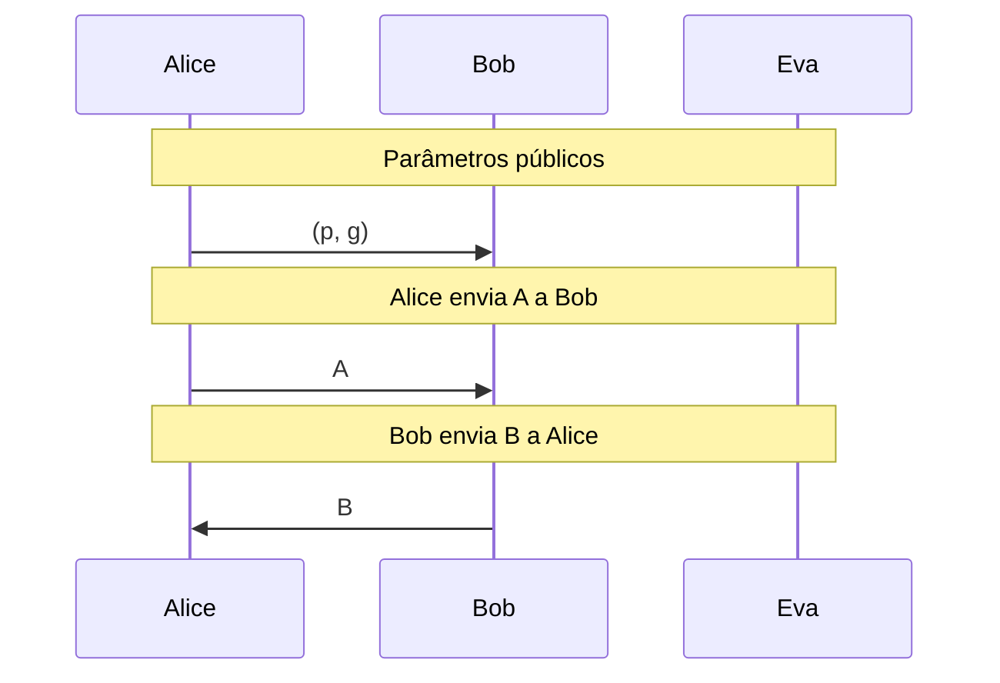
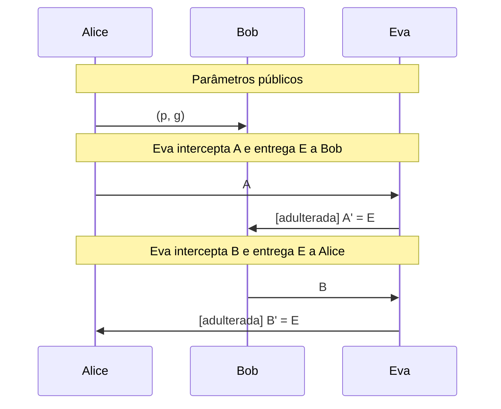

# Diffie-Hellman

Acordo de chaves por um canal público, visão de Eva, derivação de chave com HKDF e o ataque do homem do meio.

- **Categoria:** Criptografia Assimétrica e Acordo de Chaves
- **Abrir o laboratório:** <https://peotta.github.io/CryptoNet/#/lab/diffie-hellman>
- **Motor:** didático (BigInt) com HKDF e AES-GCM reais (Web Crypto)
- **Código-fonte:** `src/labs/diffie-hellman/` (interface e fluxos) e `src/crypto/diffieHellman.ts e src/crypto/kdf.ts` (operações)
- **Padrões e referências:** [RFC 7919](https://www.rfc-editor.org/rfc/rfc7919) (grupos de Diffie-Hellman finitos negociados); NIST [SP 800-56A Rev. 3](https://csrc.nist.gov/pubs/sp/800/56/a/r3/final) (acordo de chaves por logaritmo discreto); [RFC 5869](https://www.rfc-editor.org/rfc/rfc5869) (HKDF) e NIST [SP 800-56C Rev. 2](https://csrc.nist.gov/pubs/sp/800/56/c/r2/final) (derivação de chaves); [FIPS 180-4](https://csrc.nist.gov/pubs/fips/180-4/upd1/final) (SHA-256, usado no HKDF); NIST [SP 800-38D](https://csrc.nist.gov/pubs/sp/800/38/d/final) (AES-GCM); [RFC 7748](https://www.rfc-editor.org/rfc/rfc7748) (X25519).

## 1. Objetivos de aprendizagem

- Explicar que o Diffie-Hellman é um mecanismo de acordo de chaves, e não de cifragem de mensagens.
- Calcular A = g^a mod p, B = g^b mod p e o segredo compartilhado K = g^(ab) mod p, verificando que K_A = K_B.
- Identificar quais informações Eva observa (p, g, A, B) e quais permanecem secretas (a, b, K).
- Relacionar a segurança do protocolo ao problema do logaritmo discreto.
- Demonstrar o ataque do homem do meio (MITM) e justificar a necessidade de autenticação.
- Compreender o papel de uma função de derivação de chaves (HKDF) entre o segredo compartilhado e a chave simétrica.

## 2. Fundamentação

No Diffie-Hellman, Alice e Bob escolhem expoentes privados a e b e trocam A = gᵃ mod p e B = gᵇ mod p; ambos obtêm K = gᵃᵇ mod p. Eva vê p, g, A e B, mas recuperar a ou b é o problema do logaritmo discreto. O protocolo não autentica ninguém, por isso um homem do meio (Eva ativa) estabelece um segredo com cada lado. Na prática, K passa por uma função de derivação (HKDF) e alimenta um algoritmo simétrico como o AES-GCM.

## 3. Participantes

Alice e Bob são os participantes legítimos; Eva é a atacante (observadora passiva ou, quando há adulteração, ativa). As tabelas abaixo listam o que cada um mantém em cada cenário.

| Participante | Papel | Dados que pode guardar (tipo) |
| --- | --- | --- |
| Alice | Participante | p (público) (parâmetro público); g (público) (parâmetro público); A (enviado) (valor público); Valor recebido (suposto B) (valor público); K_A (com quem este segredo é compartilhado?) (segredo); a (segredo privado) (chave privada) |
| Bob | Participante | p (público) (parâmetro público); g (público) (parâmetro público); B (enviado) (valor público); Valor recebido (suposto A) (valor público); K_B (com quem este segredo é compartilhado?) (segredo); b (segredo privado) (chave privada) |
| Eva | Observadora passiva da rede | p (observado) (parâmetro público); g (observado) (parâmetro público); A (capturado de Alice) (valor público); B (capturado de Bob) (valor público); E (valor falso enviado) (valor público); K_AE (segredo com Alice) (segredo); K_EB (segredo com Bob) (segredo); e (segredo privado de Eva) (chave privada) |

## 4. Como ler os diagramas

Cada figura é um diagrama de sequência gerado a partir da mesma definição de protocolo que anima o laboratório: as colunas são os participantes, o tempo corre de cima para baixo e cada faixa horizontal é o início de uma etapa. Os valores numéricos e as chaves não aparecem aqui (são aleatórios ou dependem das entradas); eles são mostrados nas fórmulas do próprio laboratório.

- Seta cheia: mensagem enviada pelo canal, com o rótulo do que trafega.
- `[adulterada]` no início do rótulo: a mensagem foi alterada em trânsito por Eva.
- Faixa com texto: título da etapa que começa naquele ponto.

**Lista de figuras**

- [Figura 5.1.1](#511-acordo-de-chaves-com-eva-observando): Acordo de chaves com Eva observando
- [Figura 5.1.2](#512-homem-do-meio): Homem do meio

## 5. Cenários

### 5.1 Troca de chaves

#### 5.1.1 Acordo de chaves com Eva observando

**Entradas usadas:** p = 23, g = 5, a = 6, b = 15.

*Figura 5.1.1 (sequência).* Acordo de chaves com Eva observando: 3 mensagens, entre Alice, Bob e Eva.

| Etapa | Título | Operação |
| --- | --- | --- |
| 1 | Parâmetros públicos | Acordo sobre o grupo (p, g). |
| 2 | Alice escolhe o segredo a | Escolha de a em [2, p - 2]. |
| 3 | Bob escolhe o segredo b | Escolha de b em [2, p - 2]. |
| 4 | Alice calcula A | A = g^a mod p. |
| 5 | Bob calcula B | B = g^b mod p. |
| 6 | Alice envia A a Bob | Transmissão de A pelo canal público. |
| 7 | Bob envia B a Alice | Transmissão de B pelo canal público. |
| 8 | Alice calcula o segredo compartilhado K_A | K_A = B^a mod p. |
| 9 | Bob calcula o segredo compartilhado K_B | K_B = A^b mod p. |
| 10 | Comparação dos segredos | Verificação de K_A = K_B. |
| 11 | Aplicação do segredo | chave = HKDF-SHA-256(K, sal, contexto). |

**Veredito do cenário:** Segredo compartilhado estabelecido com sucesso.

#### 5.1.2 Homem do meio

**Entradas usadas:** p = 23, g = 5, a = 6, b = 15, expoente de Eva = 13.

*Figura 5.1.2 (sequência).* Homem do meio: 5 mensagens (2 adulteradas), entre Alice, Bob e Eva.

| Etapa | Título | Operação |
| --- | --- | --- |
| 1 | Parâmetros públicos | Acordo sobre o grupo (p, g). |
| 2 | Alice escolhe o segredo a | Escolha de a. |
| 3 | Bob escolhe o segredo b | Escolha de b. |
| 4 | Eva escolhe o segredo e | Escolha de e. |
| 5 | Alice calcula A | A = g^a mod p. |
| 6 | Bob calcula B | B = g^b mod p. |
| 7 | Eva calcula E | E = g^e mod p. |
| 8 | Eva intercepta A e entrega E a Bob | Substituição de A por E no canal. |
| 9 | Eva intercepta B e entrega E a Alice | Substituição de B por E no canal. |
| 10 | Alice calcula K_A sem suspeitar | K_A = (B')^a mod p, com B' = E. |
| 11 | Bob calcula K_B sem suspeitar | K_B = (A')^b mod p, com A' = E. |
| 12 | Eva calcula K_AE, o segredo que divide com Alice | K_AE = A^e mod p. |
| 13 | Eva calcula K_EB, o segredo que divide com Bob | K_EB = B^e mod p. |
| 14 | Resultado do ataque | Comparação: K_A = K_AE? K_B = K_EB? K_A = K_B? |
| 15 | Mitigação: acordo de chaves não é autenticação | Nenhum cálculo: discussão da contramedida. |

**Veredito do cenário:** Ataque bem-sucedido: Alice e Bob estabeleceram segredos distintos, ambos conhecidos por Eva.

## 6. Perguntas de fixação

1. Com p = 23, g = 5, a = 6 e b = 15, quais são A, B e o segredo compartilhado K?

   **Resposta.** A = 5^6 mod 23 = 8; B = 5^15 mod 23 = 19; K = 19^6 mod 23 = 8^15 mod 23 = 2.

2. Por que Eva, conhecendo p, g, A e B, não consegue calcular K com facilidade em um grupo grande?

   **Resposta.** Ela precisaria obter a a partir de A = g^a mod p (ou b a partir de B), isto é, resolver o problema do logaritmo discreto. Em grupos adequados de 2048 bits ou mais, não se conhece algoritmo eficiente. Computar K diretamente a partir de (g, A, B) é o problema Diffie-Hellman computacional, que na prática é considerado tão difícil quanto o logaritmo discreto.

3. O Diffie-Hellman cifra mensagens? O que o segredo K é, de fato?

   **Resposta.** Não. O protocolo apenas faz com que dois participantes, trocando valores públicos, obtenham o mesmo segredo. Esse segredo é então processado por uma função de derivação (como HKDF) para produzir chaves simétricas, que cifram os dados com algoritmos como AES-GCM.

4. Por que o DH sem autenticação é vulnerável ao homem do meio?

   **Resposta.** Nada na troca vincula A ou B a uma identidade. Eva pode substituir os valores por E = g^e mod p e estabelecer um segredo com cada lado. Alice e Bob acreditam compartilhar uma chave entre si, mas Eva a conhece e repassa/altera todo o tráfego. A contramedida é autenticar a troca (assinaturas e certificados, como no TLS 1.3).

5. Por que os parâmetros deste laboratório (p = 23, 467, 2027) não são seguros?

   **Resposta.** Com p tão pequeno, a busca exaustiva por a (no máximo p - 2 tentativas) é instantânea. O botão de força bruta de Eva demonstra isso. Na prática, usam-se grupos de pelo menos 2048 bits ([RFC 7919](https://www.rfc-editor.org/rfc/rfc7919)) ou curvas elípticas como X25519.

## 7. Limitações e cuidados

- Os grupos são pequenos, por finalidade didática: não há grupo de 2048 bits no laboratório e nenhum valor aqui oferece segurança.
- A extensão HKDF e AES-GCM usa a Web Crypto (operação real).
- Uso exclusivamente didático: os laboratórios não devem proteger dados reais.

---

*CryptoNet é um projeto mantido pelo Prof. Dr. Laerte Peotta de Melo, com apoio de IA generativa no processo de desenvolvimento, com sua estrita supervisão, revisão técnica e responsabilidade. Uso exclusivo para fins de ensino e pesquisa. Universidade de Brasília (UnB) - Departamento de Engenharia Elétrica. Código aberto (licença MIT).*
