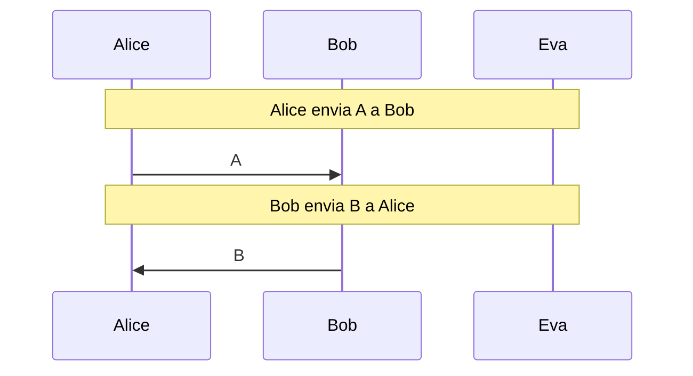
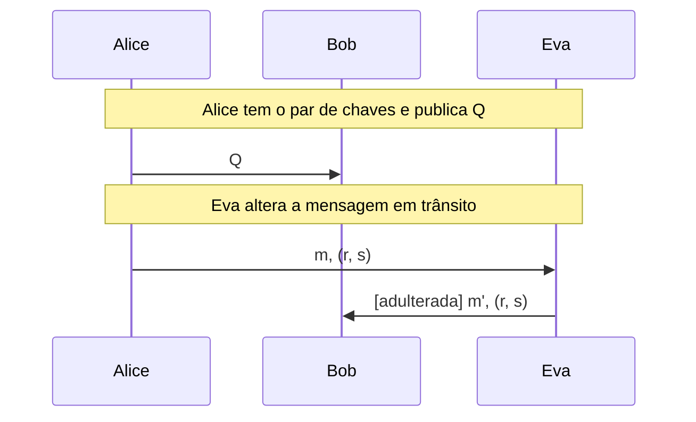
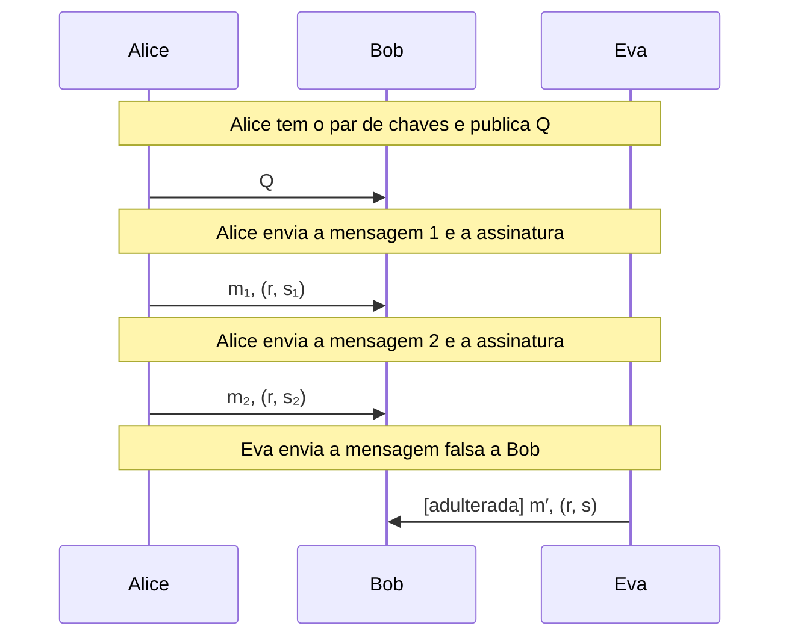
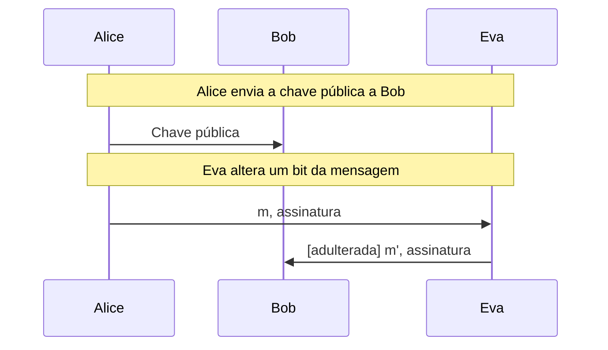

# ECDH, ECDSA e Ed25519

Aritmética de curvas elípticas passo a passo, ECDH e ECDSA em uma curva didática (com o ataque ao nonce reutilizado) e assinaturas reais ECDSA P-256 e Ed25519.

- **Categoria:** Criptografia Assimétrica e Acordo de Chaves
- **Abrir o laboratório:** <https://peotta.github.io/CryptoNet/#/lab/ecdh-assinaturas>
- **Motor:** didático (curva minúscula, BigInt) e real (Web Crypto: ECDSA P-256 e Ed25519)
- **Código-fonte:** `src/labs/ecc/` (interface e fluxos) e `src/crypto/ecc.ts` (operações)
- **Padrões e referências:** [RFC 6979](https://www.rfc-editor.org/rfc/rfc6979) (ECDSA determinístico); [RFC 8032](https://www.rfc-editor.org/rfc/rfc8032) (Ed25519); [RFC 7748](https://www.rfc-editor.org/rfc/rfc7748) (X25519); [FIPS 186-5](https://csrc.nist.gov/pubs/fips/186-5/final) (ECDSA e EdDSA); NIST [SP 800-186](https://csrc.nist.gov/pubs/sp/800/186/final) (curvas elípticas recomendadas, como a P-256); NIST [SP 800-56A Rev. 3](https://csrc.nist.gov/pubs/sp/800/56/a/r3/final) (ECDH).

## 1. Objetivos de aprendizagem

- Descrever uma curva elíptica sobre um corpo finito e a lei de grupo: soma de pontos, dobro, oposto e ponto no infinito.
- Executar, passo a passo, a soma de pontos (inclinação, inverso modular, coordenadas) e a multiplicação escalar por dobrar e somar.
- Explicar o ECDH e por que a segurança vem do problema do logaritmo discreto, que só é difícil em grupos grandes.
- Assinar e verificar com o ECDSA e entender cada quantidade (hash z, nonce k, r, s).
- Demonstrar o ataque de reutilização do nonce k, que revela a chave privada em qualquer tamanho de curva.
- Comparar o ECDSA P-256 e o Ed25519 (assinaturas determinísticas) com a Web Crypto, e relacionar ao handshake do TLS 1.3.

## 2. Fundamentação

Numa curva elíptica sobre um corpo finito, somar pontos e multiplicar por um escalar (dobrar e somar) são operações fáceis, mas descobrir k a partir de k·G é o logaritmo discreto elíptico. O ECDH acorda um segredo; o ECDSA assina com um nonce k que não pode se repetir (repetir k revela a chave privada, como no caso do PlayStation 3). O Ed25519 deriva o nonce da chave e da mensagem, sem sorteio.

## 3. Participantes

Alice e Bob são os participantes legítimos; Eva é a atacante (observadora passiva ou, quando há adulteração, ativa). As tabelas abaixo listam o que cada um mantém em cada cenário.

| Participante | Papel | Dados que pode guardar (tipo) |
| --- | --- | --- |
| Alice | Participante | Chave privada (segredo); Chave pública A = a·G (valor público); Ponto compartilhado (segredo); Nonce k (segredo); Assinatura (assinatura ou etiqueta) |
| Bob | Participante | Chave privada b (segredo); Chave pública de Alice (valor público); Ponto compartilhado (segredo); Resultado da verificação (parâmetro público) |
| Eva | Atacante (observa o canal) | Observado no canal (assinatura ou etiqueta); Chave privada deduzida (segredo); Ponto deduzido por Eva (segredo); Nonce k deduzido (segredo); Mensagem alterada (texto claro) |

## 4. Como ler os diagramas

Cada figura é um diagrama de sequência gerado a partir da mesma definição de protocolo que anima o laboratório: as colunas são os participantes, o tempo corre de cima para baixo e cada faixa horizontal é o início de uma etapa. Os valores numéricos e as chaves não aparecem aqui (são aleatórios ou dependem das entradas); eles são mostrados nas fórmulas do próprio laboratório.

- Seta cheia: mensagem enviada pelo canal, com o rótulo do que trafega.
- `[adulterada]` no início do rótulo: a mensagem foi alterada em trânsito por Eva.
- Faixa com texto: título da etapa que começa naquele ponto.

**Lista de figuras**

- [Figura 5.1.1](#511-ecdh-e-logaritmo-discreto-por-força-bruta): ECDH e logaritmo discreto por força bruta
- [Figura 5.2.1](#521-uso-correto-com-eva-alterando-a-mensagem): Uso correto, com Eva alterando a mensagem
- [Figura 5.2.2](#522-nonce-reutilizado): Nonce reutilizado
- [Figura 5.3.1](#531-ecdsa-p-256-com-eva-alterando-a-mensagem): ECDSA P-256 com Eva alterando a mensagem

## 5. Cenários

### 5.1 ECDH na curva didática

#### 5.1.1 ECDH e logaritmo discreto por força bruta

**Entradas usadas:** a = 11, b = 7.

*Figura 5.1.1 (sequência).* ECDH e logaritmo discreto por força bruta: 2 mensagens, entre Alice, Bob e Eva.

| Etapa | Título | Operação |
| --- | --- | --- |
| 1 | Alice e Bob combinam a curva e o ponto G | Nenhum cálculo: os parâmetros são públicos. |
| 2 | Alice calcula a chave pública A = a · G | Multiplicação escalar a · G. |
| 3 | Bob calcula a chave pública B = b · G | Multiplicação escalar b · G. |
| 4 | Alice envia A a Bob | Envio da chave pública A. |
| 5 | Bob envia B a Alice | Envio da chave pública B. |
| 6 | Alice calcula a · B | Multiplicação escalar a · B. |
| 7 | Bob calcula b · A | Multiplicação escalar b · A. |
| 8 | Eva procura a chave privada de Alice (força bruta) | Cálculo de G, 2G, 3G, ... até obter A. |
| 9 | Eva calcula k · B | Multiplicação escalar k · B. |
| 10 | A curva didática foi quebrada | Avaliação do resultado. |

**Veredito do cenário:** Eva viu A = (13, 10) e B = (0, 6) e testou os múltiplos de G até achar A: bastaram 11 somas (a ordem do grupo é só 19). Com a = 11, calculou a · B = (5, 1), o mesmo ponto de Alice e Bob. Numa curva real como a P-256, a ordem é cerca de 2²⁵⁶: a mesma busca exigiria cerca de 2¹²⁸ operações pelo melhor ataque conhecido (rho de Pollard), inviável. O que protege o ECDH é o tamanho do grupo, e não o formato da conta.

### 5.2 ECDSA na curva didática

#### 5.2.1 Uso correto, com Eva alterando a mensagem

**Entradas usadas:** d = 7, k = 9.

*Figura 5.2.1 (sequência).* Uso correto, com Eva alterando a mensagem: 3 mensagens (1 adulterada), entre Alice, Bob e Eva.

| Etapa | Título | Operação |
| --- | --- | --- |
| 1 | Alice tem o par de chaves e publica Q | Envio da chave pública Q. |
| 2 | Alice calcula o hash da mensagem 1 | SHA-256 e redução ao tamanho de n. |
| 3 | Alice assina com o nonce k | Cálculo de r e s. |
| 4 | Eva altera a mensagem em trânsito | Alteração da mensagem. |
| 5 | Bob verifica a assinatura | Verificação ECDSA. |
| 6 | A alteração foi detectada | Avaliação do resultado. |

**Veredito do cenário:** Eva alterou a mensagem em trânsito e manteve a assinatura de Alice. Bob recalculou o hash da mensagem recebida e a verificação falhou: a assinatura protege a integridade e a autoria. (Numa curva real o hash tem 256 bits e a colisão é inviável.) Eva não conseguiu forjar uma assinatura sem a chave privada. Nesta curva minúscula ela poderia achar d por força bruta, como na aba de ECDH; aqui Eva só usa ataques que valem em qualquer tamanho de curva.

#### 5.2.2 Nonce reutilizado

**Entradas usadas:** d = 7, k = 9 nas duas assinaturas.

*Figura 5.2.2 (sequência).* Nonce reutilizado: 4 mensagens (1 adulterada), entre Alice, Bob e Eva.

| Etapa | Título | Operação |
| --- | --- | --- |
| 1 | Alice tem o par de chaves e publica Q | Envio da chave pública Q. |
| 2 | Alice calcula o hash da mensagem 1 | SHA-256 e redução ao tamanho de n. |
| 3 | Alice assina com o nonce k | Cálculo de r e s. |
| 4 | Alice envia a mensagem 1 e a assinatura | Envio de (m₁, r, s₁). |
| 5 | Alice assina a mensagem 2 com o MESMO k (erro) | Cálculo de r e s₂ com o mesmo k. |
| 6 | Alice envia a mensagem 2 e a assinatura | Envio de (m₂, r, s₂). |
| 7 | Eva calcula o nonce k | Cálculo de k = (z₁ − z₂)/(s₁ − s₂) mod n. |
| 8 | Eva calcula a chave privada d | Cálculo de d = (s₁ · k − z₁)/r mod n. |
| 9 | Eva assina uma mensagem falsa | Assinatura ECDSA com a chave roubada. |
| 10 | Eva envia a mensagem falsa a Bob | Envio da mensagem falsa e da assinatura forjada. |
| 11 | Bob verifica a assinatura forjada | Verificação ECDSA. |
| 12 | A reutilização de k revelou a chave privada | Avaliação do resultado. |

**Veredito do cenário:** As duas assinaturas têm o mesmo r = 7, o que mostra a Eva que o mesmo k foi usado. De s₁ − s₂ = k⁻¹(z₁ − z₂) ela obtém k = 9 e, de d = (s₁·k − z₁)/r, a chave privada d = 7, a mesma de Alice (7). Com ela, forjou uma assinatura de "TRANSFERIR TUDO PARA EVA" que Bob aceitou: aceita. Isso vale para qualquer curva, inclusive a P-256: foi assim que se extraiu a chave de assinatura do PlayStation 3 (2010). Por isso o ECDSA moderno deriva k de forma determinística ([RFC 6979](https://www.rfc-editor.org/rfc/rfc6979)) e o Ed25519 não usa nonce aleatório.

### 5.3 Assinaturas reais

#### 5.3.1 ECDSA P-256 com Eva alterando a mensagem

**Entradas usadas:** mensagem "Transferir R$ 100".

*Figura 5.3.1 (sequência).* ECDSA P-256 com Eva alterando a mensagem: 3 mensagens (1 adulterada), entre Alice, Bob e Eva.

| Etapa | Título | Operação |
| --- | --- | --- |
| 1 | Alice gera o par de chaves | Geração do par ECDSA-P256. |
| 2 | Alice envia a chave pública a Bob | Envio da chave pública. |
| 3 | Alice assina a mensagem | Assinatura ECDSA-P256. |
| 4 | Eva altera um bit da mensagem | Inversão de um bit da mensagem. |
| 5 | Bob verifica a assinatura | Verificação ECDSA-P256. |
| 6 | A alteração foi detectada | Avaliação do resultado. |

**Veredito do cenário:** Eva trocou um bit da mensagem e manteve a assinatura. Bob verificou com a chave pública de Alice e rejeitou: qualquer alteração invalida a assinatura. Eva não pode gerar outra sem a chave privada, e o problema do logaritmo discreto em P-256 (cerca de 2²⁵⁶ elementos) impede que ela a derive da chave pública.

## 6. Perguntas de fixação

1. Na curva y² = x³ + 2x + 2 (mod 17), calcule 2G com G = (5, 1).

   **Resposta.** Dobro: λ = (3x² + a)/(2y) = (3·25 + 2)/2 = 77/2. Módulo 17, 77 ≡ 9 e 2⁻¹ = 9, então λ = 81 ≡ 13. x₃ = λ² − 2x = 169 − 10 = 159 ≡ 6. y₃ = λ(x − x₃) − y = 13·(5 − 6) − 1 = −14 ≡ 3. Logo 2G = (6, 3).

2. Por que o ECDH com chaves de 256 bits é seguro, se a conta k · G é tão simples?

   **Resposta.** Calcular k · G é rápido (cerca de 256 dobras e somas), mas descobrir k a partir de k · G é o logaritmo discreto em curva elíptica, para o qual o melhor ataque conhecido (rho de Pollard) leva cerca de 2¹²⁸ operações em uma curva de 256 bits. Na curva didática de ordem 19 bastam 19 tentativas. A segurança vem do tamanho do grupo, e não da conta em si.

3. Por que o ECDSA com a mesma chave de 256 bits oferece segurança equivalente a um RSA de 3072 bits?

   **Resposta.** Para o RSA existem algoritmos subexponenciais de fatoração (crivo de corpo de números), então o módulo precisa ser grande. Para curvas bem escolhidas só se conhecem ataques exponenciais (cerca de a raiz quadrada da ordem do grupo), de modo que 256 bits de curva dão cerca de 128 bits de segurança, o que o RSA só atinge com cerca de 3072 bits. Daí chaves e assinaturas menores e operações mais rápidas.

4. O que acontece se Alice reutilizar o nonce k em duas assinaturas ECDSA?

   **Resposta.** As duas assinaturas têm o mesmo r. Subtraindo as equações s = k⁻¹(z + r·d), obtém-se s₁ − s₂ = k⁻¹(z₁ − z₂), logo k = (z₁ − z₂)/(s₁ − s₂). Com k conhecido, d = (s₁·k − z₁)/r. Eva obtém a chave privada e assina o que quiser. Isso vale para qualquer curva. Casos reais: a chave de assinatura do PlayStation 3 (2010) e carteiras de bitcoin com geradores aleatórios defeituosos.

5. Como o Ed25519 evita o problema do nonce?

   **Resposta.** O nonce r é derivado por hash da parte secreta da chave e da mensagem, sem sorteio: duas assinaturas da mesma mensagem são idênticas, e mensagens diferentes dão nonces diferentes e imprevisíveis para quem não conhece a chave. O ECDSA moderno pode fazer o mesmo ([RFC 6979](https://www.rfc-editor.org/rfc/rfc6979)), mas o Ed25519 já nasceu assim.

6. Por que a troca de chaves elíptica sozinha não protege contra o homem do meio?

   **Resposta.** O ECDH garante apenas que, se Alice e a outra ponta calculam o mesmo ponto, só elas o conhecem. Não diz quem é a outra ponta: Eva pode fazer um ECDH com cada lado. Por isso o TLS 1.3 combina o ECDHE com certificados e com uma assinatura (ECDSA ou Ed25519) sobre a transcrição do handshake.

## 7. Limitações e cuidados

- A curva didática tem 19 pontos: qualquer chave cai por tentativa e nada ali oferece segurança.
- As assinaturas reais (ECDSA P-256 e Ed25519) dependem do suporte do navegador à Web Crypto; o Ed25519 pode não estar disponível em versões antigas.
- Uso exclusivamente didático: os laboratórios não devem proteger dados reais.

---

*CryptoNet é um projeto mantido pelo Prof. Dr. Laerte Peotta de Melo, com apoio de IA generativa no processo de desenvolvimento, com sua estrita supervisão, revisão técnica e responsabilidade. Uso exclusivo para fins de ensino e pesquisa. Universidade de Brasília (UnB) - Departamento de Engenharia Elétrica. Código aberto (licença MIT).*
