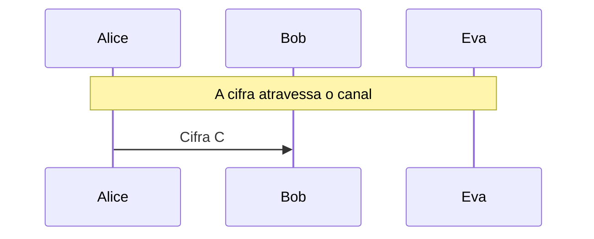

# Enigma, fase 2: a Bombe

O ataque de Turing e Welchman: menu do texto provável, hipótese de plugue, propagação, contradição e paradas falsas, com Alice, Bob e Eva.

- **Categoria:** Criptografia Clássica
- **Abrir o laboratório:** <https://peotta.github.io/CryptoNet/#/lab/enigma-bombe>
- **Motor:** didático (Bombe de Turing e Welchman)
- **Código-fonte:** `src/labs/enigma-bombe/` (interface e fluxos) e `src/crypto/bombe.ts` (operações)
- **Padrões e referências:** Turing e Welchman (Bletchley Park): a Bombe e o painel diagonal; Enigma I: rotores I a V, refletor B.

## 1. Objetivos de aprendizagem

- Montar o menu de um texto provável (crib): o grafo que liga a letra suposta à letra cifrada em cada tecla.
- Explicar a hipótese de plugue e a propagação de consequências, e reconhecer uma contradição (uma letra com dois plugues).
- Acompanhar passo a passo a propagação em uma posição inicial e ver por que a posição errada leva a contradição.
- Relacionar o número de laços do menu ao número de paradas falsas, e entender por que menus sem laços não funcionam.
- Reconhecer paradas verdadeiras e falsas e completar o painel de plugues pela legibilidade do texto.
- Comparar o custo da Bombe (17.576 posições por ordem de rotores) com a força bruta sobre o espaço de chaves inteiro.

## 2. Fundamentação

A Bombe testa as 17.576 posições iniciais dos rotores contra um texto provável. O menu liga as letras do texto claro às da cifra; uma hipótese de plugue para a letra de teste se propaga pelos laços do menu, e uma contradição elimina a posição. As posições que sobrevivem (paradas) são verificadas, e as paradas falsas são descartadas pelos laços.

## 3. Participantes

Alice e Bob são os participantes legítimos; Eva é a atacante (observadora passiva ou, quando há adulteração, ativa). As tabelas abaixo listam o que cada um mantém em cada cenário.

| Participante | Papel | Dados que pode guardar (tipo) |
| --- | --- | --- |
| Alice | Operadora (transmissora) | Configuração do dia (segredo); Mensagem m (texto claro); Cifra C (texto cifrado) |
| Bob | Operador (receptor) | Configuração do dia (segredo); Cifra recebida (texto cifrado); Mensagem recuperada (texto claro) |
| Eva | Criptoanalista (opera a Bombe) | Cifra observada (texto cifrado); Menu do texto provável (parâmetro público); Paradas da Bombe (parâmetro público); Posições e plugues deduzidos (segredo); Texto deduzido por Eva (texto claro) |

## 4. Como ler os diagramas

Cada figura é um diagrama de sequência gerado a partir da mesma definição de protocolo que anima o laboratório: as colunas são os participantes, o tempo corre de cima para baixo e cada faixa horizontal é o início de uma etapa. Os valores numéricos e as chaves não aparecem aqui (são aleatórios ou dependem das entradas); eles são mostrados nas fórmulas do próprio laboratório.

- Seta cheia: mensagem enviada pelo canal, com o rótulo do que trafega.
- `[adulterada]` no início do rótulo: a mensagem foi alterada em trânsito por Eva.
- Faixa com texto: título da etapa que começa naquele ponto.

**Lista de figuras**

- [Figura 5.1.1](#511-menu-propagação-e-paradas): Menu, propagação e paradas

## 5. Cenários

### 5.1 Alice, Bob e Eva

#### 5.1.1 Menu, propagação e paradas

**Entradas usadas:** rotores I II III, refletor B, posições iniciais QDV, texto provável RELATORIODOTEMPO.

*Figura 5.1.1 (sequência).* Menu, propagação e paradas: 1 mensagem, entre Alice, Bob e Eva.

| Etapa | Título | Operação |
| --- | --- | --- |
| 1 | Alice e Bob ajustam a máquina do dia | Nenhum cálculo: a configuração já é conhecida por Alice e por Bob. |
| 2 | Alice escreve a mensagem | Normalização do texto em letras de A a Z. |
| 3 | Alice cifra na Enigma | Cifragem de 184 letras. |
| 4 | A cifra atravessa o canal | Transmissão da cifra por rádio. |
| 5 | Eva monta o menu do texto provável | Montagem do grafo de letras do texto provável alinhado à cifra. |
| 6 | Eva roda a Bombe nas 17.576 posições | Propagação das hipóteses de plugue em cada posição inicial. |
| 7 | Eva verifica as paradas lendo o texto | Decifragem de cada parada e escolha pela legibilidade do texto. |
| 8 | Bob recebe a cifra | Recepção da cifra. |
| 9 | Bob decifra na Enigma | Decifragem na Enigma. |
| 10 | A Bombe quebrou a chave do dia | Avaliação do resultado. |

**Veredito do cenário:** A Bombe eliminou 17.575 das 17.576 posições e deixou 1 parada. Eva decifrou com as posições QDV e completou o painel de plugues pela legibilidade do texto: recuperou 100% da mensagem. O menu tinha 2 laços, o que tornou as contradições frequentes.

## 6. Perguntas de fixação

1. O que é o menu da Bombe e como se monta?

   **Resposta.** É um grafo cujos vértices são letras e cujas arestas representam as teclas do texto provável: na tecla k, liga-se a letra suposta do texto claro à letra cifrada, e a aresta leva o número k. Como cada tecla corresponde a uma posição diferente dos rotores, cada aresta representa uma permutação diferente da máquina. Os laços (ciclos) do grafo são o que dá poder ao ataque.

2. Por que a Bombe não precisa conhecer o painel de plugues para testar uma posição dos rotores?

   **Resposta.** Porque as consequências do texto provável dependem só da relação entre as letras ligadas por plugues. Se o plugue da letra a é y (S(a) = y), então S(b) = E_k(y), em que E_k é a permutação dos rotores e do refletor na tecla k. Basta supor um plugue para uma letra e propagar. Se a propagação exigir que alguma letra tenha dois plugues, a hipótese é impossível. Se todas as 26 hipóteses forem impossíveis, a posição dos rotores é descartada, sem que o painel seja conhecido.

3. O que é uma parada da Bombe e por que existem paradas falsas?

   **Resposta.** Uma parada é uma posição inicial dos rotores em que ao menos uma hipótese de plugue não leva a contradição. Pode ser a verdadeira ou acaso: cada hipótese errada escapa da contradição com probabilidade que cai muito com o número de laços do menu. Com poucos laços, milhares de posições falsas sobrevivem (como no experimento deste laboratório); com dois ou mais laços sobra praticamente só a verdadeira.

4. Por que o texto provável precisa estar na posição certa, e como os aliados lidavam com isso?

   **Resposta.** O menu é montado alinhando o texto provável à cifra. Se o alinhamento estiver errado, as contradições surgem em quase todas as posições e a Bombe não deixa a parada verdadeira. Os aliados exploravam a propriedade de que nenhuma letra se cifra em si mesma para descartar alinhamentos impossíveis (como na fase 1) e a regularidade das mensagens (relatórios do tempo, saudações, fórmulas finais) para propor textos prováveis em posições conhecidas.

5. Qual a diferença entre a Bombe polonesa (bomba) e a Bombe de Turing?

   **Resposta.** A bomba polonesa (1938) explorava a repetição da chave de mensagem enviada duas vezes no início de cada mensagem, um defeito do procedimento alemão. Quando os alemães mudaram o procedimento, Turing e Welchman projetaram, em Bletchley Park, uma máquina baseada em textos prováveis, que funcionava sem depender da repetição. Welchman acrescentou o painel diagonal, que explora a simetria do painel de plugues (se S(a) = y, então S(y) = a) e reduziu muito as paradas falsas.

6. Esta simulação reproduz a Bombe histórica fielmente?

   **Resposta.** Não. Ela reproduz a ideia lógica (menu, hipótese de plugue, propagação com simetria e contradição), mas simplifica: Eva conhece a ordem dos rotores, o refletor e os anéis (a máquina real era executada para cada ordem de rotores e tratava os anéis pelo cálculo de entalhes), o avanço dos rotores é simulado exatamente (a máquina física exigia que o rotor do meio não girasse durante o texto provável) e o completamento do painel usa a legibilidade do texto, em vez do trabalho manual dos analistas.

## 7. Limitações e cuidados

- Cifra histórica: não oferece segurança.
- O laboratório supõe que Eva conhece ou supõe a ordem dos rotores, o refletor e o texto provável, e simula a lógica da Bombe, não a máquina eletromecânica.
- Uso exclusivamente didático: os laboratórios não devem proteger dados reais.

---

*CryptoNet é um projeto mantido pelo Prof. Dr. Laerte Peotta de Melo, com apoio de IA generativa no processo de desenvolvimento, com sua estrita supervisão, revisão técnica e responsabilidade. Uso exclusivo para fins de ensino e pesquisa. Universidade de Brasília (UnB) - Departamento de Engenharia Elétrica. Código aberto (licença MIT).*
