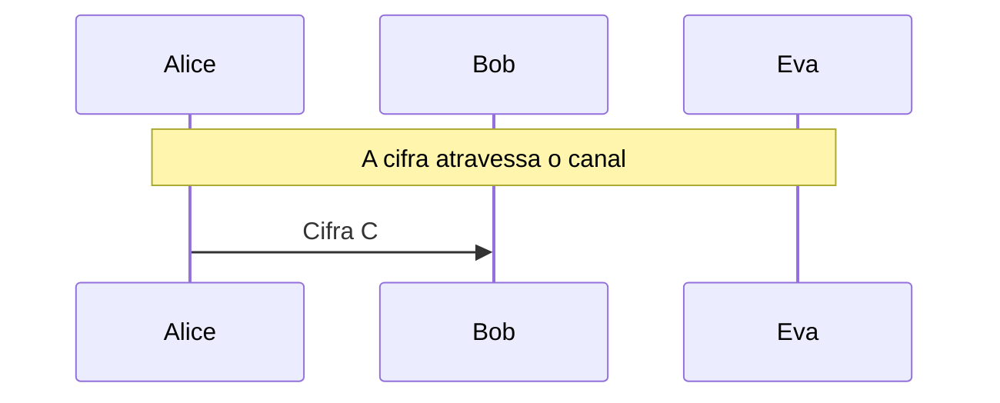

# Máquina Enigma

Enigma I: rotores, refletor, anéis e plugues, o caminho do sinal tecla a tecla e a criptoanálise de Eva por texto provável.

- **Categoria:** Criptografia Clássica
- **Abrir o laboratório:** <https://peotta.github.io/CryptoNet/#/lab/enigma>
- **Motor:** didático (Enigma I)
- **Código-fonte:** `src/labs/enigma/` (interface e fluxos) e `src/crypto/enigma.ts` (operações)
- **Padrões e referências:** Enigma I do Exército alemão (Wehrmacht), rotores I a V e refletores B e C; Rejewski, Turing e Welchman: criptoanálise por texto provável.

## 1. Objetivos de aprendizagem

- Descrever os componentes da Enigma I: teclado, painel de plugues, três rotores, refletor e lâmpadas.
- Acompanhar o caminho do sinal por uma tecla: ida pelos rotores, reflexão e volta.
- Explicar o avanço dos rotores, inclusive o passo duplo do rotor do meio, e por que a cifra é polialfabética.
- Explicar por que a Enigma é recíproca e por que nenhuma letra é cifrada em si mesma.
- Calcular o tamanho do espaço de chaves e relacioná-lo à segurança que se imaginava.
- Usar um texto provável (crib) e a fraqueza do refletor para descartar hipóteses, como fizeram os criptoanalistas aliados.

## 2. Fundamentação

A Enigma I cifra tecla a tecla: o sinal atravessa o painel de plugues, três rotores, o refletor e volta. O refletor torna a máquina recíproca (decifrar é cifrar de novo), mas impede que uma letra seja cifrada nela mesma, e essa fraqueza permite a Eva descartar alinhamentos de um texto provável (crib). Com 3 rotores escolhidos entre 5, 17.576 posições iniciais e 10 pares de plugues, há cerca de 1,6 × 10²⁰ configurações.

## 3. Participantes

Alice e Bob são os participantes legítimos; Eva é a atacante (observadora passiva ou, quando há adulteração, ativa). As tabelas abaixo listam o que cada um mantém em cada cenário.

| Participante | Papel | Dados que pode guardar (tipo) |
| --- | --- | --- |
| Alice | Operadora (transmissora) | Configuração do dia (segredo); Mensagem m (texto claro); Cifra C (texto cifrado) |
| Bob | Operador (receptor) | Configuração do dia (segredo); Cifra recebida (texto cifrado); Mensagem recuperada (texto claro) |
| Eva | Criptoanalista (observa e, se puder, altera o canal) | Cifra observada ou capturada (texto cifrado); Alinhamentos do texto provável (parâmetro público); Cifra alterada C' (enviada a Bob) (texto cifrado) |

## 4. Como ler os diagramas

Cada figura é um diagrama de sequência gerado a partir da mesma definição de protocolo que anima o laboratório: as colunas são os participantes, o tempo corre de cima para baixo e cada faixa horizontal é o início de uma etapa. Os valores numéricos e as chaves não aparecem aqui (são aleatórios ou dependem das entradas); eles são mostrados nas fórmulas do próprio laboratório.

- Seta cheia: mensagem enviada pelo canal, com o rótulo do que trafega.
- `[adulterada]` no início do rótulo: a mensagem foi alterada em trânsito por Eva.
- Faixa com texto: título da etapa que começa naquele ponto.

**Lista de figuras**

- [Figura 5.1.1](#511-cifragem-reciprocidade-e-texto-provável): Cifragem, reciprocidade e texto provável

## 5. Cenários

### 5.1 Alice, Bob e Eva

#### 5.1.1 Cifragem, reciprocidade e texto provável

**Entradas usadas:** rotores I II III, refletor B, posições KLM, 10 plugues, texto provável RELATORIO.

*Figura 5.1.1 (sequência).* Cifragem, reciprocidade e texto provável: 1 mensagem, entre Alice, Bob e Eva.

| Etapa | Título | Operação |
| --- | --- | --- |
| 1 | Alice e Bob ajustam a configuração do dia | Nenhum cálculo: a configuração já é conhecida por Alice e por Bob. |
| 2 | Alice escreve a mensagem | Normalização do texto em letras de A a Z. |
| 3 | Alice digita a mensagem na Enigma | Cifragem de 184 teclas, uma a uma, com rotores em movimento. |
| 4 | A cifra atravessa o canal | Transmissão da cifra pelo canal público. |
| 5 | Eva testa um texto provável e usa a fraqueza do refletor | Alinhamento do texto provável em 176 posições e descarte dos impossíveis. |
| 6 | Bob recebe a cifra | Recepção da mensagem cifrada. |
| 7 | Bob digita a cifra na Enigma | Cifragem da cifra com a mesma configuração: P = E(C). |
| 8 | Eva reduz as hipóteses, mas não lê a mensagem | Avaliação do resultado. |

**Veredito do cenário:** Eva alinhou o texto provável "RELATORIO" em 176 posições e descartou 50 por conterem uma letra igual à cifrada (a Enigma nunca cifra uma letra em si mesma). Restam 126 posições, e ela ainda não conhece a configuração: o espaço de chaves é cerca de 158.962.555.217.826.360.000 (com 10 pares de plugues, sem contar os anéis). Historicamente, a quebra da Enigma combinou essa propriedade com textos prováveis e com as Bombes de Turing; esta fase não inclui a Bombe, que está no laboratório "Enigma, fase 2".

## 6. Perguntas de fixação

1. Cifre "AAAAA" com os rotores I-II-III, refletor B, posições AAA e sem plugues. Qual é a cifra?

   **Resposta.** BDZGO. A mesma letra A vira cinco letras diferentes, porque o rotor da direita avança a cada tecla e muda a ligação elétrica. Observe também que nenhum A vira A.

2. Por que a Enigma é recíproca, isto é, cifrar e decifrar são a mesma operação?

   **Resposta.** O refletor é uma involução sem ponto fixo: liga as letras em pares (se A vai a E, então E vai a A), e o sinal percorre o mesmo circuito nos dois sentidos. Se, com uma certa posição dos rotores, P é cifrada em C, então C é cifrada em P na mesma posição. Basta partir da mesma configuração e das mesmas posições iniciais.

3. Por que nenhuma letra pode ser cifrada em si mesma, e por que isso é uma fraqueza?

   **Resposta.** O refletor nunca liga uma letra a ela mesma, e o sinal volta pelo mesmo caminho, então a saída nunca é igual à entrada. Isso permite descartar qualquer alinhamento de um texto provável (crib) em que uma letra do texto coincida com a da cifra na mesma posição, reduzindo muito as hipóteses.

4. O que é o passo duplo (double stepping) do rotor do meio?

   **Resposta.** O rotor do meio avança quando o rotor da direita passa pelo seu entalhe, mas também quando ele próprio está no entalhe, e, nesse caso, arrasta o rotor da esquerda. Por isso o rotor do meio pode avançar em duas teclas seguidas (por exemplo, ADU, ADV, AEW, BFX, BFY: o rotor do meio vai de D para E e de E para F).

5. Quantas configurações a Enigma I admite? Isso a tornava segura?

   **Resposta.** Com 3 rotores escolhidos entre 5 (60 ordens), 26³ = 17.576 posições iniciais e 10 pares de plugues (150.738.274.937.250 combinações), são cerca de 1,6 × 10²⁰ configurações, sem contar os anéis. Era um espaço enorme para a época, mas os ataques não testaram todas as chaves: exploraram textos prováveis, a fraqueza do refletor e erros dos operadores, com máquinas (as Bombes) para eliminar hipóteses.

6. Por que a Enigma não protege a integridade da mensagem?

   **Resposta.** Cada letra é cifrada de forma independente do restante: se Eva altera uma letra da cifra, apenas a letra correspondente sai errada na decifragem, e Bob não tem como perceber (só pelo contexto). Não há etiqueta de autenticação, como o GCM tem.

## 7. Limitações e cuidados

- Cifra histórica: não oferece segurança.
- O modelo cobre a Enigma I (três rotores, anéis e plugues); não simula variantes navais com quatro rotores.
- Uso exclusivamente didático: os laboratórios não devem proteger dados reais.

---

*CryptoNet é um projeto mantido pelo Prof. Dr. Laerte Peotta de Melo, com apoio de IA generativa no processo de desenvolvimento, com sua estrita supervisão, revisão técnica e responsabilidade. Uso exclusivo para fins de ensino e pesquisa. Universidade de Brasília (UnB) - Departamento de Engenharia Elétrica. Código aberto (licença MIT).*
