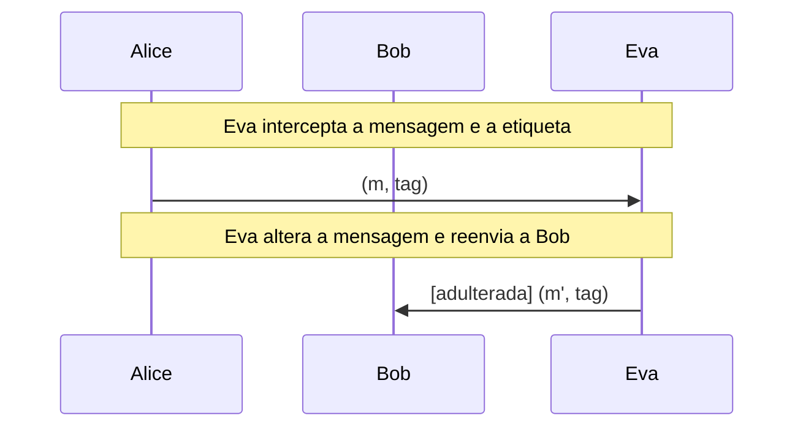

# Primitivas: funções hash e HMAC

SHA-2 reais, efeito avalanche visualizado bit a bit e HMAC calculado passo a passo ([RFC 2104](https://www.rfc-editor.org/rfc/rfc2104)).

- **Categoria:** Criptografia Simétrica
- **Abrir o laboratório:** <https://peotta.github.io/CryptoNet/#/lab/hash-hmac>
- **Motor:** real (Web Crypto: SHA-1, SHA-256, SHA-384 e SHA-512) e HMAC passo a passo
- **Código-fonte:** `src/labs/hash-hmac/` (interface e fluxos) e `src/crypto/hash.ts` (operações)
- **Padrões e referências:** [FIPS 180-4](https://csrc.nist.gov/pubs/fips/180-4/final) (SHA-2); [RFC 2104](https://www.rfc-editor.org/rfc/rfc2104) e [FIPS 198-1](https://csrc.nist.gov/pubs/fips/198-1/final) (HMAC); [RFC 4231](https://www.rfc-editor.org/rfc/rfc4231) (vetores de teste do HMAC-SHA-2).

## 1. Objetivos de aprendizagem

- Descrever as propriedades de uma função hash criptográfica: determinismo, saída de tamanho fixo, resistência à pré-imagem, à segunda pré-imagem e a colisões.
- Observar o efeito avalanche: a alteração de um único bit da entrada modifica, em média, metade dos bits do resumo.
- Calcular o HMAC passo a passo ([RFC 2104](https://www.rfc-editor.org/rfc/rfc2104)) e explicar o papel das duas passagens, do ipad e do opad.
- Distinguir hash (sem chave) de código de autenticação de mensagem (com chave) e justificar por que um hash simples não autentica.
- Reconhecer que o HMAC garante integridade e autenticidade, mas não confidencialidade.

## 2. Fundamentação

Uma função hash produz um resumo de tamanho fixo e tem o efeito avalanche: trocar um bit da entrada altera cerca de metade dos bits da saída. Hash não é cifragem nem autentica quem enviou. O HMAC combina o hash com uma chave secreta em duas passagens (ipad e opad), e só quem tem a chave calcula a etiqueta correta, o que impede Eva de alterar a mensagem sem ser notada.

## 3. Participantes

Alice e Bob são os participantes legítimos; Eva é a atacante (observadora passiva ou, quando há adulteração, ativa). As tabelas abaixo listam o que cada um mantém em cada cenário.

| Participante | Papel | Dados que pode guardar (tipo) |
| --- | --- | --- |
| Alice | Remetente | Chave compartilhada K (segredo); Mensagem m (texto claro); Hash interno (parâmetro público); Etiqueta HMAC (assinatura ou etiqueta) |
| Bob | Verificador | Chave compartilhada K (segredo); Mensagem recebida (texto claro); Etiqueta recebida (assinatura ou etiqueta); Etiqueta recalculada (assinatura ou etiqueta); Resultado da comparação (parâmetro público) |
| Eva | Atacante (observa e, se puder, altera o canal) | Mensagem observada ou capturada (texto claro); Etiqueta observada ou capturada (assinatura ou etiqueta); Mensagem alterada m' (enviada a Bob) (texto claro); Chave K: desconhecida para Eva (segredo) |

## 4. Como ler os diagramas

Cada figura é um diagrama de sequência gerado a partir da mesma definição de protocolo que anima o laboratório: as colunas são os participantes, o tempo corre de cima para baixo e cada faixa horizontal é o início de uma etapa. Os valores numéricos e as chaves não aparecem aqui (são aleatórios ou dependem das entradas); eles são mostrados nas fórmulas do próprio laboratório.

- Seta cheia: mensagem enviada pelo canal, com o rótulo do que trafega.
- `[adulterada]` no início do rótulo: a mensagem foi alterada em trânsito por Eva.
- Faixa com texto: título da etapa que começa naquele ponto.

**Lista de figuras**

- [Figura 5.1.1](#511-hmac-sha-256-com-eva-alterando-a-mensagem): HMAC-SHA-256 com Eva alterando a mensagem

## 5. Cenários

### 5.1 HMAC

#### 5.1.1 HMAC-SHA-256 com Eva alterando a mensagem

**Entradas usadas:** chave "segredo", mensagem "Transferir R$ 100".

*Figura 5.1.1 (sequência).* HMAC-SHA-256 com Eva alterando a mensagem: 2 mensagens (1 adulterada), entre Alice, Bob e Eva.

| Etapa | Título | Operação |
| --- | --- | --- |
| 1 | Alice e Bob compartilham a chave K | Nenhum cálculo: K já é conhecida por ambos e não trafega pelo canal. |
| 2 | Alice escolhe a mensagem | Definição da mensagem m. |
| 3 | Alice calcula o hash interno | hash interno = SHA-256((K' ⊕ ipad) ‖ m). |
| 4 | Alice calcula a etiqueta (hash externo) | tag = SHA-256((K' ⊕ opad) ‖ hash interno). |
| 5 | Eva intercepta a mensagem e a etiqueta | Interceptação do par (m, tag). |
| 6 | Eva altera a mensagem e reenvia a Bob | Reenvio de (m', tag). |
| 7 | Bob recebe a mensagem e a etiqueta | Recepção de (m, tag). |
| 8 | Bob recalcula a etiqueta sobre a mensagem recebida | tag' = HMAC(K, m recebida). |
| 9 | As etiquetas diferem: mensagem rejeitada | Comparação em tempo constante entre tag e tag'. |

**Veredito do cenário:** Falha de autenticação: as etiquetas HMAC são diferentes e a mensagem foi rejeitada.

## 6. Perguntas de fixação

1. Alice envia (m, H(m)) a Bob, e Eva intercepta, troca m por m' e recalcula H(m'). Bob detecta a alteração? E se Alice enviasse (m, HMAC(K, m))?

   **Resposta.** Com hash simples, não: qualquer pessoa calcula H(m') e o par alterado parece válido. O hash só detecta alterações acidentais. Com HMAC, Eva não conhece K e, por isso, não consegue gerar a etiqueta correta de m'. Bob recalcula o HMAC, encontra valor diferente e rejeita a mensagem.

2. Por que não se usa simplesmente H(K ‖ m) como código de autenticação?

   **Resposta.** Funções da família Merkle-Damgård (SHA-1, SHA-256, SHA-512) são vulneráveis ao ataque de extensão de comprimento: dado H(K ‖ m) e o tamanho de K ‖ m, um atacante calcula H(K ‖ m ‖ preenchimento ‖ x) sem conhecer K. A construção HMAC, com duas passagens, elimina o problema.

3. O que o efeito avalanche garante, e por que ele é desejável?

   **Resposta.** Uma pequena alteração na entrada altera, em média, metade dos bits do resumo, de forma imprevisível. Isso impede deduzir a entrada ou encontrar entradas parecidas a partir da saída e é uma consequência esperada de um bom projeto da função.

4. Quantas mensagens diferentes um SHA-256 distingue? Colisões existem?

   **Resposta.** A saída tem 2^256 valores possíveis, mas as entradas são infinitas, logo colisões existem pelo princípio da casa dos pombos. O que a segurança exige é que encontrá-las seja computacionalmente inviável (cerca de 2^128 operações, pelo paradoxo do aniversário). O SHA-1 já tem colisões práticas demonstradas (2017) e não deve ser usado em novas aplicações.

5. O HMAC cifra a mensagem? Como combinar sigilo e autenticidade?

   **Resposta.** Não: a mensagem trafega em claro e apenas a etiqueta é acrescentada. Para sigilo e autenticidade juntos usa-se um modo de criptografia autenticada, como o AES-GCM, ou cifra-se e aplica-se o HMAC sobre o texto cifrado (encrypt-then-MAC).

6. Por que a comparação de etiquetas deve ser feita em tempo constante?

   **Resposta.** Uma comparação que termina no primeiro byte diferente revela, pelo tempo gasto, quantos bytes iniciais estão corretos. Um atacante pode explorar isso para descobrir uma etiqueta válida byte a byte (ataque de temporização). A comparação em tempo constante examina sempre todos os bytes.

## 7. Limitações e cuidados

- O SHA-1 está disponível apenas para comparação: é considerado legado.
- O avalanche é medido por amostragem de entradas aleatórias, não por prova.
- Uso exclusivamente didático: os laboratórios não devem proteger dados reais.

---

*CryptoNet é um projeto mantido pelo Prof. Dr. Laerte Peotta de Melo, com apoio de IA generativa no processo de desenvolvimento, com sua estrita supervisão, revisão técnica e responsabilidade. Uso exclusivo para fins de ensino e pesquisa. Universidade de Brasília (UnB) - Departamento de Engenharia Elétrica. Código aberto (licença MIT).*
