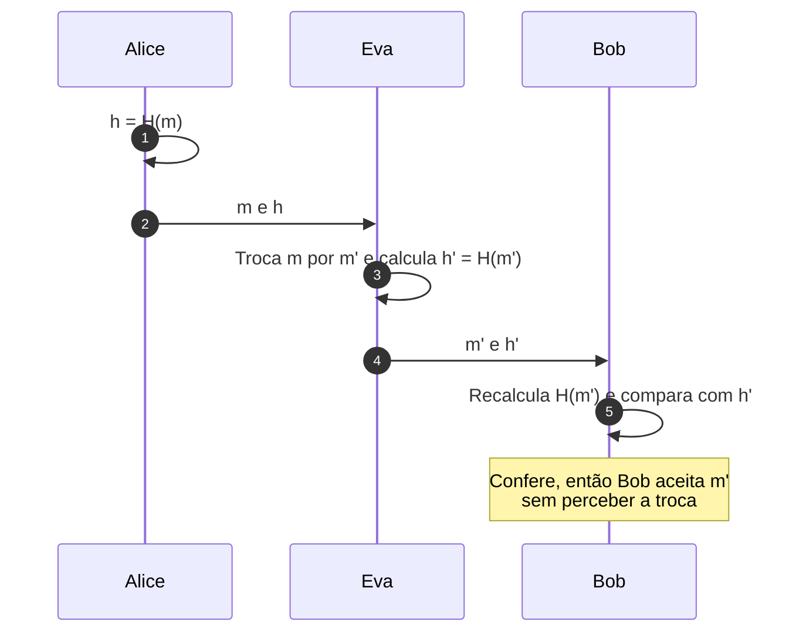
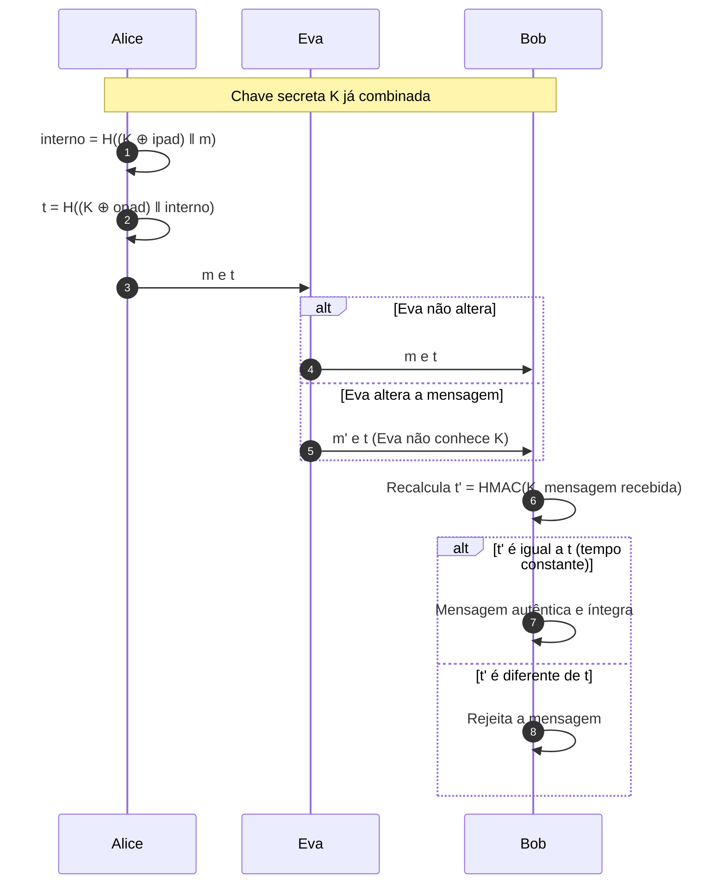
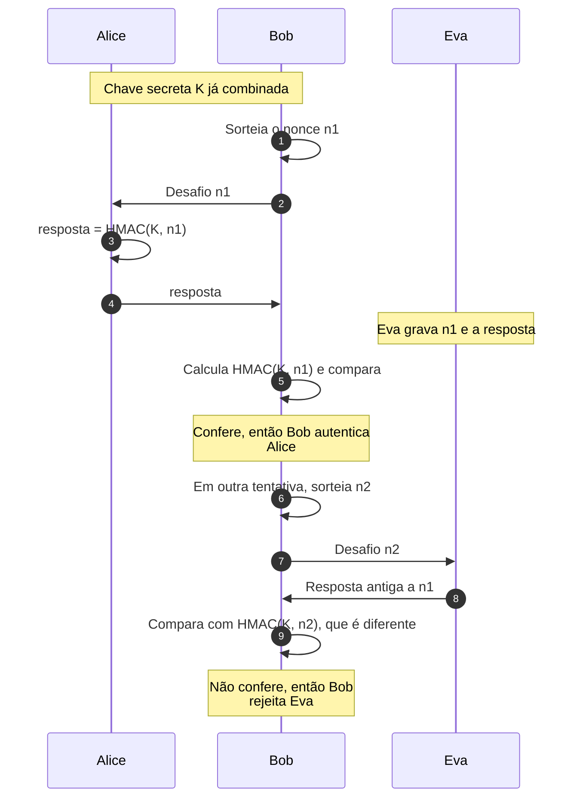
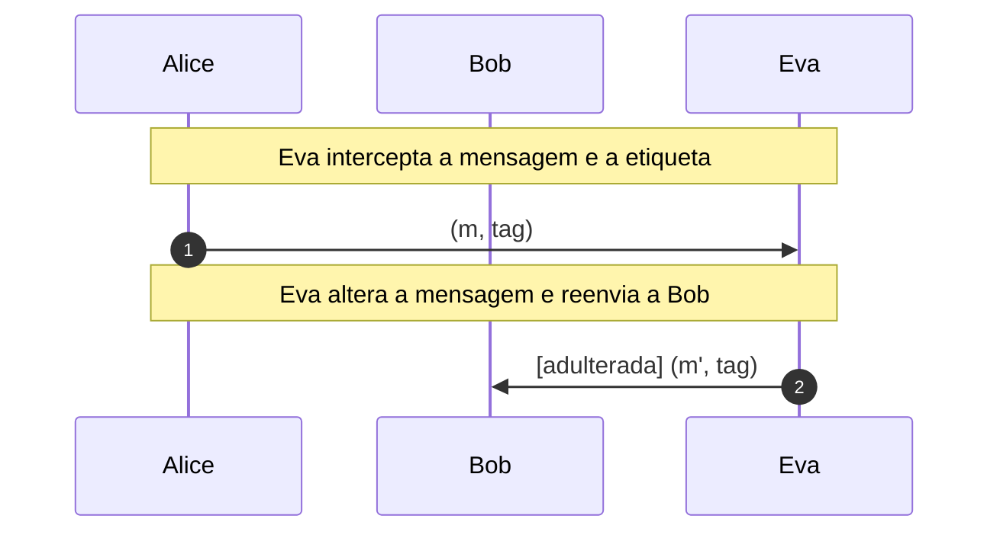

# Primitivas: funções hash e HMAC

SHA-2 reais, efeito avalanche visualizado bit a bit e HMAC calculado passo a passo ([RFC 2104](https://www.rfc-editor.org/rfc/rfc2104)).

- **Categoria:** Criptografia Simétrica
- **Abrir o laboratório:** <https://peotta.github.io/CryptoNet/#/lab/hash-hmac>
- **Motor:** real (Web Crypto: SHA-1, SHA-256, SHA-384 e SHA-512) e HMAC passo a passo
- **Código-fonte:** `src/labs/hash-hmac/` (interface e fluxos) e `src/crypto/hash.ts` (operações)
- **Padrões e referências:** [FIPS 180-4](https://csrc.nist.gov/pubs/fips/180-4/upd1/final) (SHA-2); [RFC 2104](https://www.rfc-editor.org/rfc/rfc2104) e [FIPS 198-1](https://csrc.nist.gov/pubs/fips/198-1/final) (HMAC); A [FIPS 198-1](https://csrc.nist.gov/pubs/fips/198-1/final) está em processo de retirada: o NIST propôs mover o conteúdo para o [SP 800-224](https://csrc.nist.gov/pubs/sp/800/224/ipd) (rascunho de junho de 2024) e retirá-la quando o [SP 800-224](https://csrc.nist.gov/pubs/sp/800/224/ipd) final for publicado. Até lá, continua vigente; [RFC 4231](https://www.rfc-editor.org/rfc/rfc4231) (vetores de teste do HMAC-SHA-2).

## 1. Objetivos de aprendizagem

- Descrever as propriedades de uma função hash criptográfica: determinismo, saída de tamanho fixo, resistência à pré-imagem, à segunda pré-imagem e a colisões.
- Observar o efeito avalanche: a alteração de um único bit da entrada modifica, em média, metade dos bits do resumo.
- Calcular o HMAC passo a passo ([RFC 2104](https://www.rfc-editor.org/rfc/rfc2104)) e explicar o papel das duas passagens, do ipad e do opad.
- Distinguir hash (sem chave) de código de autenticação de mensagem (com chave) e justificar por que um hash simples não autentica.
- Reconhecer que o HMAC garante integridade e autenticidade, mas não confidencialidade.

## 2. Fundamentação

Uma função hash produz um resumo de tamanho fixo e tem o efeito avalanche: trocar um bit da entrada altera cerca de metade dos bits da saída. Hash não é cifragem nem autentica quem enviou. O HMAC combina o hash com uma chave secreta em duas passagens (ipad e opad), e só quem tem a chave calcula a etiqueta correta, o que impede Eva de alterar a mensagem sem ser notada.

**Artigos originais.**

- Bellare, M.; Canetti, R.; Krawczyk, H. *Keying hash functions for message authentication*. In: CRYPTO 1996, Lecture Notes in Computer Science, v. 1109, p. 1-15. Springer, 1996. [Acessar o artigo (PDF, página de Mihir Bellare)](https://cseweb.ucsd.edu/~mihir/papers/kmd5.pdf).
- Krawczyk, H.; Bellare, M.; Canetti, R. *HMAC: Keyed-Hashing for Message Authentication*. [RFC 2104](https://www.rfc-editor.org/rfc/rfc2104), IETF, 1997.

### 2.1 Diagramas da integridade e da autenticação de mensagens

Os diagramas abaixo mostram o uso do hash e do HMAC, antes do cenário executado da seção 5. Alice e Bob são os participantes legítimos e Eva controla o canal. **H** é uma função hash, como a SHA-256; **K** é uma chave secreta compartilhada por Alice e Bob; **ipad** e **opad** são constantes do HMAC. O hash é público: qualquer um o calcula.

#### 2.1.1 Um hash sem chave não autentica (Eva recalcula o resumo)

Alice envia a mensagem m e o seu hash H(m). Bob recalcula H sobre o que recebeu e compara. Isso detecta erros acidentais, mas não protege contra Eva, que controla o canal: ela troca m por m', calcula H(m') e envia os dois. Bob recalcula, o hash confere e ele aceita a mensagem adulterada. O hash garante integridade só se o resumo chegar por um canal que Eva não altera.

*Figura 2.1.1 (sequência).* Um hash sem chave não autentica.

#### 2.1.2 Autenticação de mensagem com HMAC (a chave secreta impede a falsificação)

Alice e Bob compartilham a chave K, combinada antes por um canal seguro. Alice calcula a etiqueta t = HMAC(K, m), que aplica o hash em duas passagens: um hash interno sobre a mensagem precedida de K ⊕ ipad e um hash externo sobre o resultado precedido de K ⊕ opad. Bob refaz o cálculo com a sua cópia de K e compara as etiquetas em tempo constante. Eva, sem K, não calcula a etiqueta correta para m' e, com isso, não consegue alterar a mensagem sem ser notada. Isso garante integridade e autenticidade da origem, mas não confidencialidade nem não repúdio, pois Bob também conhece K.

*Figura 2.1.2 (sequência).* Autenticação de mensagem com HMAC.

#### 2.1.3 Autenticação por desafio e resposta com HMAC (a repetição de respostas antigas falha)

O HMAC também prova posse da chave sem revelá-la. Bob quer saber se fala com Alice: envia um desafio aleatório (nonce) que nunca usou antes. Alice responde com HMAC(K, nonce). Bob calcula o mesmo valor e compara. Eva pode gravar a resposta, mas, em uma nova tentativa, Bob envia outro nonce e a resposta antiga não confere. Por isso o nonce deve ser imprevisível e usado uma única vez. Este é um esquema didático: protocolos reais também amarram as identidades à resposta, como mostra o laboratório do Needham-Schroeder.

*Figura 2.1.3 (sequência).* Autenticação por desafio e resposta com HMAC.

> **Aviso:** a partir deste ponto são apresentados os cenários para simulação em laboratório, com Alice, Bob e Eva como participantes.

## 3. Participantes

Alice e Bob são os participantes legítimos; Eva é a atacante (observadora passiva ou, quando há adulteração, ativa). As tabelas abaixo listam o que cada um mantém em cada cenário.

| Participante | Papel | Dados que pode guardar (tipo) |
| --- | --- | --- |
| Alice | Remetente | Chave compartilhada K (segredo); Mensagem m (texto claro); Hash interno (parâmetro público); Etiqueta HMAC (assinatura ou etiqueta) |
| Bob | Verificador | Chave compartilhada K (segredo); Mensagem recebida (texto claro); Etiqueta recebida (assinatura ou etiqueta); Etiqueta recalculada (assinatura ou etiqueta); Resultado da comparação (parâmetro público) |
| Eva | Atacante (observa e, se puder, altera o canal) | Mensagem observada ou capturada (texto claro); Etiqueta observada ou capturada (assinatura ou etiqueta); Mensagem alterada m' (enviada a Bob) (texto claro); Chave K: desconhecida para Eva (segredo) |

## 4. Como ler os diagramas

Cada figura é um diagrama de sequência gerado a partir da mesma definição de protocolo que anima o laboratório: as colunas são os participantes, o tempo corre de cima para baixo e cada faixa horizontal é o início de uma etapa. Os valores numéricos e as chaves não aparecem aqui (são aleatórios ou dependem das entradas); eles são mostrados nas fórmulas do próprio laboratório.

- Seta cheia: mensagem enviada pelo canal, com o rótulo do que trafega.
- Número no início do rótulo: ordem da interação no diagrama, de cima para baixo.
- Botão Ampliar diagrama (no site): abre o diagrama em tela cheia, com zoom.
- `[adulterada]` no início do rótulo: a mensagem foi alterada em trânsito por Eva.
- Faixa com texto: título da etapa que começa naquele ponto.

**Lista de figuras**

- [Figura 5.1.1](#511-hmac-sha-256-com-eva-alterando-a-mensagem): HMAC-SHA-256 com Eva alterando a mensagem

## 5. Cenários

### 5.1 HMAC

#### 5.1.1 HMAC-SHA-256 com Eva alterando a mensagem

**Entradas usadas:** chave "segredo", mensagem "Transferir R$ 100".

*Figura 5.1.1 (sequência).* HMAC-SHA-256 com Eva alterando a mensagem: 2 mensagens (1 adulterada), entre Alice, Bob e Eva.

| Etapa | Título | Operação |
| --- | --- | --- |
| 1 | Alice e Bob compartilham a chave K | Nenhum cálculo: K já é conhecida por ambos e não trafega pelo canal. |
| 2 | Alice escolhe a mensagem | Definição da mensagem m. |
| 3 | Alice calcula o hash interno | hash interno = SHA-256((K' ⊕ ipad) ‖ m). |
| 4 | Alice calcula a etiqueta (hash externo) | tag = SHA-256((K' ⊕ opad) ‖ hash interno). |
| 5 | Eva intercepta a mensagem e a etiqueta | Interceptação do par (m, tag). |
| 6 | Eva altera a mensagem e reenvia a Bob | Reenvio de (m', tag). |
| 7 | Bob recebe a mensagem e a etiqueta | Recepção de (m, tag). |
| 8 | Bob recalcula a etiqueta sobre a mensagem recebida | tag' = HMAC(K, m recebida). |
| 9 | As etiquetas diferem: mensagem rejeitada | Comparação em tempo constante entre tag e tag'. |

**Veredito do cenário:** Falha de autenticação: as etiquetas HMAC são diferentes e a mensagem foi rejeitada.

## 6. Perguntas de fixação

1. Alice envia (m, H(m)) a Bob, e Eva intercepta, troca m por m' e recalcula H(m'). Bob detecta a alteração? E se Alice enviasse (m, HMAC(K, m))?

   **Resposta.** Com hash simples, não: qualquer pessoa calcula H(m') e o par alterado parece válido. O hash só detecta alterações acidentais. Com HMAC, Eva não conhece K e, por isso, não consegue gerar a etiqueta correta de m'. Bob recalcula o HMAC, encontra valor diferente e rejeita a mensagem.

2. Por que não se usa simplesmente H(K ‖ m) como código de autenticação?

   **Resposta.** Funções da família Merkle-Damgård (SHA-1, SHA-256, SHA-512) são vulneráveis ao ataque de extensão de comprimento: dado H(K ‖ m) e o tamanho de K ‖ m, um atacante calcula H(K ‖ m ‖ preenchimento ‖ x) sem conhecer K. A construção HMAC, com duas passagens, elimina o problema.

3. O que o efeito avalanche garante, e por que ele é desejável?

   **Resposta.** Uma pequena alteração na entrada altera, em média, metade dos bits do resumo, de forma imprevisível. Isso impede deduzir a entrada ou encontrar entradas parecidas a partir da saída e é uma consequência esperada de um bom projeto da função.

4. Quantas mensagens diferentes um SHA-256 distingue? Colisões existem?

   **Resposta.** A saída tem 2^256 valores possíveis, mas as entradas são infinitas, logo colisões existem pelo princípio da casa dos pombos. O que a segurança exige é que encontrá-las seja computacionalmente inviável (cerca de 2^128 operações, pelo paradoxo do aniversário). O SHA-1 já tem colisões práticas demonstradas (2017) e não deve ser usado em novas aplicações.

5. O HMAC cifra a mensagem? Como combinar sigilo e autenticidade?

   **Resposta.** Não: a mensagem trafega em claro e apenas a etiqueta é acrescentada. Para sigilo e autenticidade juntos usa-se um modo de criptografia autenticada, como o AES-GCM, ou cifra-se e aplica-se o HMAC sobre o texto cifrado (encrypt-then-MAC).

6. Por que a comparação de etiquetas deve ser feita em tempo constante?

   **Resposta.** Uma comparação que termina no primeiro byte diferente revela, pelo tempo gasto, quantos bytes iniciais estão corretos. Um atacante pode explorar isso para descobrir uma etiqueta válida byte a byte (ataque de temporização). A comparação em tempo constante examina sempre todos os bytes.

## 7. Limitações e cuidados

- O SHA-1 está disponível apenas para comparação: é considerado legado.
- O avalanche é medido por amostragem de entradas aleatórias, não por prova.
- Uso exclusivamente didático: os laboratórios não devem proteger dados reais.

## 8. Glossário

Significado e finalidade das siglas usadas neste documento.

| Sigla | Significado | Para que serve |
| --- | --- | --- |
| **AES-GCM** | AES no modo Galois/Counter | cifra autenticada de uso corrente no TLS e em armazenamento: cifra e detecta alteração com a mesma chave |
| **FIPS** | Federal Information Processing Standards, padrões federais de processamento de informação | padrões do NIST de uso obrigatório nos órgãos americanos, como o [FIPS 197](https://csrc.nist.gov/pubs/fips/197/final) (AES) e o [FIPS 203](https://csrc.nist.gov/pubs/fips/203/final) (ML-KEM) |
| **HMAC** | Keyed-Hash Message Authentication Code, código de autenticação de mensagem com chave | autentica uma mensagem com uma chave secreta e uma função de hash ([RFC 2104](https://www.rfc-editor.org/rfc/rfc2104)) |
| **IETF** | Internet Engineering Task Force | organização aberta que desenvolve e publica os padrões da Internet, as RFCs |
| **NIST** | National Institute of Standards and Technology, Instituto Nacional de Padrões e Tecnologia (EUA) | publica os padrões criptográficos federais americanos, como os FIPS e as SP 800 |
| **PDF** | Portable Document Format, formato de documento portátil | formato de arquivo das cópias dos artigos citados |
| **SHA-1** | Secure Hash Algorithm 1 | hash de 160 bits com colisões demonstradas; evitado em assinaturas, mas ainda usado no HMAC do HOTP e do TOTP |
| **SHA-2** | Secure Hash Algorithm 2 | família de hashes (SHA-224 a SHA-512) padronizada no [FIPS 180-4](https://csrc.nist.gov/pubs/fips/180-4/upd1/final) |
| **SHA-256** | Secure Hash Algorithm, saída de 256 bits | hash da família SHA-2 de uso mais comum |
| **SHA-512** | Secure Hash Algorithm, saída de 512 bits | hash da família SHA-2 com palavras de 64 bits |
| **SP** | Special Publication, publicação especial | série de recomendações do NIST, como a [SP 800-38A](https://csrc.nist.gov/pubs/sp/800/38/a/final) (modos de operação) e a [SP 800-38D](https://csrc.nist.gov/pubs/sp/800/38/d/final) (modo GCM) |

---

*CryptoNet é um projeto mantido pelo Prof. Dr. Laerte Peotta de Melo, com apoio de IA generativa no processo de desenvolvimento, com sua estrita supervisão, revisão técnica e responsabilidade. Uso exclusivo para fins de ensino e pesquisa. Universidade de Brasília (UnB) - Departamento de Engenharia Elétrica. Código aberto (licença MIT).*
