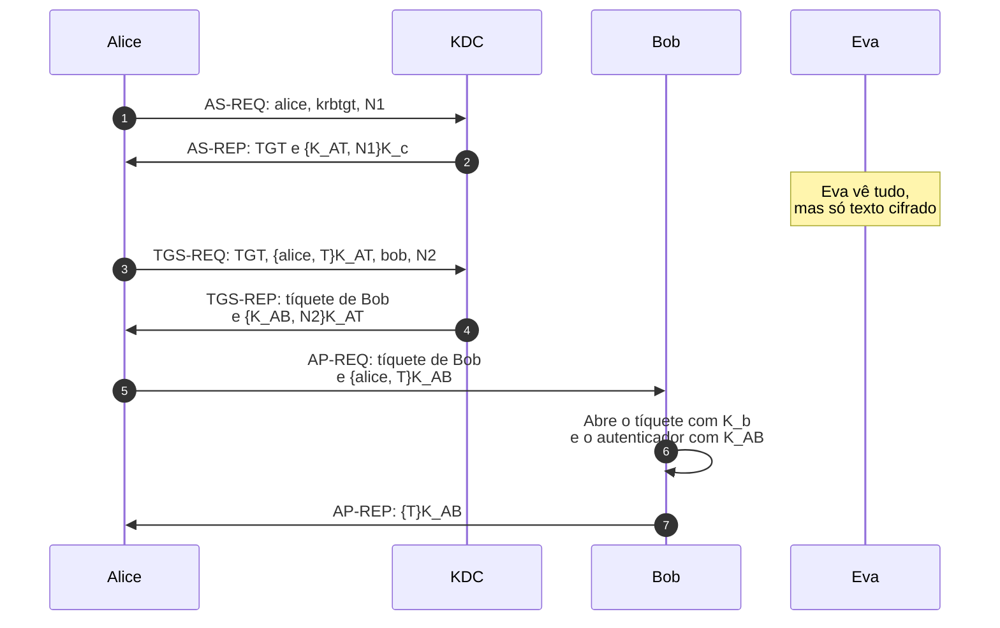
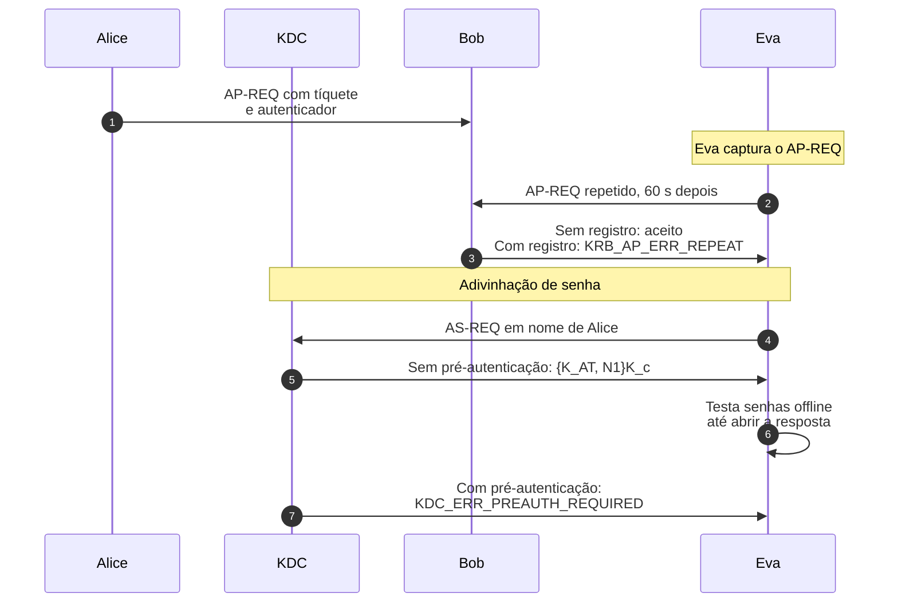
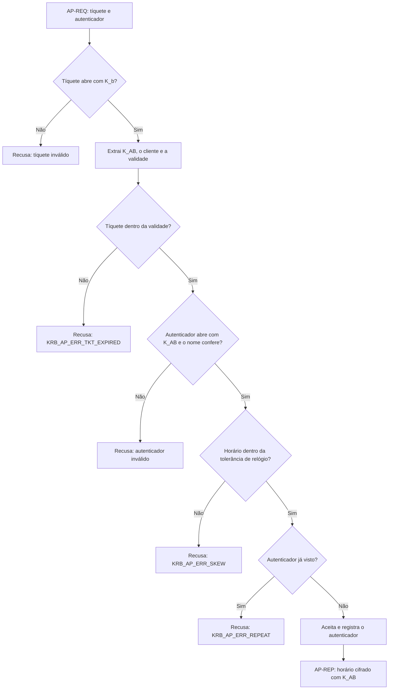
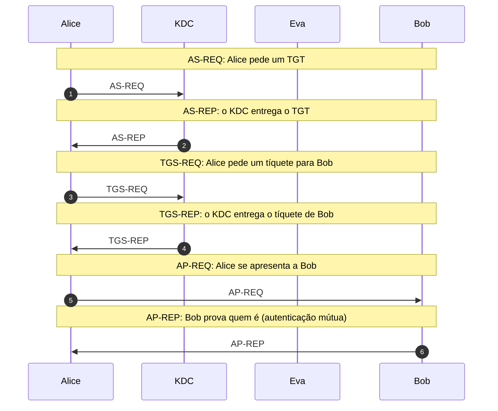
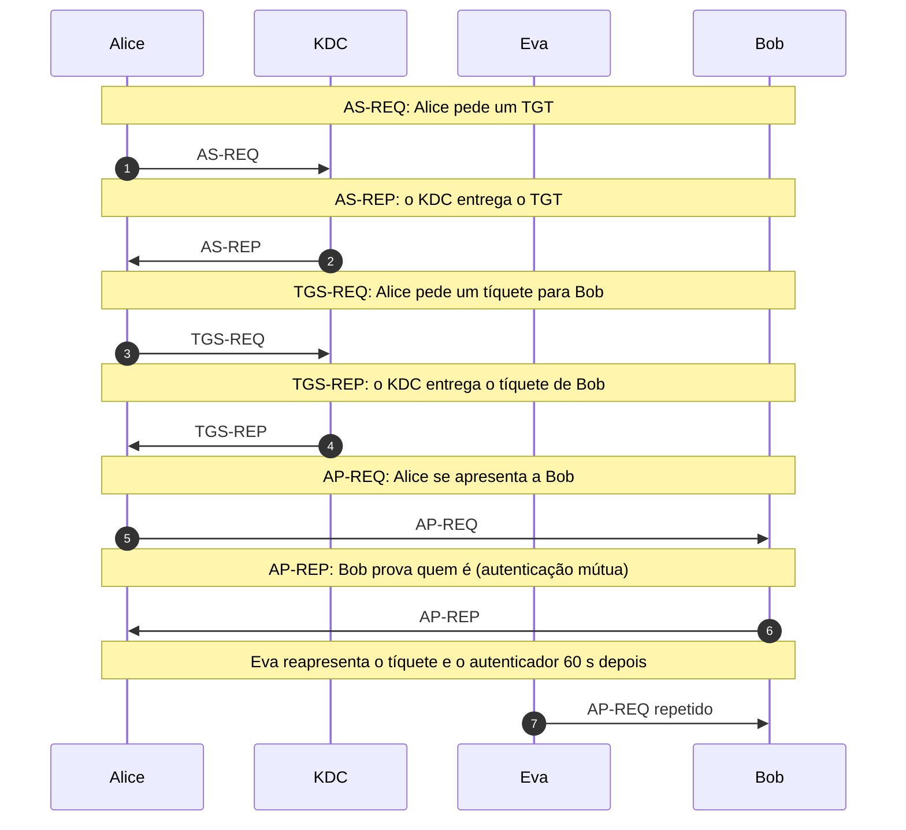
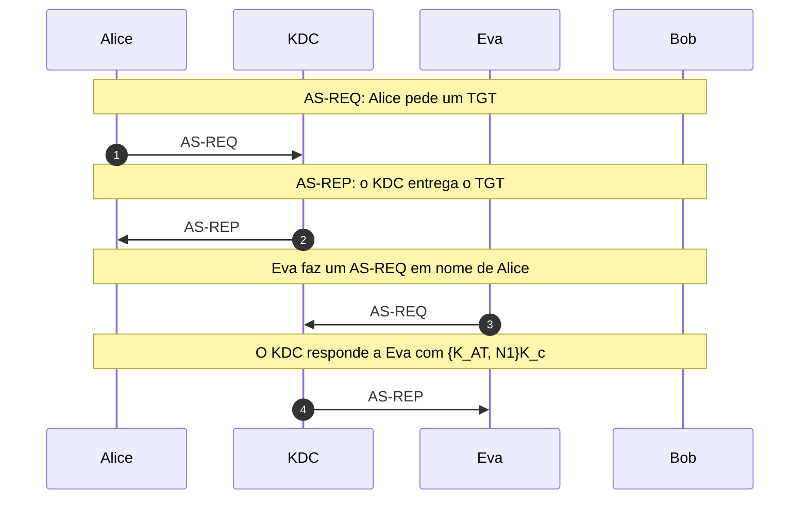
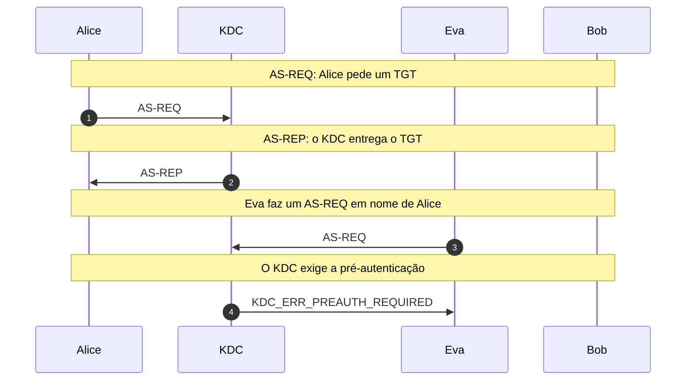

# Kerberos: tíquetes e login único

Autenticação por terceiro de confiança ([RFC 4120](https://www.rfc-editor.org/rfc/rfc4120)): as trocas AS, TGS e AP com tíquetes e autenticadores, a repetição do autenticador por Eva e a adivinhação da senha contra o KDC.

- **Categoria:** Autenticação e Protocolos Seguros
- **Abrir o laboratório:** <https://peotta.github.io/CryptoNet/#/lab/kerberos>
- **Motor:** real (PBKDF2-HMAC-SHA-256 e AES-256-GCM pela Web Crypto API), simplificado em relação ao [RFC 3962](https://www.rfc-editor.org/rfc/rfc3962)
- **Código-fonte:** `src/labs/kerberos/` (interface e fluxos) e `src/crypto/kerberos.ts` (operações)
- **Padrões e referências:** [RFC 4120](https://www.rfc-editor.org/rfc/rfc4120) (Kerberos V5), vigente e atualizada por outras RFCs, entre elas a [RFC 8429](https://www.rfc-editor.org/rfc/rfc8429) (recomendações sobre cifras); [RFC 3962](https://www.rfc-editor.org/rfc/rfc3962) (AES no Kerberos 5), [RFC 6113](https://www.rfc-editor.org/rfc/rfc6113) (framework de pré-autenticação e FAST) e [RFC 6649](https://www.rfc-editor.org/rfc/rfc6649) (abandono do DES e do RC4-HMAC-EXP); [RFC 4121](https://www.rfc-editor.org/rfc/rfc4121) (mecanismo GSS-API do Kerberos 5), que descreve como as aplicações usam o Kerberos.

## 1. Objetivos de aprendizagem

- Acompanhar as três trocas do Kerberos (AS, TGS e AP) e dizer o que cada mensagem carrega e com qual chave é cifrada ([RFC 4120](https://www.rfc-editor.org/rfc/rfc4120)).
- Explicar por que a senha de Alice nunca trafega e como o TGT permite uma única autenticação por sessão (login único).
- Distinguir o tíquete (opaco para o cliente) do autenticador (prova de posse da chave de sessão) e dizer por que os dois são necessários.
- Mostrar que o carimbo de tempo limita a janela de repetição, mas só o registro de autenticadores a fecha.
- Reconhecer o ataque de adivinhação de senha contra a resposta do AS e a defesa pela pré-autenticação e por senhas fortes.

## 2. Fundamentação

O Kerberos autentica usuários e serviços numa rede insegura sem enviar senhas. Um terceiro de confiança, o centro de distribuição de chaves (KDC), conhece a chave de cada participante. Na troca AS, Alice recebe um tíquete de concessão de tíquetes (TGT) e uma chave de sessão cifrada com a chave derivada da sua senha; na troca TGS, troca o TGT por um tíquete para o serviço de Bob; na troca AP, apresenta esse tíquete a Bob, que não precisa consultar o KDC.

Cada tíquete é cifrado com a chave de quem o consome, de modo que Alice o carrega sem poder lê-lo. Um autenticador, com o horário, mostra que quem apresenta o tíquete conhece a chave de sessão naquele instante, e a devolução do horário por Bob dá a autenticação mútua. A segurança depende da senha de Alice e de relógios sincronizados dentro de uma tolerância (por padrão, 5 minutos).

Eva vê todas as mensagens, mas só texto cifrado. Ela reapresenta o autenticador capturado, que vale dentro da tolerância de relógio e só é barrado se o serviço guardar os autenticadores já vistos; e pede ao KDC uma resposta para Alice para testar senhas offline, o que a pré-autenticação impede e uma senha forte torna inviável. O palco tem quatro participantes: Alice, o KDC, Eva e Bob.

**Especificação e artigos de origem.**

- Neuman, C.; Yu, T.; Hartman, S.; Raeburn, K. *The Kerberos Network Authentication Service (V5)*. [RFC 4120](https://www.rfc-editor.org/rfc/rfc4120), jul. 2005 (atualizada por outras RFCs, entre elas a [RFC 8429](https://www.rfc-editor.org/rfc/rfc8429)).
- Needham, R. M.; Schroeder, M. D. *Using encryption for authentication in large networks of computers*. Communications of the ACM, v. 21, n. 12, p. 993-999, dez. 1978, base do uso de um servidor de chaves de confiança. [DOI 10.1145/359657.359659](https://doi.org/10.1145/359657.359659).
- Denning, D. E.; Sacco, G. M. *Timestamps in key distribution protocols*. Communications of the ACM, v. 24, n. 8, p. 533-536, ago. 1981, origem do uso de carimbos de tempo, adotado pelo Kerberos no lugar dos nonces nas mensagens com o serviço. [DOI 10.1145/358722.358740](https://doi.org/10.1145/358722.358740).
- Hartman, S.; Zhu, L. *A Generalized Framework for Kerberos Pre-Authentication*. [RFC 6113](https://www.rfc-editor.org/rfc/rfc6113), abr. 2011, que define o FAST, a proteção do pedido inicial.

### 2.1 Diagramas do Kerberos

Os diagramas abaixo mostram o Kerberos antes dos cenários executados da seção 5. Alice é a cliente, o KDC reúne o serviço de autenticação (AS) e o de concessão de tíquetes (TGS), Bob é o serviço e Eva observa o canal e age na rede. **K_c** é a chave derivada da senha de Alice, **K_AT** e **K_AB** são chaves de sessão e **K_b** é a chave de Bob. O último diagrama é um fluxograma da validação feita pelo serviço.

#### 2.1.1 As três trocas: AS, TGS e AP ([RFC 4120](https://www.rfc-editor.org/rfc/rfc4120), seções 3.1 a 3.2)

Na troca AS, o KDC entrega a Alice a chave de sessão K_AT cifrada com K_c e o tíquete de concessão de tíquetes (TGT), selado com a chave do TGS, que Alice não consegue ler. Na troca TGS, Alice apresenta o TGT e um autenticador e recebe a chave K_AB e o tíquete de Bob, selado com K_b. Na troca AP, Alice apresenta a Bob o tíquete e um autenticador; Bob o valida sem consultar o KDC e prova quem é devolvendo o horário cifrado com K_AB. Eva vê todas as mensagens, mas só texto cifrado.

*Figura 2.1.1 (sequência).* As três trocas: AS, TGS e AP.

#### 2.1.2 O que Eva consegue fazer ([RFC 4120](https://www.rfc-editor.org/rfc/rfc4120), seções 3.2.3 e 5.2.7.2; [RFC 6113](https://www.rfc-editor.org/rfc/rfc6113))

Dois ataques mostram os limites do protocolo. Na repetição, Eva reenvia o tíquete e o autenticador capturados: dentro da tolerância de relógio o carimbo de tempo ainda vale, e só o serviço que guarda os autenticadores já vistos recusa a repetição (KRB_AP_ERR_REPEAT). Na adivinhação de senha, Eva pede ao KDC uma resposta para Alice e testa senhas offline contra o texto cifrado com K_c; a pré-autenticação faz o KDC exigir antes uma prova de que o solicitante conhece K_c.

*Figura 2.1.2 (sequência).* O que Eva consegue fazer.

#### 2.1.3 Estrutura interna: validação do AP-REQ pelo serviço (fluxograma)

O serviço abre o tíquete com a sua chave K_b, o que prova que o KDC o emitiu para ele, e dele tira a chave de sessão K_AB. Com K_AB abre o autenticador, confere que o nome coincide com o do tíquete, que o horário está dentro da tolerância de relógio e que o autenticador não foi visto antes. Só então aceita o cliente e, se for pedida a autenticação mútua, devolve o horário cifrado com K_AB.

*Figura 2.1.3 (estrutura interna).* Estrutura interna: validação do AP-REQ pelo serviço.

> **Aviso:** a partir deste ponto são apresentados os cenários para simulação em laboratório, com Alice, Bob e Eva como participantes.

## 3. Participantes

Alice e Bob são os participantes legítimos; Eva é a atacante (observadora passiva ou, quando há adulteração, ativa). As tabelas abaixo listam o que cada um mantém em cada cenário.

| Participante | Papel | Dados que pode guardar (tipo) |
| --- | --- | --- |
| Alice | Cliente (usuária) | Chave de Alice K_c (da senha) (segredo); Chave de sessão K_AT (segredo); TGT (opaco para Alice) (texto cifrado); Chave de sessão K_AB (segredo); Tíquete de Bob (opaco) (texto cifrado) |
| KDC | Centro de distribuição de chaves (AS e TGS) | Chave de Alice K_c (segredo); Chave do TGS K_tgs (segredo); Chave de Bob K_b (segredo) |
| Eva | Atacante (observa e age na rede) | Mensagens capturadas (texto cifrado); Senhas testadas offline (parâmetro público) |
| Bob | Serviço | Chave de Bob K_b (segredo); Chave de sessão K_AB (segredo); Autenticadores já vistos (parâmetro público) |

## 4. Como ler os diagramas

Cada figura é um diagrama de sequência gerado a partir da mesma definição de protocolo que anima o laboratório: as colunas são os participantes, o tempo corre de cima para baixo e cada faixa horizontal é o início de uma etapa. Os valores numéricos e as chaves não aparecem aqui (são aleatórios ou dependem das entradas); eles são mostrados nas fórmulas do próprio laboratório.

- Seta cheia: mensagem enviada pelo canal, com o rótulo do que trafega.
- Número no início do rótulo: ordem da interação no diagrama, de cima para baixo.
- Botão Ampliar diagrama (no site): abre o diagrama em tela cheia, com zoom.
- `[adulterada]` no início do rótulo: a mensagem foi alterada em trânsito por Eva.
- Faixa com texto: título da etapa que começa naquele ponto.

**Lista de figuras**

- [Figura 5.1.1](#511-troca-completa-com-eva-no-canal): Troca completa com Eva no canal
- [Figura 5.1.2](#512-repetição-do-autenticador-sem-registro): Repetição do autenticador sem registro
- [Figura 5.1.3](#513-repetição-recusada-pelo-serviço): Repetição recusada pelo serviço
- [Figura 5.1.4](#514-adivinhar-a-senha-fraca-sem-pré-autenticação): Adivinhar a senha fraca, sem pré-autenticação
- [Figura 5.1.5](#515-senha-forte-sem-pré-autenticação): Senha forte, sem pré-autenticação
- [Figura 5.1.6](#516-pré-autenticação-exigida-pelo-kdc): Pré-autenticação exigida pelo KDC

## 5. Cenários

### 5.1 Alice, o KDC, Eva e Bob

#### 5.1.1 Troca completa com Eva no canal

**Entradas usadas:** senha fraca "primavera", tolerância de 300 s, horário fixo das 13:30:10 UTC.

*Figura 5.1.1 (sequência).* Troca completa com Eva no canal: 6 mensagens, entre Alice, KDC, Eva e Bob.

| Etapa | Título | Operação |
| --- | --- | --- |
| 1 | As chaves de longo prazo | Derivação de K_c e distribuição prévia das chaves de longo prazo. |
| 2 | AS-REQ: Alice pede um TGT | Envio do pedido ao serviço de autenticação (AS). |
| 3 | AS-REP: o KDC entrega o TGT | Geração de K_AT e selagem de {K_AT, N1}K_c e do TGT. |
| 4 | TGS-REQ: Alice pede um tíquete para Bob | Envio do TGT e do autenticador ao serviço de concessão de tíquetes (TGS). |
| 5 | TGS-REP: o KDC entrega o tíquete de Bob | Geração de K_AB e selagem de {K_AB, N2}K_AT e do tíquete de Bob. |
| 6 | AP-REQ: Alice se apresenta a Bob | Envio do tíquete e do autenticador ao serviço. |
| 7 | Bob valida o tíquete e o autenticador | Abertura do tíquete e do autenticador e verificação do horário. |
| 8 | AP-REP: Bob prova quem é (autenticação mútua) | Envio da prova de Bob a Alice. |
| 9 | Eva só viu texto cifrado | Avaliação do resultado. |

**Veredito do cenário:** Eva viu os tíquetes e os autenticadores no canal, mas todos estão cifrados com chaves que ela não tem (a de Alice, a do TGS, a de Bob e as chaves de sessão). A senha de Alice nunca trafegou, e Bob autenticou Alice sem falar com o KDC.

#### 5.1.2 Repetição do autenticador sem registro

**Entradas usadas:** Eva reenvia o AP-REQ 60 s depois; o serviço não guarda autenticadores.

*Figura 5.1.2 (sequência).* Repetição do autenticador sem registro: 7 mensagens, entre Alice, KDC, Eva e Bob.

| Etapa | Título | Operação |
| --- | --- | --- |
| 1 | As chaves de longo prazo | Derivação de K_c e distribuição prévia das chaves de longo prazo. |
| 2 | AS-REQ: Alice pede um TGT | Envio do pedido ao serviço de autenticação (AS). |
| 3 | AS-REP: o KDC entrega o TGT | Geração de K_AT e selagem de {K_AT, N1}K_c e do TGT. |
| 4 | TGS-REQ: Alice pede um tíquete para Bob | Envio do TGT e do autenticador ao serviço de concessão de tíquetes (TGS). |
| 5 | TGS-REP: o KDC entrega o tíquete de Bob | Geração de K_AB e selagem de {K_AB, N2}K_AT e do tíquete de Bob. |
| 6 | AP-REQ: Alice se apresenta a Bob | Envio do tíquete e do autenticador ao serviço. |
| 7 | Bob valida o tíquete e o autenticador | Abertura do tíquete e do autenticador e verificação do horário. |
| 8 | AP-REP: Bob prova quem é (autenticação mútua) | Envio da prova de Bob a Alice. |
| 9 | Eva reapresenta o tíquete e o autenticador 60 s depois | Reenvio do AP-REQ capturado. |
| 10 | Bob aceita Eva como Alice | Abertura do tíquete e do autenticador, verificação do horário e consulta ao registro. |
| 11 | Eva entrou com o autenticador repetido | Avaliação do resultado. |

**Veredito do cenário:** Eva reapresentou, 60 segundos depois, o tíquete e o autenticador que capturou. Como o carimbo de tempo ainda estava dentro da tolerância de 300 s e Bob não guardava os autenticadores já vistos, ele aceitou a repetição e tratou Eva como Alice. Eva não sabe a chave de sessão e não lê o restante da conversa, mas passou pela autenticação.

#### 5.1.3 Repetição recusada pelo serviço

**Entradas usadas:** o serviço guarda os autenticadores já vistos.

*Figura 5.1.3 (sequência).* Repetição recusada pelo serviço: 7 mensagens, entre Alice, KDC, Eva e Bob.

| Etapa | Título | Operação |
| --- | --- | --- |
| 1 | As chaves de longo prazo | Derivação de K_c e distribuição prévia das chaves de longo prazo. |
| 2 | AS-REQ: Alice pede um TGT | Envio do pedido ao serviço de autenticação (AS). |
| 3 | AS-REP: o KDC entrega o TGT | Geração de K_AT e selagem de {K_AT, N1}K_c e do TGT. |
| 4 | TGS-REQ: Alice pede um tíquete para Bob | Envio do TGT e do autenticador ao serviço de concessão de tíquetes (TGS). |
| 5 | TGS-REP: o KDC entrega o tíquete de Bob | Geração de K_AB e selagem de {K_AB, N2}K_AT e do tíquete de Bob. |
| 6 | AP-REQ: Alice se apresenta a Bob | Envio do tíquete e do autenticador ao serviço. |
| 7 | Bob valida o tíquete e o autenticador | Abertura do tíquete e do autenticador e verificação do horário. |
| 8 | AP-REP: Bob prova quem é (autenticação mútua) | Envio da prova de Bob a Alice. |
| 9 | Eva reapresenta o tíquete e o autenticador 60 s depois | Reenvio do AP-REQ capturado. |
| 10 | Bob recusa o autenticador repetido | Abertura do tíquete e do autenticador, verificação do horário e consulta ao registro. |
| 11 | A repetição foi barrada | Avaliação do resultado. |

**Veredito do cenário:** Eva reapresentou o autenticador capturado dentro da tolerância de relógio, mas Bob guarda os autenticadores já vistos e recusou a repetição (KRB_AP_ERR_REPEAT). O carimbo de tempo limita a janela do ataque; o registro de repetições a fecha.

#### 5.1.4 Adivinhar a senha fraca, sem pré-autenticação

**Entradas usadas:** dicionário de 10 palavras que inclui a senha.

*Figura 5.1.4 (sequência).* Adivinhar a senha fraca, sem pré-autenticação: 4 mensagens, entre Alice, KDC, Eva e Bob.

| Etapa | Título | Operação |
| --- | --- | --- |
| 1 | As chaves de longo prazo | Derivação de K_c e distribuição prévia das chaves de longo prazo. |
| 2 | AS-REQ: Alice pede um TGT | Envio do pedido ao serviço de autenticação (AS). |
| 3 | AS-REP: o KDC entrega o TGT | Geração de K_AT e selagem de {K_AT, N1}K_c e do TGT. |
| 4 | Eva faz um AS-REQ em nome de Alice | Envio de um AS-REQ sem prova de identidade. |
| 5 | O KDC responde a Eva com {K_AT, N1}K_c | Entrega do AS-REP a Eva. |
| 6 | Eva testa 10 senhas do dicionário offline | Derivação de chaves candidatas e tentativa de abertura da resposta. |
| 7 | Eva descobriu a senha de Alice | Avaliação do resultado. |

**Veredito do cenário:** Sem pré-autenticação, qualquer pessoa pede ao KDC uma resposta AS para Alice. Eva recebeu um texto cifrado com a chave derivada da senha e testou as palavras do dicionário offline, sem tocar mais na rede: a senha "primavera" abriu a resposta na tentativa 8. Senha fraca é o elo mais fraco do Kerberos.

#### 5.1.5 Senha forte, sem pré-autenticação

**Entradas usadas:** o mesmo dicionário não contém a senha.

*Figura 5.1.5 (sequência).* Senha forte, sem pré-autenticação: 4 mensagens, entre Alice, KDC, Eva e Bob.

| Etapa | Título | Operação |
| --- | --- | --- |
| 1 | As chaves de longo prazo | Derivação de K_c e distribuição prévia das chaves de longo prazo. |
| 2 | AS-REQ: Alice pede um TGT | Envio do pedido ao serviço de autenticação (AS). |
| 3 | AS-REP: o KDC entrega o TGT | Geração de K_AT e selagem de {K_AT, N1}K_c e do TGT. |
| 4 | Eva faz um AS-REQ em nome de Alice | Envio de um AS-REQ sem prova de identidade. |
| 5 | O KDC responde a Eva com {K_AT, N1}K_c | Entrega do AS-REP a Eva. |
| 6 | Eva testa 10 senhas do dicionário offline | Derivação de chaves candidatas e tentativa de abertura da resposta. |
| 7 | A senha resistiu | Avaliação do resultado. |

**Veredito do cenário:** Sem pré-autenticação, Eva obteve a resposta AS de Alice e testou 10 palavras offline, mas a senha não está no dicionário. O ataque só falha por causa da senha forte: o KDC entregou o texto cifrado a quem pediu, e Eva pode continuar tentando com listas maiores.

#### 5.1.6 Pré-autenticação exigida pelo KDC

**Entradas usadas:** o KDC recusa o pedido de Eva e não entrega texto cifrado.

*Figura 5.1.6 (sequência).* Pré-autenticação exigida pelo KDC: 4 mensagens, entre Alice, KDC, Eva e Bob.

| Etapa | Título | Operação |
| --- | --- | --- |
| 1 | As chaves de longo prazo | Derivação de K_c e distribuição prévia das chaves de longo prazo. |
| 2 | AS-REQ: Alice pede um TGT | Envio do pedido ao serviço de autenticação (AS). |
| 3 | AS-REP: o KDC entrega o TGT | Geração de K_AT e selagem de {K_AT, N1}K_c e do TGT. |
| 4 | Eva faz um AS-REQ em nome de Alice | Envio de um AS-REQ sem prova de identidade. |
| 5 | O KDC exige a pré-autenticação | Recusa do pedido sem pré-autenticação. |
| 6 | A senha resistiu | Avaliação do resultado. |

**Veredito do cenário:** Com a pré-autenticação, o KDC só responde a quem prova conhecer a chave de Alice (um carimbo de tempo cifrado com ela). Eva não a tem, recebeu um erro e não obteve nenhum texto cifrado para atacar. Um pedido legítimo de Alice, se capturado no canal, ainda pode ser atacado offline: por isso a senha precisa ser forte, e o [RFC 6113](https://www.rfc-editor.org/rfc/rfc6113) (FAST) protege esse pedido.

## 6. Perguntas de fixação

1. Por que a senha de Alice nunca trafega no Kerberos?

   **Resposta.** Porque a senha só serve para derivar a chave K_c, que Alice e o KDC calculam cada um do seu lado. O KDC prova que conhece K_c cifrando com ela a chave de sessão; Alice prova que a conhece abrindo essa resposta. A rede só vê textos cifrados.

2. Qual a função do TGT, e por que Alice não consegue lê-lo?

   **Resposta.** O TGT guarda a chave de sessão K_AT e a identidade de Alice, selados com a chave do TGS. Ele permite que Alice peça tíquetes de serviço sem repetir a senha. Alice não o lê porque não tem K_tgs; ela apenas o apresenta ao KDC, que o abre e confia no conteúdo.

3. Por que o tíquete não basta e é preciso um autenticador?

   **Resposta.** O tíquete circula no canal e Eva pode copiá-lo. O autenticador {alice, T}K_AB mostra que quem o apresenta conhece a chave de sessão naquele instante. Sem K_AB, Eva não monta um autenticador novo.

4. Eva reenvia o AP-REQ capturado dentro da tolerância de relógio. O que o impede de funcionar?

   **Resposta.** O carimbo de tempo sozinho não impede: dentro de 5 minutos o autenticador ainda é válido. O serviço precisa guardar os autenticadores recentes e recusar a repetição (KRB_AP_ERR_REPEAT). A janela de guarda é a própria tolerância de relógio.

5. O que é o ataque de adivinhação de senha contra o AS-REP, e como a pré-autenticação o dificulta?

   **Resposta.** Sem pré-autenticação, qualquer pessoa recebe do KDC um texto cifrado com a chave derivada da senha de Alice e pode testá-lo offline contra um dicionário. Com a pré-autenticação, o KDC só responde a quem prova conhecer K_c, e Eva não recebe nada para atacar. Um pedido legítimo capturado no canal ainda contém um dado cifrado com K_c, por isso a senha deve ser forte e o [RFC 6113](https://www.rfc-editor.org/rfc/rfc6113) (FAST) protege o pedido.

6. Por que o Kerberos depende de relógios sincronizados?

   **Resposta.** Porque os autenticadores carregam um horário e o serviço só os aceita dentro de uma tolerância (por padrão, 5 minutos). Um relógio muito desviado faz o serviço recusar acessos legítimos (KRB_AP_ERR_SKEW), e uma tolerância grande demais alarga a janela de repetição.

7. Qual a simplificação criptográfica deste laboratório em relação ao [RFC 4120](https://www.rfc-editor.org/rfc/rfc4120)?

   **Resposta.** As chaves derivam da senha por PBKDF2 com SHA-256 e as mensagens são seladas com AES-256-GCM. O [RFC 3962](https://www.rfc-editor.org/rfc/rfc3962) define a derivação com PBKDF2 e HMAC-SHA-1 e a cifra AES-CTS com HMAC-SHA1. A estrutura do protocolo (tíquetes, autenticadores, nonces, carimbos) é a mesma; a interoperabilidade com um KDC real não é.

## 7. Limitações e cuidados

- As chaves derivam da senha por PBKDF2 com SHA-256 e as mensagens usam AES-256-GCM; o [RFC 3962](https://www.rfc-editor.org/rfc/rfc3962) define PBKDF2 com HMAC-SHA-1 e AES-CTS com HMAC-SHA1. O laboratório não interopera com um KDC real.
- Os tíquetes e as mensagens são serializados como JSON, não como estruturas ASN.1 do [RFC 4120](https://www.rfc-editor.org/rfc/rfc4120); delegação, renovação de tíquetes e referências entre reinos não são representadas.
- O KDC reúne o serviço de autenticação (AS) e o de concessão de tíquetes (TGS), como na maioria das instalações. A defesa por FAST ([RFC 6113](https://www.rfc-editor.org/rfc/rfc6113)) é apenas citada.
- Uso exclusivamente didático: os laboratórios não devem proteger dados reais.

## 8. Glossário

Significado e finalidade das siglas usadas neste documento.

| Sigla | Significado | Para que serve |
| --- | --- | --- |
| **ACM** | Association for Computing Machinery | sociedade científica que edita periódicos e anais de computação, como o Communications of the ACM |
| **AES** | Advanced Encryption Standard, padrão de criptografia avançado | cifra de bloco de 128 bits com chaves de 128, 192 ou 256 bits, padronizada no [FIPS 197](https://csrc.nist.gov/pubs/fips/197/final) |
| **AP** | Application Protocol (exchange), troca com a aplicação | troca em que o cliente apresenta o tíquete e o autenticador ao serviço |
| **API** | Application Programming Interface, interface de programação de aplicações | conjunto de funções que um programa oferece a outros, como a Web Crypto API usada no navegador |
| **AS** | Authentication Service, serviço de autenticação | parte do KDC que verifica o cliente e entrega o tíquete de concessão de tíquetes (TGT) |
| **DES** | Data Encryption Standard, padrão de criptografia de dados | cifra de bloco de 64 bits com chave efetiva de 56 bits, padronizada em 1977 e hoje obsoleta |
| **DOI** | Digital Object Identifier, identificador de objeto digital | identificador permanente de uma publicação, que leva ao artigo pelo endereço doi.org |
| **FAST** | Flexible Authentication Secure Tunneling | túnel que protege o pedido inicial do Kerberos contra a adivinhação de senha offline ([RFC 6113](https://www.rfc-editor.org/rfc/rfc6113)) |
| **GSS-API** | Generic Security Service Application Program Interface | interface genérica que as aplicações usam para obter autenticação do Kerberos ([RFC 4121](https://www.rfc-editor.org/rfc/rfc4121)) |
| **JSON** | JavaScript Object Notation | formato de texto para dados estruturados; no laboratório do Kerberos, serializa o conteúdo dos tíquetes |
| **KDC** | Key Distribution Center, centro de distribuição de chaves | terceiro de confiança do Kerberos que conhece a chave de cada participante e emite tíquetes |
| **PBKDF2** | Password-Based Key Derivation Function 2 | deriva uma chave de uma senha repetindo um HMAC muitas vezes, para encarecer a adivinhação ([RFC 8018](https://www.rfc-editor.org/rfc/rfc8018)) |
| **SHA-256** | Secure Hash Algorithm, saída de 256 bits | hash da família SHA-2 de uso mais comum |
| **TGS** | Ticket-Granting Service, serviço de concessão de tíquetes | parte do KDC que troca o TGT por tíquetes de serviço |
| **TGT** | Ticket-Granting Ticket, tíquete de concessão de tíquetes | tíquete emitido pelo AS, que permite pedir tíquetes de serviço sem repetir a senha |
| **UTC** | Coordinated Universal Time, tempo universal coordenado | referência de horário usada nos exemplos de TOTP e Kerberos |

---

*CryptoNet é um projeto mantido pelo Prof. Dr. Laerte Peotta de Melo, com apoio de IA generativa no processo de desenvolvimento, com sua estrita supervisão, revisão técnica e responsabilidade. Uso exclusivo para fins de ensino e pesquisa. Universidade de Brasília (UnB) - Departamento de Engenharia Elétrica. Código aberto (licença MIT).*
