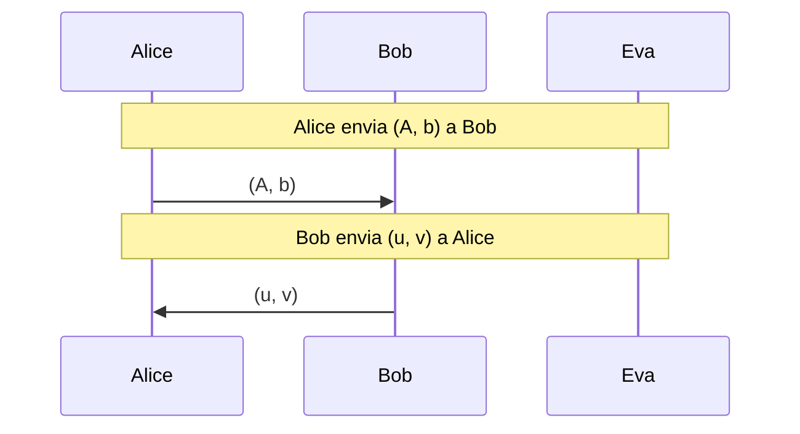
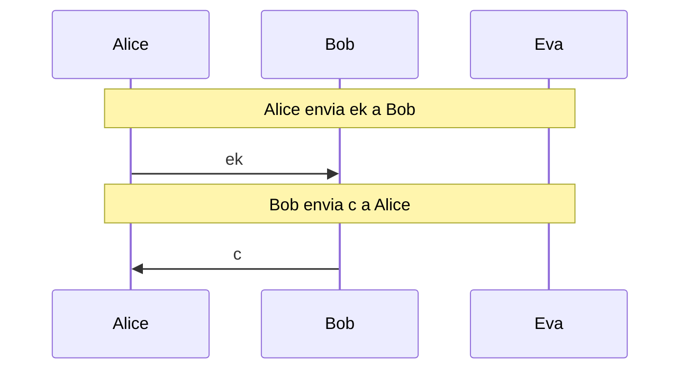
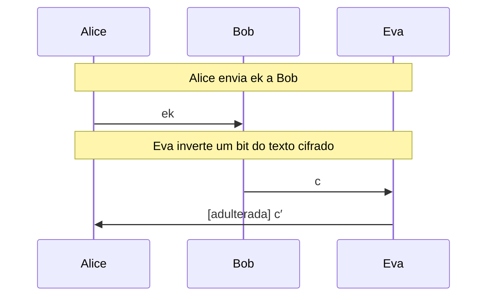

# ML-KEM e reticulados (pós-quântica)

O problema LWE em escala didática e o ML-KEM ([FIPS 203](https://csrc.nist.gov/pubs/fips/203/final)) passo a passo, com Eva observando e adulterando o texto cifrado, e a comparação de tamanhos com os algoritmos atuais.

- **Categoria:** Criptografia Pós-Quântica
- **Abrir o laboratório:** <https://peotta.github.io/CryptoNet/#/lab/ml-kem>
- **Motor:** didático (LWE com números minúsculos) e ML-KEM real (TypeScript, conferido contra o OpenSSL 3.5)
- **Código-fonte:** `src/labs/ml-kem/` (interface e fluxos) e `src/crypto/mlkem.ts` (operações)
- **Padrões e referências:** [FIPS 203](https://csrc.nist.gov/pubs/fips/203/final) (ML-KEM, antigo CRYSTALS-Kyber); [FIPS 202](https://csrc.nist.gov/pubs/fips/202/final) (SHA-3 e SHAKE, usados pelo ML-KEM); [FIPS 204](https://csrc.nist.gov/pubs/fips/204/final) (ML-DSA) e [FIPS 205](https://csrc.nist.gov/pubs/fips/205/final) (SLH-DSA): assinaturas pós-quânticas, citadas e não implementadas.

## 1. Objetivos de aprendizagem

- Explicar por que um computador quântico suficientemente grande quebra o RSA, o Diffie-Hellman e a criptografia de curvas elípticas, e por que a criptografia simétrica sofre bem menos.
- Descrever o problema LWE (Learning With Errors) e o papel do ruído: sem ele, a eliminação de Gauss revela o segredo.
- Acompanhar a geração de chaves, o encapsulamento e o desencapsulamento do ML-KEM ([FIPS 203](https://csrc.nist.gov/pubs/fips/203/final)), com Alice, Bob e Eva.
- Entender a rejeição implícita: um texto cifrado adulterado leva a uma chave diferente, sem mensagem de erro, e por que isso protege o segredo.
- Comparar tamanhos de chaves e textos cifrados (X25519, P-256, ML-KEM e o modo híbrido) e relacionar ao custo no TLS.
- Reconhecer a urgência de migrar a troca de chaves (colher agora, decifrar depois) e o papel do modo híbrido.

## 2. Fundamentação

O ML-KEM é o mecanismo de encapsulamento de chave pós-quântico padronizado pelo NIST. Sua segurança vem do problema Module-LWE: a chave pública é uma sequência de equações lineares com ruído pequeno, que só quem conhece o segredo consegue resolver. Alice gera o par de chaves, Bob encapsula uma chave de 32 bytes na chave pública dela e Alice a recupera por desencapsulamento. Se Eva alterar o texto cifrado, a transformação de Fujisaki-Okamoto faz Alice derivar uma chave diferente, sem aviso de erro (rejeição implícita). A Parte A mostra o LWE com números minúsculos, em que Eva vence; a Parte B executa o ML-KEM real; a Parte C compara tamanhos e trata do modo híbrido com o X25519.

## 3. Participantes

Alice e Bob são os participantes legítimos; Eva é a atacante (observadora passiva ou, quando há adulteração, ativa). As tabelas abaixo listam o que cada um mantém em cada cenário.

| Participante | Papel | Dados que pode guardar (tipo) |
| --- | --- | --- |
| Alice | Participante (gera as chaves) | Segredo s (segredo); Ruído e (segredo); b = A·s + e (valor público); Bit decifrado (texto claro); Sementes d e z (segredo); Semente pública ρ (valor público); Chave de encapsulamento ek (valor público); Chave de desencapsulamento dk (segredo); Texto cifrado recebido (texto cifrado); Mensagem recuperada m′ (segredo); Chave K de Alice (segredo) |
| Bob | Participante (cifra um bit) | Chave pública (A, b) (valor público); Escolha aleatória r (segredo); Bit a cifrar (texto claro); Texto cifrado (u, v) (texto cifrado); ek recebida (valor público); Mensagem aleatória m (segredo); Chave K de Bob (segredo); Texto cifrado c (texto cifrado) |
| Eva | Atacante (observa o canal) | Observado no canal (valor público); Segredo deduzido (segredo); Bit lido por Eva (texto claro); Texto cifrado alterado (texto cifrado); Chave K deduzida (segredo) |

## 4. Como ler os diagramas

Cada figura é um diagrama de sequência gerado a partir da mesma definição de protocolo que anima o laboratório: as colunas são os participantes, o tempo corre de cima para baixo e cada faixa horizontal é o início de uma etapa. Os valores numéricos e as chaves não aparecem aqui (são aleatórios ou dependem das entradas); eles são mostrados nas fórmulas do próprio laboratório.

- Seta cheia: mensagem enviada pelo canal, com o rótulo do que trafega.
- `[adulterada]` no início do rótulo: a mensagem foi alterada em trânsito por Eva.
- Faixa com texto: título da etapa que começa naquele ponto.

**Lista de figuras**

- [Figura 5.1.1](#511-com-ruído-1-e-n--3): Com ruído (±1) e n = 3
- [Figura 5.1.2](#512-sem-ruído-inseguro): Sem ruído (inseguro)
- [Figura 5.2.1](#521-estabelecimento-de-chave-com-eva-observando): Estabelecimento de chave, com Eva observando
- [Figura 5.2.2](#522-eva-inverte-um-bit-do-texto-cifrado-rejeição-implícita): Eva inverte um bit do texto cifrado (rejeição implícita)

## 5. Cenários

### 5.1 LWE em escala didática

#### 5.1.1 Com ruído (±1) e n = 3

**Entradas usadas:** semente 7, bit 1.

*Figura 5.1.1 (sequência).* Com ruído (±1) e n = 3: 2 mensagens, entre Alice, Bob e Eva.

| Etapa | Título | Operação |
| --- | --- | --- |
| 1 | Alice e Bob combinam os parâmetros | Nenhum cálculo: os parâmetros são públicos. |
| 2 | Alice sorteia o segredo s | Sorteio de s. |
| 3 | Alice sorteia a matriz pública A | Sorteio de A. |
| 4 | Alice sorteia o ruído e | Sorteio de e. |
| 5 | Alice calcula b = A·s + e | Multiplicação matriz-vetor com ruído. |
| 6 | Alice envia (A, b) a Bob | Envio da chave pública. |
| 7 | Bob escolhe um subconjunto r das linhas | Sorteio de r. |
| 8 | Bob calcula u = Aᵀ·r | Soma das linhas escolhidas de A. |
| 9 | Bob calcula v = b·r + bit·⌊q/2⌋ | Soma dos b escolhidos mais o bit na metade do módulo. |
| 10 | Bob envia (u, v) a Alice | Envio do texto cifrado. |
| 11 | Alice decifra com o segredo s | Subtração e arredondamento. |
| 12 | Eva tenta resolver o sistema por eliminação de Gauss | Eliminação de Gauss módulo q. |
| 13 | Eva testa todos os segredos possíveis | Busca exaustiva de s. |
| 14 | Eva decifra o bit | Subtração e arredondamento com o s deduzido. |
| 15 | Em escala didática, Eva quebra o esquema | Avaliação do resultado. |

**Veredito do cenário:** Com ruído de até ±1, a eliminação de Gauss resolve um sistema que não é o verdadeiro (resíduo 38, contra o máximo 1 esperado do ruído). A busca exaustiva testou 10086 dos 912673 segredos possíveis e achou s. Eva leu o bit 1: em escala didática (n = 3, q = 97) o ruído só barra a álgebra, e o espaço de segredos é pequeno demais. No ML-KEM-768 o segredo tem 768 coeficientes módulo 3329 (3329^768 possibilidades), e os melhores ataques conhecidos, por redução de reticulados, custam algo comparável à busca de chave do AES-192 (categoria 3 do NIST).

#### 5.1.2 Sem ruído (inseguro)

**Entradas usadas:** semente 7, bit 0.

*Figura 5.1.2 (sequência).* Sem ruído (inseguro): 2 mensagens, entre Alice, Bob e Eva.

| Etapa | Título | Operação |
| --- | --- | --- |
| 1 | Alice e Bob combinam os parâmetros | Nenhum cálculo: os parâmetros são públicos. |
| 2 | Alice sorteia o segredo s | Sorteio de s. |
| 3 | Alice sorteia a matriz pública A | Sorteio de A. |
| 4 | Alice sorteia o ruído e | Sorteio de e. |
| 5 | Alice calcula b = A·s + e | Multiplicação matriz-vetor com ruído. |
| 6 | Alice envia (A, b) a Bob | Envio da chave pública. |
| 7 | Bob escolhe um subconjunto r das linhas | Sorteio de r. |
| 8 | Bob calcula u = Aᵀ·r | Soma das linhas escolhidas de A. |
| 9 | Bob calcula v = b·r + bit·⌊q/2⌋ | Soma dos b escolhidos mais o bit na metade do módulo. |
| 10 | Bob envia (u, v) a Alice | Envio do texto cifrado. |
| 11 | Alice decifra com o segredo s | Subtração e arredondamento. |
| 12 | Eva tenta resolver o sistema por eliminação de Gauss | Eliminação de Gauss módulo q. |
| 13 | Eva testa todos os segredos possíveis | Busca exaustiva de s. |
| 14 | Eva decifra o bit | Subtração e arredondamento com o s deduzido. |
| 15 | Em escala didática, Eva quebra o esquema | Avaliação do resultado. |

**Veredito do cenário:** Sem ruído, o sistema b = A·s é linear e a eliminação de Gauss resolve em um instante. A busca exaustiva testou 10086 dos 912673 segredos possíveis e achou s. Eva leu o bit 0: em escala didática (n = 3, q = 97) o ruído só barra a álgebra, e o espaço de segredos é pequeno demais. No ML-KEM-768 o segredo tem 768 coeficientes módulo 3329 (3329^768 possibilidades), e os melhores ataques conhecidos, por redução de reticulados, custam algo comparável à busca de chave do AES-192 (categoria 3 do NIST).

### 5.2 ML-KEM-768

#### 5.2.1 Estabelecimento de chave, com Eva observando

**Entradas usadas:** ML-KEM-768, sementes fixas.

*Figura 5.2.1 (sequência).* Estabelecimento de chave, com Eva observando: 2 mensagens, entre Alice, Bob e Eva.

| Etapa | Título | Operação |
| --- | --- | --- |
| 1 | Alice e Bob escolhem o ML-KEM-768 | Nenhum cálculo: os parâmetros são públicos. |
| 2 | Alice sorteia as sementes d e z | Sorteio de 2 × 32 bytes. |
| 3 | Alice separa ρ e σ com SHA3-512 | Cálculo de SHA3-512(d ‖ k). |
| 4 | Alice expande a matriz pública  | Expansão de 9 polinômios com SHAKE128. |
| 5 | Alice sorteia o segredo s | Amostragem binomial centrada de s. |
| 6 | Alice sorteia o ruído e | Amostragem binomial centrada de e. |
| 7 | Alice calcula t̂ = Â∘ŝ + ê | Multiplicação matriz-vetor no domínio da NTT mais o ruído. |
| 8 | Alice empacota ek e dk | Codificação em bytes. |
| 9 | Alice envia ek a Bob | Envio da chave pública ek. |
| 10 | Bob verifica a chave recebida | Verificação de módulo da [FIPS 203](https://csrc.nist.gov/pubs/fips/203/final). |
| 11 | Bob sorteia a mensagem m | Sorteio de 32 bytes. |
| 12 | Bob deriva a chave K e a semente r | Cálculo de SHA3-512(m ‖ H(ek)). |
| 13 | Bob sorteia y, e₁ e e₂ a partir de r | Amostragem binomial centrada. |
| 14 | Bob calcula u = NTT⁻¹(Âᵀ∘ŷ) + e₁ | Multiplicação e soma com ruído. |
| 15 | Bob calcula v = NTT⁻¹(t̂ᵀ∘ŷ) + e₂ + μ | Produto interno com t̂, ruído e a mensagem. |
| 16 | Bob comprime u e v e monta o texto cifrado | Compressão e codificação em bytes. |
| 17 | Bob envia c a Alice | Envio do texto cifrado. |
| 18 | Alice decifra e recupera m′ | Decifragem K-PKE e arredondamento. |
| 19 | Alice deriva K′ e r′ da mensagem recuperada | Cálculo de SHA3-512(m′ ‖ H(ek)). |
| 20 | Alice refaz a cifragem e compara | Recifragem K-PKE e comparação. |
| 21 | Alice adota a chave K′ | Escolha entre K′ e K̄. |
| 22 | Alice e Bob têm a mesma chave | Avaliação do resultado. |

**Veredito do cenário:** Alice e Bob chegaram à mesma chave de 32 bytes (ea41c37d3ce5bba7…). Eva viu a chave de encapsulamento (1184 bytes) e o texto cifrado (1088 bytes), mas para chegar à chave precisaria do segredo s, escondido pelo ruído no problema Module-LWE. O ruído acumulado na decifragem chegou a no máximo 205, bem abaixo do limite q/4 = 832, por isso a decifragem não falha.

#### 5.2.2 Eva inverte um bit do texto cifrado (rejeição implícita)

**Entradas usadas:** ML-KEM-768, sementes fixas.

*Figura 5.2.2 (sequência).* Eva inverte um bit do texto cifrado (rejeição implícita): 3 mensagens (1 adulterada), entre Alice, Bob e Eva.

| Etapa | Título | Operação |
| --- | --- | --- |
| 1 | Alice e Bob escolhem o ML-KEM-768 | Nenhum cálculo: os parâmetros são públicos. |
| 2 | Alice sorteia as sementes d e z | Sorteio de 2 × 32 bytes. |
| 3 | Alice separa ρ e σ com SHA3-512 | Cálculo de SHA3-512(d ‖ k). |
| 4 | Alice expande a matriz pública  | Expansão de 9 polinômios com SHAKE128. |
| 5 | Alice sorteia o segredo s | Amostragem binomial centrada de s. |
| 6 | Alice sorteia o ruído e | Amostragem binomial centrada de e. |
| 7 | Alice calcula t̂ = Â∘ŝ + ê | Multiplicação matriz-vetor no domínio da NTT mais o ruído. |
| 8 | Alice empacota ek e dk | Codificação em bytes. |
| 9 | Alice envia ek a Bob | Envio da chave pública ek. |
| 10 | Bob verifica a chave recebida | Verificação de módulo da [FIPS 203](https://csrc.nist.gov/pubs/fips/203/final). |
| 11 | Bob sorteia a mensagem m | Sorteio de 32 bytes. |
| 12 | Bob deriva a chave K e a semente r | Cálculo de SHA3-512(m ‖ H(ek)). |
| 13 | Bob sorteia y, e₁ e e₂ a partir de r | Amostragem binomial centrada. |
| 14 | Bob calcula u = NTT⁻¹(Âᵀ∘ŷ) + e₁ | Multiplicação e soma com ruído. |
| 15 | Bob calcula v = NTT⁻¹(t̂ᵀ∘ŷ) + e₂ + μ | Produto interno com t̂, ruído e a mensagem. |
| 16 | Bob comprime u e v e monta o texto cifrado | Compressão e codificação em bytes. |
| 17 | Eva inverte um bit do texto cifrado | Inversão de um bit do texto cifrado. |
| 18 | Alice decifra e recupera m′ | Decifragem K-PKE e arredondamento. |
| 19 | Alice deriva K′ e r′ da mensagem recuperada | Cálculo de SHA3-512(m′ ‖ H(ek)). |
| 20 | Alice refaz a cifragem e compara | Recifragem K-PKE e comparação. |
| 21 | Alice adota a chave de rejeição K̄ | Escolha entre K′ e K̄. |
| 22 | A adulteração foi neutralizada | Avaliação do resultado. |

**Veredito do cenário:** Eva inverteu o bit 0 do byte 5 do texto cifrado. Alice decifrou, refez a cifragem e viu que o resultado não bate com o que recebeu. Em vez de acusar erro, devolveu a chave de rejeição K̄ = J(z ‖ c) = 6489f2622b7eaff2…, diferente da chave de Bob (ea41c37d3ce5bba7…). Alice e Bob não compartilham chave, e Eva não aprendeu nada sobre s: a falha só aparece depois, quando o que Bob cifrar com K não abrir em Alice (por exemplo, a etiqueta do AES-GCM). Isso evita que Eva use as respostas de Alice como oráculo para descobrir o segredo.

## 6. Perguntas de fixação

1. Por que o algoritmo de Shor ameaça o RSA, o Diffie-Hellman e o ECDH, mas o AES-256 continua seguro?

   **Resposta.** O algoritmo de Shor resolve a fatoração de inteiros e o logaritmo discreto (inclusive em curvas elípticas) em tempo polinomial em um computador quântico grande o bastante, o que desfaz a base do RSA, do Diffie-Hellman e do ECDH. Contra a criptografia simétrica e as funções de hash, o melhor ataque quântico conhecido é o de Grover, que dá apenas um ganho quadrático na busca: uma chave de 256 bits passa a valer cerca de 128 bits, ainda seguro. Para o AES basta usar chaves de 256 bits.

2. O que é "colher agora, decifrar depois" e por que a troca de chaves precisa migrar antes de existir o computador quântico?

   **Resposta.** Um atacante pode gravar hoje o tráfego cifrado (incluindo o acordo de chaves, que é público) e guardá-lo até ter um computador quântico, quando recuperaria as chaves de sessão e leria tudo. Dados que precisam permanecer secretos por muitos anos já estão em risco. Por isso a troca de chaves deve ser pós-quântica já, enquanto as assinaturas só precisam migrar antes de alguém conseguir forjá-las em tempo real.

3. No LWE, por que o ruído é necessário? O que acontece sem ele?

   **Resposta.** Sem ruído, b = A·s (mod q) é um sistema linear, e a eliminação de Gauss recupera s com poucas contas. O ruído pequeno e aleatório torna as equações levemente inconsistentes: a álgebra deixa de funcionar e o problema vira "achar o vetor do reticulado mais próximo", que não tem algoritmo eficiente conhecido, nem quântico, em dimensões grandes. O ruído não atrapalha quem tem s, porque o erro acumulado fica bem abaixo de q/4 e some no arredondamento.

4. Por que o ML-KEM usa q = 3329 e polinômios de 256 coeficientes?

   **Resposta.** Cada polinômio vive no anel Z_q[X]/(X^256 + 1). Com q = 3329 (primo), q − 1 = 3328 = 2^8 · 13 é divisível por 256, então existe uma raiz primitiva 256ª da unidade (17). Isso permite a NTT, a versão modular da transformada de Fourier, que multiplica polinômios em cerca de 256·log 256 operações, em vez de 256². Também mantém todos os coeficientes em 12 bits.

5. O que é a rejeição implícita e por que Alice não devolve um erro quando o texto cifrado foi alterado?

   **Resposta.** Alice recifra a mensagem que recuperou e compara com o texto cifrado recebido. Se diferirem, em vez de sinalizar erro ela devolve K̄ = J(z ‖ c), uma chave pseudoaleatória derivada de uma semente secreta z. Se Alice respondesse "inválido", Eva poderia testar textos cifrados modificados e usar a resposta como oráculo para descobrir o segredo (ataque de texto cifrado escolhido). Com a rejeição implícita, toda resposta parece uma chave normal e não vaza nada.

6. Qual é o tamanho da chave pública e do texto cifrado no ML-KEM-768, e que impacto isso tem no TLS?

   **Resposta.** A chave de encapsulamento tem 384·k + 32 = 1184 bytes e o texto cifrado tem 32·(d_u·k + d_v) = 32·(10·3 + 4) = 1088 bytes, contra 32 bytes do X25519. No modo híbrido X25519 mais ML-KEM-768, o key_share do cliente passa a ter 1216 bytes e o do servidor 1120 bytes. O ClientHello fica grande, podendo ultrapassar um pacote, mas o custo é pequeno perto do benefício. A computação é rápida, comparável à de curvas elípticas.

7. Por que usar um modo híbrido (X25519 mais ML-KEM) em vez de só ML-KEM?

   **Resposta.** O ML-KEM foi padronizado em 2024 e os reticulados têm menos décadas de criptoanálise que as curvas elípticas. No híbrido, a chave final depende dos dois segredos: se alguém quebrar o ML-KEM por um defeito matemático ou de implementação, o X25519 ainda protege contra atacantes clássicos; se surgir o computador quântico, o ML-KEM protege. Para o atacante vencer, precisa quebrar os dois.

## 7. Limitações e cuidados

- A implementação é didática, sem proteção contra ataques de canal lateral (tempo constante, zeroização) e sem os testes de conformidade completos do NIST; foi conferida byte a byte contra o OpenSSL 3.5 e não deve proteger dados reais.
- O LWE da Parte A usa dimensão 2 ou 3 e módulo 97, só para que cada conta caiba na tela: Eva sempre o quebra.
- O laboratório trata só do estabelecimento de chaves. O modo híbrido com o X25519 é descrito na Parte C, mas não é executado, e as assinaturas pós-quânticas (ML-DSA e SLH-DSA) não estão implementadas.
- Uso exclusivamente didático: os laboratórios não devem proteger dados reais.

---

*CryptoNet é um projeto mantido pelo Prof. Dr. Laerte Peotta de Melo, com apoio de IA generativa no processo de desenvolvimento, com sua estrita supervisão, revisão técnica e responsabilidade. Uso exclusivo para fins de ensino e pesquisa. Universidade de Brasília (UnB) - Departamento de Engenharia Elétrica. Código aberto (licença MIT).*
