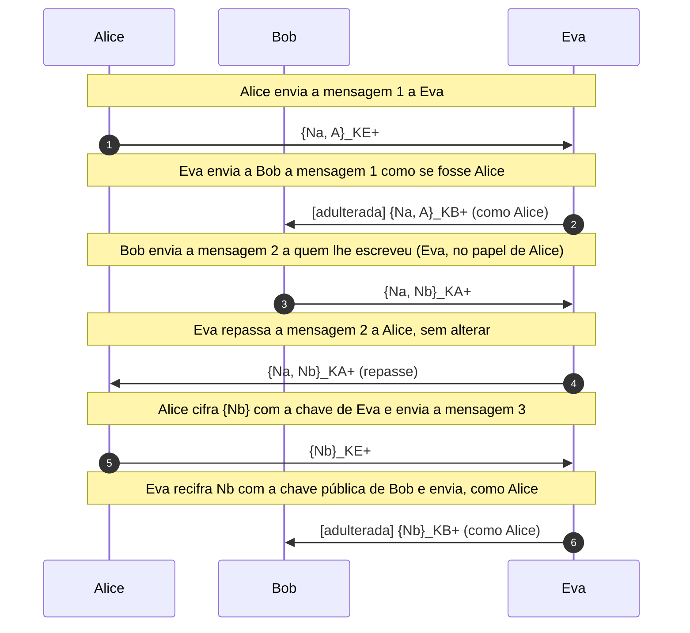
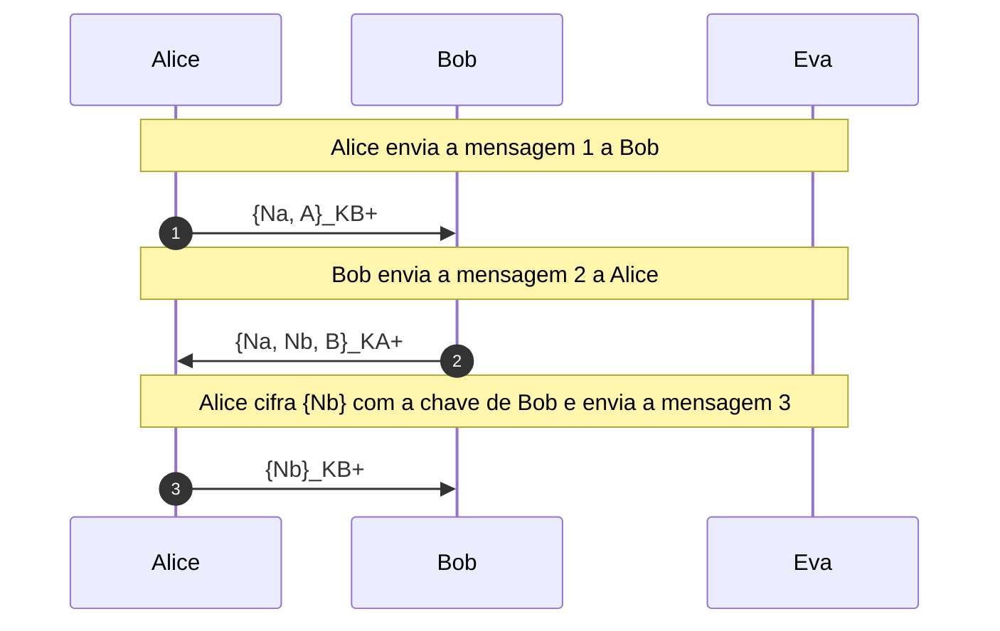
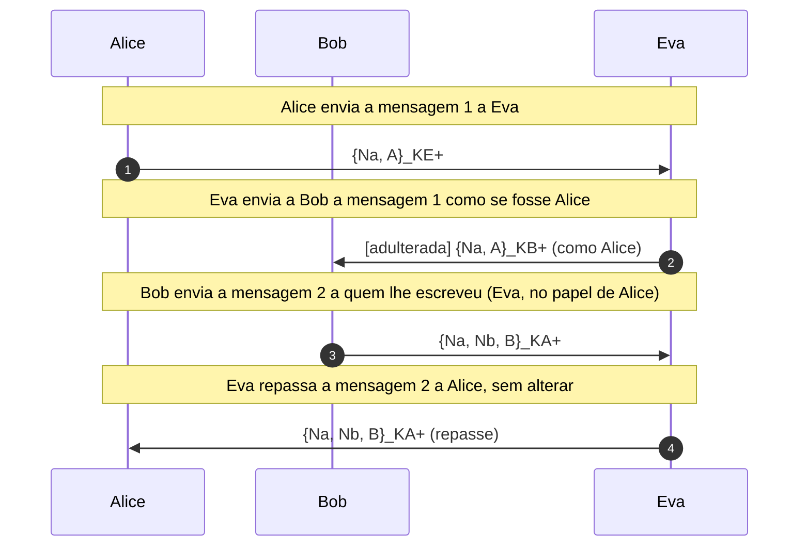

# Needham-Schroeder e o ataque de Lowe

Autenticação mútua com chave pública em três mensagens, o ataque de Lowe com que Eva se passa por Alice diante de Bob e a correção que coloca a identidade de Bob na mensagem 2.

- **Categoria:** Autenticação e Protocolos Seguros
- **Abrir o laboratório:** <https://peotta.github.io/CryptoNet/#/lab/needham-schroeder>
- **Motor:** didático (RSA sem padding com módulo de 128 bits, em BigInt)
- **Código-fonte:** `src/labs/needham-schroeder/` (interface e fluxos) e `src/crypto/needhamSchroeder.ts` (operações)
- **Padrões e referências:** Needham, R. M.; Schroeder, M. D. *Using encryption for authentication in large networks of computers*. Communications of the ACM, v. 21, n. 12, p. 993-999, 1978; Lowe, G. *An attack on the Needham-Schroeder public-key authentication protocol*. Information Processing Letters, v. 56, n. 3, p. 131-133, 1995; Denning, D. E.; Sacco, G. M. *Timestamps in key distribution protocols*. Communications of the ACM, v. 24, n. 8, p. 533-536, 1981; [RFC 4120](https://www.rfc-editor.org/rfc/rfc4120) (Kerberos versão 5), com atualizações como a [RFC 8429](https://www.rfc-editor.org/rfc/rfc8429).

## 1. Objetivos de aprendizagem

- Descrever o protocolo de Needham-Schroeder de chave pública em três mensagens, {Na, A}, {Na, Nb} e {Nb}, e o papel dos nonces (números usados uma vez) na prova de atualidade e de posse da chave privada.
- Executar o protocolo passo a passo entre Alice e Bob, vendo o que cada um calcula, decifra e confere, e o que Eva observa no canal.
- Reproduzir o ataque de Lowe (1995): Eva, um participante legítimo, usa uma sessão iniciada por Alice para se passar por Alice diante de Bob e obter os dois nonces.
- Explicar por que o protocolo falha: a mensagem 2 não identifica quem a gerou, e Alice funciona, sem saber, como oráculo de decifragem para Eva.
- Aplicar a correção de Lowe (a identidade de Bob dentro da mensagem 2) e verificar que Alice aborta o protocolo diante do ataque.
- Situar o protocolo entre os de autenticação com servidor de chaves: a versão simétrica, a falha de repetição de Denning e Sacco e o Kerberos.

## 2. Fundamentação

O **protocolo de Needham-Schroeder de chave pública** (1978) permite que Alice e Bob, que conhecem as chaves públicas um do outro, se **autentiquem mutuamente** em três mensagens: {Na, A} cifrada para Bob, {Na, Nb} cifrada para Alice e {Nb} cifrada para Bob. Cada um prova que possui a sua chave privada devolvendo um **nonce** (número aleatório usado uma vez) que só quem a possui consegue ler. Em 1995, **Gavin Lowe** mostrou que Eva, um participante legítimo do sistema, pode usar uma sessão que Alice iniciou com ela para se passar por Alice diante de Bob e obter os dois nonces: a falha é de projeto, pois a mensagem 2 não diz quem a gerou, e não depende de quebrar o RSA. A **correção de Lowe** coloca a identidade de Bob dentro da mensagem 2, {Na, Nb, B}, e Alice, ao conferi-la, aborta o protocolo diante do ataque. A versão simétrica do protocolo, com servidor de chaves, tem a falha de repetição descrita por Denning e Sacco (1981) e deu origem ao Kerberos; ela não é simulada porque exige um quarto participante.

**Artigos originais.**

- Needham, R. M.; Schroeder, M. D. *Using encryption for authentication in large networks of computers*. Communications of the ACM, v. 21, n. 12, p. 993-999, dez. 1978. [Acessar o artigo (PDF, cópia hospedada na Universidade de Washington)](https://homes.cs.washington.edu/~arvind/cs422/doc/needham.pdf); [DOI 10.1145/359657.359659](https://doi.org/10.1145/359657.359659).
- Lowe, G. *An attack on the Needham-Schroeder public-key authentication protocol*. Information Processing Letters, v. 56, n. 3, p. 131-133, nov. 1995. [Página da publicação na Universidade de Oxford](https://www.cs.ox.ac.uk/publications/publication641-abstract.html); [DOI 10.1016/0020-0190(95)00144-2](https://doi.org/10.1016/0020-0190(95)00144-2).
- Denning, D. E.; Sacco, G. M. *Timestamps in key distribution protocols*. Communications of the ACM, v. 24, n. 8, p. 533-536, ago. 1981. [DOI 10.1145/358722.358740](https://doi.org/10.1145/358722.358740).

## 3. Participantes

Alice e Bob são os participantes legítimos; Eva é a atacante (observadora passiva ou, quando há adulteração, ativa). As tabelas abaixo listam o que cada um mantém em cada cenário.

| Participante | Papel | Dados que pode guardar (tipo) |
| --- | --- | --- |
| Alice | Inicia a sessão (iniciadora) | K_A^+ (chave pública) (valor público); K_A^- (chave privada) (chave privada); Na (nonce de Alice) (segredo); Nb (recebido) (segredo); Conclusão de Alice (texto claro) |
| Bob | Responde (respondente) | K_B^+ (chave pública) (valor público); K_B^- (chave privada) (chave privada); Na (recebido) (segredo); Nb (nonce de Bob) (segredo); Conclusão de Bob (texto claro) |
| Eva | Participante legítima, mas desonesta; controla o canal | K_E^+ (chave pública) (valor público); K_E^- (chave privada) (chave privada); Na (aprendido por Eva) (segredo); Nb (aprendido por Eva) (segredo); O que Eva alcançou (texto claro) |

## 4. Como ler os diagramas

Cada figura é um diagrama de sequência gerado a partir da mesma definição de protocolo que anima o laboratório: as colunas são os participantes, o tempo corre de cima para baixo e cada faixa horizontal é o início de uma etapa. Os valores numéricos e as chaves não aparecem aqui (são aleatórios ou dependem das entradas); eles são mostrados nas fórmulas do próprio laboratório.

- Seta cheia: mensagem enviada pelo canal, com o rótulo do que trafega.
- Número no início do rótulo: ordem da interação no diagrama, de cima para baixo.
- Botão Ampliar diagrama (no site): abre o diagrama em tela cheia, com zoom.
- `[adulterada]` no início do rótulo: a mensagem foi alterada em trânsito por Eva.
- Faixa com texto: título da etapa que começa naquele ponto.

**Lista de figuras**

- [Figura 5.1.1](#511-sessão-normal-entre-alice-e-bob): Sessão normal entre Alice e Bob
- [Figura 5.2.1](#521-eva-se-passa-por-alice-diante-de-bob): Eva se passa por Alice diante de Bob
- [Figura 5.3.1](#531-sessão-normal-com-a-correção): Sessão normal com a correção
- [Figura 5.3.2](#532-o-mesmo-ataque-barrado-por-alice): O mesmo ataque, barrado por Alice

## 5. Cenários

### 5.1 O protocolo original

#### 5.1.1 Sessão normal entre Alice e Bob

**Entradas usadas:** valores fixos.

*Figura 5.1.1 (sequência).* Sessão normal entre Alice e Bob: 3 mensagens, entre Alice, Bob e Eva.

| Etapa | Título | Operação |
| --- | --- | --- |
| 1 | Cada participante tem um par de chaves e publica a chave pública | Geração dos pares (K+, K-) e publicação de K+. |
| 2 | Alice sorteia o nonce Na | Sorteio de Na (32 bits). |
| 3 | Alice cifra {Na, A} com a chave pública de Bob | Mensagem 1: A → B: {Na, A}_KB+. |
| 4 | Alice envia a mensagem 1 a Bob | A → B: {Na, A}_KB+. |
| 5 | Bob decifra a mensagem 1 e sorteia o nonce Nb | Bob calcula Na \| A = D(K_B-, C₁) e sorteia Nb. |
| 6 | Bob cifra {Na, Nb} com a chave pública de Alice | Mensagem 2: B → A: {Na, Nb}_KA+. |
| 7 | Bob envia a mensagem 2 a Alice | B → A: {Na, Nb}_KA+. |
| 8 | Alice decifra a mensagem 2 e confere | Alice confere Na. |
| 9 | Alice cifra {Nb} com a chave de Bob e envia a mensagem 3 | A → B: {Nb}_KB+. |
| 10 | Bob decifra a mensagem 3 e confere Nb | Bob calcula Nb' = D(K_B-, C₃) e compara com Nb. |

**Veredito do cenário:** Autenticação mútua concluída: Alice sabe que Bob decifrou a mensagem 1 e Bob sabe que Alice decifrou a mensagem 2. Eva viu apenas texto cifrado e não conhece Na nem Nb.

### 5.2 O ataque de Lowe

#### 5.2.1 Eva se passa por Alice diante de Bob

**Entradas usadas:** valores fixos.

*Figura 5.2.1 (sequência).* Eva se passa por Alice diante de Bob: 6 mensagens (2 adulteradas), entre Alice, Bob e Eva.

| Etapa | Título | Operação |
| --- | --- | --- |
| 1 | Cada participante tem um par de chaves e publica a chave pública | Geração dos pares (K+, K-) e publicação de K+. |
| 2 | Alice sorteia o nonce Na | Sorteio de Na (32 bits). |
| 3 | Alice cifra {Na, A} com a chave pública de Eva | Mensagem 1: A → E: {Na, A}_KE+. |
| 4 | Alice envia a mensagem 1 a Eva | A → E: {Na, A}_KE+. |
| 5 | Eva decifra a mensagem 1, que era para ela | Eva calcula D(K_E-, C₁) = Na \| A. |
| 6 | Eva recifra Na com a chave pública de Bob, dizendo ser Alice | E(A) → B: {Na, A}_KB+. |
| 7 | Eva envia a Bob a mensagem 1 como se fosse Alice | E(A) → B: {Na, A}_KB+. |
| 8 | Bob decifra a mensagem 1 e sorteia o nonce Nb | Bob calcula Na \| A = D(K_B-, C₁) e sorteia Nb. |
| 9 | Bob cifra {Na, Nb} com a chave pública de Alice | Mensagem 2: B → A: {Na, Nb}_KA+. |
| 10 | Bob envia a mensagem 2 a quem lhe escreveu (Eva, no papel de Alice) | B → E(A): {Na, Nb}_KA+. |
| 11 | Eva repassa a mensagem 2 a Alice, sem alterar | E → A: {Na, Nb}_KA+ (repasse). |
| 12 | Alice decifra a mensagem 2 e confere | Alice confere Na. |
| 13 | Alice cifra {Nb} com a chave de Eva e envia a mensagem 3 | A → E: {Nb}_KE+. |
| 14 | Eva decifra a mensagem 3 e aprende Nb | Eva calcula Nb = D(K_E-, C₃). |
| 15 | Eva recifra Nb com a chave pública de Bob e envia, como Alice | E(A) → B: {Nb}_KB+. |
| 16 | Bob decifra a mensagem 3 e confere Nb | Bob calcula Nb' = D(K_B-, C₃) e compara com Nb. |

**Veredito do cenário:** Ataque de Lowe bem-sucedido: Bob autenticou "Alice", mas quem estava do outro lado era Eva. Eva conhece Na e Nb e pode derivar a chave de sessão que Alice e Bob supostamente combinariam.

### 5.3 A correção de Lowe

#### 5.3.1 Sessão normal com a correção

**Entradas usadas:** valores fixos.

*Figura 5.3.1 (sequência).* Sessão normal com a correção: 3 mensagens, entre Alice, Bob e Eva.

| Etapa | Título | Operação |
| --- | --- | --- |
| 1 | Cada participante tem um par de chaves e publica a chave pública | Geração dos pares (K+, K-) e publicação de K+. |
| 2 | Alice sorteia o nonce Na | Sorteio de Na (32 bits). |
| 3 | Alice cifra {Na, A} com a chave pública de Bob | Mensagem 1: A → B: {Na, A}_KB+. |
| 4 | Alice envia a mensagem 1 a Bob | A → B: {Na, A}_KB+. |
| 5 | Bob decifra a mensagem 1 e sorteia o nonce Nb | Bob calcula Na \| A = D(K_B-, C₁) e sorteia Nb. |
| 6 | Bob cifra {Na, Nb, B} com a chave pública de Alice | Mensagem 2: B → A: {Na, Nb, B}_KA+. |
| 7 | Bob envia a mensagem 2 a Alice | B → A: {Na, Nb, B}_KA+. |
| 8 | Alice decifra a mensagem 2 e confere | Alice confere Na e a identidade (esperada: Bob). |
| 9 | Alice cifra {Nb} com a chave de Bob e envia a mensagem 3 | A → B: {Nb}_KB+. |
| 10 | Bob decifra a mensagem 3 e confere Nb | Bob calcula Nb' = D(K_B-, C₃) e compara com Nb. |

**Veredito do cenário:** Autenticação mútua concluída: Alice sabe que Bob decifrou a mensagem 1 e Bob sabe que Alice decifrou a mensagem 2. Eva viu apenas texto cifrado e não conhece Na nem Nb.

#### 5.3.2 O mesmo ataque, barrado por Alice

**Entradas usadas:** valores fixos.

*Figura 5.3.2 (sequência).* O mesmo ataque, barrado por Alice: 4 mensagens (1 adulterada), entre Alice, Bob e Eva.

| Etapa | Título | Operação |
| --- | --- | --- |
| 1 | Cada participante tem um par de chaves e publica a chave pública | Geração dos pares (K+, K-) e publicação de K+. |
| 2 | Alice sorteia o nonce Na | Sorteio de Na (32 bits). |
| 3 | Alice cifra {Na, A} com a chave pública de Eva | Mensagem 1: A → E: {Na, A}_KE+. |
| 4 | Alice envia a mensagem 1 a Eva | A → E: {Na, A}_KE+. |
| 5 | Eva decifra a mensagem 1, que era para ela | Eva calcula D(K_E-, C₁) = Na \| A. |
| 6 | Eva recifra Na com a chave pública de Bob, dizendo ser Alice | E(A) → B: {Na, A}_KB+. |
| 7 | Eva envia a Bob a mensagem 1 como se fosse Alice | E(A) → B: {Na, A}_KB+. |
| 8 | Bob decifra a mensagem 1 e sorteia o nonce Nb | Bob calcula Na \| A = D(K_B-, C₁) e sorteia Nb. |
| 9 | Bob cifra {Na, Nb, B} com a chave pública de Alice | Mensagem 2: B → A: {Na, Nb, B}_KA+. |
| 10 | Bob envia a mensagem 2 a quem lhe escreveu (Eva, no papel de Alice) | B → E(A): {Na, Nb, B}_KA+. |
| 11 | Eva repassa a mensagem 2 a Alice, sem alterar | E → A: {Na, Nb, B}_KA+ (repasse). |
| 12 | Alice decifra a mensagem 2 e confere | Alice confere Na e a identidade (esperada: Eva). |

**Veredito do cenário:** Ataque barrado: Alice viu que o respondente é Bob, e não Eva, com quem pretendia falar, e abortou antes de enviar a mensagem 3. Eva não aprendeu Nb.

## 6. Perguntas de fixação

1. Qual é o papel dos nonces Na e Nb no protocolo de chave pública?

   **Resposta.** Um nonce é um valor aleatório usado uma única vez. Na prova a Alice que a mensagem 2 é recente e foi produzida por quem decifrou a mensagem 1, pois só quem possui a chave privada do destinatário lê Na. Nb prova a Bob que a mensagem 3 foi produzida por quem decifrou a mensagem 2, ou seja, por quem possui a chave privada de Alice. Dessa forma, cada lado recebe uma prova de posse da chave privada do outro e de atualidade, sem relógio sincronizado.

2. Como Eva realiza o ataque de Lowe e por que Alice não percebe?

   **Resposta.** Alice inicia uma sessão legítima com Eva (um usuário do sistema). Eva decifra a mensagem 1, aprende Na, e a recifra com a chave pública de Bob, apresentando-se como Alice. Bob responde com {Na, Nb} cifrado para Alice; Eva não consegue lê-lo, mas o repassa a Alice sem alterar. Alice decifra, vê o seu Na correto e devolve {Nb} a Eva, achando que conversa com Eva. Eva decifra Nb, recifra para Bob e é aceita como Alice. Alice não percebe porque, na versão original, a mensagem 2 não contém nada que identifique Bob como o seu autor.

3. Qual foi a correção proposta por Lowe e por que ela funciona?

   **Resposta.** Colocar a identidade do respondente dentro da mensagem 2: {Na, Nb, B}_KA+. Ao decifrá-la, Alice confere que o B interno é o participante com quem iniciou a sessão. No ataque, Alice iniciou a sessão com Eva, mas a mensagem 2 contém B, de modo que ela vê o desencontro e aborta antes de enviar a mensagem 3. Eva não aprende Nb e Bob nunca recebe a confirmação. O vínculo entre a resposta e o seu autor é o que faltava.

4. Por que o protocolo ficou 17 anos sem que se conhecesse a falha?

   **Resposta.** O protocolo foi publicado em 1978 e a falha só foi descrita por Gavin Lowe em 1995; em 1996, ele mostrou como o verificador de modelos FDR encontra o ataque e confirma a correção. O ataque exige um modelo de adversário em que Eva é também um participante legítimo, que conversa de verdade com Alice. Modelos que consideravam o adversário apenas como alguém de fora do sistema não o enxergavam. É um bom exemplo de como a análise formal revela erros que a revisão informal não vê.

5. O que é a versão simétrica do protocolo e que falha ela tem?

   **Resposta.** Na versão simétrica, Alice e Bob compartilham chaves de longo prazo com um servidor de confiança S, que gera uma chave de sessão Kab e a entrega a Alice cifrada, junto com um bilhete {Kab, A} cifrado para Bob. A falha foi descrita por Denning e Sacco em 1981: Bob não tem como saber se o bilhete é recente. Se uma chave de sessão antiga for comprometida, Eva reapresenta o bilhete antigo a Bob e o convence a usar uma chave que ela conhece. A solução foi acrescentar carimbos de tempo, que é o que o Kerberos faz. Este laboratório não simula essa versão, porque ela exige um servidor de chaves, um quarto participante.

6. Como o Kerberos se relaciona com o Needham-Schroeder?

   **Resposta.** O Kerberos ([RFC 4120](https://www.rfc-editor.org/rfc/rfc4120)) é descendente direto do protocolo simétrico: usa um servidor de autenticação e um servidor de concessão de bilhetes, e entrega ao cliente bilhetes cifrados para o servidor de aplicação. Corrige a falha de Denning e Sacco com carimbos de tempo e validade nos bilhetes e nos autenticadores, o que exige relógios aproximadamente sincronizados.

## 7. Limitações e cuidados

- A cifra é RSA didático sem padding, com módulo de 128 bits: serve para mostrar a lógica do protocolo e é insegura como cifra real.
- A versão simétrica do Needham-Schroeder e o Kerberos aparecem só na comparação, porque exigem um servidor de chaves, um quarto participante além de Alice, Bob e Eva.
- Eva é um participante legítimo, com par de chaves próprio, que escolhe se comportar de modo desonesto; a análise formal da correção não é feita no laboratório.
- Uso exclusivamente didático: os laboratórios não devem proteger dados reais.

---

*CryptoNet é um projeto mantido pelo Prof. Dr. Laerte Peotta de Melo, com apoio de IA generativa no processo de desenvolvimento, com sua estrita supervisão, revisão técnica e responsabilidade. Uso exclusivo para fins de ensino e pesquisa. Universidade de Brasília (UnB) - Departamento de Engenharia Elétrica. Código aberto (licença MIT).*
