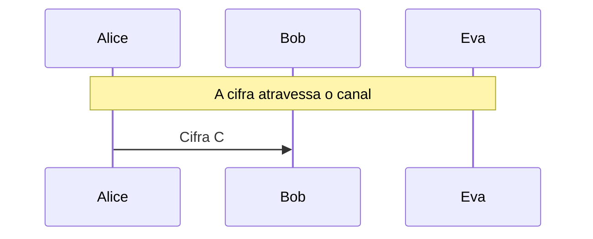
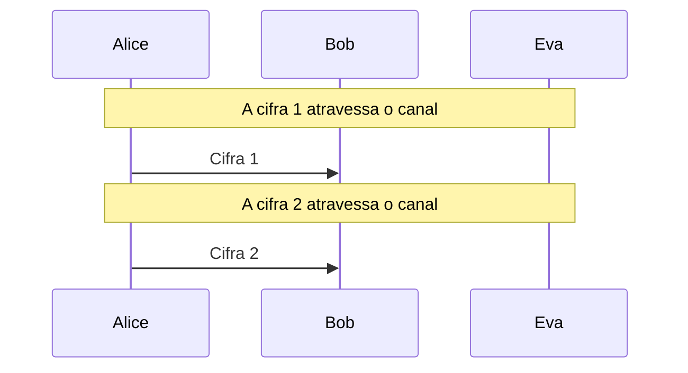

# One-time pad

Sigilo perfeito de Shannon, a maleabilidade e a destruição do sigilo quando a chave é reutilizada, com o arrasto de texto provável de Eva.

- **Categoria:** Criptografia Clássica
- **Abrir o laboratório:** <https://peotta.github.io/CryptoNet/#/lab/otp>
- **Motor:** didático (soma módulo 26)
- **Código-fonte:** `src/labs/otp/` (interface e fluxos) e `src/crypto/otp.ts` (operações)
- **Padrões e referências:** Shannon, *Communication Theory of Secrecy Systems* (1949): sigilo perfeito; Vernam (1917) e Mauborgne.

## 1. Objetivos de aprendizagem

- Cifrar e decifrar com o one-time pad por soma e subtração módulo 26, e relacioná-lo ao XOR dos bits.
- Enunciar as quatro condições do sigilo perfeito: chave aleatória, tão longa quanto a mensagem, de uso único e secreta.
- Demonstrar o sigilo perfeito: para qualquer texto de mesmo tamanho existe uma chave que leva a cifra a ele.
- Mostrar por que reutilizar a chave a destrói: a diferença das duas cifras elimina a chave.
- Executar o arrasto de texto provável (crib dragging) e entender por que um único trecho acertado vaza a chave.
- Reconhecer que o one-time pad não protege a integridade (é maleável) e o custo prático de distribuir chaves tão longas.

## 2. Fundamentação

O one-time pad soma a mensagem a uma chave verdadeiramente aleatória, do tamanho da mensagem e usada uma única vez. Nessas condições o sigilo é perfeito: o texto cifrado não revela nada além do tamanho. A cifra é maleável (Eva altera o claro sem conhecer a chave) e, se a chave for reutilizada, a soma das duas cifras elimina a chave e expõe a soma dos claros, que Eva explora com o arrasto de texto provável (como no projeto Venona).

## 3. Participantes

Alice e Bob são os participantes legítimos; Eva é a atacante (observadora passiva ou, quando há adulteração, ativa). As tabelas abaixo listam o que cada um mantém em cada cenário.

| Participante | Papel | Dados que pode guardar (tipo) |
| --- | --- | --- |
| Alice | Remetente | Chave (pad) K (segredo); Mensagem m (texto claro); Cifra C (texto cifrado); Mensagem 1 (texto claro); Mensagem 2 (texto claro); Cifra 1 (com K) (texto cifrado); Cifra 2 (com a MESMA K) (texto cifrado) |
| Bob | Destinatário | Chave (pad) K (segredo); Cifra recebida (texto cifrado); Mensagem recuperada (texto claro); Cifra 1 recebida (texto cifrado); Cifra 2 recebida (texto cifrado); Mensagem 1 recuperada (texto claro); Mensagem 2 recuperada (texto claro) |
| Eva | Criptoanalista (observa e, se puder, altera o canal) | Cifra observada ou capturada (texto cifrado); Texto candidato testado (hipótese) (texto claro); Chave que levaria a esse candidato (parâmetro público); Cifra alterada C' (enviada a Bob) (texto cifrado); Cifra 1 observada (texto cifrado); Cifra 2 observada (texto cifrado); Diferença D = C2 − C1 (parâmetro público); Fragmento da outra mensagem (texto claro); Fragmento da chave (segredo) |

## 4. Como ler os diagramas

Cada figura é um diagrama de sequência gerado a partir da mesma definição de protocolo que anima o laboratório: as colunas são os participantes, o tempo corre de cima para baixo e cada faixa horizontal é o início de uma etapa. Os valores numéricos e as chaves não aparecem aqui (são aleatórios ou dependem das entradas); eles são mostrados nas fórmulas do próprio laboratório.

- Seta cheia: mensagem enviada pelo canal, com o rótulo do que trafega.
- `[adulterada]` no início do rótulo: a mensagem foi alterada em trânsito por Eva.
- Faixa com texto: título da etapa que começa naquele ponto.

**Lista de figuras**

- [Figura 5.1.1](#511-sigilo-perfeito): Sigilo perfeito
- [Figura 5.2.1](#521-two-time-pad-e-arrasto-de-texto-provável): Two-time pad e arrasto de texto provável

## 5. Cenários

### 5.1 Uso correto

#### 5.1.1 Sigilo perfeito

**Entradas usadas:** chave aleatória do tamanho da mensagem.

*Figura 5.1.1 (sequência).* Sigilo perfeito: 1 mensagem, entre Alice, Bob e Eva.

| Etapa | Título | Operação |
| --- | --- | --- |
| 1 | Alice e Bob possuem a mesma chave aleatória | Nenhum cálculo: a chave já é conhecida por Alice e por Bob. |
| 2 | Alice escreve a mensagem | Normalização do texto em letras de A a Z. |
| 3 | Alice soma a chave à mensagem, letra a letra | Soma módulo 26 de 39 letras. |
| 4 | A cifra atravessa o canal | Transmissão da cifra pelo canal público. |
| 5 | Eva testa um texto candidato e descobre que nada o descarta | Cálculo da chave K′ = C − T para o texto candidato T. |
| 6 | Bob recebe a cifra | Recepção da mensagem cifrada. |
| 7 | Bob subtrai a chave da cifra | Subtração módulo 26. |
| 8 | Eva não aprende nada sobre o conteúdo | Avaliação do resultado. |

**Veredito do cenário:** Eva não aprendeu nada além do tamanho da mensagem (39 letras): para o candidato que ela testou existe a chave HXUQFLDEJMTPSD…, tão aleatória quanto a verdadeira, e o mesmo vale para qualquer outro dos ≈ 1,52 × 10^55 textos possíveis. É o sigilo perfeito de Shannon. Ele depende de a chave ser aleatória, do tamanho da mensagem, usada uma única vez e secreta, e não protege a integridade.

### 5.2 Reutilização da chave

#### 5.2.1 Two-time pad e arrasto de texto provável

**Entradas usadas:** duas mensagens com a mesma chave, texto provável AMANHECER.

*Figura 5.2.1 (sequência).* Two-time pad e arrasto de texto provável: 2 mensagens, entre Alice, Bob e Eva.

| Etapa | Título | Operação |
| --- | --- | --- |
| 1 | Alice e Bob possuem a mesma chave aleatória | Nenhum cálculo: a chave já é conhecida por Alice e por Bob. |
| 2 | Alice escreve duas mensagens | Normalização dos dois textos. |
| 3 | Alice cifra a mensagem 1 com a chave K | C1 = P1 + K (mod 26). |
| 4 | Alice cifra a mensagem 2 com a MESMA chave K | C2 = P2 + K (mod 26), com o mesmo K. |
| 5 | A cifra 1 atravessa o canal | Transmissão da cifra 1. |
| 6 | A cifra 2 atravessa o canal | Transmissão da cifra 2. |
| 7 | Eva subtrai as duas cifras: a chave desaparece | Diferença módulo 26 das duas cifras (região comum de 97 letras). |
| 8 | Eva arrasta o texto provável "AMANHECER" | Arrasto do texto provável em 89 posições, ordenadas pela legibilidade do trecho. |
| 9 | Bob recebe as duas cifras | Recepção das mensagens cifradas. |
| 10 | Bob decifra a mensagem 1 | P1 = C1 − K (mod 26). |
| 11 | Bob decifra a mensagem 2 | P2 = C2 − K (mod 26). |
| 12 | O sigilo perfeito foi destruído pela reutilização | Avaliação do resultado. |

**Veredito do cenário:** Reutilizar a chave destruiu o sigilo: D = C2 − C1 = P2 − P1 não contém a chave. Eva arrastou o texto provável "AMANHECER" e, na posição 26, obteve o fragmento "ROFESSORE" da mensagem 2 e o fragmento "PZZQZIPMT" da chave. Com o fragmento da chave, ela lê as duas mensagens nesse trecho e continua estendendo, adivinhando palavras vizinhas. Foi assim que o projeto Venona decifrou mensagens soviéticas.

## 6. Perguntas de fixação

1. Cifre "HELLO" com a chave "XMCKL" por soma módulo 26. Qual é a cifra?

   **Resposta.** H+X = 7+23 = 30 ≡ 4 (E); E+M = 4+12 = 16 (Q); L+C = 11+2 = 13 (N); L+K = 11+10 = 21 (V); O+L = 14+11 = 25 (Z). A cifra é "EQNVZ". Para decifrar, subtrai-se a chave.

2. O que é o sigilo perfeito e por que o one-time pad o possui?

   **Resposta.** Sigilo perfeito (Shannon, 1949) significa que a cifra não revela informação alguma sobre o texto claro: P(M = m | C = c) = P(M = m). No one-time pad, com chave uniforme, para qualquer texto de mesmo tamanho existe exatamente uma chave que leva a cifra a ele, e todas são igualmente prováveis. Eva só aprende o tamanho da mensagem.

3. Por que a chave precisa ser tão longa quanto a mensagem?

   **Resposta.** Se a chave for menor e for repetida, o texto cifrado passa a ter periodicidade, e Eva usa Kasiski e frequência por coluna, como na Vigenère. Com uma chave curta, não há mais uma chave para cada texto possível, e o sigilo perfeito se perde. A prova de Shannon exige que o número de chaves seja pelo menos igual ao número de mensagens.

4. O que acontece quando a mesma chave cifra duas mensagens, e como Eva se aproveita?

   **Resposta.** A diferença das cifras elimina a chave: C2 − C1 = P2 − P1. Eva passa a trabalhar com uma relação entre dois textos em português. Ela desliza um texto provável pelas posições (arrasto de texto provável): onde acerta, o trecho correspondente da outra mensagem aparece legível, e o fragmento de chave (C − P) vaza. Estendendo o trecho, ela lê as duas mensagens. O projeto Venona decifrou parte do tráfego soviético porque pads foram reutilizados.

5. O one-time pad garante integridade? Dê um exemplo de ataque.

   **Resposta.** Não. A cifra é maleável: somar d a uma letra da cifra soma d à mesma letra do texto claro, sem que Eva conheça a chave. Se Eva sabe que a mensagem diz "PAGAR 100" na posição X, ela pode trocar o 1 por 9 e Bob decifrará "PAGAR 900" sem qualquer erro. Por isso o sigilo precisa ser combinado com autenticação (como um HMAC ou o GCM).

6. Se o one-time pad é perfeitamente seguro, por que quase não é usado?

   **Resposta.** Porque o custo prático é enorme: a chave deve ser sorteada por uma fonte realmente aleatória, ser tão longa quanto todo o tráfego, distribuída previamente por um canal seguro e nunca reutilizada (o que exige descartar cada trecho usado). A criptografia moderna substitui isso por chaves curtas e cifras de fluxo, como o AES-CTR, cujo fluxo de chaves é pseudoaleatório: a segurança passa a ser computacional, e não perfeita.

## 7. Limitações e cuidados

- O laboratório usa o alfabeto de 26 letras; o one-time pad real opera sobre bits e exige distribuição segura de chaves tão longas quanto os dados.
- Uso exclusivamente didático: os laboratórios não devem proteger dados reais.

---

*CryptoNet é um projeto mantido pelo Prof. Dr. Laerte Peotta de Melo, com apoio de IA generativa no processo de desenvolvimento, com sua estrita supervisão, revisão técnica e responsabilidade. Uso exclusivo para fins de ensino e pesquisa. Universidade de Brasília (UnB) - Departamento de Engenharia Elétrica. Código aberto (licença MIT).*
