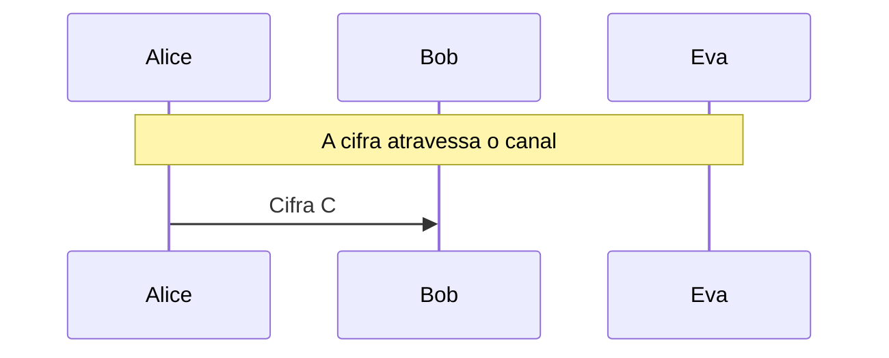

# Playfair e Hill

Cifras poligráficas: digrafos em uma grade 5 × 5 e multiplicação por matriz módulo 26, com o ataque de texto claro conhecido contra o Hill.

- **Categoria:** Criptografia Clássica
- **Abrir o laboratório:** <https://peotta.github.io/CryptoNet/#/lab/playfair-hill>
- **Motor:** didático (digrafos e matrizes módulo 26)
- **Código-fonte:** `src/labs/playfair-hill/` (interface e fluxos) e `src/crypto/playfair.ts e src/crypto/hill.ts` (operações)
- **Padrões e referências:** Playfair (Wheatstone, 1854) e Hill (1929); Livro de referência: Stallings, *Cryptography and Network Security*, cap. 3.

## 1. Objetivos de aprendizagem

- Montar a grade 5 × 5 do Playfair a partir de uma palavra-chave e aplicar as regras da linha, da coluna e do retângulo.
- Explicar por que cifrar pares de letras (digrafos) achata o histograma de letras e resiste à análise de frequência simples.
- Cifrar e decifrar com a cifra de Hill por multiplicação de matrizes módulo 26, e calcular a inversa da chave.
- Explicar por que o determinante da matriz-chave precisa ser coprimo com 26.
- Executar o ataque de texto claro conhecido contra o Hill (K = C · P⁻¹) e entender por que a linearidade o torna frágil.
- Reconhecer que nenhuma das duas cifras tem integridade e que ambas são cifras clássicas, sem segurança real.

## 2. Fundamentação

O Playfair cifra pares de letras (digrafos) sobre uma grade 5 × 5 montada com uma palavra-chave (I e J compartilham a célula). O Hill cifra blocos de n letras multiplicando-os por uma matriz n × n invertível módulo 26. O Hill é linear e, por isso, cai diante de um ataque de texto claro conhecido: com n pares independentes, Eva resolve a matriz.

## 3. Participantes

Alice e Bob são os participantes legítimos; Eva é a atacante (observadora passiva ou, quando há adulteração, ativa). As tabelas abaixo listam o que cada um mantém em cada cenário.

| Participante | Papel | Dados que pode guardar (tipo) |
| --- | --- | --- |
| Alice | Remetente | Chave K (matriz 2 × 2) (segredo); Mensagem m (texto claro); Cifra C (texto cifrado) |
| Bob | Destinatário | Chave K (matriz 2 × 2) (segredo); Cifra recebida (texto cifrado); Mensagem recuperada (texto claro) |
| Eva | Criptoanalista (observa e, se puder, altera o canal) | Cifra observada ou capturada (texto cifrado); Estatísticas observadas por Eva (parâmetro público); Cifra alterada C' (enviada a Bob) (texto cifrado); Texto claro conhecido por Eva (texto claro); Chave deduzida por Eva (segredo) |

## 4. Como ler os diagramas

Cada figura é um diagrama de sequência gerado a partir da mesma definição de protocolo que anima o laboratório: as colunas são os participantes, o tempo corre de cima para baixo e cada faixa horizontal é o início de uma etapa. Os valores numéricos e as chaves não aparecem aqui (são aleatórios ou dependem das entradas); eles são mostrados nas fórmulas do próprio laboratório.

- Seta cheia: mensagem enviada pelo canal, com o rótulo do que trafega.
- `[adulterada]` no início do rótulo: a mensagem foi alterada em trânsito por Eva.
- Faixa com texto: título da etapa que começa naquele ponto.

**Lista de figuras**

- [Figura 5.1.1](#511-playfair-com-a-palavra-chave-monarquia): Playfair com a palavra-chave MONARQUIA
- [Figura 5.2.1](#521-hill-2--2-e-ataque-de-texto-claro-conhecido): Hill 2 × 2 e ataque de texto claro conhecido

## 5. Cenários

### 5.1 Playfair

#### 5.1.1 Playfair com a palavra-chave MONARQUIA

**Entradas usadas:** palavra-chave MONARQUIA.

*Figura 5.1.1 (sequência).* Playfair com a palavra-chave MONARQUIA: 1 mensagem, entre Alice, Bob e Eva.

| Etapa | Título | Operação |
| --- | --- | --- |
| 1 | Alice e Bob combinam a palavra-chave | Nenhum cálculo: a chave já é conhecida por Alice e por Bob. |
| 2 | Alice prepara a mensagem em digrafos | Divisão em 197 digrafos. |
| 3 | Alice cifra cada digrafo pela grade | Cifragem de 197 digrafos com a grade. |
| 4 | A cifra atravessa o canal | Transmissão da cifra pelo canal público. |
| 5 | Eva tenta a análise de frequência | Cálculo do IC e da frequência de digrafos da cifra. |
| 6 | Bob recebe a cifra | Recepção da mensagem cifrada. |
| 7 | Bob decifra pela regra inversa | Decifragem Playfair. |
| 8 | Eva não lê a mensagem só com a frequência de letras | Avaliação do resultado. |

**Veredito do cenário:** A frequência de letras isolada não revela a mensagem: o IC da cifra é 0,0567 (português: 0,0745) e o histograma é achatado. Eva precisaria de análise de digrafos com centenas de letras, de palavras prováveis ou de texto claro conhecido. O Playfair foi usado em campo por décadas, mas não é seguro: é quebrado por esses métodos, e por computador.

### 5.2 Hill

#### 5.2.1 Hill 2 × 2 e ataque de texto claro conhecido

**Entradas usadas:** matriz [3 3; 2 5], 24 letras conhecidas.

*Figura 5.2.1 (sequência).* Hill 2 × 2 e ataque de texto claro conhecido: 1 mensagem, entre Alice, Bob e Eva.

| Etapa | Título | Operação |
| --- | --- | --- |
| 1 | Alice e Bob combinam a matriz-chave | Nenhum cálculo: a chave já é conhecida por Alice e por Bob. |
| 2 | Alice prepara a mensagem em blocos | Divisão em 35 blocos de 2 letras. |
| 3 | Alice multiplica cada bloco pela matriz | C = K · P (mod 26), bloco a bloco. |
| 4 | A cifra atravessa o canal | Transmissão da cifra pelo canal público. |
| 5 | Eva resolve a chave com texto claro conhecido | Resolução de K = C · P⁻¹ com 2 blocos independentes. |
| 6 | Bob recebe a cifra | Recepção da mensagem cifrada. |
| 7 | Bob multiplica pela inversa da chave | Decifragem: P = K⁻¹ · C (mod 26). |
| 8 | A cifra foi quebrada por Eva | Avaliação do resultado. |

**Veredito do cenário:** Eva montou o sistema C = K · P com 2 blocos independentes e o resolveu: K = C · P⁻¹ (mod 26). Obteve a chave exata [3 3; 2 5] conhecendo apenas 24 letras do texto claro. A cifra de Hill é linear, e a linearidade é a sua fraqueza.

## 6. Perguntas de fixação

1. Cifre "HI" com o Playfair e a chave "PLAYFAIR EXAMPLE". Qual a regra aplicada?

   **Resposta.** A grade é PLAYF / IREXM / BCDGH / KNOQS / TUVWZ. H está na linha 3, coluna 5 e I na linha 2, coluna 1: linhas e colunas diferentes, regra do retângulo. H é trocada pela letra da sua linha na coluna de I (B) e I pela letra da sua linha na coluna de H (M). O resultado é "BM".

2. Por que o Playfair resiste à análise de frequência que quebra a substituição simples?

   **Resposta.** Porque cifra pares de letras: a mesma letra clara vira letras cifradas diferentes conforme a vizinha, e o histograma de letras fica achatado (o IC cai bastante, de cerca de 0,07 para cerca de 0,05). As estatísticas de digrafos existem, mas são cerca de 600 possíveis em vez de 26, e exigem muito mais texto cifrado para aparecer.

3. Por que o Playfair não é seguro, apesar disso?

   **Resposta.** Digrafos repetidos no texto claro geram digrafos repetidos na cifra, e a estrutura da língua (digrafos como "ES", "DE", "OS") sobrevive. Com algumas centenas de letras, análise de digrafos, palavras prováveis ou busca por computador recuperam a grade. Também vale o padrão inverso: se AB vira CD, então BA vira DC.

4. Por que o determinante da matriz do Hill precisa ser coprimo com 26?

   **Resposta.** Para a matriz ter inversa módulo 26: K⁻¹ = (det K)⁻¹ · adj(K), e o inverso de det K módulo 26 só existe se mdc(det K, 26) = 1. Sem inversa, Bob não consegue decifrar e blocos diferentes poderiam gerar a mesma cifra.

5. Como Eva quebra o Hill 2 × 2 conhecendo 4 letras do texto claro?

   **Resposta.** Dois blocos de texto claro P1 e P2 e as cifras C1 e C2 satisfazem C = K · P, em que as colunas de P e de C são os blocos. Se P é inversível módulo 26, então K = C · P⁻¹. Ela calcula P⁻¹ (inverso do determinante vezes a adjunta) e multiplica. A linearidade do Hill é a sua fraqueza.

6. Por que às vezes o ataque ao Hill precisa de mais texto claro conhecido do que o mínimo?

   **Resposta.** Porque os blocos conhecidos precisam formar uma matriz P inversível módulo 26. Dependendo das letras, o determinante pode ser par ou múltiplo de 13 e P não tem inversa (por exemplo, blocos repetidos). Com mais blocos, Eva escolhe outros que sejam independentes.

7. O Hill difunde cada letra por todo o bloco. Isso o protege contra adulteração?

   **Resposta.** Não. Se Eva altera uma letra da cifra, o bloco inteiro de n letras é decifrado errado (difusão), mas Bob não tem como perceber: não há verificação de integridade. Só cifras autenticadas, como o AES-GCM, detectam a alteração.

## 7. Limitações e cuidados

- Cifras históricas: não oferecem segurança.
- O Hill aceita matrizes 2 × 2 e 3 × 3; o ataque exige blocos independentes (determinante invertível módulo 26).
- Uso exclusivamente didático: os laboratórios não devem proteger dados reais.

---

*CryptoNet é um projeto mantido pelo Prof. Dr. Laerte Peotta de Melo, com apoio de IA generativa no processo de desenvolvimento, com sua estrita supervisão, revisão técnica e responsabilidade. Uso exclusivo para fins de ensino e pesquisa. Universidade de Brasília (UnB) - Departamento de Engenharia Elétrica. Código aberto (licença MIT).*
