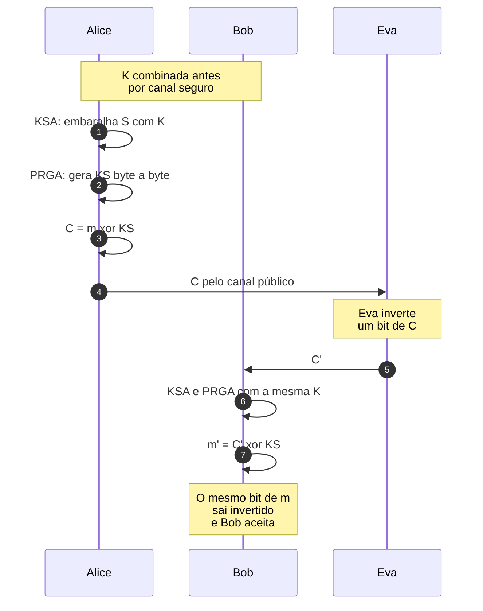
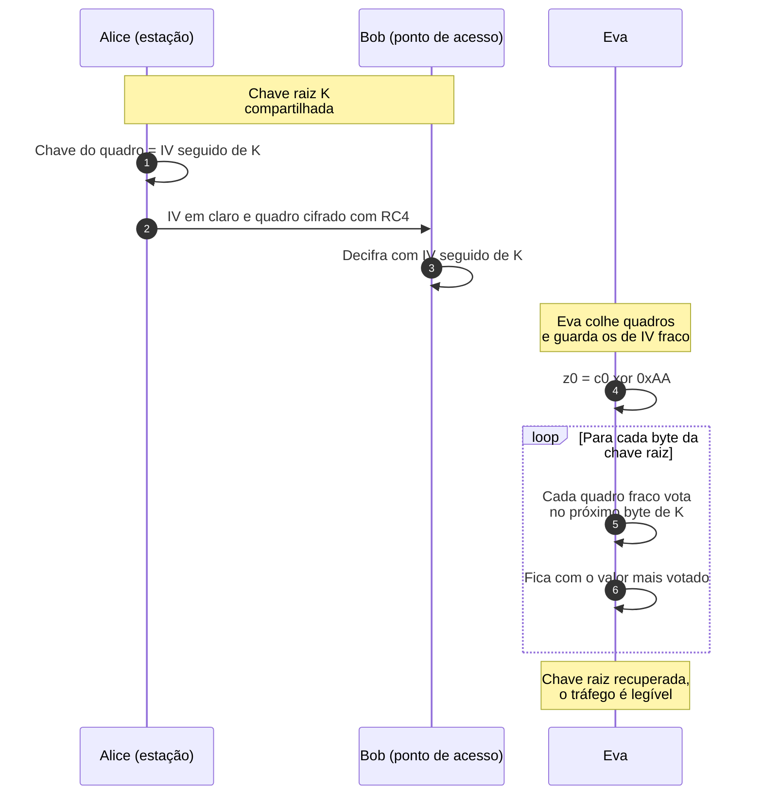
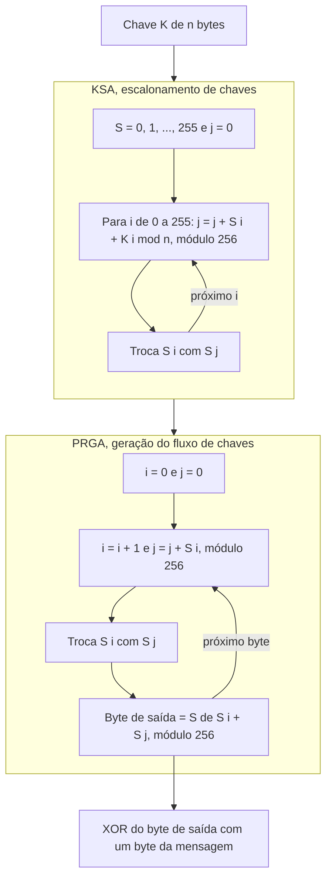
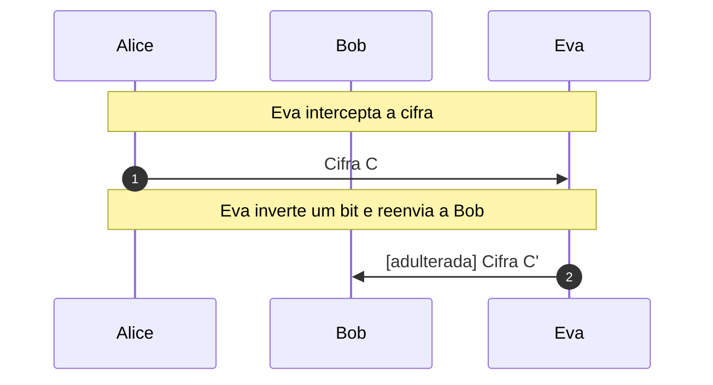
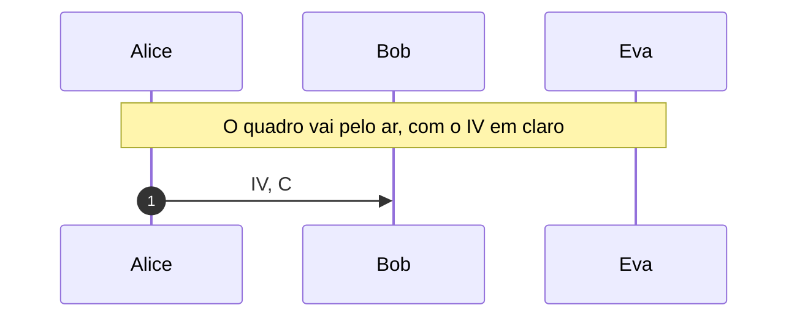

# RC4 e o ataque ao WEP

Cifra de fluxo clássica: KSA e PRGA troca por troca, a maleabilidade e o ataque FMS, com que Eva recupera a chave do WEP por votação.

- **Categoria:** Criptografia Simétrica
- **Abrir o laboratório:** <https://peotta.github.io/CryptoNet/#/lab/rc4>
- **Motor:** didático (RC4 com rastro; conferido com vetores conhecidos e com a [RFC 6229](https://www.rfc-editor.org/rfc/rfc6229))
- **Código-fonte:** `src/labs/rc4/` (interface e fluxos) e `src/crypto/rc4.ts` (operações)
- **Padrões e referências:** [RFC 6229](https://www.rfc-editor.org/rfc/rfc6229) (vetores de teste do RC4, informativa); [RFC 7465](https://www.rfc-editor.org/rfc/rfc7465) (proíbe as suítes RC4 no TLS); [RFC 8758](https://www.rfc-editor.org/rfc/rfc8758) (descontinua o RC4 no SSH); O RC4 não é um algoritmo aprovado pelo NIST (não consta em nenhuma FIPS nem SP).

## 1. Objetivos de aprendizagem

- Executar a KSA (256 trocas que embaralham o estado com a chave) e a PRGA (uma troca por byte emitido) do RC4, conferidas com os vetores conhecidos e com a [RFC 6229](https://www.rfc-editor.org/rfc/rfc6229).
- Explicar que o RC4 é uma cifra de fluxo sem nonce: a mesma chave gera sempre o mesmo fluxo, o que obriga a acrescentar um IV à chave (como no WEP).
- Mostrar a maleabilidade: sem autenticação, Eva inverte bits do claro sem conhecer a chave.
- Reproduzir o ataque FMS contra o WEP: com o IV em claro e um primeiro byte de claro conhecido (0xAA), Eva recupera a chave raiz byte a byte por votação.
- Verificar o viés do segundo byte do fluxo (zero com probabilidade próxima de 2/256) e o efeito de descartar o início do fluxo.
- Situar o RC4 entre as cifras abandonadas ([RFC 7465](https://www.rfc-editor.org/rfc/rfc7465) e [RFC 8758](https://www.rfc-editor.org/rfc/rfc8758)) e compará-lo com o ChaCha20 e o AES-CTR.

## 2. Fundamentação

O RC4 mantém um estado de 256 bytes. A KSA o embaralha com a chave em 256 trocas e a PRGA emite um byte por troca; a mensagem é combinada com o fluxo por XOR. Não há nonce, o fluxo tem vieses (o segundo byte vale zero com probabilidade próxima de 2/256) e a cifra não autentica. No WEP, a chave de cada quadro é o IV de 3 bytes, em claro, seguido da chave raiz, e o ataque FMS recupera a chave raiz por votação a partir do primeiro byte de fluxo de quadros com IV fracos, sabendo que o claro começa por 0xAA.

**Artigos e especificação.** O RC4 foi projetado por Ronald Rivest em 1987 e nunca foi publicado oficialmente: o algoritmo tornou-se público por divulgação não autorizada em 1994, de modo que não há artigo original do autor.

- Fluhrer, S.; Mantin, I.; Shamir, A. *Weaknesses in the Key Scheduling Algorithm of RC4*. In: Selected Areas in Cryptography (SAC 2001), Lecture Notes in Computer Science, v. 2259. Springer, 2001. [Acessar o artigo (PDF, cópia hospedada na Universidade Cornell)](https://www.cs.cornell.edu/people/egs/615/rc4_ksaproc.pdf); [DOI 10.1007/3-540-45537-X_1](https://doi.org/10.1007/3-540-45537-X_1).
- AlFardan, N. J.; Bernstein, D. J.; Paterson, K. G.; Poettering, B.; Schuldt, J. C. N. *On the Security of RC4 in TLS*. In: 22nd USENIX Security Symposium, 2013. [Acessar o artigo (PDF, USENIX)](https://www.usenix.org/system/files/conference/usenixsecurity13/sec13-paper_alfardan.pdf).
- Popov, A. *Prohibiting RC4 Cipher Suites*. [RFC 7465](https://www.rfc-editor.org/rfc/rfc7465), fev. 2015.

### 2.1 Diagramas do RC4 em uso, do ataque ao WEP e da estrutura interna

Os diagramas abaixo mostram o RC4 antes dos cenários executados da seção 5. Alice cifra, Bob decifra e Eva observa o canal e, quando indicado, altera a cifra ou coleta quadros. **K** é a chave, **S** o estado de 256 bytes, **KS** o fluxo de chaves e **m** a mensagem. O último diagrama é um fluxograma da estrutura interna: o escalonamento de chaves (KSA) e a geração do fluxo (PRGA).

#### 2.1.1 Chave de sessão, cifragem e a alteração de um bit pela Eva (uso sem nonce)

Alice e Bob compartilham K. Cada um executa o KSA, que embaralha o estado S com a chave, e depois o PRGA, que emite um byte de fluxo por troca de elementos de S. Alice soma o fluxo à mensagem por XOR. O RC4 não tem nonce: usar a mesma chave duas vezes reproduz o mesmo fluxo. Eva inverte um bit da cifra e o mesmo bit sai invertido no claro de Bob, que não percebe, pois a cifra não autentica. Além disso, o fluxo tem vieses estatísticos (o segundo byte vale zero com probabilidade próxima de 2/256, o dobro do esperado), o que motivou a proibição do RC4 no TLS.

*Figura 2.1.1 (sequência).* Chave de sessão, cifragem e a alteração de um bit pela Eva.

#### 2.1.2 WEP: Eva recupera a chave raiz (ataque FMS) (IV de 3 bytes em claro)

No WEP, a estação (Alice) cifra cada quadro com o RC4 usando como chave o IV de 3 bytes, transmitido em claro, seguido da chave raiz K compartilhada com o ponto de acesso (Bob). Como o IV é curto e visível, Eva colhe quadros e separa os que têm IV fracos (na forma A+3, 255, X). Todo quadro começa com o cabeçalho 0xAA, então Eva obtém o primeiro byte do fluxo de cada quadro por z0 = c0 xor 0xAA. Pelo ataque de Fluhrer, Mantin e Shamir, cada quadro fraco vota em um valor para o byte seguinte da chave raiz com probabilidade acima da ao acaso (cerca de 5%); com votos suficientes o valor mais votado é o byte correto. Byte a byte, Eva reconstrói a chave raiz e passa a ler o tráfego.

*Figura 2.1.2 (sequência).* WEP: Eva recupera a chave raiz (ataque FMS).

#### 2.1.3 Estrutura interna: KSA e PRGA (fluxograma)

O estado S começa como a permutação identidade dos valores 0 a 255. No KSA (*key-scheduling algorithm*), um índice j é atualizado com j = j + S[i] + K[i mod n] (módulo 256) e S[i] troca de lugar com S[j], para i de 0 a 255; a chave decide como o estado é embaralhado. No PRGA (*pseudo-random generation algorithm*), a cada byte de saída i avança uma posição, j soma S[i], os elementos S[i] e S[j] trocam de lugar e o byte do fluxo é S[(S[i] + S[j]) mod 256]. O fluxo é combinado com a mensagem por XOR.

*Figura 2.1.3 (estrutura interna).* Estrutura interna: KSA e PRGA.

> **Aviso:** a partir deste ponto são apresentados os cenários para simulação em laboratório, com Alice, Bob e Eva como participantes.

## 3. Participantes

Alice e Bob são os participantes legítimos; Eva é a atacante (observadora passiva ou, quando há adulteração, ativa). As tabelas abaixo listam o que cada um mantém em cada cenário.

| Participante | Papel | Dados que pode guardar (tipo) |
| --- | --- | --- |
| Alice | Remetente | Chave raiz K (40 bits) (segredo); Estado S depois da KSA (segredo); Quadro em claro (texto claro); Fluxo de chaves (segredo); Quadro cifrado (texto cifrado); IV do quadro (24 bits, em claro) (parâmetro público) |
| Bob | Destinatário | Chave raiz K (40 bits) (segredo); Quadro recebido (texto cifrado); Fluxo de chaves (segredo); Quadro recuperado (texto claro) |
| Eva | Atacante (observa e, se puder, altera o canal) | Quadros colhidos (IV e 1º byte cifrado) (texto cifrado); Cifra alterada C' (enviada a Bob) (texto cifrado); Primeiro byte do fluxo (c0 ⊕ 0xAA) (parâmetro público); Chave raiz recuperada (segredo); Quadro lido por Eva (texto claro) |

## 4. Como ler os diagramas

Cada figura é um diagrama de sequência gerado a partir da mesma definição de protocolo que anima o laboratório: as colunas são os participantes, o tempo corre de cima para baixo e cada faixa horizontal é o início de uma etapa. Os valores numéricos e as chaves não aparecem aqui (são aleatórios ou dependem das entradas); eles são mostrados nas fórmulas do próprio laboratório.

- Seta cheia: mensagem enviada pelo canal, com o rótulo do que trafega.
- Número no início do rótulo: ordem da interação no diagrama, de cima para baixo.
- Botão Ampliar diagrama (no site): abre o diagrama em tela cheia, com zoom.
- `[adulterada]` no início do rótulo: a mensagem foi alterada em trânsito por Eva.
- Faixa com texto: título da etapa que começa naquele ponto.

**Lista de figuras**

- [Figura 5.1.1](#511-eva-observa-e-altera-um-byte): Eva observa e altera um byte
- [Figura 5.2.1](#521-eva-recupera-a-chave-raiz-ataque-fms): Eva recupera a chave raiz (ataque FMS)

## 5. Cenários

### 5.1 Chave de sessão

#### 5.1.1 Eva observa e altera um byte

**Entradas usadas:** chave de 16 bytes, mensagem de 25 bytes.

*Figura 5.1.1 (sequência).* Eva observa e altera um byte: 2 mensagens (1 adulterada), entre Alice, Bob e Eva.

| Etapa | Título | Operação |
| --- | --- | --- |
| 1 | Alice e Bob compartilham a chave | Nenhum cálculo: a chave já é conhecida por Alice e por Bob. |
| 2 | Alice embaralha o estado com a chave (KSA) | 256 trocas (KSA). |
| 3 | Alice escreve a mensagem | Codificação UTF-8 da mensagem. |
| 4 | Alice gera o fluxo de chaves (PRGA) | Geração de 25 bytes de fluxo de chaves. |
| 5 | Alice faz o XOR da mensagem com o fluxo | XOR byte a byte: C = m ⊕ KS. |
| 6 | Eva intercepta a cifra | Interceptação da cifra. |
| 7 | Eva inverte um bit e reenvia a Bob | XOR de 0x01 no byte 10 da cifra. |
| 8 | Bob recebe a cifra | Recepção da cifra. |
| 9 | Bob gera o mesmo fluxo de chaves | KSA e PRGA com a chave K. |
| 10 | Bob faz o XOR da cifra com o fluxo | XOR byte a byte: m = C ⊕ KS. |
| 11 | Bob aceita uma mensagem alterada | Avaliação do resultado. |

**Veredito do cenário:** Eva inverteu um bit do byte 10 da cifra, sem conhecer a chave, e Bob decifrou a mensagem com exatamente esse bit invertido (1 byte alterado), sem perceber. O RC4 só cifra: não autentica.

### 5.2 WEP

#### 5.2.1 Eva recupera a chave raiz (ataque FMS)

**Entradas usadas:** chave raiz de 40 bits, 1.280 quadros com IV fracos.

*Figura 5.2.1 (sequência).* Eva recupera a chave raiz (ataque FMS): 1 mensagem, entre Alice, Bob e Eva.

| Etapa | Título | Operação |
| --- | --- | --- |
| 1 | A estação e o ponto de acesso compartilham a chave raiz | Nenhum cálculo: a chave raiz já é conhecida por Alice e por Bob. |
| 2 | Alice cifra um quadro com IV mais chave raiz | Cifragem RC4 com a chave IV ‖ K. |
| 3 | O quadro vai pelo ar, com o IV em claro | Transmissão do IV e do quadro cifrado. |
| 4 | Bob decifra o quadro | Decifragem RC4 com a chave IV ‖ K. |
| 5 | Eva colhe quadros com IV fracos | Coleta de 1.280 quadros (IV e primeiro byte cifrado). |
| 6 | Eva obtém o primeiro byte do fluxo de cada quadro | XOR do primeiro byte cifrado com 0xAA. |
| 7 | Eva descobre o byte 1 da chave raiz | Votação para o byte 1 (254 votos). |
| 8 | Eva descobre o byte 2 da chave raiz | Votação para o byte 2 (252 votos). |
| 9 | Eva descobre o byte 3 da chave raiz | Votação para o byte 3 (250 votos). |
| 10 | Eva descobre o byte 4 da chave raiz | Votação para o byte 4 (248 votos). |
| 11 | Eva descobre o byte 5 da chave raiz | Votação para o byte 5 (247 votos). |
| 12 | Eva confere a chave e lê o quadro | Decifragem do quadro com a chave recuperada. |
| 13 | O WEP caiu: a chave raiz foi recuperada | Avaliação do resultado. |

**Veredito do cenário:** Eva recuperou a chave raiz de 40 bits com 1.280 quadros, sem testar as 2^40 chaves: o candidato mais votado de cada byte já servia. Com a chave, ela lê e forja quadros da rede. O defeito é do uso do RC4 no WEP (IV curto e em claro, chave por quadro = IV mais chave raiz), explorado pelo ataque FMS (2001); o WEP foi substituído pelo WPA e pelo WPA2.

## 6. Perguntas de fixação

1. Como o RC4 transforma uma chave curta em um fluxo de bytes?

   **Resposta.** O estado S começa como a permutação identidade de 0 a 255. A KSA percorre i de 0 a 255, calcula j = j + S[i] + K[i mod tamanho] e troca S[i] com S[j], o que embaralha S de modo dependente da chave. A PRGA, a cada byte, faz i = i + 1, j = j + S[i], troca S[i] com S[j] e emite S[(S[i] + S[j]) mod 256]. A mensagem é combinada com esse fluxo por XOR, e decifrar é a mesma operação.

2. Por que o RC4 precisa de um IV acrescentado à chave, e por que isso foi um problema no WEP?

   **Resposta.** O RC4 não tem nonce: com a mesma chave, o fluxo é sempre o mesmo, e reutilizá-lo permite a Eva obter C1 ⊕ C2 = m1 ⊕ m2. O WEP resolveu isso formando a chave de cada quadro como IV (24 bits) seguido da chave raiz. Mas o IV é curto (repete-se após cerca de 16 milhões de quadros), viaja em claro e fica justamente no início da chave, onde a KSA é mais fraca. Isso permite o ataque FMS.

3. Como funciona o ataque FMS em linhas gerais?

   **Resposta.** Para IVs da forma (B+3, 255, X), quando os três primeiros bytes são conhecidos e o byte B da chave raiz é o próximo, a KSA, depois de B+3 passos, deixa o estado em uma situação em que, com probabilidade de cerca de 5%, o primeiro byte do fluxo é determinado pelo byte desconhecido: K[B+3] = S⁻¹[z0] − j − S[B+3]. Eva obtém z0 pelo XOR do primeiro byte cifrado com 0xAA (cabeçalho SNAP conhecido). Cada quadro vota em um valor; o certo recebe mais votos que os outros. Repetindo para cada byte, ela recupera a chave sem testar as 2^40 possibilidades.

4. Por que o primeiro byte do claro ser conhecido facilita o ataque?

   **Resposta.** Porque a cifra de fluxo é C = m ⊕ fluxo: se Eva conhece m, obtém o fluxo diretamente, sem adivinhar nada. No 802.11, todo quadro IP começa pelo cabeçalho LLC/SNAP AA AA 03 00 00 00. É um caso de texto claro conhecido, comum em protocolos, com cabeçalhos fixos.

5. O que é o viés do segundo byte e como descartar o início do fluxo ajuda?

   **Resposta.** No RC4, o segundo byte do fluxo vale zero com probabilidade próxima de 2/256 (o dobro de um fluxo aleatório), por uma propriedade da PRGA quando S[2] = 0. Se uma mesma mensagem é cifrada com muitas chaves, o atacante vê um valor aparecer mais que os outros naquela posição e deduz o claro. Descartar os primeiros 256 bytes (RC4-drop[256]) elimina esse viés e outros do início do fluxo, mas vieses em posições posteriores continuam, e o RC4 acabou proibido no TLS ([RFC 7465](https://www.rfc-editor.org/rfc/rfc7465)).

6. Por que o ChaCha20 e o AES-CTR são preferíveis ao RC4?

   **Resposta.** Têm nonce (a mesma chave serve para muitas mensagens sem repetir o fluxo), não apresentam vieses estatísticos conhecidos, têm análise de segurança mais completa e, no caso do ChaCha20-Poly1305 e do AES-GCM, vêm em modos autenticados (AEAD), o que impede a maleabilidade. O RC4 só cifra, é enviesado e exige gambiarras como o IV do WEP.

## 7. Limitações e cuidados

- O ataque FMS é demonstrado no WEP de 40 bits com quadros de IV fracos (256 por byte da chave); ferramentas reais precisam de mais quadros e usam ataques posteriores (KoreK, PTW).
- A KSA e a PRGA são exibidas para a chave informada; a Parte C mede o viés por amostragem de chaves aleatórias, não por prova.
- A mensagem é limitada a 120 bytes.
- Uso exclusivamente didático: os laboratórios não devem proteger dados reais.

## 8. Glossário

Significado e finalidade das siglas usadas neste documento.

| Sigla | Significado | Para que serve |
| --- | --- | --- |
| **AEAD** | Authenticated Encryption with Associated Data, cifra autenticada com dados associados | cifra que protege o sigilo e a integridade juntos e também autentica dados que ficam em claro, como cabeçalhos |
| **AES-CTR** | AES no modo contador | cifra de fluxo construída com o AES; não autentica a mensagem |
| **AES-GCM** | AES no modo Galois/Counter | cifra autenticada de uso corrente no TLS e em armazenamento: cifra e detecta alteração com a mesma chave |
| **DOI** | Digital Object Identifier, identificador de objeto digital | identificador permanente de uma publicação, que leva ao artigo pelo endereço doi.org |
| **FIPS** | Federal Information Processing Standards, padrões federais de processamento de informação | padrões do NIST de uso obrigatório nos órgãos americanos, como o [FIPS 197](https://csrc.nist.gov/pubs/fips/197/final) (AES) e o [FIPS 203](https://csrc.nist.gov/pubs/fips/203/final) (ML-KEM) |
| **FMS** | Fluhrer, Mantin e Shamir | ataque de 2001 que recupera a chave do WEP a partir dos primeiros bytes do fluxo de chave do RC4 |
| **IP** | Internet Protocol, protocolo de internet | endereça e encaminha pacotes entre redes, de origem a destino |
| **IV** | Initialization Vector, vetor de inicialização | valor que torna distintas duas cifragens com a mesma chave; em geral público, mas único ou imprevisível conforme o modo |
| **KSA** | Key-Scheduling Algorithm, algoritmo de escalonamento de chave | fase do RC4 que embaralha a permutação inicial com a chave |
| **NIST** | National Institute of Standards and Technology, Instituto Nacional de Padrões e Tecnologia (EUA) | publica os padrões criptográficos federais americanos, como os FIPS e as SP 800 |
| **PDF** | Portable Document Format, formato de documento portátil | formato de arquivo das cópias dos artigos citados |
| **PRGA** | Pseudo-Random Generation Algorithm, algoritmo de geração pseudoaleatória | fase do RC4 que produz o fluxo de chave byte a byte |
| **PTW** | Pyshkin, Tews e Weinmann | ataque de 2007 ao WEP que precisa de bem menos pacotes que o FMS |
| **RC4** | Rivest Cipher 4 | cifra de fluxo antiga, hoje proibida em protocolos modernos por vieses no fluxo de chaves |
| **SAC** | Selected Areas in Cryptography | conferência de criptografia em que foram publicados artigos sobre o RC4 |
| **SP** | Special Publication, publicação especial | série de recomendações do NIST, como a [SP 800-38A](https://csrc.nist.gov/pubs/sp/800/38/a/final) (modos de operação) e a [SP 800-38D](https://csrc.nist.gov/pubs/sp/800/38/d/final) (modo GCM) |
| **SSH** | Secure Shell | protocolo de acesso remoto e de transferência de arquivos com autenticação e cifra |
| **TLS** | Transport Layer Security, segurança da camada de transporte | protocolo que cifra e autentica a comunicação entre cliente e servidor; sucessor do SSL |
| **USENIX** | Advanced Computing Systems Association (nome histórico: Unix Users Group) | associação que realiza conferências de sistemas e segurança, como o USENIX Security |
| **UTF-8** | Unicode Transformation Format, 8 bits | codificação de texto Unicode em bytes, compatível com o ASCII |
| **WEP** | Wired Equivalent Privacy, privacidade equivalente à de redes cabeadas | mecanismo de segurança do Wi-Fi original, baseado em RC4 e quebrado por falhas no uso do vetor de inicialização |
| **WPA** | Wi-Fi Protected Access, acesso protegido Wi-Fi | sucessor do WEP no Wi-Fi, com renovação das chaves por pacote |
| **WPA2** | Wi-Fi Protected Access 2 | versão do WPA que usa o AES no modo CCMP |
| **XOR** | Exclusive OR, ou exclusivo | operação bit a bit que combina o texto claro com o fluxo de chave e é a sua própria inversa |

---

*CryptoNet é um projeto mantido pelo Prof. Dr. Laerte Peotta de Melo, com apoio de IA generativa no processo de desenvolvimento, com sua estrita supervisão, revisão técnica e responsabilidade. Uso exclusivo para fins de ensino e pesquisa. Universidade de Brasília (UnB) - Departamento de Engenharia Elétrica. Código aberto (licença MIT).*
