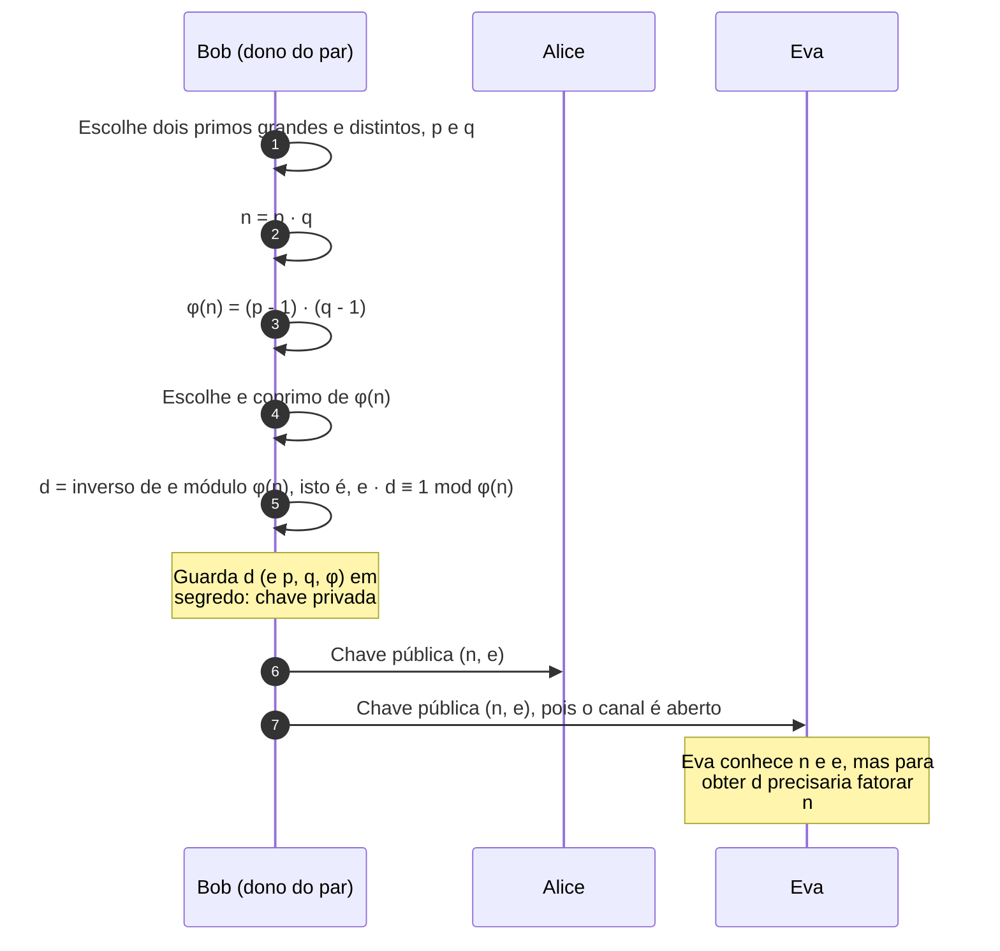
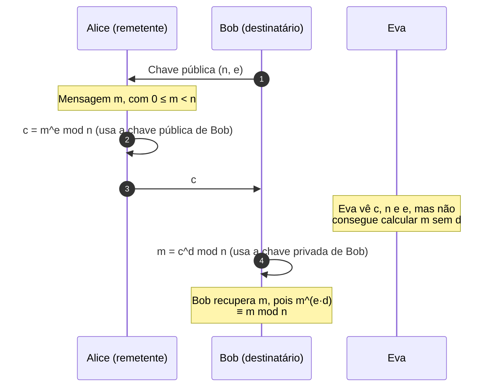
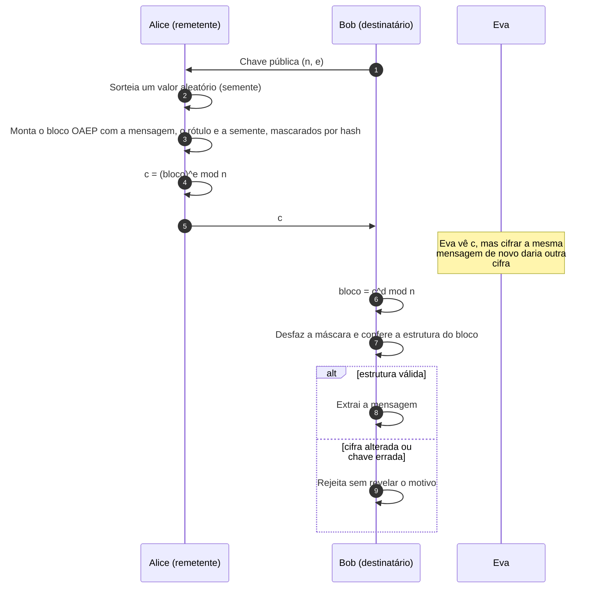
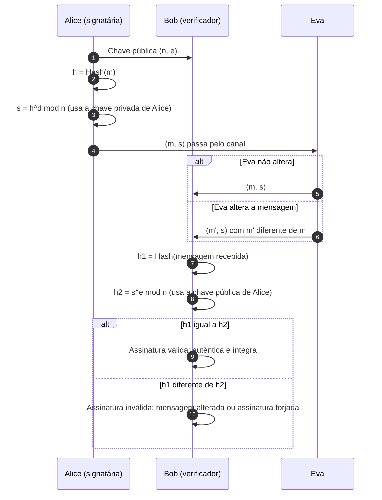
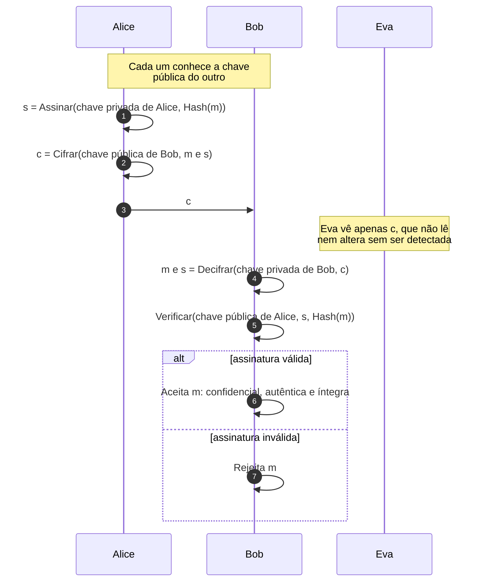
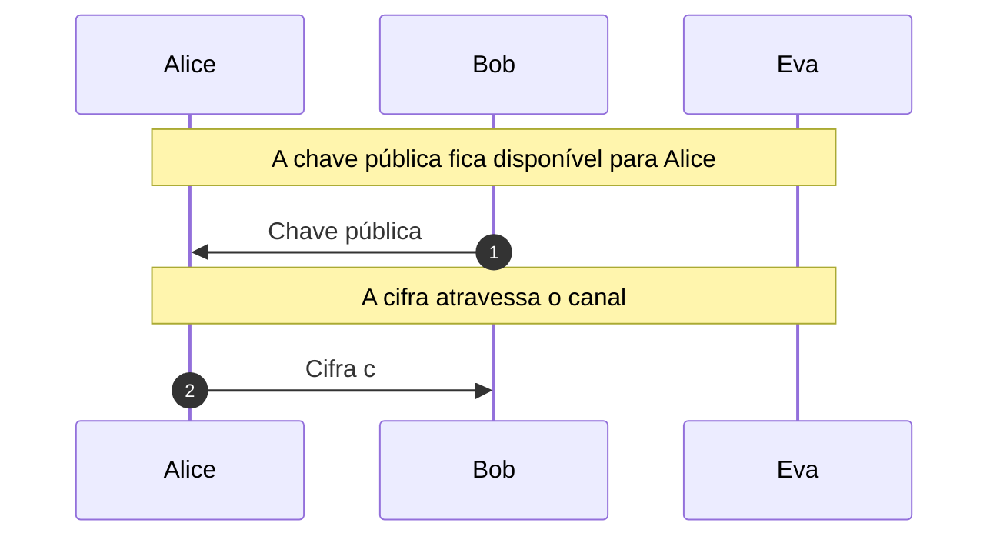
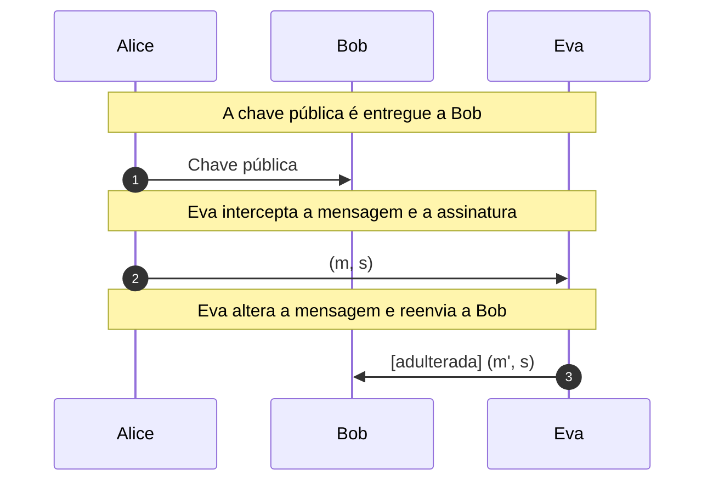

# RSA

Geração de chaves, cifragem, decifragem e assinatura digital, em versão didática (BigInt) e real (RSA-OAEP e RSA-PSS).

- **Categoria:** Criptografia Assimétrica e Acordo de Chaves
- **Abrir o laboratório:** <https://peotta.github.io/CryptoNet/#/lab/rsa>
- **Motor:** didático (BigInt, sem padding) e real (Web Crypto)
- **Código-fonte:** `src/labs/rsa/` (interface e fluxos) e `src/crypto/rsaDidactic.ts e src/crypto/rsaWebCrypto.ts` (operações)
- **Padrões e referências:** [RFC 8017](https://www.rfc-editor.org/rfc/rfc8017) (PKCS #1 v2.2: RSAES-OAEP e RSASSA-PSS); [FIPS 186-5](https://csrc.nist.gov/pubs/fips/186-5/final) (assinaturas RSA, incluindo o RSASSA-PSS); [FIPS 180-4](https://csrc.nist.gov/pubs/fips/180-4/upd1/final) (SHA-2, usado no OAEP e no PSS); NIST [SP 800-56B Rev. 2](https://csrc.nist.gov/pubs/sp/800/56/b/r2/final) (estabelecimento de chaves com RSA); NIST [SP 800-57 Parte 1 Rev. 5](https://csrc.nist.gov/pubs/sp/800/57/pt1/r5/final) (tamanhos de chave).

## 1. Objetivos de aprendizagem

- Calcular um par de chaves RSA a partir de dois primos (n, φ(n), e, d) e interpretar cada parâmetro.
- Cifrar e decifrar com exponenciação modular e explicar por que m^(e·d) ≡ m (mod n).
- Diferenciar RSA de livro-texto (sem padding) de RSA-OAEP e RSA-PSS, e justificar por que só os últimos são aceitáveis na prática.
- Distinguir cifragem (confidencialidade, chave pública cifra) de assinatura digital (autenticidade e integridade, chave privada assina).
- Observar o efeito da adulteração de uma cifra ou de uma mensagem assinada.

## 2. Fundamentação

No RSA, n = p·q, e é coprimo de φ(n) e d é o inverso de e módulo φ(n). Cifrar é c = mᵉ mod n e decifrar é m = cᵈ mod n; assinar usa a chave privada e verificar usa a pública. O modo didático usa primos pequenos e nenhum padding (inseguro); o modo real usa RSA-OAEP (cifragem) e RSA-PSS (assinatura) pela Web Crypto, com chaves de 2048 a 4096 bits.

**Artigo original.**

- Rivest, R. L.; Shamir, A.; Adleman, L. *A method for obtaining digital signatures and public-key cryptosystems*. Communications of the ACM, v. 21, n. 2, p. 120-126, fev. 1978. [Acessar o artigo (PDF, cópia de Ronald Rivest no MIT)](https://people.csail.mit.edu/rivest/Rsapaper.pdf); [DOI 10.1145/359340.359342](https://doi.org/10.1145/359340.359342).

### 2.1 Diagramas da geração de chaves, da cifragem e da assinatura digital

Os diagramas abaixo mostram o RSA em operação, antes dos cenários executados da seção 5. Alice e Bob são os participantes legítimos e Eva observa o canal. O **par de chaves** pertence a quem **recebe** a mensagem cifrada (Bob) ou a quem **assina** (Alice): a chave pública (n, e) é divulgada a todos, inclusive a Eva, e a chave privada d fica apenas com o dono. Cifrar usa a chave pública do destinatário, e assinar usa a chave privada do signatário.

#### 2.1.1 Geração do par de chaves e divulgação da chave pública (feita pelo dono do par, aqui Bob)

Bob escolhe dois primos grandes e distintos, p e q, e calcula o módulo n = p·q e o totiente φ(n) = (p-1)(q-1). Escolhe o expoente público e, coprimo de φ(n), e calcula o expoente privado d como o inverso de e módulo φ(n), ou seja, e·d ≡ 1 (mod φ(n)). Divulga (n, e) e guarda d, e também p, q e φ(n), em segredo. Eva e Alice recebem a mesma chave pública; recuperar d a partir de (n, e) exige fatorar n, o que é inviável para módulos de 2048 bits ou mais.

*Figura 2.1.1 (sequência).* Geração do par de chaves e divulgação da chave pública.

#### 2.1.2 Cifragem com a chave pública e decifragem com a chave privada (confidencialidade)

Alice quer enviar uma mensagem confidencial a Bob. Ela usa a chave pública de Bob para cifrar (c = m^e mod n) e envia c pelo canal aberto. Eva vê c, n e e, mas não consegue inverter a exponenciação sem d. Bob usa a sua chave privada para decifrar (m = c^d mod n), recuperando a mensagem original, pois m^(e·d) ≡ m (mod n). Qualquer um pode cifrar para Bob, mas só Bob decifra. Neste diagrama a mensagem é um número m < n, como no modo didático sem padding do laboratório (inseguro); o RSA real usa o preenchimento do diagrama seguinte.

*Figura 2.1.2 (sequência).* Cifragem com a chave pública e decifragem com a chave privada.

#### 2.1.3 Cifragem real com RSA-OAEP (com preenchimento aleatório)

O RSA de livro-texto é determinístico e maleável: a mesma mensagem produz sempre a mesma cifra, e Eva pode manipular a cifra de modo previsível. O RSA-OAEP corrige isso. Antes de exponenciar, Alice monta um bloco com a mensagem, um rótulo opcional e um valor aleatório, misturados por uma função de hash (máscara). Como o valor aleatório muda a cada cifragem, a mesma mensagem gera cifras diferentes. Ao decifrar, Bob desfaz a máscara e confere a estrutura do bloco; se a cifra foi alterada, a conferência falha e a mensagem é rejeitada.

*Figura 2.1.3 (sequência).* Cifragem real com RSA-OAEP.

#### 2.1.4 Assinatura digital com a chave privada e verificação com a chave pública (autenticidade e integridade)

Aqui o par de chaves pertence a Alice, a signatária. Ela calcula o resumo (hash) da mensagem e o transforma com a sua chave privada, obtendo a assinatura s = h^d mod n, e envia a mensagem e a assinatura. Bob calcula o hash da mensagem recebida e aplica a chave pública de Alice à assinatura (h' = s^e mod n). Se os dois valores coincidem, a mensagem veio de quem possui a chave privada de Alice e não foi alterada. Se Eva muda a mensagem, o hash muda e a verificação falha; Eva não consegue refazer a assinatura sem a chave privada. No modo didático do laboratório assina-se o número m diretamente, e no RSA-PSS real o resumo passa por um preenchimento probabilístico antes da exponenciação.

*Figura 2.1.4 (sequência).* Assinatura digital com a chave privada e verificação com a chave pública.

#### 2.1.5 Cifrar e assinar a mesma mensagem (confidencialidade, autenticidade e integridade)

Os dois usos se combinam, cada um com a chave certa. Alice assina a mensagem com a sua chave privada (prova de autoria e integridade) e cifra o conjunto com a chave pública de Bob (confidencialidade). Bob decifra com a sua chave privada e, em seguida, verifica a assinatura com a chave pública de Alice. Eva vê apenas a cifra e não consegue lê-la nem alterá-la sem que a verificação falhe. Cada par de chaves serve a um único propósito: o de Bob, para receber cifras, e o de Alice, para assinar. Em sistemas reais, a mensagem longa é cifrada com uma chave simétrica e só essa chave é protegida pelo RSA.

*Figura 2.1.5 (sequência).* Cifrar e assinar a mesma mensagem.

> **Aviso:** a partir deste ponto são apresentados os cenários para simulação em laboratório, com Alice, Bob e Eva como participantes.

## 3. Participantes

Alice e Bob são os participantes legítimos; Eva é a atacante (observadora passiva ou, quando há adulteração, ativa). As tabelas abaixo listam o que cada um mantém em cada cenário.

| Participante | Papel | Dados que pode guardar (tipo) |
| --- | --- | --- |
| Alice | Remetente | Chave pública (valor público); Mensagem m (texto claro); Cifra c (texto cifrado); Assinatura s (assinatura ou etiqueta); Chave privada (chave privada) |
| Bob | Destinatário | Chave pública de Alice (valor público); Cifra recebida c (texto cifrado); Mensagem recuperada m' (texto claro); Chave privada (chave privada); Mensagem recebida (texto claro); Assinatura recebida (assinatura ou etiqueta); Resultado da verificação (assinatura ou etiqueta) |
| Eva | Atacante (observa e, se puder, altera o canal) | Chave pública de Alice (observada) (valor público); Cifra observada ou capturada (texto cifrado); Mensagem alterada m' (enviada a Bob) (texto claro); Mensagem observada ou capturada (texto claro); Assinatura observada ou capturada (assinatura ou etiqueta) |

## 4. Como ler os diagramas

Cada figura é um diagrama de sequência gerado a partir da mesma definição de protocolo que anima o laboratório: as colunas são os participantes, o tempo corre de cima para baixo e cada faixa horizontal é o início de uma etapa. Os valores numéricos e as chaves não aparecem aqui (são aleatórios ou dependem das entradas); eles são mostrados nas fórmulas do próprio laboratório.

- Seta cheia: mensagem enviada pelo canal, com o rótulo do que trafega.
- Número no início do rótulo: ordem da interação no diagrama, de cima para baixo.
- Botão Ampliar diagrama (no site): abre o diagrama em tela cheia, com zoom.
- `[adulterada]` no início do rótulo: a mensagem foi alterada em trânsito por Eva.
- Faixa com texto: título da etapa que começa naquele ponto.

**Lista de figuras**

- [Figura 5.1.1](#511-cifragem): Cifragem
- [Figura 5.1.2](#512-assinatura-digital-com-eva-adulterando): Assinatura digital com Eva adulterando
- [Figura 5.2.1](#521-rsa-oaep): RSA-OAEP
- [Figura 5.2.2](#522-rsa-pss-com-eva-adulterando): RSA-PSS com Eva adulterando

## 5. Cenários

### 5.1 RSA didático

#### 5.1.1 Cifragem

**Entradas usadas:** p = 61, q = 53, e = 17, m = 65.

*Figura 5.1.1 (sequência).* Cifragem: 2 mensagens, entre Alice, Bob e Eva.

| Etapa | Título | Operação |
| --- | --- | --- |
| 1 | Bob gera o par de chaves | Geração do par de chaves RSA. |
| 2 | A chave pública fica disponível para Alice | Distribuição da chave pública de Bob. |
| 3 | A chave privada permanece com Bob | Nenhum cálculo: apenas a política de guarda da chave privada. |
| 4 | Alice escreve a mensagem | Codificação da mensagem. |
| 5 | Alice cifra com a chave pública de Bob | Cifragem RSA sem padding. |
| 6 | A cifra atravessa o canal | Transmissão da cifra pelo canal público. |
| 7 | Bob recebe a cifra | Recepção da mensagem cifrada. |
| 8 | Bob decifra com a chave privada | Decifragem RSA sem padding. |
| 9 | A mensagem original é recuperada | Comparação entre a mensagem enviada e a recuperada. |

**Veredito do cenário:** Mensagem original recuperada: m = 65.

#### 5.1.2 Assinatura digital com Eva adulterando

**Entradas usadas:** p = 61, q = 53, e = 17, m = 65; Eva altera a mensagem.

*Figura 5.1.2 (sequência).* Assinatura digital com Eva adulterando: 3 mensagens (1 adulterada), entre Alice, Bob e Eva.

| Etapa | Título | Operação |
| --- | --- | --- |
| 1 | Alice gera o par de chaves de assinatura | Geração do par de chaves RSA. |
| 2 | A chave pública é entregue a Bob | Distribuição da chave pública de Alice. |
| 3 | Alice escreve a mensagem | Definição da mensagem a assinar. |
| 4 | Alice assina com a chave privada | Assinatura RSA sem hash e sem padding. |
| 5 | Eva intercepta a mensagem e a assinatura | Interceptação do par (m, s). |
| 6 | Eva altera a mensagem e reenvia a Bob | Reenvio de (m', s). |
| 7 | Bob recebe a mensagem e a assinatura | Recepção do par (m, s). |
| 8 | Bob verifica com a chave pública de Alice | Verificação RSA sem padding. |
| 9 | A assinatura é inválida | Conclusão da verificação. |

**Veredito do cenário:** Assinatura inválida: s^e mod n = 65, mas a mensagem recebida é 66. A mensagem ou a assinatura foi alterada.

### 5.2 RSA real (OAEP e PSS)

#### 5.2.1 RSA-OAEP

**Entradas usadas:** chave de 2048 bits gerada na hora.

*Figura 5.2.1 (sequência).* RSA-OAEP: 2 mensagens, entre Alice, Bob e Eva.

| Etapa | Título | Operação |
| --- | --- | --- |
| 1 | Bob gera o par de chaves | Geração do par de chaves RSA. |
| 2 | A chave pública fica disponível para Alice | Distribuição da chave pública de Bob. |
| 3 | A chave privada permanece com Bob | Nenhum cálculo: apenas a política de guarda da chave privada. |
| 4 | Alice escreve a mensagem | Codificação da mensagem. |
| 5 | Alice cifra com a chave pública de Bob | Cifragem RSA-OAEP. |
| 6 | A cifra atravessa o canal | Transmissão da cifra pelo canal público. |
| 7 | Bob recebe a cifra | Recepção da mensagem cifrada. |
| 8 | Bob decifra com a chave privada | Decifragem RSA-OAEP. |
| 9 | A mensagem original é recuperada | Comparação entre a mensagem enviada e a recuperada. |

**Veredito do cenário:** Mensagem original recuperada: "Olá, Bob! Esta mensagem é confidencial.".

#### 5.2.2 RSA-PSS com Eva adulterando

**Entradas usadas:** chave de 2048 bits gerada na hora.

*Figura 5.2.2 (sequência).* RSA-PSS com Eva adulterando: 3 mensagens (1 adulterada), entre Alice, Bob e Eva.

| Etapa | Título | Operação |
| --- | --- | --- |
| 1 | Alice gera o par de chaves de assinatura | Geração do par de chaves RSA. |
| 2 | A chave pública é entregue a Bob | Distribuição da chave pública de Alice. |
| 3 | Alice escreve a mensagem | Definição da mensagem a assinar. |
| 4 | Alice assina com a chave privada | Assinatura RSA-PSS (SHA-256). |
| 5 | Eva intercepta a mensagem e a assinatura | Interceptação do par (m, s). |
| 6 | Eva altera a mensagem e reenvia a Bob | Reenvio de (m', s). |
| 7 | Bob recebe a mensagem e a assinatura | Recepção do par (m, s). |
| 8 | Bob verifica com a chave pública de Alice | Verificação RSA-PSS. |
| 9 | A assinatura é inválida | Conclusão da verificação. |

**Veredito do cenário:** Assinatura inválida: a mensagem recebida difere da assinada (basta um único bit). A verificação RSA-PSS rejeita a adulteração.

## 6. Perguntas de fixação

1. Por que a segurança do RSA depende da dificuldade de fatorar n, e não de manter n em segredo?

   **Resposta.** O módulo n é público. Quem fatora n = p × q calcula φ(n) = (p - 1)(q - 1) e, com isso, obtém d como inverso modular de e. A chave privada deixa de ser secreta. Por isso n precisa ser grande o bastante para tornar a fatoração inviável (2048 bits ou mais).

2. Com p = 61, q = 53 e e = 17, qual é o valor de d? Verifique que e·d ≡ 1 (mod φ(n)).

   **Resposta.** φ(n) = 60 × 52 = 3120 e d = 2753, pois 17 × 2753 = 46801 = 15 × 3120 + 1. Logo e·d ≡ 1 (mod 3120).

3. Por que o RSA sem padding é inseguro mesmo com chaves grandes?

   **Resposta.** Ele é determinístico (mesma mensagem, mesma cifra), permite ataques de dicionário, é maleável (c1 × c2 mod n cifra m1 × m2) e não detecta adulteração. Padrões como OAEP e PSS acrescentam aleatoriedade e verificações de integridade.

4. Qual a diferença entre cifrar com a chave pública e assinar com a chave privada?

   **Resposta.** Na cifragem, qualquer pessoa pode cifrar para o dono da chave e só ele decifra (confidencialidade). Na assinatura, só o dono da chave privada assina e qualquer pessoa verifica com a pública (autenticidade, integridade e não repúdio). A assinatura, por si só, não oculta a mensagem.

5. No modo real, por que a decifragem falha quando um único bit da cifra é alterado?

   **Resposta.** O RSA-OAEP embute um teste de integridade no bloco codificado: após a operação com a chave privada, o decodificador verifica a estrutura (hash do rótulo e separador). Uma cifra alterada produz um bloco sem essa estrutura e a operação é rejeitada.

## 7. Limitações e cuidados

- O modo didático não tem padding e usa números pequenos: é inseguro por construção.
- No modo real, as chaves são geradas no navegador e não são extraíveis; nada é armazenado.
- Uso exclusivamente didático: os laboratórios não devem proteger dados reais.

## 8. Glossário

Significado e finalidade das siglas usadas neste documento.

| Sigla | Significado | Para que serve |
| --- | --- | --- |
| **ACM** | Association for Computing Machinery | sociedade científica que edita periódicos e anais de computação, como o Communications of the ACM |
| **DOI** | Digital Object Identifier, identificador de objeto digital | identificador permanente de uma publicação, que leva ao artigo pelo endereço doi.org |
| **FIPS** | Federal Information Processing Standards, padrões federais de processamento de informação | padrões do NIST de uso obrigatório nos órgãos americanos, como o [FIPS 197](https://csrc.nist.gov/pubs/fips/197/final) (AES) e o [FIPS 203](https://csrc.nist.gov/pubs/fips/203/final) (ML-KEM) |
| **MIT** | Massachusetts Institute of Technology (licença MIT), licença MIT | licença de código aberto permissiva sob a qual o CryptoNet é distribuído |
| **NIST** | National Institute of Standards and Technology, Instituto Nacional de Padrões e Tecnologia (EUA) | publica os padrões criptográficos federais americanos, como os FIPS e as SP 800 |
| **OAEP** | Optimal Asymmetric Encryption Padding, preenchimento assimétrico ótimo para cifração | preenchimento aleatório que torna a cifração RSA segura contra textos cifrados escolhidos (PKCS #1) |
| **PDF** | Portable Document Format, formato de documento portátil | formato de arquivo das cópias dos artigos citados |
| **PKCS** | Public-Key Cryptography Standards, padrões de criptografia de chave pública | série de padrões da RSA Laboratories, como o PKCS #1 (RSA) e o PKCS #5 (senhas) |
| **PSS** | Probabilistic Signature Scheme, esquema de assinatura probabilístico | preenchimento aleatório da assinatura RSA, com prova de segurança (PKCS #1) |
| **RSA** | Rivest, Shamir e Adleman | sistema de chave pública cuja segurança vem da dificuldade de fatorar o produto de dois primos grandes; cifra e assina |
| **SHA-2** | Secure Hash Algorithm 2 | família de hashes (SHA-224 a SHA-512) padronizada no [FIPS 180-4](https://csrc.nist.gov/pubs/fips/180-4/upd1/final) |
| **SHA-256** | Secure Hash Algorithm, saída de 256 bits | hash da família SHA-2 de uso mais comum |
| **SP** | Special Publication, publicação especial | série de recomendações do NIST, como a [SP 800-38A](https://csrc.nist.gov/pubs/sp/800/38/a/final) (modos de operação) e a [SP 800-38D](https://csrc.nist.gov/pubs/sp/800/38/d/final) (modo GCM) |

---

*CryptoNet é um projeto mantido pelo Prof. Dr. Laerte Peotta de Melo, com apoio de IA generativa no processo de desenvolvimento, com sua estrita supervisão, revisão técnica e responsabilidade. Uso exclusivo para fins de ensino e pesquisa. Universidade de Brasília (UnB) - Departamento de Engenharia Elétrica. Código aberto (licença MIT).*
