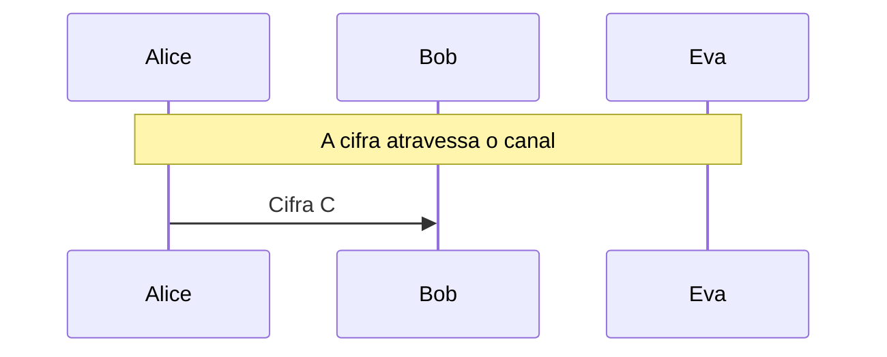

# Substituição simples e análise de frequência

Chave de 26 letras (26! chaves) e a quebra por frequência, índice de coincidência e bigramas, com Eva como criptoanalista.

- **Categoria:** Criptografia Clássica
- **Abrir o laboratório:** <https://peotta.github.io/CryptoNet/#/lab/substituicao-frequencia>
- **Motor:** didático (permutação de 26 letras)
- **Código-fonte:** `src/labs/substituicao/` (interface e fluxos) e `src/crypto/substitution.ts` (operações)
- **Padrões e referências:** Índice de coincidência: Friedman (1922); Livro de referência: Stallings, *Cryptography and Network Security*, cap. 3.

## 1. Objetivos de aprendizagem

- Descrever a cifra de substituição simples e calcular o tamanho do seu espaço de chaves (26!).
- Explicar por que um espaço de chaves enorme não torna uma cifra segura.
- Aplicar a análise de frequência das letras para formar um primeiro palpite da chave.
- Calcular o índice de coincidência e mostrar que a substituição simples não o altera.
- Entender como o modelo de bigramas (pares de letras) refina o palpite e quebra a cifra.
- Relacionar o tamanho do texto cifrado ao sucesso da criptoanálise.

## 2. Fundamentação

Na substituição simples a chave é uma permutação das 26 letras (26! ≈ 4,0 × 10²⁶ chaves), grande demais para a força bruta. Mesmo assim, cada letra clara sempre vira a mesma letra cifrada, e a distribuição de frequências, o índice de coincidência e os pares de letras (bigramas) do português permitem a Eva reconstruir a chave.

## 3. Participantes

Alice e Bob são os participantes legítimos; Eva é a atacante (observadora passiva ou, quando há adulteração, ativa). As tabelas abaixo listam o que cada um mantém em cada cenário.

| Participante | Papel | Dados que pode guardar (tipo) |
| --- | --- | --- |
| Alice | Remetente | Chave K (26 letras) (segredo); Mensagem m (texto claro); Cifra C (texto cifrado) |
| Bob | Destinatário | Chave K (26 letras) (segredo); Cifra recebida (texto cifrado); Mensagem recuperada (texto claro) |
| Eva | Criptoanalista (observa e, se puder, altera o canal) | Cifra observada ou capturada (texto cifrado); Palpite só por frequência (texto claro); Chave deduzida por Eva (segredo); Texto deduzido após refinamento (texto claro); Cifra alterada C' (enviada a Bob) (texto cifrado) |

## 4. Como ler os diagramas

Cada figura é um diagrama de sequência gerado a partir da mesma definição de protocolo que anima o laboratório: as colunas são os participantes, o tempo corre de cima para baixo e cada faixa horizontal é o início de uma etapa. Os valores numéricos e as chaves não aparecem aqui (são aleatórios ou dependem das entradas); eles são mostrados nas fórmulas do próprio laboratório.

- Seta cheia: mensagem enviada pelo canal, com o rótulo do que trafega.
- `[adulterada]` no início do rótulo: a mensagem foi alterada em trânsito por Eva.
- Faixa com texto: título da etapa que começa naquele ponto.

**Lista de figuras**

- [Figura 5.1.1](#511-substituição-simples-e-criptoanálise-de-eva): Substituição simples e criptoanálise de Eva

## 5. Cenários

### 5.1 Alice, Bob e Eva

#### 5.1.1 Substituição simples e criptoanálise de Eva

**Entradas usadas:** chave QWERTY…, texto de cerca de 500 letras.

*Figura 5.1.1 (sequência).* Substituição simples e criptoanálise de Eva: 1 mensagem, entre Alice, Bob e Eva.

| Etapa | Título | Operação |
| --- | --- | --- |
| 1 | Alice e Bob combinam a chave | Nenhum cálculo: a chave já é conhecida por Alice e por Bob. |
| 2 | Alice escreve a mensagem | Normalização do texto em letras de A a Z. |
| 3 | Alice cifra por substituição | Substituição de 388 letras pela tabela da chave. |
| 4 | A cifra atravessa o canal | Transmissão da cifra pelo canal público. |
| 5 | Eva analisa a frequência das letras | Contagem de letras, ordenação e correspondência com a frequência do português. |
| 6 | Eva refina o palpite com bigramas | Busca local por trocas de letras, maximizando a verossimilhança dos bigramas do português. |
| 7 | Bob recebe a cifra | Recepção da mensagem cifrada. |
| 8 | Bob decifra com a chave K | Substituição inversa. |
| 9 | A cifra foi quebrada por Eva | Avaliação do resultado. |

**Veredito do cenário:** Eva recuperou 99,0% das letras sem conhecer a chave, apesar das 26! ≈ 4,0 × 10²⁶ chaves possíveis. A frequência isolada acertou só 49,7%; o refinamento com bigramas fez o resto.

## 6. Perguntas de fixação

1. Quantas chaves tem a substituição simples? Por que isso não a torna segura?

   **Resposta.** 26! ≈ 4,0 × 10²⁶ chaves (a primeira letra tem 26 opções, a segunda 25, e assim por diante). Isso derrota a força bruta, mas não a análise estatística: cada letra clara sempre vira a mesma letra cifrada, e as frequências do idioma sobrevivem. Segurança exige resistir à criptoanálise, e não apenas ao teste de todas as chaves.

2. Por que a análise de frequência isolada acerta só cerca de metade das letras?

   **Resposta.** Porque letras de frequência parecida se confundem (por exemplo, R, I, N e S, ou D, M e U). O palpite correto da ordem exata depende de pequenas diferenças, que variam de texto para texto. O refinamento com pares de letras resolve essas ambiguidades.

3. Qual é o índice de coincidência do texto cifrado, em comparação com o do texto claro?

   **Resposta.** É exatamente o mesmo. A substituição apenas renomeia as letras, então a probabilidade de duas letras sorteadas serem iguais não muda (cerca de 0,074 em português, contra 0,038 de um texto aleatório). O Vigenère, ao contrário, aproxima o IC do aleatório, e é por isso que é mais difícil de quebrar.

4. Por que o refinamento usa pares de letras (bigramas) em vez de só a frequência de cada letra?

   **Resposta.** Porque a frequência individual não distingue letras parecidas, mas os pares sim: "QU" é comum e "QX" é impossível; "ÃO" e "DE" são muito comuns. Medir quão plausível é o texto decifrado, par a par, permite saber se uma troca de duas letras melhora ou piora o palpite.

5. Por que a criptoanálise de Eva falha com um texto de 40 letras?

   **Resposta.** Com poucas letras, as frequências observadas oscilam muito em relação às do idioma, e há poucos pares de letras para avaliar. A criptoanálise estatística precisa de algumas centenas de letras. Isso é uma limitação dela nesta mensagem, e não segurança: mais texto cifrado com a mesma chave a quebra.

6. Quais letras da chave Eva não consegue deduzir, e isso a atrapalha?

   **Resposta.** As letras que não aparecem no texto claro, como K, W ou Y em um texto curto. Elas não deixam rastro na cifra. Como não aparecem na mensagem, não atrapalham a leitura dela.

## 7. Limitações e cuidados

- Cifra histórica: não oferece segurança.
- O refinamento usa estatísticas de um corpus pequeno em português; textos muito curtos podem não ser quebrados.
- Uso exclusivamente didático: os laboratórios não devem proteger dados reais.

---

*CryptoNet é um projeto mantido pelo Prof. Dr. Laerte Peotta de Melo, com apoio de IA generativa no processo de desenvolvimento, com sua estrita supervisão, revisão técnica e responsabilidade. Uso exclusivo para fins de ensino e pesquisa. Universidade de Brasília (UnB) - Departamento de Engenharia Elétrica. Código aberto (licença MIT).*
