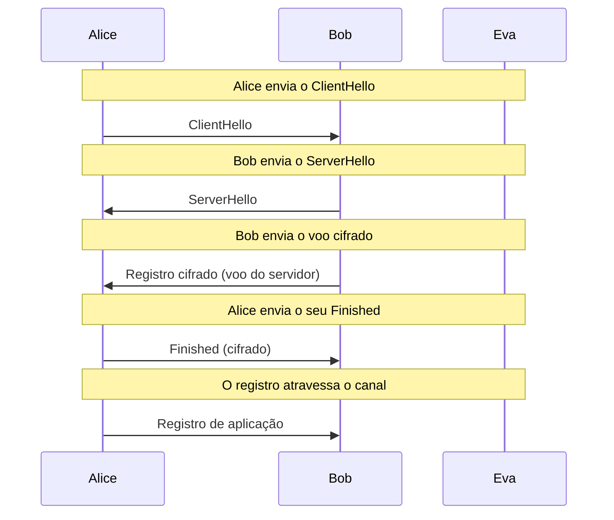
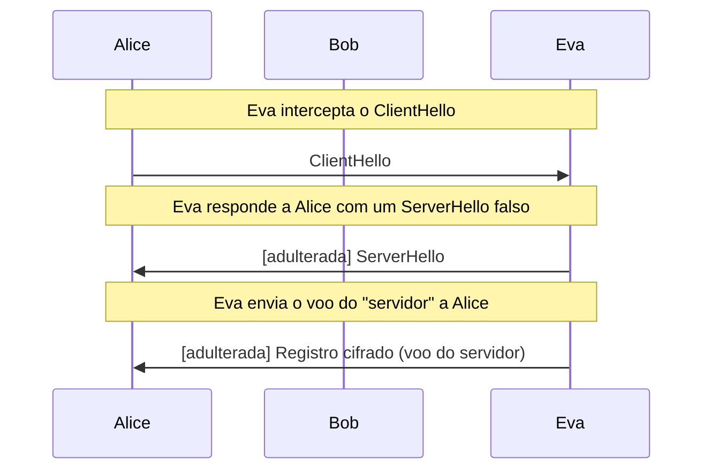

# Handshake do TLS 1.3

ECDHE, cronograma de chaves com HKDF, certificado, CertificateVerify e Finished, com Eva observando e como homem do meio.

- **Categoria:** Criptografia Assimétrica e Acordo de Chaves
- **Abrir o laboratório:** <https://peotta.github.io/CryptoNet/#/lab/tls13>
- **Motor:** real (Web Crypto: ECDHE P-256, HKDF-SHA-256, ECDSA P-256, HMAC e AES-128-GCM)
- **Código-fonte:** `src/labs/tls13/` (interface e fluxos) e `src/crypto/tls13.ts` (operações)
- **Padrões e referências:** [RFC 9846](https://www.rfc-editor.org/rfc/rfc9846) (TLS 1.3; substitui a [RFC 8446](https://www.rfc-editor.org/rfc/rfc8446)); [RFC 8448](https://www.rfc-editor.org/rfc/rfc8448) (exemplos de handshakes do TLS 1.3, usados para conferir o cronograma de chaves); [RFC 5869](https://www.rfc-editor.org/rfc/rfc5869) (HKDF).

## 1. Objetivos de aprendizagem

- Descrever as mensagens do handshake 1-RTT do TLS 1.3 (ClientHello, ServerHello, voo cifrado do servidor, Finished) e o que cada uma entrega.
- Acompanhar o ECDHE: por que as duas pontas chegam ao mesmo segredo e por que Eva, que vê as chaves públicas, não o obtém.
- Seguir o cronograma de chaves do TLS 1.3 (HKDF): Early Secret, Handshake Secret, Master Secret e os segredos de tráfego, conferidos com a [RFC 8448](https://www.rfc-editor.org/rfc/rfc8448).
- Distinguir o papel de cada verificação: certificado (quem é o dono da chave), CertificateVerify (posse da chave privada) e Finished (integridade da transcrição).
- Mostrar que a troca de chaves sozinha não autentica: o ataque do homem do meio e o que o impede.
- Explicar o sigilo adiante (chaves efêmeras) e a proteção dos registros por AES-128-GCM com nonce derivado do número de sequência.

## 2. Fundamentação

O handshake de 1-RTT do TLS 1.3 acorda a chave com ECDHE, deriva os segredos pelo cronograma de chaves (HKDF-Extract e HKDF-Expand-Label), autentica o servidor com certificado e CertificateVerify e confirma tudo com o Finished. Eva vê o ClientHello e o ServerHello, mas não as mensagens cifradas. Como homem do meio, ela só passa se o cliente deixar de validar o certificado.

## 3. Participantes

Alice e Bob são os participantes legítimos; Eva é a atacante (observadora passiva ou, quando há adulteração, ativa). As tabelas abaixo listam o que cada um mantém em cada cenário.

| Participante | Papel | Dados que pode guardar (tipo) |
| --- | --- | --- |
| Alice | Cliente | Chave efêmera privada (segredo); Segredo ECDHE (segredo); Segredo do handshake (segredo); Chaves de tráfego do handshake (segredo); Chaves da aplicação (segredo); Mensagem de aplicação (texto claro) |
| Bob | Servidor | Chave de identidade (ECDSA) (segredo); Chave efêmera privada (segredo); Segredo ECDHE (segredo); Segredo do handshake (segredo); Chaves da aplicação (segredo); Mensagem recebida (texto claro) |
| Eva | Atacante (observa e, se puder, intercepta o canal) | Observado no canal (texto cifrado); Chave efêmera de Eva (segredo); Segredo ECDHE com Alice (segredo); Voo falsificado (texto cifrado); Texto lido por Eva (texto claro) |

## 4. Como ler os diagramas

Cada figura é um diagrama de sequência gerado a partir da mesma definição de protocolo que anima o laboratório: as colunas são os participantes, o tempo corre de cima para baixo e cada faixa horizontal é o início de uma etapa. Os valores numéricos e as chaves não aparecem aqui (são aleatórios ou dependem das entradas); eles são mostrados nas fórmulas do próprio laboratório.

- Seta cheia: mensagem enviada pelo canal, com o rótulo do que trafega.
- `[adulterada]` no início do rótulo: a mensagem foi alterada em trânsito por Eva.
- Faixa com texto: título da etapa que começa naquele ponto.

**Lista de figuras**

- [Figura 5.1.1](#511-handshake-normal-com-eva-observando): Handshake normal, com Eva observando
- [Figura 5.1.2](#512-eva-como-homem-do-meio-com-o-cliente-validando): Eva como homem do meio, com o cliente validando

## 5. Cenários

### 5.1 Handshake

#### 5.1.1 Handshake normal, com Eva observando

**Entradas usadas:** servidor banco.exemplo.

*Figura 5.1.1 (sequência).* Handshake normal, com Eva observando: 5 mensagens, entre Alice, Bob e Eva.

| Etapa | Título | Operação |
| --- | --- | --- |
| 1 | Alice gera o par efêmero (ECDHE) | Geração do par de chaves ECDHE P-256. |
| 2 | Alice envia o ClientHello | Envio do ClientHello. |
| 3 | Bob gera o par efêmero (ECDHE) | Geração do par de chaves ECDHE P-256. |
| 4 | Bob envia o ServerHello | Envio do ServerHello. |
| 5 | Alice calcula o segredo ECDHE | Cálculo ECDH: a · (chave pública recebida). |
| 6 | Bob calcula o segredo ECDHE | Cálculo ECDH com a chave pública de Alice. |
| 7 | Eva tenta obter o segredo | Nenhum cálculo viável: faltam as chaves privadas. |
| 8 | Alice deriva o segredo do handshake | HKDF-Extract(derived, segredo ECDHE). |
| 9 | Alice deriva as chaves de tráfego do handshake | Derive-Secret(HS, "c hs traffic" e "s hs traffic", Hash(ClientHello..ServerHello)). |
| 10 | Bob deriva o segredo do handshake | HKDF-Extract(derived, segredo ECDHE). |
| 11 | Bob deriva as chaves de tráfego do handshake | Derive-Secret(HS, "c hs traffic" e "s hs traffic", Hash(ClientHello..ServerHello)). |
| 12 | Bob assina o CertificateVerify | Assinatura ECDSA da transcrição com a chave de identidade de Bob. |
| 13 | Bob calcula o Finished | HMAC-SHA-256(chave do Finished, H(transcrição)). |
| 14 | Bob envia o voo cifrado | Envio do registro cifrado. |
| 15 | Alice verifica o certificado | Verificação da assinatura da autoridade certificadora. |
| 16 | Alice verifica o CertificateVerify | Verificação da assinatura ECDSA da transcrição. |
| 17 | Alice verifica o Finished | Recálculo do HMAC e comparação. |
| 18 | Alice deriva as chaves da aplicação | Derive-Secret(Master, "c ap traffic" e "s ap traffic", H(CH..Finished)). |
| 19 | Alice envia o seu Finished | Envio do Finished cifrado com a chave do handshake do cliente. |
| 20 | Bob deriva as chaves da aplicação | Derive-Secret(Master, "c ap traffic" e "s ap traffic", H(CH..Finished)). |
| 21 | Alice protege a mensagem de aplicação | Cifragem AES-128-GCM do registro. |
| 22 | O registro atravessa o canal | Envio do registro de aplicação. |
| 23 | Bob decifra a mensagem | Decifragem AES-128-GCM. |
| 24 | Eva não lê nada | Avaliação do resultado. |

**Veredito do cenário:** Alice e Bob derivaram as mesmas chaves, e Eva, que viu as duas chaves públicas efêmeras e todos os registros, não consegue obter o segredo ECDHE: isso exigiria uma das chaves privadas (problema do logaritmo discreto em curvas elípticas). Como as chaves efêmeras são descartadas, um vazamento posterior da chave do servidor não decifra este tráfego (sigilo adiante).

#### 5.1.2 Eva como homem do meio, com o cliente validando

**Entradas usadas:** cliente valida o certificado.

*Figura 5.1.2 (sequência).* Eva como homem do meio, com o cliente validando: 3 mensagens (2 adulteradas), entre Alice, Bob e Eva.

| Etapa | Título | Operação |
| --- | --- | --- |
| 1 | Alice gera o par efêmero (ECDHE) | Geração do par de chaves ECDHE P-256. |
| 2 | Eva intercepta o ClientHello | Envio do ClientHello. |
| 3 | Eva gera o próprio par efêmero | Geração do par ECDHE de Eva. |
| 4 | Eva responde a Alice com um ServerHello falso | Envio do ServerHello. |
| 5 | Alice calcula o segredo ECDHE | Cálculo ECDH: a · (chave pública recebida). |
| 6 | Eva calcula o segredo ECDHE | Cálculo ECDH com a chave pública de Alice. |
| 7 | Alice deriva o segredo do handshake | HKDF-Extract(derived, segredo ECDHE). |
| 8 | Alice deriva as chaves de tráfego do handshake | Derive-Secret(HS, "c hs traffic" e "s hs traffic", Hash(ClientHello..ServerHello)). |
| 9 | Eva deriva o segredo do handshake | HKDF-Extract(derived, segredo ECDHE). |
| 10 | Eva deriva as chaves de tráfego do handshake | Derive-Secret(HS, "c hs traffic" e "s hs traffic", Hash(ClientHello..ServerHello)). |
| 11 | Eva tenta assinar o CertificateVerify | Assinatura ECDSA da transcrição com a chave de Eva. |
| 12 | Eva calcula um Finished válido | HMAC-SHA-256(chave do Finished, H(transcrição)). |
| 13 | Eva envia o voo do "servidor" a Alice | Envio do registro cifrado. |
| 14 | Alice verifica o certificado | Verificação da assinatura da autoridade certificadora. |
| 15 | Alice verifica o CertificateVerify | Verificação da assinatura ECDSA da transcrição. |
| 16 | O handshake é interrompido: Eva não lê nada | Avaliação do resultado. |

**Veredito do cenário:** Eva fez um handshake próprio com Alice, usando uma chave efêmera sua, e repetiu o certificado verdadeiro de Bob (que é público). Mas o CertificateVerify exige uma assinatura com a chave privada do servidor, que Eva não tem, e Alice interrompeu o handshake: CertificateVerify inválido: a assinatura não corresponde à chave pública do certificado (decrypt_error). Observe que o Finished de Eva estava correto: ele prova apenas que ela conhece as chaves da sessão, e não quem ela é. É a autenticação do servidor que impede o ataque, e não a troca de chaves.

## 6. Perguntas de fixação

1. Por que o handshake do TLS 1.3 precisa de apenas uma ida e volta (1-RTT)?

   **Resposta.** Porque o cliente já envia a sua chave pública efêmera (key_share) no ClientHello, apostando em um grupo que o servidor aceite. O servidor responde com a sua no ServerHello e já envia o certificado e o Finished cifrados no mesmo voo. No TLS 1.2 eram duas idas e voltas, pois a troca de chaves só começava depois da negociação dos parâmetros.

2. Eva vê as chaves públicas A e B do ECDHE. Por que não consegue calcular o segredo?

   **Resposta.** O segredo é x(a · B) = x(b · A). Obtê-lo a partir de A = a · G e B = b · G é o problema Diffie-Hellman em curvas elípticas, e a única via conhecida é resolver o logaritmo discreto (descobrir a ou b), inviável na curva P-256 com a computação clássica. Computadores quânticos de grande escala quebrariam esse problema, motivo da migração para trocas de chaves pós-quânticas.

3. Qual a diferença entre o certificado, o CertificateVerify e o Finished?

   **Resposta.** O certificado liga um nome (por exemplo banco.exemplo) a uma chave pública, com assinatura de uma autoridade certificadora; é público e qualquer um pode repeti-lo. O CertificateVerify é uma assinatura da transcrição do handshake com a chave privada correspondente: prova posse da chave e amarra a identidade a esta sessão. O Finished é um HMAC da transcrição com uma chave derivada do segredo do handshake: prova que quem o enviou conhece as chaves e que nenhuma mensagem foi alterada, mas não prova identidade.

4. No ataque do homem do meio, por que Eva consegue um Finished válido, mas é descoberta?

   **Resposta.** Eva fez um ECDHE próprio com Alice, então conhece as chaves do handshake e calcula um Finished correto. Ela pode repetir o certificado verdadeiro de Bob, que é público. Mas o CertificateVerify exige uma assinatura com a chave privada de Bob, que ela não tem; uma assinatura feita com outra chave falha na verificação contra a chave do certificado. Alice interrompe o handshake. A defesa é a autenticação do servidor, e não a troca de chaves.

5. O que é sigilo adiante (forward secrecy) e como o TLS 1.3 o garante?

   **Resposta.** É a propriedade de que o vazamento futuro das chaves de longo prazo não permite decifrar tráfego passado. No TLS 1.3 o segredo de sessão vem de chaves ECDHE efêmeras, descartadas ao fim do handshake, e a chave de identidade do servidor só assina: ela não protege a chave de sessão. Quem gravar o tráfego e roubar a chave do servidor depois não consegue decifrá-lo. Na troca RSA do TLS 1.2 isso não valia, e por isso ela foi removida.

6. Como o TLS 1.3 evita reutilizar o mesmo nonce no AES-GCM em cada registro?

   **Resposta.** O nonce de cada registro é o IV de tráfego (12 bytes, derivado por HKDF) combinado por XOR com o número de sequência de 64 bits, que cresce a cada registro e recomeça a cada nova chave. Assim cada registro tem um nonce distinto sem enviá-lo no canal. Reutilizar um nonce no GCM destruiria o sigilo e a autenticidade, como mostram os laboratórios de ChaCha20 e de AES.

## 7. Limitações e cuidados

- Suíte única (TLS_AES_128_GCM_SHA256) e grupo único (P-256); não há negociação, HelloRetryRequest, retomada de sessão (PSK) nem 0-RTT.
- O certificado é gerado no laboratório e não é validado por uma cadeia de uma autoridade certificadora real.
- Uso exclusivamente didático: os laboratórios não devem proteger dados reais.

---

*CryptoNet é um projeto mantido pelo Prof. Dr. Laerte Peotta de Melo, com apoio de IA generativa no processo de desenvolvimento, com sua estrita supervisão, revisão técnica e responsabilidade. Uso exclusivo para fins de ensino e pesquisa. Universidade de Brasília (UnB) - Departamento de Engenharia Elétrica. Código aberto (licença MIT).*
