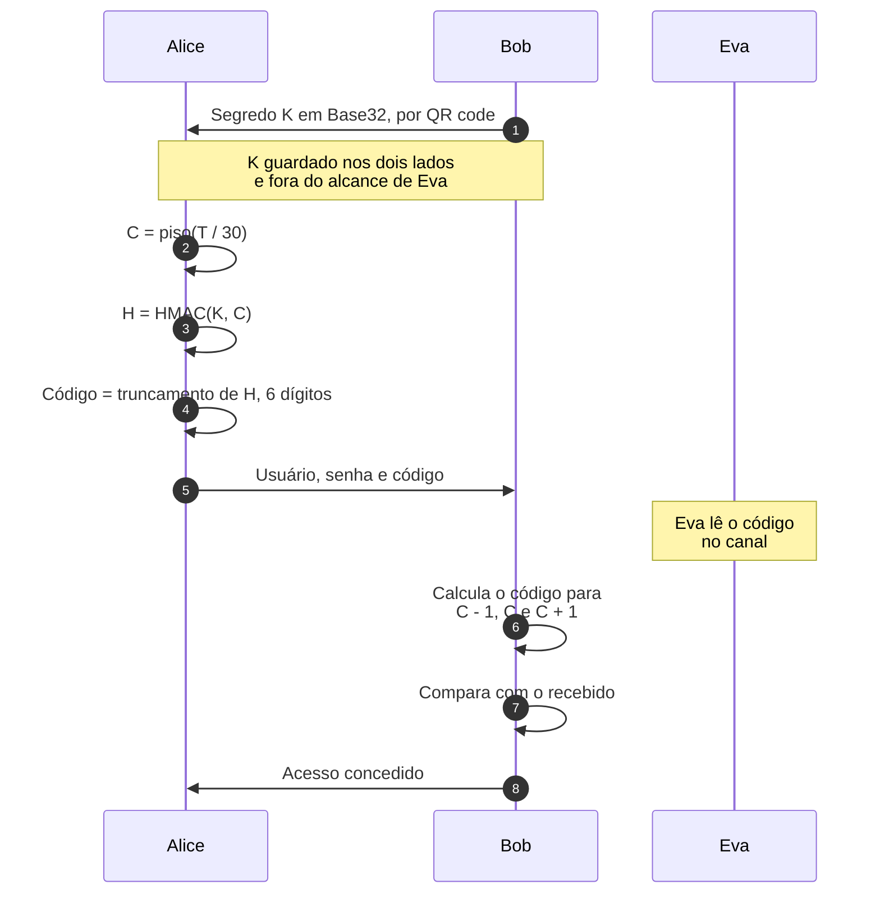
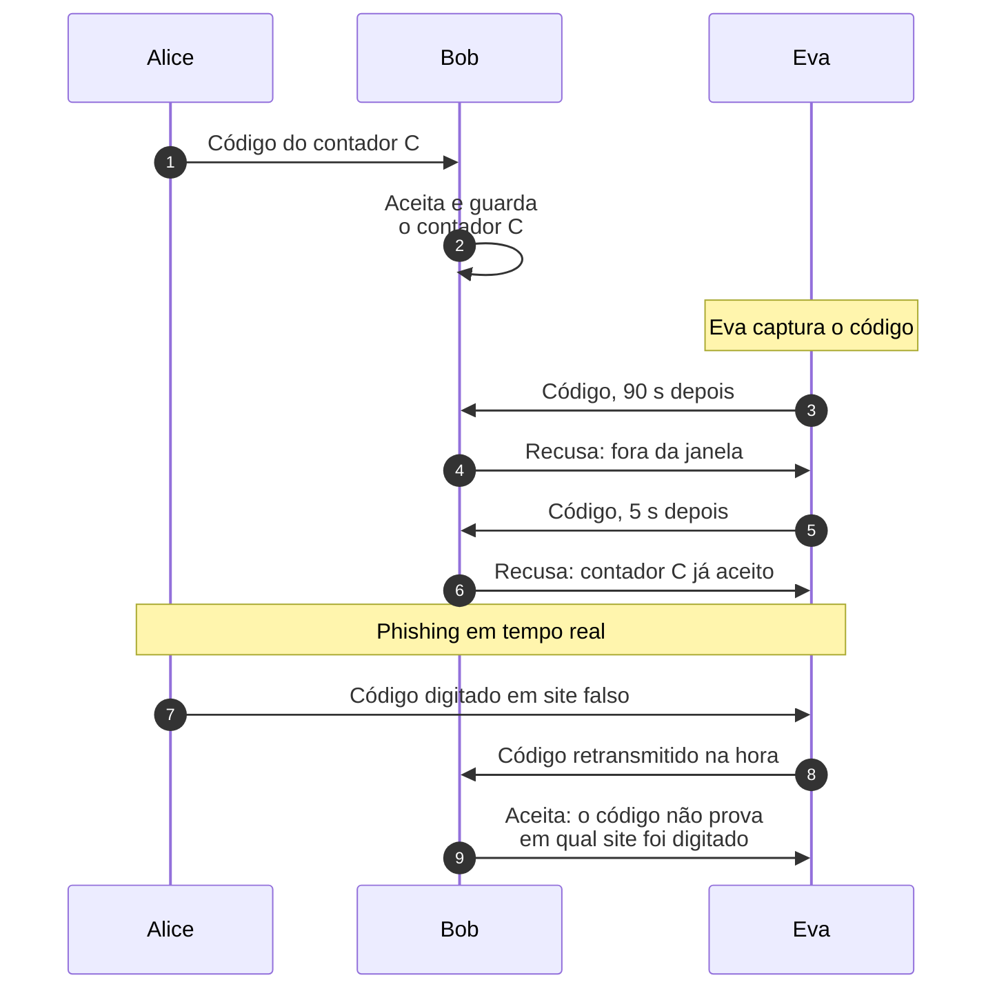
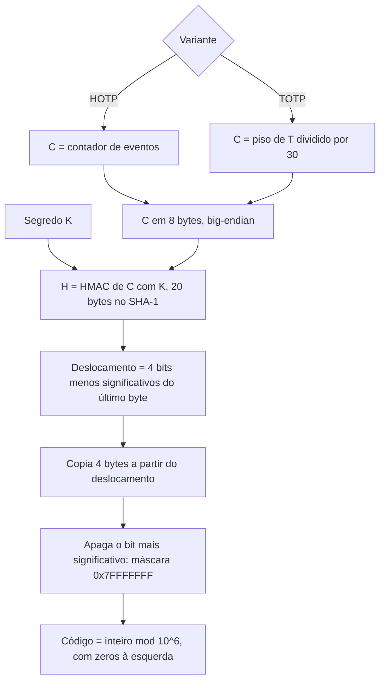
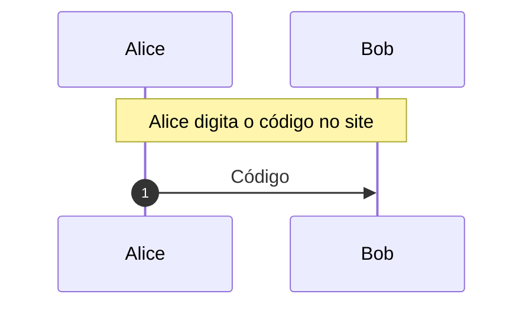
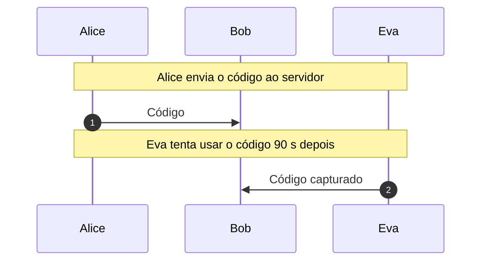
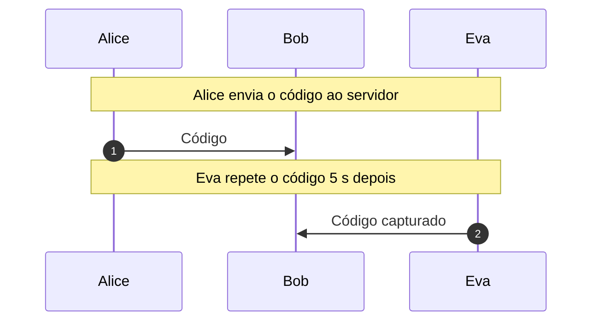
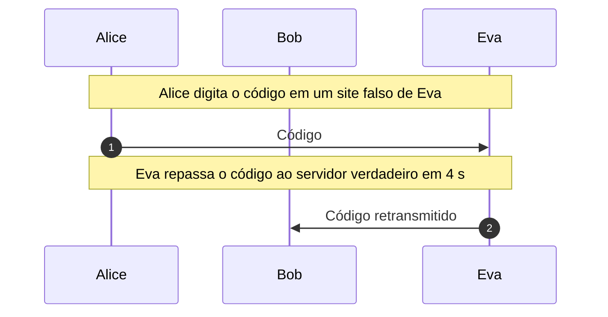
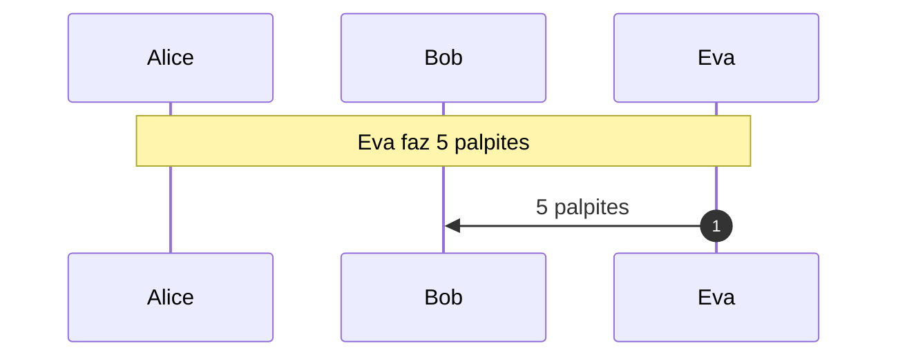

# HOTP e TOTP: senhas de uso único

Segundo fator dos aplicativos autenticadores ([RFC 4226](https://www.rfc-editor.org/rfc/rfc4226) e [RFC 6238](https://www.rfc-editor.org/rfc/rfc6238)): contador, HMAC e truncamento dinâmico passo a passo, conferidos com os vetores das RFCs, e o que Eva consegue com um código capturado.

- **Categoria:** Autenticação e Protocolos Seguros
- **Abrir o laboratório:** <https://peotta.github.io/CryptoNet/#/lab/totp-hotp>
- **Motor:** real (HMAC pela Web Crypto API) com truncamento dinâmico calculado passo a passo
- **Código-fonte:** `src/labs/totp-hotp/` (interface e fluxos) e `src/crypto/otpAuth.ts` (operações)
- **Padrões e referências:** [RFC 4226](https://www.rfc-editor.org/rfc/rfc4226) (HOTP: algoritmo de senha de uso único baseado em HMAC) e [RFC 6238](https://www.rfc-editor.org/rfc/rfc6238) (TOTP: algoritmo de senha de uso único baseado em tempo), seção 5.2 sobre a validação; [RFC 2104](https://www.rfc-editor.org/rfc/rfc2104) (HMAC) e [RFC 4648](https://www.rfc-editor.org/rfc/rfc4648) (Base32, usado na entrega do segredo por QR code); As RFCs 4226 e 6238 são informativas e continuam vigentes: não foram substituídas nem atualizadas.

## 1. Objetivos de aprendizagem

- Calcular um código HOTP passo a passo: contador de 8 bytes, HMAC, truncamento dinâmico e redução a 6 dígitos ([RFC 4226](https://www.rfc-editor.org/rfc/rfc4226)).
- Explicar como o TOTP troca o contador de eventos pelo contador de tempo e por que Alice e Bob chegam ao mesmo código sem trocar mensagens ([RFC 6238](https://www.rfc-editor.org/rfc/rfc6238)).
- Conferir a implementação contra os vetores de teste publicados nas duas RFCs.
- Mostrar por que um código capturado por Eva deixa de valer depois da janela e por que o servidor deve registrar o último contador aceito.
- Reconhecer os limites do TOTP: não resiste a phishing em tempo real e depende de limitar as tentativas, pois o código tem poucos dígitos.

## 2. Fundamentação

O HOTP e o TOTP são as senhas de uso único dos aplicativos autenticadores. Alice e Bob compartilham um segredo K; a cada autenticação, Alice calcula o HMAC de um contador de 8 bytes com K, aplica o truncamento dinâmico (os 4 bits menos significativos do último byte dão o deslocamento de 4 bytes, de que se apaga o bit de sinal) e reduz o inteiro a 6 dígitos. Bob repete a conta e compara.

No HOTP o contador é o número de códigos gerados; no TOTP é o número de passos de 30 segundos desde 1970, e por isso Alice e Bob chegam ao mesmo código sem trocar mensagens e o código expira sozinho. O código prova a posse do segredo, mas não cifra nada e não identifica o site em que é digitado.

Por isso Eva lê o código no canal e o usa se o servidor ainda o aceitar, repete-o dentro da janela se o servidor não registrar o último contador aceito ([RFC 6238](https://www.rfc-editor.org/rfc/rfc6238), seção 5.2), retransmite-o em tempo real a partir de um site falso (phishing) e tenta adivinhá-lo, o que só é contido limitando as tentativas. A Parte A calcula o código operação por operação e confere os vetores das RFCs; a Parte B executa quatro cenários com Alice, Bob e Eva.

**Especificações e artigo de origem.**

- M'Raihi, D.; Bellare, M.; Hoornaert, F.; Naccache, D.; Ranen, O. *HOTP: An HMAC-Based One-Time Password Algorithm*. [RFC 4226](https://www.rfc-editor.org/rfc/rfc4226), dez. 2005.
- M'Raihi, D.; Machani, S.; Pei, M.; Rydell, J. *TOTP: Time-Based One-Time Password Algorithm*. [RFC 6238](https://www.rfc-editor.org/rfc/rfc6238), maio 2011.
- Lamport, L. *Password authentication with insecure communication*. Communications of the ACM, v. 24, n. 11, p. 770-772, nov. 1981, origem da ideia de senhas de uso único derivadas por função unidirecional. [DOI 10.1145/358790.358797](https://doi.org/10.1145/358790.358797).

### 2.1 Diagramas do HOTP e do TOTP

Os diagramas abaixo mostram o HOTP e o TOTP antes dos cenários executados da seção 5. Alice é a usuária, com um aplicativo autenticador, Bob é o servidor e Eva observa o canal e age na rede. **K** é o segredo compartilhado, **C** o contador de 8 bytes e **T** o horário Unix. O último diagrama é um fluxograma do cálculo do código.

#### 2.1.1 Cadastro do segredo e acesso com o código ([RFC 4226](https://www.rfc-editor.org/rfc/rfc4226) e [RFC 6238](https://www.rfc-editor.org/rfc/rfc6238))

No cadastro, Bob gera o segredo K e o entrega a Alice por um canal separado, em geral um QR code com K em Base32; Eva não participa dessa etapa. A cada acesso, o aplicativo de Alice calcula o contador (no TOTP, C = ⌊T / 30⌋), o HMAC de C com K e o código de 6 dígitos, e Alice o digita junto da senha. Bob repete o cálculo para o contador atual e os vizinhos e compara. Eva lê o código no canal, mas ele não revela K, pois sair do HMAC para o segredo exige inverter a função.

*Figura 2.1.1 (sequência).* Cadastro do segredo e acesso com o código.

#### 2.1.2 O que Eva consegue com o código capturado ([RFC 6238](https://www.rfc-editor.org/rfc/rfc6238), seção 5.2)

O código vale só para um contador. Se Eva o apresenta depois da janela (mais de um passo de diferença), Bob o recusa. Dentro da janela, Eva o repete e Bob o aceita de novo, a menos que tenha guardado o último contador aceito: a [RFC 6238](https://www.rfc-editor.org/rfc/rfc6238) exige que o verificador não aceite uma segunda tentativa de um código já validado. O ataque que o TOTP não impede é o de retransmissão em tempo real: Alice digita o código em um site falso de Eva, e Eva o repassa na hora ao servidor verdadeiro, porque o código não está vinculado ao site em que é digitado.

*Figura 2.1.2 (sequência).* O que Eva consegue com o código capturado.

#### 2.1.3 Estrutura interna: do contador ao código de 6 dígitos (fluxograma)

O contador de 64 bits é autenticado com o segredo (HMAC-SHA-1 no padrão, com 20 bytes de saída). O truncamento dinâmico usa os 4 bits menos significativos do último byte como deslocamento, copia 4 bytes a partir dali e apaga o bit mais significativo (máscara 0x7FFFFFFF), o que evita ambiguidade de sinal. O resto da divisão por 10^6 dá o código. No HOTP o contador é o número de códigos gerados; no TOTP é o tempo dividido pelo passo de 30 segundos.

*Figura 2.1.3 (estrutura interna).* Estrutura interna: do contador ao código de 6 dígitos.

> **Aviso:** a partir deste ponto são apresentados os cenários para simulação em laboratório, com Alice, Bob e Eva como participantes.

## 3. Participantes

Alice e Bob são os participantes legítimos; Eva é a atacante (observadora passiva ou, quando há adulteração, ativa). As tabelas abaixo listam o que cada um mantém em cada cenário.

| Participante | Papel | Dados que pode guardar (tipo) |
| --- | --- | --- |
| Alice | Usuária (aplicativo autenticador) | Segredo compartilhado K (segredo); Contador C (8 bytes) (parâmetro público); HMAC(K, C) (segredo); Inteiro de 31 bits (parâmetro público); Código de uso único (assinatura ou etiqueta); Horário do aparelho (parâmetro público) |
| Bob | Servidor de autenticação | Segredo compartilhado K (segredo); Código recebido (assinatura ou etiqueta); Código esperado (assinatura ou etiqueta); Último contador aceito (parâmetro público) |
| Eva | Atacante (observa e age na rede) | Código capturado (assinatura ou etiqueta); Palpites (assinatura ou etiqueta) |

## 4. Como ler os diagramas

Cada figura é um diagrama de sequência gerado a partir da mesma definição de protocolo que anima o laboratório: as colunas são os participantes, o tempo corre de cima para baixo e cada faixa horizontal é o início de uma etapa. Os valores numéricos e as chaves não aparecem aqui (são aleatórios ou dependem das entradas); eles são mostrados nas fórmulas do próprio laboratório.

- Seta cheia: mensagem enviada pelo canal, com o rótulo do que trafega.
- Número no início do rótulo: ordem da interação no diagrama, de cima para baixo.
- Botão Ampliar diagrama (no site): abre o diagrama em tela cheia, com zoom.
- `[adulterada]` no início do rótulo: a mensagem foi alterada em trânsito por Eva.
- Faixa com texto: título da etapa que começa naquele ponto.

**Lista de figuras**

- [Figura 5.1.1](#511-hotp-com-o-contador-0-vetor-da-rfc-4226httpswwwrfc-editororgrfcrfc4226): HOTP com o contador 0 (vetor da [RFC 4226](https://www.rfc-editor.org/rfc/rfc4226))
- [Figura 5.1.2](#512-totp-no-instante-59-s-vetor-da-rfc-6238httpswwwrfc-editororgrfcrfc6238): TOTP no instante 59 s (vetor da [RFC 6238](https://www.rfc-editor.org/rfc/rfc6238))
- [Figura 5.2.1](#521-código-vencido): Código vencido
- [Figura 5.2.2](#522-repetição-do-código-dentro-da-janela): Repetição do código dentro da janela
- [Figura 5.2.3](#523-repetição-recusada-pelo-servidor): Repetição recusada pelo servidor
- [Figura 5.2.4](#524-phishing-em-tempo-real): Phishing em tempo real
- [Figura 5.2.5](#525-adivinhar-o-código): Adivinhar o código

## 5. Cenários

### 5.1 Do segredo ao código

#### 5.1.1 HOTP com o contador 0 (vetor da [RFC 4226](https://www.rfc-editor.org/rfc/rfc4226))

**Entradas usadas:** segredo "12345678901234567890", contador 0, 6 dígitos, HMAC-SHA-1.

*Figura 5.1.1 (sequência).* HOTP com o contador 0 (vetor da [RFC 4226](https://www.rfc-editor.org/rfc/rfc4226)): 1 mensagem, entre Alice e Bob.

| Etapa | Título | Operação |
| --- | --- | --- |
| 1 | Alice e Bob compartilham o segredo | Nenhum cálculo: o segredo já é conhecido por Alice e por Bob. |
| 2 | Alice usa o contador de eventos | Codificação do contador em 8 bytes. |
| 3 | Alice calcula o HMAC-SHA-1 | HMAC-SHA-1 do contador com a chave K. |
| 4 | Alice escolhe a posição do truncamento | Leitura dos 4 bits menos significativos do último byte do HMAC. |
| 5 | Alice extrai 4 bytes e apaga o bit de sinal | Extração de 4 bytes e máscara 0x7FFFFFFF. |
| 6 | Alice reduz o inteiro a 6 dígitos | Resto da divisão por 10^6. |
| 7 | Alice digita o código no site | Envio do código ao servidor. |
| 8 | Bob calcula o mesmo código | Repetição do cálculo no servidor e comparação. |
| 9 | Os códigos coincidem | Avaliação do resultado. |

**Veredito do cenário:** Autenticação aceita: Alice provou conhecer K.

#### 5.1.2 TOTP no instante 59 s (vetor da [RFC 6238](https://www.rfc-editor.org/rfc/rfc6238))

**Entradas usadas:** segredo "12345678901234567890", tempo 59 s, 8 dígitos, HMAC-SHA-1.

*Figura 5.1.2 (sequência).* TOTP no instante 59 s (vetor da [RFC 6238](https://www.rfc-editor.org/rfc/rfc6238)): 1 mensagem, entre Alice e Bob.

| Etapa | Título | Operação |
| --- | --- | --- |
| 1 | Alice e Bob compartilham o segredo | Nenhum cálculo: o segredo já é conhecido por Alice e por Bob. |
| 2 | Alice converte o horário em um contador | Divisão do tempo Unix pelo passo de 30 s e codificação em 8 bytes. |
| 3 | Alice calcula o HMAC-SHA-1 | HMAC-SHA-1 do contador com a chave K. |
| 4 | Alice escolhe a posição do truncamento | Leitura dos 4 bits menos significativos do último byte do HMAC. |
| 5 | Alice extrai 4 bytes e apaga o bit de sinal | Extração de 4 bytes e máscara 0x7FFFFFFF. |
| 6 | Alice reduz o inteiro a 8 dígitos | Resto da divisão por 10^8. |
| 7 | Alice digita o código no site | Envio do código ao servidor. |
| 8 | Bob calcula o mesmo código | Repetição do cálculo no servidor e comparação. |
| 9 | Os códigos coincidem | Avaliação do resultado. |

**Veredito do cenário:** Autenticação aceita: Alice provou conhecer K.

### 5.2 Alice, Bob e Eva

#### 5.2.1 Código vencido

**Entradas usadas:** segredo fixo, primeiro acesso às 13:30:10 UTC, segundo acesso 90 s depois.

*Figura 5.2.1 (sequência).* Código vencido: 2 mensagens, entre Alice, Bob e Eva.

| Etapa | Título | Operação |
| --- | --- | --- |
| 1 | Alice e Bob compartilham o segredo | Nenhum cálculo: o segredo já é conhecido por Alice e por Bob. |
| 2 | Alice gera o código do instante atual | Cálculo de TOTP(K, T) no aparelho de Alice. |
| 3 | Alice envia o código ao servidor | Envio do código pela rede. |
| 4 | Bob valida o código | Cálculo dos códigos esperados e comparação. |
| 5 | Eva tenta usar o código 90 s depois | Reapresentação do código capturado. |
| 6 | Bob recusa o código vencido | Cálculo dos códigos esperados e comparação. |
| 7 | O código vencido não serve a Eva | Avaliação do resultado. |

**Veredito do cenário:** Eva leu o código no canal, mas 90 segundos depois ele já não vale: o servidor só aceita os contadores vizinhos do atual. O código captado é inútil fora da janela de 30 s (com tolerância de um passo).

#### 5.2.2 Repetição do código dentro da janela

**Entradas usadas:** servidor sem registro do último contador aceito.

*Figura 5.2.2 (sequência).* Repetição do código dentro da janela: 2 mensagens, entre Alice, Bob e Eva.

| Etapa | Título | Operação |
| --- | --- | --- |
| 1 | Alice e Bob compartilham o segredo | Nenhum cálculo: o segredo já é conhecido por Alice e por Bob. |
| 2 | Alice gera o código do instante atual | Cálculo de TOTP(K, T) no aparelho de Alice. |
| 3 | Alice envia o código ao servidor | Envio do código pela rede. |
| 4 | Bob valida o código | Cálculo dos códigos esperados e comparação. |
| 5 | Eva repete o código 5 s depois | Repetição do código capturado. |
| 6 | Bob aceita o código pela segunda vez | Cálculo dos códigos esperados e comparação. |
| 7 | Eva entrou com o código repetido | Avaliação do resultado. |

**Veredito do cenário:** Eva repetiu o código 5 segundos depois, ainda dentro da janela, e o servidor o aceitou de novo. Sem registrar o último contador aceito, "uso único" vale só para o relógio, não para o servidor. A [RFC 6238](https://www.rfc-editor.org/rfc/rfc6238) exige que o verificador não aceite uma segunda tentativa de um código já validado.

#### 5.2.3 Repetição recusada pelo servidor

**Entradas usadas:** servidor com registro do último contador aceito.

*Figura 5.2.3 (sequência).* Repetição recusada pelo servidor: 2 mensagens, entre Alice, Bob e Eva.

| Etapa | Título | Operação |
| --- | --- | --- |
| 1 | Alice e Bob compartilham o segredo | Nenhum cálculo: o segredo já é conhecido por Alice e por Bob. |
| 2 | Alice gera o código do instante atual | Cálculo de TOTP(K, T) no aparelho de Alice. |
| 3 | Alice envia o código ao servidor | Envio do código pela rede. |
| 4 | Bob valida o código | Cálculo dos códigos esperados e comparação. |
| 5 | Eva repete o código 5 s depois | Repetição do código capturado. |
| 6 | Bob recusa o código já usado | Cálculo dos códigos esperados e comparação. |
| 7 | A repetição foi barrada | Avaliação do resultado. |

**Veredito do cenário:** Eva repetiu o código dentro da janela, mas o servidor guardou o contador do último código aceito e recusou a repetição. É a defesa exigida pela [RFC 6238](https://www.rfc-editor.org/rfc/rfc6238), seção 5.2.

#### 5.2.4 Phishing em tempo real

**Entradas usadas:** Eva retransmite o código 4 s depois.

*Figura 5.2.4 (sequência).* Phishing em tempo real: 2 mensagens, entre Alice, Bob e Eva.

| Etapa | Título | Operação |
| --- | --- | --- |
| 1 | Alice e Bob compartilham o segredo | Nenhum cálculo: o segredo já é conhecido por Alice e por Bob. |
| 2 | Alice gera o código do instante atual | Cálculo de TOTP(K, T) no aparelho de Alice. |
| 3 | Alice digita o código em um site falso de Eva | Envio do código ao site falso. |
| 4 | Eva repassa o código ao servidor verdadeiro em 4 s | Retransmissão do código ao servidor. |
| 5 | Bob valida o código | Cálculo dos códigos esperados e comparação. |
| 6 | O TOTP não impediu o phishing | Avaliação do resultado. |

**Veredito do cenário:** Alice digitou o código em um site falso de Eva, que o repassou ao servidor verdadeiro 4 segundos depois, ainda dentro da janela. O TOTP não vincula o código ao site em que ele é digitado, então não resiste a esse ataque de retransmissão em tempo real. A defesa é um fator que verifica a origem, como o WebAuthn.

#### 5.2.5 Adivinhar o código

**Entradas usadas:** cinco palpites antes do bloqueio da conta.

*Figura 5.2.5 (sequência).* Adivinhar o código: 1 mensagem, entre Alice, Bob e Eva.

| Etapa | Título | Operação |
| --- | --- | --- |
| 1 | Alice e Bob compartilham o segredo | Nenhum cálculo: o segredo já é conhecido por Alice e por Bob. |
| 2 | Eva faz 5 palpites | Envio de palpites ao servidor. |
| 3 | Bob recusa todos e bloqueia a conta | Comparação de cada palpite e bloqueio. |
| 4 | Eva calcula a chance de sucesso | Cálculo da probabilidade de acerto. |
| 5 | O limite de tentativas protegeu a conta | Avaliação do resultado. |

**Veredito do cenário:** Com 3 códigos válidos em 10^6, cada palpite acerta com probabilidade 0,000003. Com o bloqueio após 5 erros, a chance total de Eva é de cerca de 0,0015%. Sem limite de tentativas, o código de 6 dígitos cairia em minutos.

## 6. Perguntas de fixação

1. Por que Alice e Bob geram o mesmo código TOTP sem trocar nenhuma mensagem?

   **Resposta.** Porque ambos têm o segredo K e calculam o mesmo contador C = ⌊T / 30⌋ a partir do horário Unix. O código é HOTP(K, C), uma função determinística de K e de C. Basta que os relógios estejam próximos, e por isso o servidor aceita também os contadores vizinhos.

2. Por que o HMAC é truncado, e por que a posição do corte muda de código para código?

   **Resposta.** O HMAC-SHA-1 tem 20 bytes e o usuário digita 6 dígitos, então é preciso reduzir. O truncamento dinâmico usa os 4 bits menos significativos do último byte como deslocamento: como esse byte é imprevisível sem K, o corte cai em lugares diferentes do HMAC e nenhum trecho fixo é exposto. A máscara 0x7FFFFFFF apaga o bit de sinal para que todas as implementações cheguem ao mesmo inteiro.

3. Eva leu o código no canal. Por que ela não consegue usá-lo mais tarde?

   **Resposta.** O código vale só para o contador em que foi gerado. O servidor aceita o contador atual e, no máximo, os vizinhos. Passados cerca de 90 segundos, o contador está três passos adiante e o código capturado não coincide com nenhum dos aceitos. Dentro da janela, porém, ele serve, e é por isso que o servidor deve guardar o último contador aceito.

4. O que a [RFC 6238](https://www.rfc-editor.org/rfc/rfc6238) exige do servidor depois de aceitar um código?

   **Resposta.** Que não aceite uma segunda tentativa com o mesmo código (seção 5.2). Para isso o servidor registra o último contador validado e recusa qualquer código de contador igual ou menor. Sem esse registro, Eva repete o código lido no canal dentro da mesma janela e entra.

5. O TOTP protege contra um site falso que repassa o código ao site verdadeiro na hora?

   **Resposta.** Não. O código não está vinculado ao site em que é digitado, então Eva o retransmite ao servidor verdadeiro dentro dos 30 segundos. A proteção exige um fator que verifique a origem, como o WebAuthn, em que a assinatura inclui o domínio.

6. Um código de 6 dígitos não é fácil de adivinhar? O que o torna aceitável?

   **Resposta.** Há 10^6 códigos e o servidor aceita 3 por vez, então cada palpite acerta com probabilidade de 3 em um milhão. Sem limite, a busca terminaria em minutos. O que o torna aceitável é limitar as tentativas e bloquear a conta após poucos erros: com 5 tentativas, a chance de Eva é de cerca de 0,0015%.

7. Qual a diferença entre HOTP e TOTP, e quando o HOTP ainda é usado?

   **Resposta.** O HOTP usa um contador de eventos que avança a cada código e precisa ser ressincronizado se o usuário gerar códigos sem usá-los; o código vale até ser usado. O TOTP usa o tempo e expira sozinho. O HOTP continua em tokens de hardware sem relógio, como chaves com um botão.

## 7. Limitações e cuidados

- O HMAC é o da Web Crypto API, e o segredo é gerado no navegador; nada é armazenado.
- O servidor do laboratório aceita o contador atual e um vizinho de cada lado; servidores reais podem usar outra tolerância e também ressincronizar o relógio do usuário.
- O cenário de phishing mostra o limite do TOTP; a defesa por verificação de origem (WebAuthn) não é implementada neste laboratório.
- Uso exclusivamente didático: os laboratórios não devem proteger dados reais.

---

*CryptoNet é um projeto mantido pelo Prof. Dr. Laerte Peotta de Melo, com apoio de IA generativa no processo de desenvolvimento, com sua estrita supervisão, revisão técnica e responsabilidade. Uso exclusivo para fins de ensino e pesquisa. Universidade de Brasília (UnB) - Departamento de Engenharia Elétrica. Código aberto (licença MIT).*
