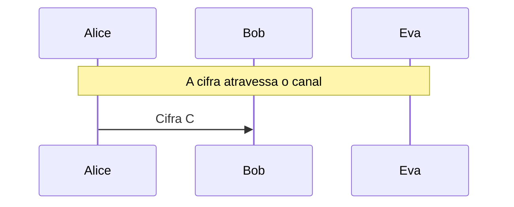

# Transposição e cifra produto

Cerca de trilhos, transposição colunar e a combinação com substituição (confusão e difusão), com a anagramação de Eva.

- **Categoria:** Criptografia Clássica
- **Abrir o laboratório:** <https://peotta.github.io/CryptoNet/#/lab/transposicao>
- **Motor:** didático (transposição e cifra produto)
- **Código-fonte:** `src/labs/transposicao/` (interface e fluxos) e `src/crypto/transposition.ts` (operações)
- **Padrões e referências:** Shannon, *Communication Theory of Secrecy Systems* (1949): confusão e difusão; Livro de referência: Stallings, *Cryptography and Network Security*, cap. 3.

## 1. Objetivos de aprendizagem

- Distinguir substituição (troca as letras) de transposição (troca as posições) e reconhecer cada uma pela estatística da cifra.
- Cifrar e decifrar com a cerca de trilhos e com a transposição colunar com palavra-chave.
- Explicar por que a transposição preserva o índice de coincidência e o histograma de letras, e por que isso a denuncia.
- Executar a criptoanálise por anagramação: testar números de trilhos e ordens de colunas e escolher o texto mais legível.
- Compreender confusão e difusão (Shannon) e por que a cifra produto resiste aos ataques que quebram cada parte isolada.
- Relacionar a cifra produto às rodadas do AES (SubBytes é confusão; ShiftRows e MixColumns são difusão).

## 2. Fundamentação

Na transposição as letras não mudam, apenas de lugar (cerca de trilhos e transposição colunar com palavra-chave). Como a frequência das letras permanece a do português, Eva reconhece a cifra e a quebra por anagramação, escolhendo a ordem que produz o texto mais legível. Combinar substituição (confusão) com transposição (difusão) resulta na cifra produto, a ideia por trás das cifras modernas.

## 3. Participantes

Alice e Bob são os participantes legítimos; Eva é a atacante (observadora passiva ou, quando há adulteração, ativa). As tabelas abaixo listam o que cada um mantém em cada cenário.

| Participante | Papel | Dados que pode guardar (tipo) |
| --- | --- | --- |
| Alice | Remetente | Chave K (segredo); Mensagem m (texto claro); Cifra C (texto cifrado) |
| Bob | Destinatário | Chave K (segredo); Cifra recebida (texto cifrado); Mensagem recuperada (texto claro) |
| Eva | Criptoanalista (observa e, se puder, altera o canal) | Cifra observada ou capturada (texto cifrado); Impressão digital estatística (parâmetro público); Chave deduzida por Eva (segredo); Texto deduzido por Eva (texto claro); Cifra alterada C' (enviada a Bob) (texto cifrado) |

## 4. Como ler os diagramas

Cada figura é um diagrama de sequência gerado a partir da mesma definição de protocolo que anima o laboratório: as colunas são os participantes, o tempo corre de cima para baixo e cada faixa horizontal é o início de uma etapa. Os valores numéricos e as chaves não aparecem aqui (são aleatórios ou dependem das entradas); eles são mostrados nas fórmulas do próprio laboratório.

- Seta cheia: mensagem enviada pelo canal, com o rótulo do que trafega.
- `[adulterada]` no início do rótulo: a mensagem foi alterada em trânsito por Eva.
- Faixa com texto: título da etapa que começa naquele ponto.

**Lista de figuras**

- [Figura 5.1.1](#511-cerca-de-trilhos): Cerca de trilhos
- [Figura 5.1.2](#512-transposição-colunar): Transposição colunar
- [Figura 5.1.3](#513-cifra-produto-substituição-e-transposição): Cifra produto (substituição e transposição)

## 5. Cenários

### 5.1 Alice, Bob e Eva

#### 5.1.1 Cerca de trilhos

**Entradas usadas:** 4 trilhos.

*Figura 5.1.1 (sequência).* Cerca de trilhos: 1 mensagem, entre Alice, Bob e Eva.

| Etapa | Título | Operação |
| --- | --- | --- |
| 1 | Alice e Bob combinam a chave | Nenhum cálculo: a chave já é conhecida por Alice e por Bob. |
| 2 | Alice escreve a mensagem | Normalização do texto em letras de A a Z. |
| 3 | Alice cifra com a cerca de trilhos | Cifragem por cerca de trilhos de 388 letras. |
| 4 | A cifra atravessa o canal | Transmissão da cifra pelo canal público. |
| 5 | Eva examina a estatística das letras e dos pares | Cálculo do IC, da correlação do histograma e da legibilidade. |
| 6 | Eva testa todos os números de trilhos | Decifragem com 2 a 12 trilhos e escolha do texto mais legível. |
| 7 | Bob recebe a cifra | Recepção da mensagem cifrada. |
| 8 | Bob desfaz a cifra | Decifragem. |
| 9 | A cifra foi quebrada por Eva | Avaliação do resultado. |

**Veredito do cenário:** Eva reconheceu a transposição pela estatística (as letras estão intactas) e testou de 2 a 12 trilhos: o mais legível foi 4, e recuperou 100% da mensagem. Poucos trilhos significam um espaço de chaves minúsculo.

#### 5.1.2 Transposição colunar

**Entradas usadas:** palavra-chave CHAVE.

*Figura 5.1.2 (sequência).* Transposição colunar: 1 mensagem, entre Alice, Bob e Eva.

| Etapa | Título | Operação |
| --- | --- | --- |
| 1 | Alice e Bob combinam a chave | Nenhum cálculo: a chave já é conhecida por Alice e por Bob. |
| 2 | Alice escreve a mensagem | Normalização do texto em letras de A a Z. |
| 3 | Alice cifra com a transposição colunar | Cifragem por transposição colunar de 388 letras. |
| 4 | A cifra atravessa o canal | Transmissão da cifra pelo canal público. |
| 5 | Eva examina a estatística das letras e dos pares | Cálculo do IC, da correlação do histograma e da legibilidade. |
| 6 | Eva testa todas as ordens de colunas (anagramação) | Decifragem com todas as ordens de colunas e escolha do texto mais legível. |
| 7 | Bob recebe a cifra | Recepção da mensagem cifrada. |
| 8 | Bob desfaz a cifra | Decifragem. |
| 9 | A cifra foi quebrada por Eva | Avaliação do resultado. |

**Veredito do cenário:** Eva reconheceu a transposição pela estatística e tentou todas as ordens de colunas para 2 a 8 colunas, escolhendo o texto mais legível: 5 colunas, 100% da mensagem. A palavra-chave só precisa ser deduzida como ordem das colunas.

#### 5.1.3 Cifra produto (substituição e transposição)

**Entradas usadas:** chave QWERTY… e palavra-chave CHAVE.

*Figura 5.1.3 (sequência).* Cifra produto (substituição e transposição): 1 mensagem, entre Alice, Bob e Eva.

| Etapa | Título | Operação |
| --- | --- | --- |
| 1 | Alice e Bob combinam a chave | Nenhum cálculo: a chave já é conhecida por Alice e por Bob. |
| 2 | Alice escreve a mensagem | Normalização do texto em letras de A a Z. |
| 3 | Alice cifra com a cifra produto | Cifragem por cifra produto de 388 letras. |
| 4 | A cifra atravessa o canal | Transmissão da cifra pelo canal público. |
| 5 | Eva examina a estatística das letras e dos pares | Cálculo do IC, da correlação do histograma e da legibilidade. |
| 6 | Eva aplica os dois ataques isolados à cifra produto | Anagramação e quebra por frequência e bigramas contra a cifra produto. |
| 7 | Bob recebe a cifra | Recepção da mensagem cifrada. |
| 8 | Bob desfaz a cifra | Decifragem. |
| 9 | Os ataques isolados falham contra a cifra produto | Avaliação do resultado. |

**Veredito do cenário:** Os ataques que quebram cada cifra sozinha (100% e 99%) recuperaram só 5% e 9% contra o produto: a substituição esconde as letras (confusão) e a transposição desfaz os pares de letras de que o ataque por bigramas depende (difusão). Cada cifra anula o ataque da outra. Ataques conjuntos existem e quebraram cifras produto históricas (a ADFGVX alemã, de 1918, foi quebrada pelo francês Georges Painvin), mas exigem mais texto e trabalho.

## 6. Perguntas de fixação

1. Cifre "WEAREDISCOVEREDFLEEATONCE" com a cerca de trilhos de 3 trilhos.

   **Resposta.** A escrita em zigue-zague coloca as letras nos trilhos 1, 2, 3, 2, 1, 2, 3, ... Lendo trilho por trilho: trilho 1 = WECRLTE, trilho 2 = ERDSOEEFEAOC, trilho 3 = AIVDEN. A cifra é "WECRLTEERDSOEEFEAOCAIVDEN".

2. Por que o índice de coincidência de uma cifra de transposição é igual ao do texto claro?

   **Resposta.** Porque a transposição só reordena as letras: a contagem de cada letra não muda, e o IC depende apenas dessas contagens. Por isso o histograma da cifra acompanha o do português, e Eva reconhece de imediato que se trata de transposição. O que se perde são os pares de letras vizinhas, e é isso que ela explora.

3. Como Eva quebra a transposição colunar de poucas colunas?

   **Resposta.** Por anagramação: para cada número de colunas testa todas as ordens de leitura (c! permutações) e escolhe a que dá o texto mais legível, medido pela probabilidade dos pares de letras. Com 8 colunas são 40.320 ordens, trivial para um computador. A palavra-chave não precisa ser descoberta como palavra, apenas a ordem das colunas.

4. Aumentar o número de colunas torna a transposição segura?

   **Resposta.** Não por si só. O espaço de chaves cresce como c! (12! ≈ 4,8 × 10⁸), mas a busca local (trocar colunas e manter o que melhora a legibilidade) e a análise de pares de colunas quebram chaves maiores sem testar todas. A dupla transposição, usada até a Segunda Guerra, dificulta mais, mas ainda é cifra clássica.

5. O que são confusão e difusão, e como a cifra produto as combina?

   **Resposta.** Shannon (1949) chamou de confusão a relação complexa entre chave e cifra (a substituição esconde as letras) e de difusão o espalhamento da estrutura do texto claro (a transposição desfaz os pares de letras). A cifra produto aplica as duas em sequência: a anagramação falha porque as letras já estão trocadas, e a análise de frequência com bigramas falha porque os pares estão embaralhados.

6. A cifra produto de substituição e transposição é segura?

   **Resposta.** Não. Resiste aos ataques isolados, mas existem ataques conjuntos: por exemplo, pares de letras repetidos são invariantes à substituição e revelam a estrutura da transposição. A ADFGVX alemã (1918), que combinava um quadrado de Polybius com transposição colunar, foi quebrada por Georges Painvin. A lição moderna é a do AES: muitas rodadas de confusão e difusão com chaves fortes e análise pública.

## 7. Limitações e cuidados

- Cifras históricas: não oferecem segurança.
- A anagramação cobre de 2 a 8 colunas e a legibilidade é medida por bigramas do português.
- Uso exclusivamente didático: os laboratórios não devem proteger dados reais.

---

*CryptoNet é um projeto mantido pelo Prof. Dr. Laerte Peotta de Melo, com apoio de IA generativa no processo de desenvolvimento, com sua estrita supervisão, revisão técnica e responsabilidade. Uso exclusivo para fins de ensino e pesquisa. Universidade de Brasília (UnB) - Departamento de Engenharia Elétrica. Código aberto (licença MIT).*
