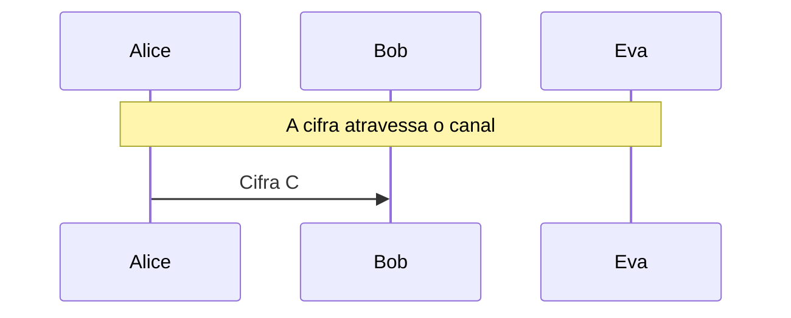

# Vigenère, Kasiski e índice de coincidência

Cifra polialfabética, tabela de Vigenère e como Eva descobre o tamanho e as letras da chave por Kasiski, IC e frequência por coluna.

- **Categoria:** Criptografia Clássica
- **Abrir o laboratório:** <https://peotta.github.io/CryptoNet/#/lab/vigenere>
- **Motor:** didático (cifra polialfabética)
- **Código-fonte:** `src/labs/vigenere/` (interface e fluxos) e `src/crypto/vigenere.ts` (operações)
- **Padrões e referências:** Teste de Kasiski (1863) e índice de coincidência de Friedman; Livro de referência: Stallings, *Cryptography and Network Security*, cap. 3.

## 1. Objetivos de aprendizagem

- Cifrar e decifrar com a Vigenère, somando a cada letra a letra da chave na posição i mod m (módulo 26).
- Usar a tabela de Vigenère e explicar por que a cifra é polialfabética.
- Explicar por que o índice de coincidência do texto inteiro cai e por que o IC de cada coluna não.
- Aplicar o teste de Kasiski e o IC médio por tamanho de chave para descobrir o tamanho da chave.
- Deduzir a chave por análise de frequência de cada coluna, reduzindo a Vigenère a vários Césares.
- Relacionar o tamanho da chave e do texto ao sucesso da criptoanálise.

## 2. Fundamentação

A cifra de Vigenère usa uma palavra como chave e aplica um César diferente a cada posição, o que achata as frequências. Eva descobre o tamanho da chave pela repetição de trechos (Kasiski) e pelo índice de coincidência por tamanho candidato, e então resolve cada coluna como um César.

## 3. Participantes

Alice e Bob são os participantes legítimos; Eva é a atacante (observadora passiva ou, quando há adulteração, ativa). As tabelas abaixo listam o que cada um mantém em cada cenário.

| Participante | Papel | Dados que pode guardar (tipo) |
| --- | --- | --- |
| Alice | Remetente | Chave K (palavra) (segredo); Mensagem m (texto claro); Cifra C (texto cifrado) |
| Bob | Destinatário | Chave K (palavra) (segredo); Cifra recebida (texto cifrado); Mensagem recuperada (texto claro) |
| Eva | Criptoanalista (observa e, se puder, altera o canal) | Cifra observada ou capturada (texto cifrado); Tamanho da chave deduzido (parâmetro público); Chave deduzida por Eva (segredo); Texto deduzido por Eva (texto claro); Cifra alterada C' (enviada a Bob) (texto cifrado) |

## 4. Como ler os diagramas

Cada figura é um diagrama de sequência gerado a partir da mesma definição de protocolo que anima o laboratório: as colunas são os participantes, o tempo corre de cima para baixo e cada faixa horizontal é o início de uma etapa. Os valores numéricos e as chaves não aparecem aqui (são aleatórios ou dependem das entradas); eles são mostrados nas fórmulas do próprio laboratório.

- Seta cheia: mensagem enviada pelo canal, com o rótulo do que trafega.
- `[adulterada]` no início do rótulo: a mensagem foi alterada em trânsito por Eva.
- Faixa com texto: título da etapa que começa naquele ponto.

**Lista de figuras**

- [Figura 5.1.1](#511-vigenère-e-criptoanálise-de-eva): Vigenère e criptoanálise de Eva

## 5. Cenários

### 5.1 Alice, Bob e Eva

#### 5.1.1 Vigenère e criptoanálise de Eva

**Entradas usadas:** chave SEGREDO.

*Figura 5.1.1 (sequência).* Vigenère e criptoanálise de Eva: 1 mensagem, entre Alice, Bob e Eva.

| Etapa | Título | Operação |
| --- | --- | --- |
| 1 | Alice e Bob combinam a chave | Nenhum cálculo: a chave já é conhecida por Alice e por Bob. |
| 2 | Alice escreve a mensagem | Normalização do texto em letras de A a Z. |
| 3 | Alice cifra com a Vigenère | Cifragem Vigenère de 388 letras com chave de 7 letras. |
| 4 | A cifra atravessa o canal | Transmissão da cifra pelo canal público. |
| 5 | Eva descobre o tamanho da chave | Teste de Kasiski e IC médio das colunas para m = 1, 2, 3, ... |
| 6 | Eva deduz a chave coluna a coluna | Análise de frequência de 7 colunas. |
| 7 | Bob recebe a cifra | Recepção da mensagem cifrada. |
| 8 | Bob decifra com a chave K | Decifragem Vigenère. |
| 9 | A cifra foi quebrada por Eva | Avaliação do resultado. |

**Veredito do cenário:** Eva descobriu o tamanho da chave (m = 7) e a própria chave (SEGREDO) e leu 100,0% da mensagem, sem conhecê-la. A Vigenère esconde a frequência das letras, mas não a periodicidade da chave.

## 6. Perguntas de fixação

1. Cifre "ATTACKATDAWN" com a chave LEMON. Qual é a cifra?

   **Resposta.** A chave se repete: LEMONLEMONLE. Somando letra a letra, módulo 26: A+L = L, T+E = X, T+M = F, A+O = O, C+N = P, K+L = V, e assim por diante. O resultado é "LXFOPVEFRNHR".

2. Por que a Vigenère resiste à análise de frequência simples, que quebra a substituição?

   **Resposta.** Porque a mesma letra clara vira letras cifradas diferentes, conforme a posição (cada letra da chave usa um alfabeto). O histograma da cifra fica quase plano e o IC do texto inteiro cai para perto de 0,04, escondendo a frequência do idioma.

3. Como o teste de Kasiski revela o tamanho da chave?

   **Resposta.** Se um trecho de texto claro se repete a uma distância que é múltiplo do tamanho m da chave, ele é cifrado do mesmo jeito nas duas vezes e a cifra repete a sequência. As distâncias entre repetições são múltiplos de m; o fator comum a muitas delas é candidato a m. Divisores pequenos (2, 3...) também aparecem, por isso o Kasiski sozinho pode ser ambíguo.

4. Por que o IC médio das colunas tem um pico no tamanho correto da chave (e em seus múltiplos)?

   **Resposta.** Com o tamanho certo, cada coluna foi cifrada por uma única letra da chave, isto é, é um César: tem o mesmo IC do português (cerca de 0,074). Com um tamanho errado, cada coluna mistura letras cifradas por chaves diferentes e o IC cai para perto de 0,04. Múltiplos do tamanho certo também separam colunas de uma única letra de chave; o menor deles é o tamanho da chave.

5. Depois de saber o tamanho da chave, como Eva encontra as letras da chave?

   **Resposta.** Separa o texto em m colunas. Cada coluna é um César com um deslocamento desconhecido; testando os 26 deslocamentos e escolhendo o que deixa a coluna mais parecida com português (menor χ²), obtém a letra da chave daquela coluna. A Vigenère se reduz, assim, a m cifras de César.

6. Por que uma chave tão longa quanto a mensagem, usada uma única vez, muda tudo?

   **Resposta.** Se a chave é aleatória, tão longa quanto o texto e nunca reutilizada, não há repetição para o Kasiski nem colunas para a frequência: é o one-time pad, que tem sigilo perfeito (Shannon). Chaves curtas e repetidas, como na Vigenère, deixam a periodicidade, e é ela que Eva explora.

## 7. Limitações e cuidados

- Cifra histórica: não oferece segurança.
- A chave tem de 1 a 20 letras; textos curtos tornam o ataque estatístico pouco confiável.
- Uso exclusivamente didático: os laboratórios não devem proteger dados reais.

---

*CryptoNet é um projeto mantido pelo Prof. Dr. Laerte Peotta de Melo, com apoio de IA generativa no processo de desenvolvimento, com sua estrita supervisão, revisão técnica e responsabilidade. Uso exclusivo para fins de ensino e pesquisa. Universidade de Brasília (UnB) - Departamento de Engenharia Elétrica. Código aberto (licença MIT).*
